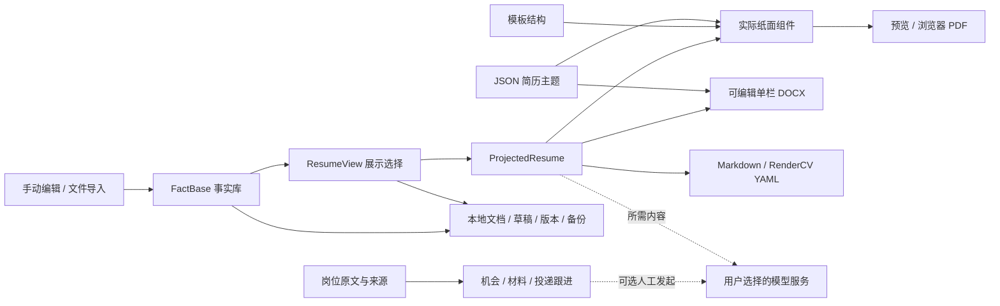

# 迈向更好 · BetterMe

**把真实经历，整理成值得投递的简历。**

A local-first resume and job search workspace.

BetterMe 是一个本地优先的简历与求职工作台：从核对履历、制作多份简历，到收藏岗位、记录投递与保存当时的材料，尽量在同一处完成。日常编辑、模板、导出、机会记录与版本管理不依赖 AI；需要时，再连接自己的模型服务。

**119 套版式 · 10 套简历主题 · 4 套工作台配色 × 浅深模式 · 中英输出 · 本地草稿与版本历史**

[快速开始](#快速开始) · [功能一览](#功能一览) · [部署与自动更新](#部署与自动更新) · [开发规划](docs/ROADMAP.md) · [模板来源](templates/CATALOG.md) · [验收记录](#文档与验收记录)


*纸张工作室：内容编辑与实际简历预览并排，支持调整分栏比例、适应宽度与跟随编辑。下文截图使用合成演示内容，不代表任何人的真实履历；截图展示当前界面，功能边界见对应说明。*

## 为什么做 BetterMe

一份真实经历，常常需要投递不同方向的岗位。BetterMe 将**事实**与**呈现方式**分开：经历内容只维护一份，每份简历独立选择模板、语言、展示条目与排版，避免为了改版式反复复制履历。

它也保留求职过程中的上下文：岗位最初写了什么、来源在哪里、当时用了哪份材料、下一步准备做什么。AI 可以协助整理和分析，最终事实与投递动作仍由使用者确认。

- **先把简历写好**：编辑、导入、检查、模板、主题、导出与恢复形成完整流程。
- **让样式自由组合**：模板管结构，简历主题管视觉，排版参数管细节，网页配色管工作环境。
- **给数据留退路**：未完成草稿、正式版本、命名检查点、单项恢复和 JSON 备份各司其职。
- **按真实流程求职**：收藏岗位、准备材料、手动投递、记录沟通与跟进，无需先接入模型。

## 先看界面

<table>
  <tr>
    <td width="50%"><br><strong>浅色工作台</strong><br>暖色画布、清晰表单与独立 A4 纸面。</td>
    <td width="50%"><br><strong>深色工作台</strong><br>改变编辑环境，简历保持自己的纸色与字体。</td>
  </tr>
  <tr>
    <td><br><strong>真实模板图库</strong><br>按来源筛选、搜索与分页；缩略图复用实际纸面组件。</td>
    <td><br><strong>独立简历主题</strong><br>同一个布局可以使用不同配色、字体与装饰。</td>
  </tr>
  <tr>
    <td><br><strong>机会与投递</strong><br>把岗位来源、申请阶段、材料与下一步联系起来。</td>
    <td><br><strong>版本与恢复</strong><br>查看完整快照与差异，恢复整版或某个差异项。</td>
  </tr>
</table>

## 功能一览

| 模块 | 已实现 | 使用时需要知道 |
| --- | --- | --- |
| 事实库与多份简历 | 个人资料、教育、工作、项目、技能与成果要点；新建、复制、切换及重命名简历 | 多份简历共享 Fact；更改事实会影响引用它的视图，展示取舍与样式分别保存 |
| 简历导入 | PDF、DOCX、图片、HTML、Markdown、TXT 与结构化 JSON；旧 DOC 尽力提取 | 先核对原文、警告与待补录内容；当前会重新排版，不保留任意原稿的版式 |
| 内容核对 | 数字待核实、空洞表达检查、具体字段定位与修改指引 | Schema 合法与问题提示消失都不等于事实真实；量化仍需本人核实 |
| 版式与主题 | 119 套版式、来源筛选、搜索、分页；10 套简历 JSON 主题 | 来源适配保留各自结构与特殊装饰；切换不会凭空新增履历字段 |
| 精细排版 | 字号、行距、间距、边距、分节顺序、显示开关、头像、局部文字格式与高亮 | 纸面为连续内容预览；浏览器打印决定实际跨页，不强制压成一页 |
| 双语与网页外观 | 简历中英字段、界面中英、4 套网页配色及明暗切换 | 三者独立；切换输出语言使用已有字段，不自动翻译 |
| 保存与历史 | 手动/自动保存、即时草稿、最近 50 版、命名检查点、差异与整版/单项恢复、多窗口冲突提示 | 数据在当前浏览器来源内；命名版本仍受总量限制，长期留存应另做备份 |
| 机会与投递 | 岗位列表/看板、国内/海外/待确认筛选、阶段、联系人、截止日、实际沟通、跟进与材料快照 | 记录本人实际动作；不会自动投递、发邮件或后台提醒 |
| 岗位获取 | 粘贴 JD、图片识别、四个平台官方分享链接；Greenhouse、Lever、腾讯官网按需预览收藏 | 网页读取与公司源依赖本地 Node 服务，纯静态网页不包含这些接口 |
| 可选 AI | Gemini、OpenAI 兼容服务、DeepSeek、本地 Ollama；结构化导入、视觉 OCR、JD 诊断与表达建议 | 云请求直达所选服务商；建议需核对，不自动写回 Fact，分数不是录用概率 |
| 数据进出 | PDF、DOCX、Markdown、RenderCV YAML、简历 JSON；机会 JSON / CSV | 不同格式承担不同用途，详见下方导出对照 |

### 119 套版式，按来源清楚标注

| 来源 | 数量 | 集成范围 |
| --- | ---: | --- |
| BetterMe 自研 | 6 | 经典、现代、侧栏、编辑部等原生布局 |
| RenderCV | 9 | 固定 2.8 源码的全部内置主题 |
| JSON Resume | 65 | 官网固定目录快照，含 Team 48 套与其他作者 17 套 |
| NewFuture/CV | 3 | 基础、flex、block 三种打印布局 |
| 开源社区 | 36 | 经逐项源码与许可核对的来源适配 |
| **合计** | **119** | **6 套自研 + 113 套第三方来源适配** |

这些布局通过统一 React 组件和按模板 ID 隔离的 CSS 呈现，消费同一份结构化简历投影。图库中的纸张是真实组件渲染，不是静态风格图；每页最多展示 12 张。

集成采用固定源码/目录快照，不代表上游生态中的全部主题。适配不运行上游 Python、Typst、TeX、Jekyll 或第三方主题引擎，也不承诺与上游逐像素相同。完整 ID、说明、来源、推荐参数与许可见 [模板目录](templates/CATALOG.md)、[模板维护说明](templates/README.md) 和 [集成报告](docs/reports/open-source-template-integration-2026-10-18.md)。

### 模板、简历主题、排版与网页主题分别控制

| 设置 | 决定什么 | 示例 |
| --- | --- | --- |
| Template · 模板 | 内容结构与位置 | 单栏、侧栏、日期轨、编辑部布局 |
| Resume Theme · 简历主题 | 纸色、正文/强调色、字体角色与装饰默认值 | 商务藏蓝、暖调编辑部、沉稳墨绿 |
| Layout · 排版参数 | 当前简历的字号、行距、间距与边距等 | 正文 10.5 pt、页边距 16 mm |
| Workspace Theme · 网页主题 | 编辑工作台的画布、表单、按钮与明暗 | 森林工作室、藏蓝书房、梅紫画室、石墨工坊 |

10 套简历主题包括：**商务藏蓝、暖调编辑部、纯粹黑白、科技深青、沉稳墨绿、酒红典雅、石墨灰、北欧浅灰、岩青蓝、暖砂岩**。主题以版本化 JSON 管理，经严格 Schema 校验后转换为 CSS 变量；无需为每个模板复制一套主题 CSS。

用户已经手动设置的颜色与字体优先保留。选择主题后仍显示旧颜色时，可以显式点击“采用主题原始配色与字形”；字号、边距、内容与显示开关继续保留。6 套自研模板完整支持公共装饰，113 套来源适配统一颜色/字体并保留其特殊装饰。


*图为“梅紫画室”，顶部可选择工作台配色。网页配色与明暗是本浏览器的偏好，不写入简历事实、文档备份或纸面主题；深色工作台也能编辑一份暖白纸张的简历。*

### 导入时能看见依据


*图中是合成 TXT 样例的实际离线解析结果，保留了待补录警示；解析出部分段落不代表完整导入。*

导入先提取文本，再选择离线规则或 AI 结构化；图片与扫描 PDF 可使用支持视觉输入的模型。手机截图可先裁剪识别区域，避免把状态栏、登录横幅等带入解析。

确认前核对提取文字、模型 OCR 转录、警告与未解析项；确认后，来源文本及待补录内容可在“导入原文与待补录”查看和下载，并随文档 JSON 备份留存。这些材料不进入正式简历。原 PDF、Word 与图片需要自行保存，OCR 转录不能代替原件。

新解析的结构化量化默认未核实，核对数字、单位和上下文后才能确认。AI 解析失败会显示错误，不静默改成另一种结果；缺失职位、日期与业绩不会用默认值补造。当前不支持对任意原稿进行保留坐标、字体和字号的局部编辑。

### 导出选择

| 格式 | 适合用途 | 保留范围与限制 |
| --- | --- | --- |
| PDF / 浏览器打印 | 正式投递、视觉版式 | 当前模板、简历主题和排版；检查 A4、边距、分页与背景图形，关闭不需要的浏览器页眉页脚 |
| DOCX | 继续用 Word 编辑 | 当前语言、展示取舍、顺序、基本格式及可映射的主题字体/颜色/装饰；A4 可编辑单栏，不含照片，不复刻网页分栏 |
| Markdown | 内容审阅、笔记、其他工具 | 当前可见内容、结构及支持的强调/高亮，不复现纸面配色与布局 |
| RenderCV YAML | 自行使用 RenderCV 渲染 | 映射可见内容；9 套 RenderCV 模板对应原生主题，其余回落 classic 并提示；不复现网页主题 |
| 简历 JSON | 完整文档备份与迁移 | Fact、全部简历视图、主题选择/覆盖与已留存的导入核对文本；不含 Key、界面偏好或完整历史链 |
| 机会 JSON / CSV | 求职记录备份、表格分析 | JSON 保留机会、跟进、阶段及材料正文；CSV 仅导出当前筛选结果，不能代替完整备份 |

DOCX 已有 OOXML 结构与正文回读验证，尚未完成所有中文字体和长文逐页视觉验收；RenderCV 引擎不随网页安装或运行。模板名称中的 ATS 只表示简洁排版方向，不构成招聘系统解析或筛选认证。

## 快速开始

需要 **Node.js `^22.13.0` 或 `>=24`**，使用仓库指定的 **pnpm 11.9.0**。建议新环境采用 Node.js 24 LTS。

```bash
git clone https://github.com/nanfengovo/better-me.git
cd better-me

# 已安装 pnpm 时可直接进行下一步
npm install --global pnpm@11.9.0

pnpm install --frozen-lockfile
pnpm dev
```

打开终端中 Vite 提示的地址，默认是 `http://localhost:5173`。首次使用内置演示数据；也可参考 [examples/](examples/README.md) 中的虚构样例。

生产构建与本机预览：

```bash
pnpm build
pnpm --filter @better-me/web preview
```

`preview` 用于本机检查生产构建；岗位读取等接口由本地 Vite 服务提供。公共发布方式见 [部署文档](docs/deployment.md)。

### 从第一份简历开始

1. **导入或填写**：先用示例熟悉操作；导入自己的材料时核对原文与待补录项，确认前先备份原有内容。
2. **核实内容**：补齐经历、确认量化依据；点击内容问题可定位字段，修改相关文字后重新核对。
3. **做展示取舍**：选择语言、顺序、经历与要点；多份简历共享事实，各自选择展示重点。
4. **选择视觉**：先选模板，再选简历主题，最后调字号与边距；推荐配色需要显式应用。
5. **保存并投递**：手动保存或按设置自动保存，重要节点建立命名检查点；导出前检查分页与联系方式。
6. **留存过程**：在机会区收藏岗位、创建岗位简历、记录材料快照与实际投递；保存下一步跟进。
7. **定期备份**：分别下载简历 JSON 与机会 JSON，把真实备份放在仓库外的私人位置。

常用快捷键：`Ctrl/Cmd + S` 保存，`Ctrl/Cmd + Shift + S` 打开历史；选中文字后可用 `Ctrl/Cmd + B / I / U` 设置格式。预览可适应宽度或手动缩放，分栏可拖动，聚焦分隔线后也可用键盘调整。

<details>
<summary><strong>岗位读取、本地代理与跟进的详细边界</strong></summary>

### 岗位来源

可粘贴 LinkedIn、猎聘、51JOB、BOSS 直聘的官方岗位链接或完整分享消息。静态提取与动态浏览器读取均先进入核对区，确认后采用，保留来源链接和采集时间。登录、验证码、动态页面和 App 专属正文可能导致读取失败。

动态读取在**本地服务所在电脑**打开专用 Microsoft Edge，各平台使用独立持久目录，不接管日常浏览器资料。遇到登录或访问验证由本人完成，再接续原岗位，不自动完成验证码。岗位 Tab 默认 10 分钟到期，可显式再保留 10 分钟；关闭本次岗位页只释放该 Tab，“关闭招聘浏览器”才关闭全部专用窗口。磁盘登录保留不保证网站始终免验证。

公司源支持 Greenhouse/Lever 的指定 board 及腾讯招聘官网关键词预览，勾选后才收藏。ATS 每次最多 300 条；腾讯只读第一页最多 100 条，职责可能只是摘录，截断明确提示。未披露字段保持未知，一次读取失败不代表岗位关闭。

截图识别支持最多 6 张 PNG/JPEG/WebP，每张不超过 10 MB、合计不超过 24 MB。点击识别才发送到配置的图片模型，不是内置离线 OCR。模糊文字、薪资与要求需要核对，原始图片不随刷新恢复。

### 网络与本地服务

“网络与代理”只控制 Node 本地服务的岗位与公司源请求，支持自动检测、直连和手动 HTTP/HTTPS 代理，以及国内三平台独立路线。AI、截图识别、模型列表和外部网页仍走浏览器与系统网络。端口有监听或网站返回响应，都不能证明正文可提取。

Windows 国内独立通路的可选辅助脚本见 [操作说明](scripts/README-domestic-route.md)。它不随静态托管运行，也不改变模型服务的访问路线。

### 个人求职记录

“已投递”表示本人确认已在原站提交；打开链接、生成材料或分析 JD 不会自动登记。沟通日志只记录已发生的行为，不发送消息。时间按北京时间输入与展示，队列不是后台提醒服务。

材料快照保存当时简历的 Markdown、名称与时间，后续修改不会改写旧快照；它不是 PDF/Word 附件库，也不证明材料已发出。JSON 是完整机会备份，CSV 用于查看筛选结果。单岗成功不代表全站与长期覆盖。

</details>

## 部署与自动更新

推荐使用 **GitHub Pages + GitHub Actions**：代码和发布流程在同一仓库管理，不需要额外托管账号或部署密钥。

```text
本地修改 → git commit / git push → GitHub Actions 检查 → 构建产物 → GitHub Pages
```

远端 CI/CD 由推送触发，仅在本地保存文件不会发布。主分支检查通过后更新静态网页；具体工作流、仓库 Pages 启用步骤、首次部署与排错见 **[免费部署与 CI/CD](docs/deployment.md)**。线上地址与已验收状态以部署记录为准。

| 能力 | GitHub Pages 静态版 | 本地开发 / 本地预览 |
| --- | --- | --- |
| 编辑、模板、主题、预览、浏览器本地保存 | 支持 | 支持 |
| 浏览器生成 PDF、DOCX、Markdown、JSON 等 | 支持 | 支持 |
| 手动管理机会、材料与投递记录 | 支持 | 支持 |
| 用户配置的云模型调用 | 取决于服务商 CORS、网络与浏览器策略 | 同样依赖服务商与网络 |
| 岗位提取、公司源、网络检测 | 需独立兼容服务，Pages 不运行 Node | 当前 Node / Vite 服务提供 |
| 本机专用招聘 Edge 与人工验证接续 | 不能由静态页面独立提供 | 在运行本地服务的电脑使用 |

免费托管提供应用发布与更新，不自动提供数据库、跨设备同步、模型额度或常驻浏览器。需要完整本机岗位读取时继续使用本地版；独立后端的身份校验、环境与访问边界另行设计。Cloudflare Pages、Vercel 可作替代，方案对照见部署文档。

## 数据在哪里，AI 会看到什么

- **文档、草稿、机会与配置**：保存在当前浏览器来源的 `localStorage`；简历历史保存在 IndexedDB。没有项目自建云账号。
- **来源隔离**：本地、线上、不同端口、浏览器和设备的数据彼此独立。发布不会上传本地资料；迁移请分别导出/恢复简历与机会备份。
- **草稿与正式版本**：编辑时尝试保护草稿，未补全字段也可保留；完整文档通过校验并满足保存条件，才成为正式版本。关闭自动保存不关闭草稿保护。
- **版本留存**：最近 50 版包含命名检查点；JSON 备份不包含整条历史链。恢复先保护当前内容，多窗口冲突会暂停自动覆盖。
- **云模型请求**：所需简历文字、JD 或图片直接发送给所选模型提供商，Key 用于鉴权。离线解析无需模型，本地保存不等于云推理全程离线。
- **Key 与环境**：AI 在界面配置，当前不读取 `.env` 的 `BETTER_ME_LLM_*`；不要把 Key 写进源码、示例或前端构建变量。
- **备份与 Git**：真实履历、联系方式、凭据、浏览器 profile 与私人备份不进 Git。忽略规则不保护强制添加或任意重命名的文件，提交前仍须检查。

存储不足、读取失败与历史写入失败会分别提示。清理站点数据、换地址或设备前，先下载有效备份；不要把浏览器存储当成唯一长期副本。

## 架构与开发

技术栈为 **React 19 + Vite + TypeScript + Tailwind CSS 4**，采用 pnpm workspace 与 Turborepo，核心规则和存储独立于网页组件。



```text
apps/web/
  src/components/      # 编辑器、图库、主题、预览、机会与版本界面
  src/themes/          # 工作台配色与明暗令牌
  server/              # 本地岗位读取、公司源与网络服务
packages/core/
  src/schema/          # Fact / ResumeView / 主题数据契约
  src/themes/          # 10 套 JSON 简历主题与解析器
  src/project/         # 事实投影、展示规则与结构化出口
packages/storage/      # 本地文档、草稿、版本、差异、恢复与备份
templates/             # 来源目录、固定版本、LICENSE 与 NOTICE
examples/              # 虚构 / 泛化样例
docs/                  # 部署、路线图、来源研究与验收报告
.agent-memory/         # 开发侧续聊记忆，非产品运行时数据库
```

### 开发检查

```bash
pnpm test
pnpm lint
pnpm typecheck
pnpm build
pnpm memory:check
```

最近一次功能分批发布记录（2026-10-18）：**1251/1251 测试通过、Lint 通过、Typecheck 5/5、Build 3/3**。这是对应提交时的结果，最新状态应查看仓库工作流与后续记录。`memory:check` 只检查约定文件存在，不验证业务。

视觉验证另有范围：模板批次使用合成长内容生成 126 份 / 416 页 PDF；主题批次验证 119 × 10 × 中英共 2380 个真实 CSS 组合，以及 4 份代表性主题 PDF。两者不能合并解释为全部组合都经过长文打印验收。当前仍有大包提示，按需加载、其他系统字体与浏览器覆盖在 [路线图](docs/ROADMAP.md) 中跟踪。

欢迎围绕可复现问题、已脱敏导入样本、排版、无障碍和来源适配提交 Issue / PR。模板贡献先核对源码与逐文件许可，附中英示例和长文打印检查；不要贡献商业站爬取模板、私人数据或真实 Key。开发 Agent 先读 [AGENTS.md](AGENTS.md) 与项目记忆入口。

### 窄屏也能继续处理


*图为 390 px 宽的中文内容编辑界面。窄屏使用上下布局，桌面支持左右分栏；这是响应式网页，不是独立移动端 App。*

## 开发规划

当前优先级是**稳定的非 Agent 求职工作台**：部署交付、真实文件与导出质量、可信 JD 对比、来源更新保护和本地数据可靠性。先让既有流程可持续使用，再扩职业对话与学习执行。

| 阶段 | 目标 | 核心验收点 |
| --- | --- | --- |
| 当前基础 | 简历、模板/主题、导出、机会记录与恢复 | 已实现；继续处理真实反馈与有限样本以外的问题 |
| 发布与可靠性 | 自动检查/发布、性能与跨环境质量 | 失败不发布、可追溯提交、更多真实文件与字体分页检查 |
| 有依据的匹配 | 区分能力、简历呈现与岗位条件 | 判断关联 JD 原句与事实证据，未知不当作不会 |
| 可追溯的岗位更新 | 来源目录、关注公司、刷新与候选归并 | 保留私人备注、投递与材料；失败不误判关闭 |
| 长期探索 | 职业对话、练习/测评、证据回流、可选宿主 | 独立范围与授权；当前 V1 不做自动投递、学习打卡或插件 |

完整状态与验收事项见 **[ROADMAP](docs/ROADMAP.md)**。阶段不承诺日期，愿景不等于已实现；真实机会地图、全站持续同步、跨设备同步与自动申请尚未提供。

## 文档与验收记录

| 想了解什么 | 文档 |
| --- | --- |
| 免费托管、部署与自动发布 | [部署与 CI/CD](docs/deployment.md) |
| 当前完成情况与长期方向 | [开发路线图](docs/ROADMAP.md) · [产品草案](docs/planning/betterme-product-roadmap-2026-10-16.md) |
| 模板全目录、来源与授权 | [目录](templates/CATALOG.md) · [维护与许可](templates/README.md) · [LICENSE/NOTICE](templates/licenses/) |
| 工作台与响应式 | [UI 实施与视觉验收](docs/reports/ui-paper-atelier-2026-10-18.md) |
| 119 套适配与长文 PDF | [来源集成报告](docs/reports/open-source-template-integration-2026-10-18.md) |
| 主题、兼容性与打印 | [主题系统报告](docs/reports/theme-system-2026-10-18.md) |
| 导入、版本与 AI 保护 | [导入修复](docs/reports/resume-import-repair-2026-10-17.md) · [单项恢复](docs/reports/version-field-restore-2026-10-18.md) · [JD 输入保护](docs/reports/jd-analysis-input-guard-2026-10-18.md) |
| 岗位读取与网络 | [浏览器验收](docs/reports/job-browser-reading-2026-10-17.md) · [网络与代理](docs/reports/network-proxy-settings-2026-10-17.md) |
| 机会工作台与来源研究 | [跟进与导出](docs/reports/non-agent-followups-and-export-2026-10-17.md) · [开源做法](docs/research/non-agent-patterns-2026-10-17.md) |
| 分批发布历史 | [首轮发布](docs/reports/github-feature-batches-2026-10-18.md) · [模板与主题发布](docs/reports/github-theme-template-batches-2026-10-18.md) |

## 许可证与致谢

**根项目整体许可证尚未选定。公开可读不等于整个仓库已按 MIT 授权。** 维护者确定整体许可证前，第三方来源仍按具体条款管理。

感谢 RenderCV、JSON Resume、NewFuture/CV，以及由 awesome-resume-for-chinese 等入口发现的模板作者。113 套来源适配分别保留 LICENSE、NOTICE、固定版本与修改说明；MIT、ISC、Apache、LPPL、CC 等许可适用于对应单元，不由目录或根仓库统一覆盖。

**Rick Osborne 主题采用 CC BY-NC-SA 4.0，含非商业使用限制**；商业分发应排除该主题或取得作者单独授权。相关 CC 模板需要的作者、修改与许可署名保留在预览和 PDF 中，详情见 [模板授权说明](templates/README.md)。

项目不打包上游人物履历、照片、字体、二维码或商业站素材，也不爬取商业简历站模板。外部资料链接表示来源导航，不表示其应用、数据库或内容已被镜像或完整集成。
