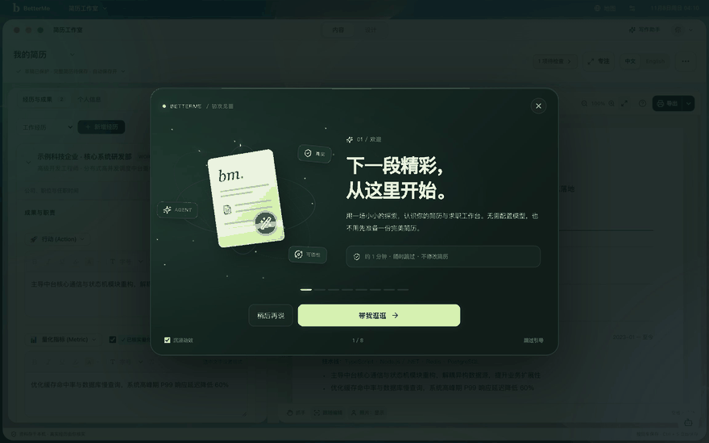
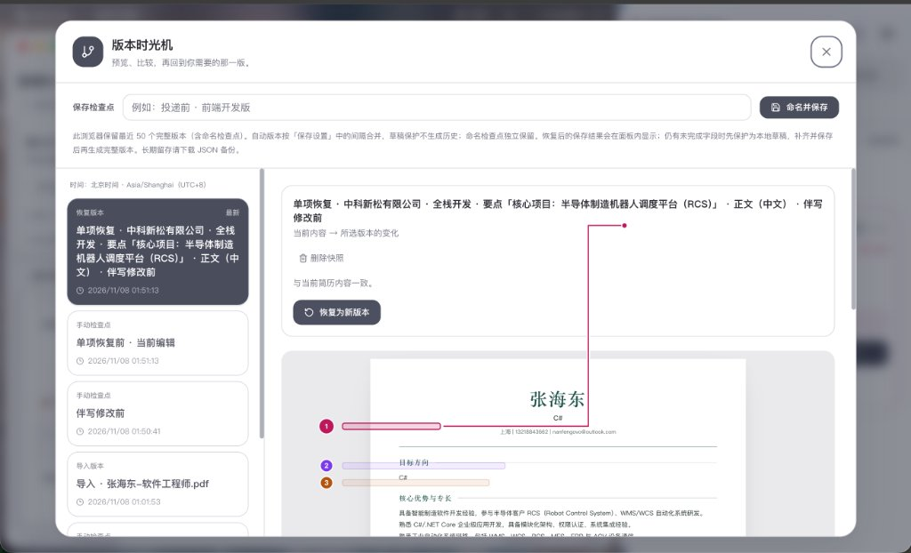
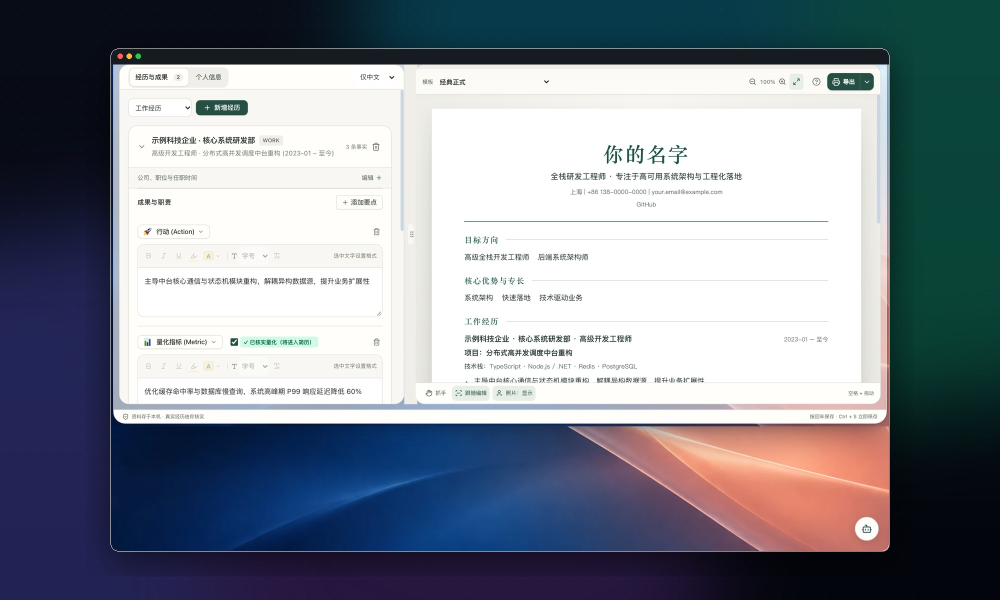
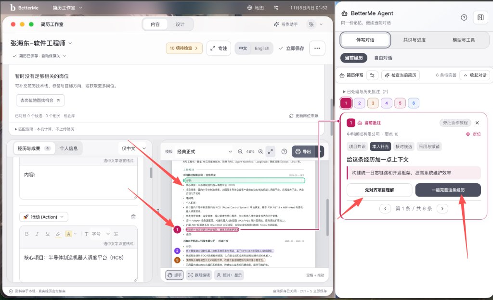

# 迈向更好 · BetterMe

<p align="center">
  
</p>

<p align="center">
  <strong>把真实经历，整理成值得投递的高质量简历；把目标岗位、地理通勤与下一步求职行动紧密串联。</strong>
</p>

<p align="center">
  <a href="https://github.com/nanfengovo/better-me/actions/workflows/ci-pages.yml"></a>
  
  
  
  
  
  
</p>

<p align="center">
  <strong>119 套经典版式 · 10 套专业简历主题 · 中英双语输出 · 真实经历深度伴写 · 真实 JD 证据对齐 · 3D 通勤地理图谱 · Docker 一键运行</strong>
</p>

<p align="center">
  <a href="https://nanfengovo.github.io/better-me/">🌐 在线体验（网页端预览）</a> · 
  <a href="#-快速开始">🚀 快速开始</a> · 
  <a href="#-核心特性亮点-highlights">✨ 核心特性</a> · 
  <a href="#-真实工作台预览-refactored-ui">📸 重构界面一览</a> · 
  <a href="#-真实-jd-对齐与岗位匹配">🎯 真实岗位对齐</a> · 
  <a href="#-ai-与-agent-深度伴写工作流">🤖 Agent 深度伴写</a> · 
  <a href="#-架构与模块边界">🏗️ 架构设计</a> · 
  <a href="#-文档索引">📚 完整文档</a>
</p>

---

## 🌟 核心特性亮点 (Highlights)

市面上大多数 AI 简历工具只是简单的套壳 Prompt，盲目扩写大话套话、甚至虚构经历，不仅容易被面试官一眼识破，还面临极大的个人隐私泄露风险。**BetterMe 坚持「真实经历不可篡改、深度挖掘优于虚构夸大」的理念：**

- 🛡️ **100% 本地优先与数据私密 (Local-First)**：简历数据、事实库、版本历史全部存放在本地浏览器存储或本机独立 SQLite 中；无需强制云端注册，永不拿求职者隐私训练模型。
- 🧠 **不编造假数据的深度 Agent 伴写**：
  - **项目理解深度挖掘 (Project Understanding)**：像资深架构师或技术面试官一样，通过多轮对话对齐项目的业务背景、技术选型、指标闭环与真实贡献边界。
  - **红绿对比与删除线 (Visual Diff)**：修改前原句以浅红底色 + 玫红删除线（`<del>`）标出，已采用新表达以翠绿色（`<ins>`）高亮，多轮长篇补充自动折叠收纳，视觉对比一目了然。
  - **逐字核验与事实依据**：生成的候选表达强制要求引用原文或用户亲口确认的事实证据，杜绝模型幻觉编造假指标，保卫面试信誉。
- 🎯 **真实岗位 JD 深度拆解与 1v1 对齐 (JD Alignment)**：
  - 支持直接粘贴 BOSS 直聘、猎聘、51job 等平台岗位详情链接或文本。
  - 自动拆解核心职责、硬性要求、加分项与技术栈，与简历事实库逐条进行 1v1 证据链匹配，针对性指出欠缺项，不盲目海投。
- ⚡ **智能导入补录与 PDF 断行修复**：
  - 导入 PDF / Word 简历时，自动检测因排版换行导致的文本断裂（如 `...状态反馈与异常处` + `理闭环。`），提供 **一键智能合并断行**。
  - 自动识别并一键补录未能转入结构化事实库的个人/开源项目与教育背景，避免关键经历遗漏。
  - 一键核实全部业绩量化指标，快速恢复初次导入时被保护隐藏的成果数据。
- 📑 **119 套经典排版 & 10 套专业主题**：
  - 层次分明的排版体系：区分小标题（`内容：`、`个人职责：`、`业绩：`）、核心项目名、项目背景与职责子项的多级视觉层次，彻底告别所有内容堆成扁平圆点的混乱排版。
  - 支持中文/英文一键切面、实时 A4 纸张排版渲染，无缝导出高保真 PDF、DOCX、Markdown、RenderCV YAML 及 JSON 备份。
- ⏳ **版本时光机 (Version Time Machine)**：
  - 浏览器端自动记录最近 50 个完整版本，支持命名检查点、可视化差异对比以及按单条经历/要点进行精准单项回滚。
- 🗺️ **职位机会库与 3D 通勤地图 (Job Atlas)**：
  - 将投递记录、HR 联系人、企业实际位置、通勤距离与 3D 地理信息联动，把求职变成掌控全局的作战地图。
- 🐳 **Docker 一键启动 & 任意大模型无缝连接**：
  - 内置 Docker 完整单机环境，网页端 + Agent Host + SQLite 岗位服务开箱即用。
  - 自由接入本地 Ollama、DeepSeek、OpenAI、Claude Code CLI 或 ChatGPT 个人账号。

---

## 📸 真实工作台预览 (Refactored UI)

> 💡 **全新自适应双栏工作流**：日常模式下「左侧手工编辑 + 右侧 A4 实时预览」；点击批注呼出 Agent 时，左侧自动收起表单，腾出宽阔的独立空间给 Agent 深度对齐、多轮追问与红绿对比，彻底消灭挤在狭窄侧栏对话的压抑感！

| 1. 全新分层简历排版（小标题/项目名/缩进子项） | 2. Agent 伴写红绿删除线 Diff 与多轮折叠 |
| :---: | :---: |
|  |  |
| **3. 智能导入补录与 PDF 断行一键修复** | **4. 版本时光机（50 独立检查点与单项回滚）** |
|  |  |
| **5. 项目理解深度挖掘与共识共享** | **6. 自适应双栏宽屏工作台** |
|  |  |

---

## 目录

- [快速开始](#-快速开始)
- [核心设计理念](#-核心特性亮点-highlights)
- [真实工作台预览](#-真实工作台预览-refactored-ui)
- [真实 JD 对齐与岗位匹配](#-真实-jd-对齐与岗位匹配)
- [AI 与 Agent 深度伴写工作流](#-ai-与-agent-深度伴写工作流)
- [简历排版体系与智能补录](#-简历排版体系与智能补录)
- [版本时光机与本地草稿安全](#-版本时光机与本地草稿安全)
- [三维地图与通勤图谱](#-三维地图与通勤图谱)
- [架构与模块边界](#-架构与模块边界)
- [数据、隐私与安全声明](#-数据隐私与安全声明)
- [开发与测试验证](#-开发与测试验证)
- [常见问题 FAQ](#-常见问题-faq)
- [文档索引](#-文档索引)

---

## 🚀 快速开始

### 方式一：Docker 一键完整启动（最推荐）

包含完整的 Web 界面、本地 Agent Host 服务和 SQLite 岗位数据库，开箱即用：

```sh
# 克隆仓库
git clone https://github.com/nanfengovo/better-me.git
cd better-me

# 启动完整单机服务
docker compose up -d --build --wait
```

访问 **http://127.0.0.1:8080/** 即可进入完整工作台。
- 简历排版、本地规则检查、A4 实时预览与导入导出完全离线可用。
- 如需使用 Agent 深度伴写，在页面内「AI 配置」填入自己的 DeepSeek / OpenAI Key，或直接连接宿主机运行的 Ollama。
- 停止服务：`docker compose down`（数据保留在本地命名卷中）。

### 方式二：本地源码开发启动

- **环境要求**：Node.js 24.x 或 26+，pnpm 11+（推荐锁定 `pnpm@11.9.0`）。

```sh
pnpm install --frozen-lockfile
pnpm dev
```

终端将启动开发服务：
- **简历工作室**：`http://127.0.0.1:5173/`
- **岗位地图 (Atlas)**：`http://127.0.0.1:5173/?workspace=atlas`
- **岗位数据服务**：`http://127.0.0.1:5178/`
- **Agent Host**：`http://127.0.0.1:5179/`

---

## 🎯 真实 JD 对齐与岗位匹配

很多人写简历的最大痛点是：“简历写了一大堆，但投递出去全是已读不回”。核心原因在于**简历表达与目标岗位的真实考核点严重脱节**。

BetterMe 内置专门的 **JD 拆解与证据对齐引擎 (`jd-decomposition`)**：

1. **一键输入真实岗位**：支持粘贴 BOSS 直聘、猎聘等公开招聘链接或完整岗位文本。
2. **结构化拆解**：自动剥离客套招聘套话，提取出：
   - 核心业务职责与技术平台（如：分布式服务、调度系统、高并发治理）
   - 硬性技术栈与经验年限（如：.NET / C#、Docker、微服务）
   - 业务加分项（如：工业控制协议、MES/WCS 对接经验）
3. **1v1 证据链匹配**：与当前简历中的真实经历逐一进行关键词与语义对照：
   - **已具备优势**：指出简历中已体现的直接证据，增强面试信心。
   - **缺失与差距 (Gaps)**：明确指出哪些 JD 重点在简历中没有体现，指导你在下一轮 Agent 伴写中重点补充相关真实细节。
4. **拒绝无脑造假**：不直接替你虚构没做过的技术，而是提醒你：“你是否有做过类似协议对接或业务调度？如果有，请在经历中补充；如果没有，在面试准备中提前复习对应概念。”

---

## 🤖 AI 与 Agent 深度伴写工作流

### 1. 沉浸式自适应双栏空间
- **日常编辑模式**：左侧结构化编辑、右侧实时渲染 A4 纸张排版。
- **Agent 协作模式**：点击批注或针对某条经历点击「一起弄清这个项目」，左侧自动平滑收起手工表单，将大面积留给 Agent 对话、思考过程与对比卡片，彻底解决对话空间狭窄逼仄的问题；关闭 Agent 时自动恢复手工编辑区。

### 2. 项目理解（Project Understanding）深度挖掘
- 不急于直接改写文字，而是先对齐项目共识：
  - 梳理项目的真实背景、软硬件边界、你负责的模块。
  - 追问核心技术细节：例如是“仅参与方案设计”还是“负责全栈开发与调优”？遇到过哪些故障？如何做状态机闭环？
- 确立共识后，记忆**自动打通共享**至单条经历伴写，无需重复向 AI 解释背景。

### 3. 红绿删除线可视化对比 (Visual Diff & Review)
- **修改前原句**：浅红底色 + 玫红删除线（`<del>`），一眼辨认被替换的内容。
- **候选新表达**：翠绿色标签 + 翠绿底色（`<ins>`），突出优化后的专业动词与技术表达。
- **用户多轮补充**：长篇补充内容自动折叠为 `💬 你的补充（N 字 · 点击展开）`，主屏只展示高价值改写方案。
- **逐字核验与撤销**：必须勾选「我确认来自实际经历，无夸大虚构」后方可采用入库；采用后支持一键撤销或二次补充修改。
- **批注全生命周期跟踪**：直观展示 `✓ 已采用`、`↻ 原文已变化`、`✕ 已收起`，支持随时回溯修改。

---

## 📑 简历排版体系与智能补录

### 层次分明的排版体系
- 自动识别并分类工作经历中的内容属性：
  - **小标题**（`内容：`、`个人职责：`、`业绩：`）：左侧垂直 Accent 条加粗展示，不再显示混乱的前置圆点；未确认业绩指标时自动隐藏空标题。
  - **核心项目与背景**（`核心项目：...`、`项目背景：...`）：独立样式展示，增强阅读条理性。
  - **具体职责条目**：自动缩进成为二级子项，层次分明，HR 扫一眼就能抓住重心。

### 一键智能补录与断行修复
- 从 PDF 提取文字时经常出现换行截断乱码（例如上一行结尾是 `异常处`，下一行开头是 `理闭环。`）。
- BetterMe 能够自动识别此类跨行残段，并在顶部直观提示：
  - **「✨ 一键补录待核对内容并修复断行」**：自动拼合断句，并将未入库的开源项目、个人项目、教育经历解析为结构化卡片入库。
  - **「✓ 一键核实全部业绩指标」**：恢复因未核实而被隐藏的数字/百分比量化成果。

---

## ⏳ 版本时光机与本地草稿安全

简历修改最怕改砸了找不回原版。BetterMe 内置 **版本时光机 (Version History)**：
- **自动快照**：本地自动保存最近 50 个完整编辑版本，编辑过程断电/误关窗口不丢失。
- **命名检查点**：支持手动命名保存关键版本（如“投递阿里前”、“海外英文版”）。
- **单项差异对比与恢复**：支持查看与当前版本的细粒度差异，不仅可以全量恢复旧版，还支持针对单条工作经历的**单项局部回滚**。

---

## 🗺️ 三维地图与通勤图谱

求职不仅是改简历，更是衡量生活与工作的平衡。BetterMe 集成了本地 **Job Atlas**：
- **通勤全景**：支持 MapLibre 矢量底图，按真实坐标呈现岗位分布与通勤半径。
- **企业与岗位关联**：点击地图点位直接联动对应企业的招聘 JD 与薪资分布。
- **安全与合规**：所有三维点位与查询完全基于本地 SQLite WAL 只读线程隔离执行，支持断网环境离线运行。

---

## 🏗️ 架构与模块边界

```text
better-me/
├── apps/
│   ├── web/                  # React 19 + Vite + Tailwind：简历工作室、Agent 侧栏、Atlas
│   │   ├── src/components/   # 模块化 UI：ResumeTemplate, IssuesPanel, ImportSourceReview...
│   │   └── server/           # 开发 Broker、安全来源工具、JD 浏览器会话
│   ├── job-service/          # Node:sqlite 岗位索引服务、后台补全、WAL 计算隔离
│   └── agent-host/           # 本机 Agent 进程托管、Runtime 协议、LangGraph 状态编排
├── packages/
│   ├── core/                 # 核心事实库 Schema、JD 拆解器 (jd-decomposition)、AI 客户端
│   ├── storage/              # 本地 localStorage / IndexedDB 容灾备份与 50 版历史时光机
│   ├── opportunities/        # 岗位数据领域模型、增量索引
│   └── agent-contracts/      # 跨进程 Agent 通信规范与审批机制
└── docs/                     # 详细设计、规划与严苛的真实场景验收报告
```

---

## 🔒 数据、隐私与安全声明

| 数据类别 | 存储与传输边界 | 隐私保障 |
| :--- | :--- | :--- |
| **简历与个人档案** | 浏览器本地存储 (`localStorage` / `IndexedDB`) | **绝不上云**，离线完全可用 |
| **编辑历史与版本** | 自动保存最近 50 个独立快照，随时回滚 | 本机受控，支持导出脱敏 JSON |
| **目标岗位与 JD** | 本机独立 SQLite 数据库，WAL 线程安全隔离 | 不与外部服务器同步个人投递偏好 |
| **AI 模型调用** | 用户自备 API Key 直连服务商或本地 Ollama | 不做任何中间数据收集，不拿用户隐私训模型 |

---

## 🧪 开发与测试验证

项目坚持严格的自动化测试与工程规范，绝不将未经测试的代码推向生产：

```sh
# 依赖安装
pnpm install --frozen-lockfile

# 全局类型检查
pnpm typecheck

# 运行全套组件与业务逻辑单测 (62/62 通过)
pnpm test

# 核心真实场景专项测试（含真实工控履历 × 真实工控 JD 闭环校验）
node --test packages/core/tests/e2e-jd-resume-flow.test.mjs
node --test packages/core/tests/jd-decomposition.test.mjs
```

---

## 💬 常见问题 FAQ

<details>
<summary><strong>Q: 为什么生成的候选表达不允许我直接复制，必须逐字核验？</strong></summary>
A: 这是 BetterMe 的核心立足点。面试官在面对面提问时，会针对简历上的每一个数字、每一个技术名词深挖背后的原理和细节。如果完全任由 AI 编造假数据，面试时一旦露馅后果灾难。只有你自己真正做过、核验过的内容，才是你的核心竞争力。
</details>

<details>
<summary><strong>Q: 导出的 PDF 能保证打印时不跨页乱断行吗？</strong></summary>
A: 可以。BetterMe 专门适配了标准的 A4 页面比例与打印媒体查询规则（`@media print`），并优化了分页规避机制（`break-inside: avoid`），确保工作经历与项目条目在换页时整块过渡，不被强行截断。
</details>

<details>
<summary><strong>Q: 我可以使用完全离线的本地模型（如 DeepSeek-R1 / Qwen 2.5）吗？</strong></summary>
A: 完全可以。在「AI 配置」中将端点设置为本地 Ollama（如 `http://127.0.0.1:11434/v1`），即可在完全断网的状态下享受完整的 Agent 深度项目挖掘与简历伴写功能。
</details>

---

## 📚 文档索引

- [系统架构与路线图 (Roadmap)](docs/ROADMAP.md)
- [119 套简历模板与主题样式目录](templates/CATALOG.md)
- [Docker 本机完整部署与数据卷持久化指南](docs/docker.md)
- [真实履历与岗位端到端对齐可行性研究](docs/planning/career-os-experience-feasibility-2026-11-06.md)
- [本地 Agent 身份与多账号数据隔离报告](docs/reports/agent-identity-isolation-2026-11-02.md)

---

## 🤝 贡献与鸣谢

欢迎提交 Issue 和 Pull Request！如果你觉得 BetterMe 对你的求职和简历打磨有所帮助，**欢迎在 GitHub 上点亮一颗 ⭐️ Star**，让更多在求职路上的伙伴不再迷茫！

[](https://star-history.com/#nanfengovo/better-me&Date)

---

<p align="center">
  Made with ❤️ by Developers for Job Seekers · 迈向更好
</p>
