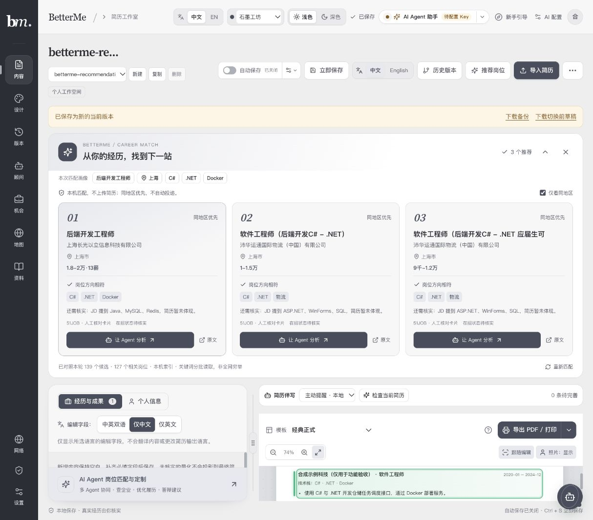
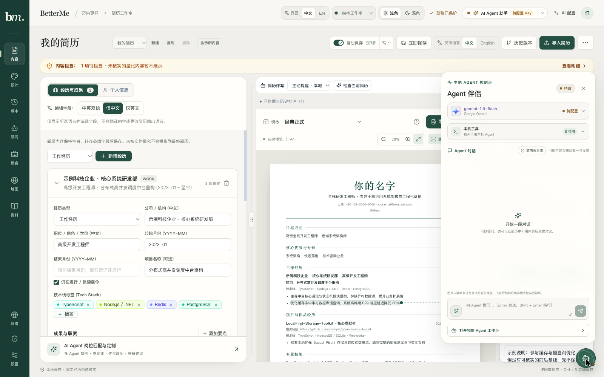

# 迈向更好 · BetterMe

[](https://github.com/nanfengovo/better-me/actions/workflows/ci-pages.yml)

**把真实经历，整理成值得投递的简历；把岗位、地点和下一步行动联系起来。**

A local-first resume, job atlas and optional AI-agent workspace.

BetterMe 是本地优先的简历与求职工作台。事实库、多份简历、模板、导出、历史和投递记录不依赖 AI；岗位采集、独立后台补全与地图通过本机服务扩展；需要时再连接自己的模型或本机 CLI。

**119 套版式 · 10 套简历主题 · 中英输出 · 主动简历伴写 · 导入后岗位推荐 · 可调整地图/JD 工作台 · Docker 一键运行**

[在线体验（main 部署）](https://nanfengovo.github.io/better-me/) · [快速开始](#快速开始) · [功能状态](#功能状态与边界) · [三维配置](#实景-3d-配置) · [验证](#开发与验证) · [文档索引](#文档索引)

> 本文描述本分支源码，不保证在线体验已经部署同一版本。静态网站不包含本机采集器、SQLite 或 CLI。Google 实景建筑需要合规数据源、凭据与适用计费；上海覆盖和真实 Google 场景性能尚未验收，不能把合成网格或本地地球底图当作实景证明。



2026-10-31 更新：以上图片来自实际简历编辑模块，不是独立 HTML 示例页。简历为合成测试内容，岗位来自现有真实来源索引，在招状态仍待核实；仅在本机只读查询，没有改动用户真实简历或调用模型。画面中的 139 个候选是该轮查询结果，不代表全网覆盖。[截图来源与边界](docs/images/README.md)。

[▶ 查看工作台操作视频（WebM，1 分 37 秒）](docs/media/betterme-workflow-20261030.webm) · [图片与视频来源](docs/media/README.md) · [Docker 使用说明](docs/docker.md)

## 目录

- [快速开始](#快速开始)
- [功能状态与边界](#功能状态与边界)
- [简历、事实与恢复](#简历事实与恢复)
- [岗位采集与后台流水线](#岗位采集与后台流水线)
- [查询、同步与大库计算](#查询同步与大库计算)
- [地图与灵活工作台](#地图与灵活工作台)
- [实景 3D 配置](#实景-3d-配置)
- [AI 与 Agent](#ai-与-agent)
- [架构与模块边界](#架构与模块边界)
- [数据、隐私与安全](#数据隐私与安全)
- [开发与验证](#开发与验证)
- [部署](#部署)
- [常见问题](#常见问题)
- [文档索引](#文档索引)
- [来源与许可证](#来源与许可证)

## 快速开始

### Docker 一键启动（本机完整运行版）

安装并启动 Docker Desktop，或使用 Docker Engine + Compose v2。在包含本功能的分支根目录执行：

```sh
docker compose up -d --build --wait
```

打开 **http://127.0.0.1:8080/**。默认镜像同时运行网页、Agent Host 和 SQLite 岗位服务，自动建立同源连接，不必分别开三个终端或复制令牌。

- 简历编辑、主动伴写的本地检查、预览、历史与导出无需模型。
- 模型不包含在镜像中；在「AI 配置」选择自己的服务。Agent 的本机 Ollama 地址会转换到宿主机网关，不会自动下载模型或购买额度。
- 容器不接管个人 Chrome/Edge 登录态，也不安装本机 Claude/Codex CLI。需要交互式招聘浏览器或 CLI 时使用下方 `pnpm dev`。
- 默认只开放本机端口；后台数据写入专用命名卷。简历、草稿、历史和模型配置仍由当前浏览器保存。更新前分别备份。

健康状态：`docker compose ps`；日志：`docker compose logs --tail=100 web`；停止：`docker compose down`（保留数据卷）。端口、模型连接、恢复、迁移与静态模式见 [Docker 指南](docs/docker.md)。

### 环境与单一开发入口

- Node.js **24.15.0+ 的 24.x，或 26+**，以根 package.json 的 engines 为准。
- pnpm **11+**，仓库锁定 pnpm@11.9.0。
- 岗位数据库使用 Node 内置 node:sqlite；Agent 部分依赖包含原生模块，切换 Node 主版本可能需要重新安装或重建。
- 浏览器建议启用 WebGL/硬件加速。平台读取还需要支持的本机 Chrome/Edge，不要求接管日常浏览器。

```sh
git clone https://github.com/nanfengovo/better-me.git
cd better-me
pnpm install --frozen-lockfile
pnpm dev
```

开发入口先构建所需 workspace 包，再启动 Web。默认简历工作室为 http://127.0.0.1:5173/，岗位地图为 http://127.0.0.1:5173/?workspace=atlas；地址以终端为准。

| 服务 | 默认端口 | 职责 |
| --- | ---: | --- |
| Web / Vite | 5173 | 简历、机会、地图、Agent 界面及仅开发期的受控来源工具 |
| Job Service | 5178 | SQLite 岗位索引、认证查询、同步、入库、后台补全 |
| Agent Host | 5179 | 可选模型代理、本机 Runtime 扫描、Run 与事件流 |

pnpm dev 启动或复用健康配套服务。关闭时只停止自己启动的子进程，不接管外部健康服务；未知端口占用、令牌或 origin 不匹配会明确失败，不强杀其他进程。启动不等于自动采集，也不会自动投递或提交简历。

当前开发岗位目录由 broker 默认选为用户目录下 Library/Application Support/BetterMe/job-atlas；这是当前实现路径，不是跨平台配置保证。已有数据要沿用原目录，不能通过换空目录“修复”连接。

### 单独运行服务

自定义数据目录或 origin 时，可手动运行岗位服务。目录必须在 Git 仓库之外：

```sh
pnpm --filter @better-me/job-service start \
  --data-dir /absolute/path/to/private-job-atlas \
  --origin http://127.0.0.1:5173 \
  --origin http://localhost:5173
```

127.0.0.1 与 localhost 是不同 origin。token 保存在专用目录的 service.token，不要粘贴到公开日志。接口、锁和备份见 [Job Service README](apps/job-service/README.md)。

Agent 独立启动见 [Agent Host README](apps/agent-host/README.md)。开发 broker 使用的固定开发 token **不是生产安全凭据**，不要把开发服务暴露公网。

## 功能状态与边界

| 模块 | 当前源码能力 | 重要限制 |
| --- | --- | --- |
| 简历与事实 | 结构化事实、多份视图、内容核对、119 模板、10 主题、中英字段、精细排版 | AI 不自动创造经历；切语言不等于自动翻译；导入不保证原版式 |
| 岗位推荐 | 导入确认后自动匹配，或手动按当前简历匹配；最多 3 张卡片、同地区筛选、匹配依据、Agent 分析入口、可停止与错峰入场动效 | 只读本机索引或机会库中的有限候选；不保证全网最优、仍在招或录用，不自动投递 |
| 保存与恢复 | 草稿、IndexedDB 备用、最近 50 版、检查点、差异/单项恢复、JSON 备份 | 来源隔离的本地数据，不是云端账号同步；仍需自行备份 |
| 机会与投递 | 收藏、阶段/联系人/跟进、材料快照、JSON/CSV 导出 | 不自动投递、不发邮件，不保证后台提醒 |
| 平台采集 | LinkedIn、猎聘、51JOB、BOSS 受控读取、范围采集、分批入库、部分覆盖说明 | 登录/验证由用户完成；站点变化和限制可能导致部分完成，不保证全站覆盖 |
| 后台补全 | 地区/企业独立任务、队列状态、自动发布 revision | 缺证据保留未知，不生成办公坐标或控股结论 |
| 采集恢复 | 本地日志、检查点、未确认回执核对、继续采集入口 | 不绕过验证；已抓卡片不等于已保存岗位 |
| 大库查询 | Worker 隔离、revision 增量、增量投影、查询索引、有界缓存 | 首次基线仍完整读取；新 revision 仍有索引准备成本 |
| 工作台 UI | 调整地图/列表/JD 分栏、布局预设、拖动排序、焦点模式、可读状态 | 不能据单测认定所有设备 FPS/INP 通过 |
| 三维地图 | MapLibre 工作地图 + 懒加载 Cesium 地球 + 显式 Google/授权 3D Tiles | 上海实景、Google 带凭据请求和真实场景成本仍待验收 |
| AI/Agent | 模型对话、引用/图片、授权摘要、CLI Run、SSE、编排骨架 | 完整持久职业记忆、追问卡和全部 Worker 执行尚未接通 |

## 简历、事实与恢复

### 第一次使用：沉浸式工作台引导

首次进入内容编辑器时，8 步引导会介绍真实经历、Agent 伴写、预览导出、草稿保护、模型配置和岗位地图。带有浮动简历、轨道粒子、扫描光、区域聚光与完成庆祝动效；可随时上一/下一步、跳过单步、点击进度跳转，或按 Esc 退出。完成或跳过后不再自动出现，顶部「新手引导」可重新播放。

支持中英文、小屏布局、键盘左右键、焦点管理、关闭「沉浸动效」及系统减少动态效果。引导只讲解与高亮，不修改简历、不调用模型、不发起采集；只在当前浏览器写入独立的引导偏好。已开始输入或已有弹窗时不会突然打断。[实现与验收边界](docs/onboarding.md)。

### 在现有编辑器中主动伴写

进入「内容」编辑经历时，Agent 以锚定原文的轻量批注提醒缺少上下文、流水账表达或缺乏依据的数字。点击「一起完善」后，围绕个人行动、方法、范围和结果逐步补充；本地检查无需模型，模型追问需要配置和明确同意。

补充内容先生成可编辑候选，对照原文后由你决定是否采用；不会自动编造量化结果、修改事实或标记已核实。支持忽略提示、关闭主动提醒、采用后撤销，草稿与历史继续沿用现有编辑模块的保护机制。[查看实际操作视频](docs/media/betterme-workflow-20261030.webm)。

[查看主动伴写编辑器截图（2026-10-30）](docs/images/resume-copilot-20261030.webp)。历史视频没有包含后续新增的岗位推荐流程。

### 导入简历后，推荐下一站

在现有简历导入弹窗中核对结构化内容，点击「确认替换简历并推荐岗位」后，编辑器内自动展示最多 3 个相关岗位。已有简历可使用顶部「推荐岗位」。按技术栈、经历标签、目标方向匹配，同地区优先；可切换「仅看同地区」、收起推荐或重新匹配。

推荐使用已连接的本机岗位索引，每次按最多 3 个关键词分批读取候选（每批最多 60 个），不导出庞大的采集历史；无法读取时明确提示，仅回退当前机会库。这里是有限候选中的文本相关性排序，不是全网穷举、录用概率或岗位要求核验。已关闭岗位和演示来源不参与推荐；技能命中、异地和在招状态待核实分别展示。JD 提及而简历没有体现的技术只标「还需核实」，不认定求职者不会。

卡片依次入场、加载状态与按钮反馈支持系统减少动态效果；等待时可停止，迟到结果不会覆盖已停止或新一轮推荐。推荐只读岗位与简历，不改事实、不投递、不自动调用外部模型。仅公开技术关键词和已披露城市用于配套本机服务查询，姓名、联系方式及简历正文不随推荐请求发送。点击「让 Agent 分析」后进入现有 Agent 工作台，模型分析仍由用户按现有授权流程启动。

推荐流程回归：`pnpm test:recommendations`，覆盖排序与去重、查询鉴权与边界、停止/重试、地区筛选、导入快照与当前画像的区分。

### 一份事实，多份呈现

事实库存教育、工作、项目、技能与成果；每份视图分别选择可见条目、模板、语言、排序与排版。更改共享事实可能影响引用它的视图，切换样式不等于复制独立事实。

- 导入 PDF、DOCX、图片、HTML、Markdown、TXT、结构化 JSON 等；旧 DOC 仅尽力提取。
- 导入先保留提取结果、警告与待核对项，再由用户确认。当前按模板重排，不声称保留任意原稿的字号、分栏和分页。
- 数字待核实、空洞表达检查和字段定位帮助修改；Schema 合法不等于事实真实。
- 模板、简历主题、网页配色分别管结构、纸面与工作环境；明暗模式不应改变导出纸张原有配色。
- 支持 PDF/打印、DOCX、Markdown、RenderCV YAML、结构化备份。浏览器打印决定实际跨页，不强制把内容压进一页。
- 机会区记录真实岗位来源、投递阶段、联系人、下一步和当时材料快照，不擅自投递。

### 草稿与正式历史

即时草稿与正式版本分离。localStorage 写入失败时尝试 IndexedDB 备用；两者都失败时应立即导出备份，而不是先清数据。历史保留最近 50 版并支持命名检查点、整版/差异项恢复；命名版本也受总量限制。

清网站数据、更换协议/主机/端口、换浏览器都会影响数据可见性。升级不应通过清理站点存储、强制刷新或换数据目录解决状态问题。

## 岗位采集与后台流水线

搜索已有岗位与获取新岗位是两件事。搜索条件作用于已收录索引；显式采集才操作专用浏览器。登录和人机验证由用户完成，不复用日常 profile。

```text
平台读取 ──分批已核验卡片──> 入库提交 ──revision──> 列表/地图自动更新
                                  └──> 地区/企业后台补全 ──revision──┘
```

- 多平台按有限并发读取，不无上限开页面。
- 入库与补全独立：平台仍在读取时，已确认岗位即可保存、查询和展示；不用等待所有平台或补全结束。
- 发现卡片、成功提交回执、待确认、失败/取消、部分覆盖分别展示；不同口径的数字不能简单相减当作队列。
- 明确失败原因与可执行下一步。未知原因保留未知，分页未确认、登录阻断、超时或预算用尽不叫完整成功。
- 取消保留已核验结果；检查点帮助恢复，重复提交按幂等回执核对，未确认不等于未写入。
- 地区/企业自动后台补全不要求手动点；前端离开不因此停止服务端任务，异常独立诊断，不阻塞搜索。

有限站点样本不代表全站长期稳定。来源卡片、完整 JD、唯一岗位和 listing 不同；原文链接、时间、覆盖与待核实状态应保留。

## 查询、同步与大库计算

性能链路分开实现，不与动画或某个地图供应商耦合：

1. **服务端计算隔离**：单写线程处理入库/补全，只读线程通过 SQLite WAL 读已提交版本，HTTP 主线程负责认证与转发。
2. **增量投影**：从变化来源和反向依赖读取真实受影响片段，沿用 CAS、幂等、人工覆盖及事实规则；大共享公司/归并组仍可能形成大切片，不承诺所有路径 O(delta)。
3. **revision 同步**：已有基线后按 epoch + revision 拉净 upserts/deletes；未变化复用对象；断档/换库/预算超出时明确返回完整快照，不静默截断。
4. **浏览器 Worker**：解析、引用验证、查询和地图几何准备离开 UI 主线程；取消、并发共享、缓存淘汰有独立协议。
5. **查询索引**：按不可变快照准备关系与字段索引，惰性标准化 JD；分页、排序、地图级别复用有界缓存，跨 revision 复用未变实体文本。
6. **三维点位**：按真实坐标分组，批量 billboards，差量更新 GPU；相同输入不重复上传，不因后台进度重建 Viewer 或拉走相机。

**尚未实现的独立阶段：首次基线分页。** 当前空游标返回完整公共快照；列表分页和增量同步不是首次快照分页。初始下载、全局引用校验、新索引准备与大规模真实变化仍有成本。

既有 5,000/15,000 合成方法与结果见 [查询索引](docs/reports/job-atlas-query-index-2026-10-28.md)、[增量投影](docs/reports/job-atlas-incremental-projection-2026-10-28.md)、[revision 同步](docs/reports/job-atlas-revision-sync-2026-10-28.md)。历史计时不是本次机器状态的新基准，不代表真实平台耗时或浏览器 FPS。

## 地图与灵活工作台

- 地图、列表、JD 可同屏，支持调整分栏、预设、模块顺序和焦点布局。窄屏优先可读，控件不能遮住署名。
- 地图与列表使用同一查询语义；后台更新尽量保留选中岗位、详情和相机，不强制回总览。
- 地址/街道点和城市参考有不同精度。无精确位置的岗位留在列表，城市中心不冒充办公室，重合点不随机抖动。
- 同坐标多地址/岗位通过选择器显示；地图选择可联动 JD。
- 行政边界保留数据和坐标系来源；显示转换不改变来源事实，也不当作测绘成果。
- UI 插画和 Agent 3D 图标是艺术资产，不是官方认证标识，更不是实景地图。来源在对应 public 目录说明中。

## 实景 3D 配置

### 三种模式

| 模式 | 引擎 / 数据 | 凭据与覆盖 |
| --- | --- | --- |
| 工作地图 | MapLibre 与选定街道/本地概览 | 随底图而定；默认不请求 Google 3D |
| 三维地球 | CesiumJS 1.146.0，本地 Natural Earth II 底图与概略边界 | 不需要 Google/ion；不是卫星实景建筑 |
| 实景 3D | Cesium + Google Photorealistic 3D Tiles，或授权 tileset | 需要合法数据源；Google 需要有效 Key 与计费；上海覆盖未验收 |

引擎懒加载，默认 MapLibre 首屏不预载整份 Cesium。SDK Workers、Assets、ThirdParty、Widgets 和许可文件通过专用插件发布，路径跟随 Vite base，支持 Pages 子路径。

### Google 数据接入

1. 自行在 Google Cloud 配置 Map Tiles API、适用账单、预算/配额和凭据限制。应用不替用户启用计费或创建 Key。
2. 地图上方选择 **3D** 视角，打开 **实景 3D / 数据与画质**。
3. 选择 Google 数据源，输入 Map Tiles API Key，阅读请求和费用说明。
4. 明确确认权限与请求范围后点击“加载实景数据”。无 Key 不调用 factory，不隐式转到 ion。
5. 验证目标街区真实覆盖、位置对齐与署名；仅 tileset 加载成功不证明上海有摄影测量建筑。

Key 仅存在当前地图组件内存，不写 localStorage、IndexedDB、env 或仓库；卸载组件丢失，主动清除立即返回工作地图。浏览器直连中的 Key 对使用者可见，**不是服务端秘密存储**。供应商接收地图请求及可推断的视角区域，应用不主动附带简历、JD 正文或家庭地址字段。

### 自有 / 授权 3D Tiles

填写完整 tileset.json URL 与来源署名；数据需拥有使用许可并允许浏览器 CORS。远端只接受 HTTPS，本机允许 loopback HTTP；URL 不允许嵌入账号密码。影像、网格、地形的许可分别核对。

### 画质、交互与故障回退

| 画质 | DPR 上限 | 屏幕空间误差 | tiles 缓存 / 溢出预算 |
| --- | ---: | ---: | ---: |
| 流畅 | 1 | 32 | 64 / 32 MiB |
| 均衡 | 1.5 | 16 | 128 / 64 MiB |
| 精细 | 2 | 8 | 256 / 128 MiB |

预算只约束 tiles 缓存，不是整个浏览器/GPU 内存上限。采用按需渲染，默认不自动旋转；开启后仍遵循减少动态效果、页面可见性和用户操作暂停。支持缩放、朝北、地址选择、位置聚焦和原生相机恢复。

400/401/403、429、网络超时和 WebGL 失败分别给出脱敏原因与重试/工作地图入口；不展示可能含 Key 的上游 URL，429 不密集自动重建会话，地图失败不清空列表。

保留 Google/Cesium 与动态数据署名。不增加 Google 瓦片离线包、预抓取、网格提取或从影像生成岗位事实；开源引擎不等于数据免费。费用和条款查 [Google 3D 文档](https://developers.google.com/maps/documentation/tile/3d-tiles)、[用量计费](https://developers.google.com/maps/documentation/tile/usage-and-billing)、[数据政策](https://developers.google.com/maps/documentation/tile/policies)，不在 README 固定长期价格。

**验收边界**：无凭据引擎、生命周期、合成 tileset、回退和 5,000/15,000 点位模型可验证；真实 Google、上海覆盖、纹理/坐标对齐、真实场景 GPU/FPS 与成本需授权数据源。本轮浏览器采样仍出现秒级长任务，不能宣称全面性能达标。见 [三维升级报告](docs/reports/job-atlas-cesium-upgrade-2026-10-29.md)。

## AI 与 Agent

### 模型对话

可选 Gemini、OpenAI 兼容端点、DeepSeek、本地 Ollama 等；使用实际配置的服务，本机安装 CLI 不等于云模型已配置。

- 默认不带简历。授权后仅发送当前视图可见的简介、技能和经历摘要，排除姓名、联系方式、头像及隐藏字段。
- 引用仅随本次问题发送；图片先本地预览，点击发送才进入模型请求，历史图不反复随之后问题上传。
- 视觉能力区分已知支持、不支持和未验证；未知不冒充支持。
- 表达建议与结构化提案需核对后应用，不自动改事实，匹配分数不是录用概率。

### 本机执行与 LangGraph

agent-contracts 定义 ContextPack、Run、事件、Artifact、Runtime 和审批协议；Host 扫描支持的 CLI，以参数数组、独立运行目录、超时/取消与有序 SSE 管理运行。

Career Orchestrator 提供阶段、产物与审批中断骨架，**不代表**平台发现、公司研究、地图写入等 Worker 全部接上真实执行。CLI 原生审批、嵌套协议解析和成功/拒绝判定仍有待办，不能只凭 exit 0 宣布用户任务成功。见 [执行审计](docs/reports/agent-execution-audit-2026-10-29.md)。

默认 process 隔离是独立目录与 shell:false，**不是 OS 文件权限沙箱**。需要 OS 限制时显式选择 required；macOS sandbox-exec / Linux bubblewrap 不可用则 fail closed。不要给不可信任务宽泛读写路径。

普通聊天尚未完成跨入口持久会话、经授权长期职业记忆、问题卡提交自动推进闭环；见 [职业对话设计](docs/planning/career-advisor-conversation-2026-10-29.md)。不读取本应用之外的 ChatGPT 私人历史，不擅自作人格诊断，不默认授权投递。

## 架构与模块边界

```text
apps/web                 React 19 + Vite：简历 / Atlas / Agent
  server/                开发 broker、受控来源工具、Cesium 资源插件
  components/atlas/      同步、计算 Worker、采集恢复、灵活布局
    map3d/               来源校验、纯点位模型、Cesium runtime、React 适配
apps/job-service         SQLite、事务与幂等、后台补全、读写线程
apps/agent-host          模型代理、Runtime/Run、事件、LangGraph
packages/core            简历事实、视图、Schema、AI client
packages/storage         草稿、历史、IndexedDB 与恢复
packages/opportunities   岗位领域、统一查询、索引、工具契约
packages/source-adapters 来源适配与受控读取
packages/agent-contracts 跨进程 Agent 协议
docs/                    规划、研究、分阶段验收
```

地图供应商不拥有查询索引；Cesium 不直接写 SQLite 或简历；后台队列不由动画驱动。SDK 生命周期、业务点位和来源配置分别封装，避免地图失败牵连整个工作台。

## 数据、隐私与安全

| 数据 | 默认存放 / 传输边界 |
| --- | --- |
| 简历、视图、机会、模型偏好 | 当前浏览器 origin 的本地存储；需保护设备与同源脚本 |
| 草稿和历史 | localStorage / IndexedDB；不是云备份 |
| 岗位索引 | 仓库外私有 SQLite 目录，token/WAL/锁不进 Git |
| 采集检查点 | 当前浏览器本地采集日志，帮助回执核对与继续 |
| 模型请求 | 用户选择的服务；“本地模型”仍需检查实际 endpoint |
| Agent Run | 本机运行目录、事件与产物，日志/ContextPack 可能敏感 |
| 三维地图 | 浏览器直连数据源；遵循其许可和隐私条款 |

代码同步不上传用户简历、真实数据库、登录 profile、cookies、token、.env、浏览器原始日志和私人对话附件。忽略规则覆盖运行数据、导出、output/ 和 .playwright-cli/；忽略不等于已跟踪文件自动消失，提交前仍需审查。

Job Service 限 loopback、精确 origin 与 Bearer；采集校验来源/公网地址。不要为了连通而关掉安全检查。来源、未知与人工核对记录应保留，缺证据不生成城市、薪资或控股确定值。

## 开发与验证

```sh
pnpm install --frozen-lockfile
pnpm typecheck
pnpm lint
pnpm build
pnpm test
```

根 test 是显式 glob；Web 的 .test.tsx glob 不包含部分新增 .test.ts 专项。因此 pnpm test 不能代替全部专项，也不证明真实平台、模型、Google 和浏览器视觉验收完成。

2026-10-29 本轮检查：8 包类型检查与构建通过；服务/存储/查询/三维专项 496 通过、3 跳过。全仓 lint 仍有 68 错误、6 警告，不是可直接发布的全绿版本；新增三维源码定向 lint 通过。浏览器仍有长任务/结果等待，详见三维报告。

### 三维专项

```sh
pnpm exec tsx --test \
  apps/web/tests/atlas-cesium-model.test.ts \
  apps/web/tests/atlas-cesium-runtime.test.ts \
  apps/web/tests/atlas-map-viewport.test.tsx \
  apps/web/tests/cesium-assets.test.ts
```

覆盖 5,000/15,000 不同坐标的差量模型、无 Key 不外呼、StrictMode 生命周期、延迟请求卸载、回退、清凭据与子路径资源。模型计算耗时不是 FPS。

### 查询与服务规模专项

```sh
pnpm exec tsx --test packages/opportunities/tests/query-index.test.ts
BETTER_ME_SCALE_BENCH=1 pnpm exec tsx --test apps/web/tests/atlas-query-index-scale.test.ts
BETTER_ME_SCALE_BENCH=1 pnpm exec tsx --test apps/job-service/tests/compute-isolation-scale.test.ts
```

环境变量示例为 POSIX；PowerShell 使用 $env:BETTER_ME_SCALE_BENCH='1'。规模压测串行运行，避免与构建竞争后得出错误结论。只用合成临时库，不写真实岗位。

### 隔离 UI 验收

```sh
pnpm --filter @better-me/web exec vite --config tests/ui-lab/vite.config.ts --port 5188
```

在新建验收页打开 http://127.0.0.1:5188/tests/ui-lab/index.html?size=5000 或 ?size=15000。挂载实际工作台与 Worker，但使用合成 API，不连接真实岗位、简历、Agent 或 Google；本机原创合成网格仅验证 SDK 链路。详见 [UI Lab](apps/web/tests/ui-lab/README.md)。

性能记录区分长任务、rAF 节奏、Event Timing 与 GPU 呈现；缺事件不记零，实验室交互值不称 field INP。不能只凭平均 FPS 或单测通过认定全部流畅。

## 部署

### 本机与静态站点

```sh
pnpm build
pnpm --filter @better-me/web preview
```

dist 可部署 HTTPS 静态站点，但不包含 dev broker、来源读取 API、SQLite 或 CLI；不要把 vite preview 当生产 API。远端 HTTPS 页面访问本机 HTTP 另受浏览器网络策略约束，需单独验证。

### Docker

```sh
docker compose up -d --build --wait
docker compose ps
```

默认 http://127.0.0.1:8080，可用 `BETTER_ME_PORT` 调整。默认 `runtime` 镜像包含网页、Agent Host 和岗位服务；`/healthz` 聚合检查两个配套服务。连续三次失败时运行入口退出，由 Compose 的重启策略重新启动；不是仅标记 unhealthy 就宣称已经恢复。

运行用户非 root、根文件系统只读，仅 `/data` 卷和 `/tmp` 可写；不挂载宿主机源码、密钥、Docker socket 或浏览器 profile。旧 Nginx 静态发行保留为 `docker build --target static`，不要与完整运行模式混淆。具体能力和限制见 [Docker 指南](docs/docker.md)。



### GitHub Pages 与分支

[CI workflow](.github/workflows/ci-pages.yml) 在 main push、面向 main 的 PR、手动触发时检查；发布条件以 workflow 为准。本次功能分支推送只保存代码，不等于合并 main、更新 Pages 或远端 CI 已通过。

```sh
pnpm --filter @better-me/web exec vite build --base=/better-me/
node scripts/check-atlas-distribution.mjs apps/web/dist
```

Cesium Workers/WASM/纹理/许可证必须一起发布，不能只复制 JS。生产构建仍有大 chunk 等警告；懒加载减轻默认入口，不消除首次开三维的下载/编译成本。

## 常见问题

| 现象 | 先检查 |
| --- | --- |
| 岗位很多、地图点很少 | 核对真实坐标口径；无坐标岗位仍在列表，不伪造落点 |
| 平台部分完成 | 查看具体来源；登录/验证、分页未确认、预算和网络分别处理，保留已有结果 |
| 刷新后像丢了数据 | 检查原数据目录、endpoint/token、origin；不要立即建空库或清站点数据 |
| 大库首次慢 | 完整基线和首次索引仍有成本；增量同步不是首次分页 |
| Google 加载失败 | 检查 API/Key/账单/限制/CORS/网络；403/超时不证明城市无覆盖 |
| 加载成功但没逼真建筑 | 验证目标街区，不能把 globe/影像或海外示例当上海摄影测量 |
| Agent 要审批却未执行 | 查 CLI 原生审批和 Run 事件，该协议链路仍有待办，不以正常退出当成功 |
| 保存配额不足 | 先导出 JSON 备份，检查 IndexedDB 备用，不先清数据 |
| 端口已有未知服务 | 根据健康/认证错误处理，不杀未知进程 |

## 文档索引

- 本轮交付：[模块化提交清单与未完成项](docs/reports/modular-release-2026-10-29.md)。

- 产品：[Roadmap](docs/ROADMAP.md)、[模板目录](templates/CATALOG.md)。
- 本机：[Job Service](apps/job-service/README.md)、[Agent Host](apps/agent-host/README.md)。
- 性能：[计算隔离](docs/reports/job-atlas-compute-isolation-2026-10-28.md)、[revision 增量](docs/reports/job-atlas-revision-sync-2026-10-28.md)、[增量投影](docs/reports/job-atlas-incremental-projection-2026-10-28.md)、[查询索引](docs/reports/job-atlas-query-index-2026-10-28.md)。
- UI：[接入](docs/reports/job-atlas-ui-integration-2026-10-28.md)、[精修](docs/reports/job-atlas-ui-polish-2026-10-28.md)、[布局/图标](docs/reports/job-atlas-flex-brand-2026-10-28.md)、[状态可读性](docs/reports/job-atlas-status-clarity-2026-10-28.md)、[控件/边界](docs/reports/job-atlas-map-controls-alignment-2026-10-28.md)。
- 三维：[方案](docs/planning/job-atlas-photorealistic-map-2026-10-29.md)、[研究](docs/research/photorealistic-map-providers-2026-10-29.md)、[SDK 清单](docs/research/cesium-atlas-integration-checklist-2026-10-29.md)、[本轮验收](docs/reports/job-atlas-cesium-upgrade-2026-10-29.md)。
- Agent：[审计](docs/reports/agent-execution-audit-2026-10-29.md)、[审批研究](docs/research/agent-tools-and-approval-study-2026-10-29.md)、[LangGraph 研究](docs/research/langgraph-js-documentation-study-2026-10-29.md)、[职业对话设计](docs/planning/career-advisor-conversation-2026-10-29.md)。

报告按日期保留证据。“研究/设计/待验收”不是完成特性，历史数据量与计时不是本轮当前值。

## 来源与许可证

- 根级许可证尚未选定，不因 GitHub 可读就默认允许所有用途。
- 模板逐来源保留 LICENSE/NOTICE；部分主题如 RickOsborne CC BY-NC-SA 有非商业限制，使用前查 [模板目录](templates/CATALOG.md)。
- CesiumJS 为 Apache-2.0，MapLibre 等遵循各自许可；构建携带 Cesium 和第三方许可清单。
- Natural Earth、行政边界、OpenFreeMap/OpenMapTiles/OSM 各有署名与适用范围，不能混成无限制数据许可。
- Google 3D Tiles 是受许可/计费约束的数据服务，不因引擎开源变为可离线或任意再分发。
- public/agent-icons 与 public/atlas-art 注明生成来源及艺术用途，品牌启发图标不表示授权、认证或隶属。
