# 迈向更好 · BetterMe

[](https://github.com/nanfengovo/better-me/actions/workflows/ci-pages.yml)

**把真实经历，整理成值得投递的简历。**

A local-first resume and job search workspace.

BetterMe 是一个本地优先的简历与求职工作台：从核对履历、制作多份简历，到收藏岗位、记录投递与保存当时的材料，尽量在同一处完成。日常编辑、模板、导出、机会记录与版本管理不依赖 AI；需要时，再连接自己的模型服务。

**119 套版式 · 10 套简历主题 · 国内 / 全球三维岗位地图 · 本机来源工具 · 中英输出 · 本地草稿与版本历史**

[在线体验](https://nanfengovo.github.io/better-me/) · [快速开始](#快速开始) · [Docker 部署](#docker-部署) · [功能一览](#功能一览) · [部署与自动更新](#部署与自动更新) · [开发规划](docs/ROADMAP.md) · [模板来源](templates/CATALOG.md) · [验收记录](#文档与验收记录)

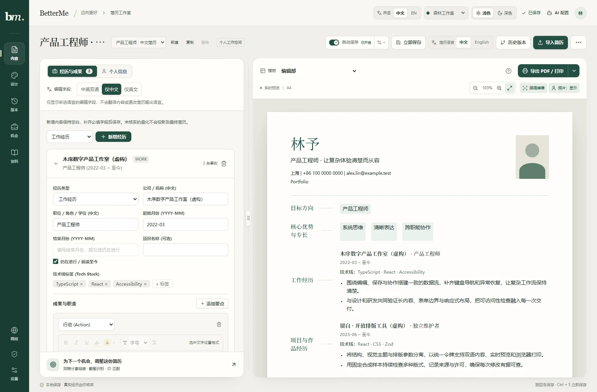

*纸张工作室：内容编辑与实际简历预览并排，支持调整分栏比例、适应宽度与跟随编辑。下文截图使用合成演示内容，不代表任何人的真实履历；截图展示当前界面，功能边界见对应说明。*

## 为什么做 BetterMe

一份真实经历，常常需要投递不同方向的岗位。BetterMe 将**事实**与**呈现方式**分开：经历内容只维护一份，每份简历独立选择模板、语言、展示条目与排版，避免为了改版式反复复制履历。

它也保留求职过程中的上下文：岗位最初写了什么、来源在哪里、当时用了哪份材料、下一步准备做什么。AI 可以协助整理和分析，最终事实与投递动作仍由使用者确认。

- **先把简历写好**：编辑、导入、检查、模板、主题、导出与恢复形成完整流程。
- **让样式自由组合**：模板管结构，简历主题管视觉，排版参数管细节，网页配色管工作环境。
- **给数据留退路**：未完成草稿、正式版本、命名检查点、单项恢复和 JSON 备份各司其职。
- **按真实流程求职**：收藏岗位、准备材料、手动投递、记录沟通与跟进，无需先接入模型。

## 先看界面

<table>
  <tr>
    <td width="50%"><br><strong>浅色工作台</strong><br>暖色画布、清晰表单与独立 A4 纸面。</td>
    <td width="50%">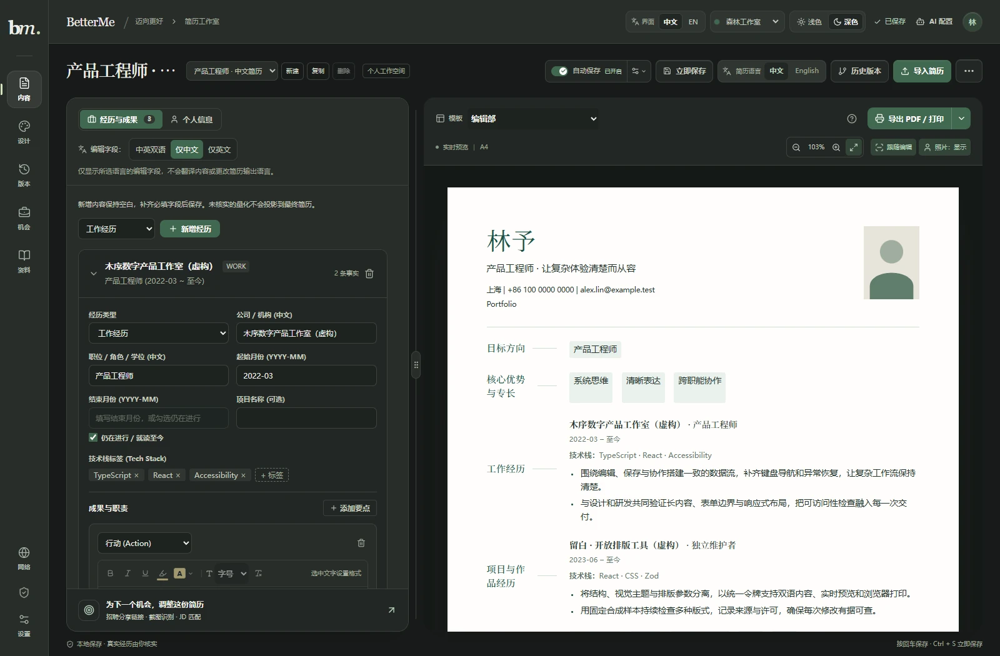<br><strong>深色工作台</strong><br>改变编辑环境，简历保持自己的纸色与字体。</td>
  </tr>
  <tr>
    <td>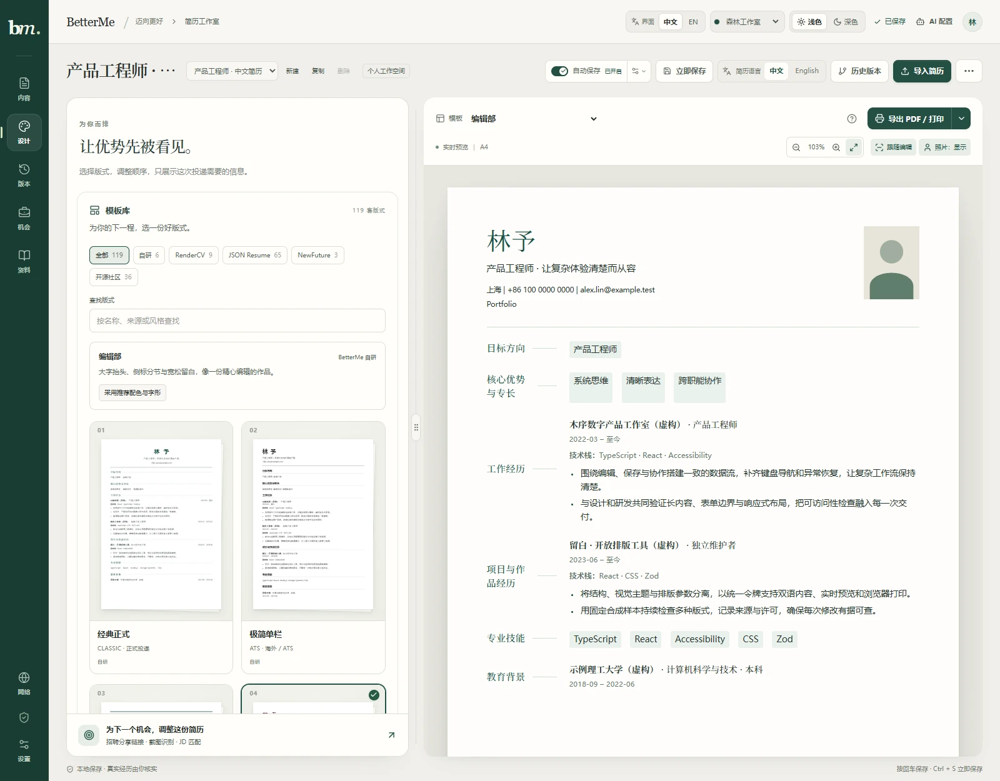<br><strong>真实模板图库</strong><br>按来源筛选、搜索与分页；缩略图复用实际纸面组件。</td>
    <td>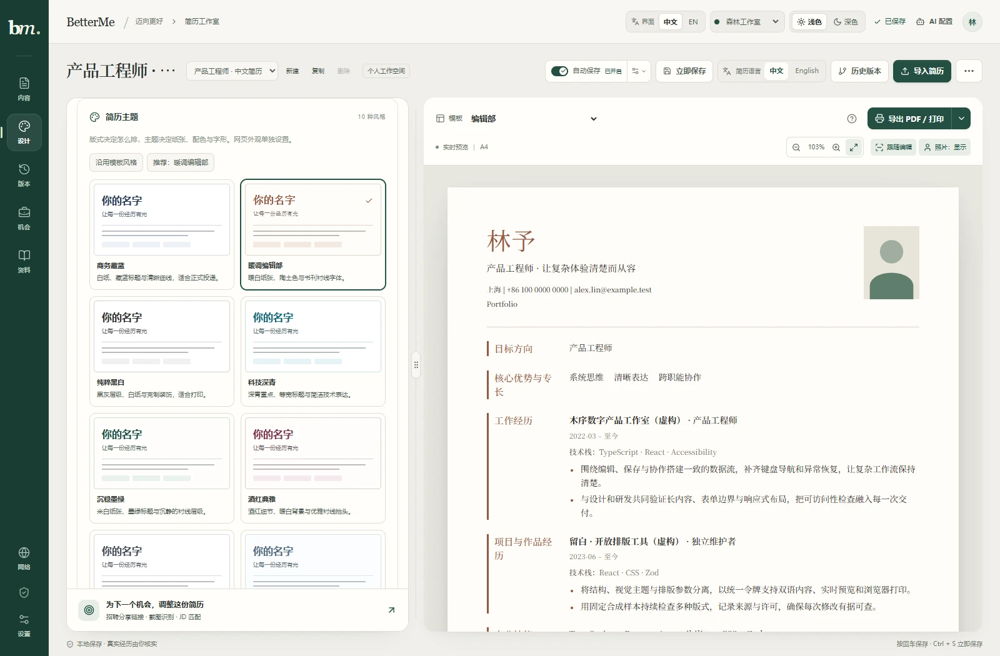<br><strong>独立简历主题</strong><br>同一个布局可以使用不同配色、字体与装饰。</td>
  </tr>
  <tr>
    <td>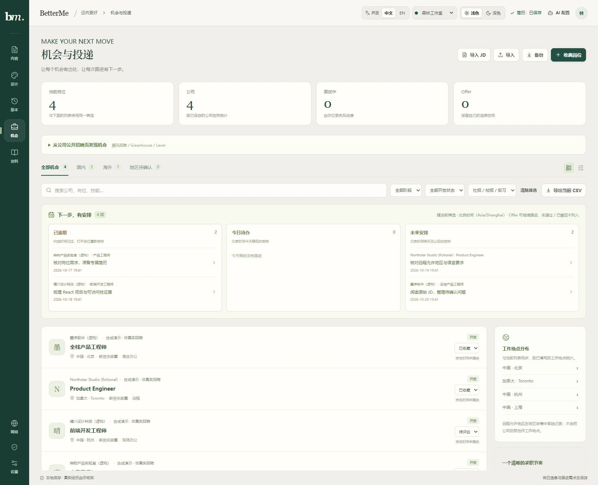<br><strong>机会与投递</strong><br>把岗位来源、申请阶段、材料与下一步联系起来。</td>
    <td>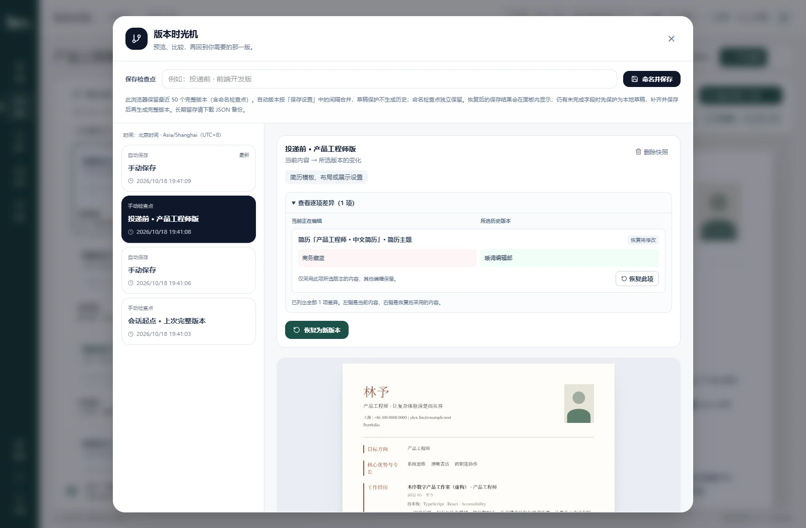<br><strong>版本与恢复</strong><br>查看完整快照与差异，恢复整版或某个差异项。</td>
  </tr>
  <tr>
    <td>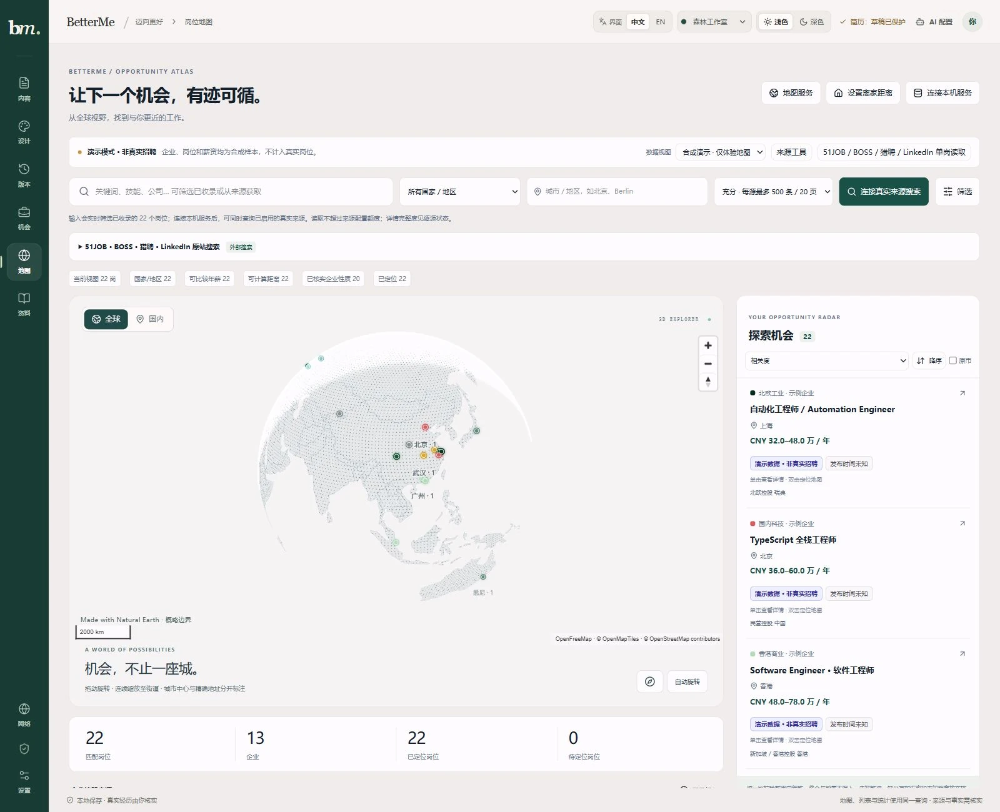<br><strong>全球岗位地图</strong><br>1600 × 1300 合成演示总览，地图、列表与统计共用查询。</td>
    <td>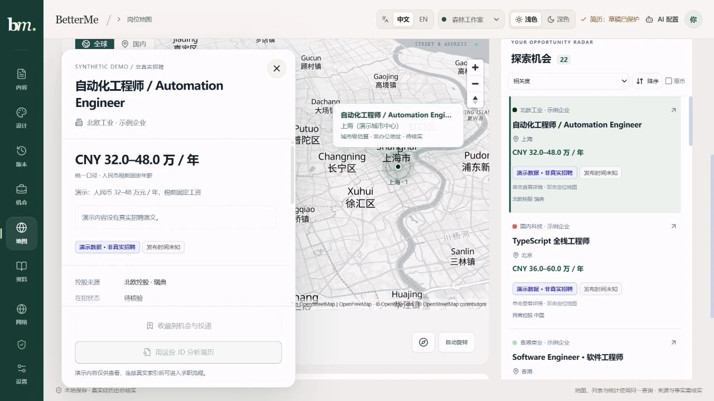<br><strong>岗位详情与地图定位</strong><br>1280 × 720 合成演示，上海已知城市中心仍标为估算，详情与地图同屏。</td>
  </tr>
</table>

## 功能一览

| 模块 | 已实现 | 使用时需要知道 |
| --- | --- | --- |
| 事实库与多份简历 | 个人资料、教育、工作、项目、技能与成果要点；新建、复制、切换及重命名简历 | 多份简历共享 Fact；更改事实会影响引用它的视图，展示取舍与样式分别保存 |
| 简历导入 | PDF、DOCX、图片、HTML、Markdown、TXT 与结构化 JSON；旧 DOC 尽力提取 | 先核对原文、警告与待补录内容；当前会重新排版，不保留任意原稿的版式 |
| 内容核对 | 数字待核实、空洞表达检查、具体字段定位与修改指引 | Schema 合法与问题提示消失都不等于事实真实；量化仍需本人核实 |
| 版式与主题 | 119 套版式、来源筛选、搜索、分页；10 套简历 JSON 主题 | 来源适配保留各自结构与特殊装饰；切换不会凭空新增履历字段 |
| 精细排版 | 字号、行距、间距、边距、分节顺序、显示开关、头像、局部文字格式与高亮 | 纸面为连续内容预览；浏览器打印决定实际跨页，不强制压成一页 |
| 双语与网页外观 | 简历中英字段、界面中英、4 套网页配色及明暗切换 | 三者独立；切换输出语言使用已有字段，不自动翻译 |
| 保存与历史 | 手动/自动保存、即时草稿、最近 50 版、命名检查点、差异与整版/单项恢复、多窗口冲突提示 | 数据在当前浏览器来源内；命名版本仍受总量限制，长期留存应另做备份 |
| 机会与投递 | 岗位列表/看板、国内/海外/待确认筛选、阶段、联系人、截止日、实际沟通、跟进与材料快照 | 记录本人实际动作；不会自动投递、发邮件或后台提醒 |
| 岗位获取 | 粘贴 JD、图片识别、四个平台官方分享链接；新增专用浏览器单页搜索工具 | LinkedIn 美国默认范围单页50卡、猎聘C#上海单页22卡已实测；卡片可预览并明确审核入统一索引，51JOB / BOSS与完整JD仍待验 |
| 岗位地图与来源 | 全球点阵地球 / 国内连续街道地图、省市区、可撤销地区确认、岗位详情 / 原文与精度定位；多来源并行同步、真实进度、GitHub 线索和企业招聘入口发现 | 同步需独立本机服务；无坐标时显式选择城市候选仅改变浏览视角，薪资、办公坐标与控股证据不补造 |
| 可选 AI | Gemini、OpenAI 兼容服务、DeepSeek、本地 Ollama；结构化导入、视觉 OCR、JD 诊断与表达建议 | 云请求直达所选服务商；建议需核对，不自动写回 Fact，分数不是录用概率 |
| 数据进出 | PDF、DOCX、Markdown、RenderCV YAML、简历 JSON；机会 JSON / CSV | 不同格式承担不同用途，详见下方导出对照 |

### 119 套版式，按来源清楚标注

| 来源 | 数量 | 集成范围 |
| --- | ---: | --- |
| BetterMe 自研 | 6 | 经典、现代、侧栏、编辑部等原生布局 |
| RenderCV | 9 | 固定 2.8 源码的全部内置主题 |
| JSON Resume | 65 | 官网固定目录快照，含 Team 48 套与其他作者 17 套 |
| NewFuture/CV | 3 | 基础、flex、block 三种打印布局 |
| 开源社区 | 36 | 经逐项源码与许可核对的来源适配 |
| **合计** | **119** | **6 套自研 + 113 套第三方来源适配** |

这些布局通过统一 React 组件和按模板 ID 隔离的 CSS 呈现，消费同一份结构化简历投影。图库中的纸张是真实组件渲染，不是静态风格图；每页最多展示 12 张。

集成采用固定源码/目录快照，不代表上游生态中的全部主题。适配不运行上游 Python、Typst、TeX、Jekyll 或第三方主题引擎，也不承诺与上游逐像素相同。完整 ID、说明、来源、推荐参数与许可见 [模板目录](templates/CATALOG.md)、[模板维护说明](templates/README.md) 和 [集成报告](docs/reports/open-source-template-integration-2026-10-18.md)。

### 模板、简历主题、排版与网页主题分别控制

| 设置 | 决定什么 | 示例 |
| --- | --- | --- |
| Template · 模板 | 内容结构与位置 | 单栏、侧栏、日期轨、编辑部布局 |
| Resume Theme · 简历主题 | 纸色、正文/强调色、字体角色与装饰默认值 | 商务藏蓝、暖调编辑部、沉稳墨绿 |
| Layout · 排版参数 | 当前简历的字号、行距、间距与边距等 | 正文 10.5 pt、页边距 16 mm |
| Workspace Theme · 网页主题 | 编辑工作台的画布、表单、按钮与明暗 | 森林工作室、藏蓝书房、梅紫画室、石墨工坊 |

10 套简历主题包括：**商务藏蓝、暖调编辑部、纯粹黑白、科技深青、沉稳墨绿、酒红典雅、石墨灰、北欧浅灰、岩青蓝、暖砂岩**。主题以版本化 JSON 管理，经严格 Schema 校验后转换为 CSS 变量；无需为每个模板复制一套主题 CSS。

用户已经手动设置的颜色与字体优先保留。选择主题后仍显示旧颜色时，可以显式点击“采用主题原始配色与字形”；字号、边距、内容与显示开关继续保留。6 套自研模板完整支持公共装饰，113 套来源适配统一颜色/字体并保留其特殊装饰。

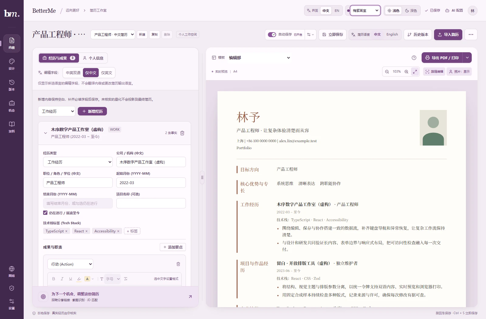

*图为“梅紫画室”，顶部可选择工作台配色。网页配色与明暗是本浏览器的偏好，不写入简历事实、文档备份或纸面主题；深色工作台也能编辑一份暖白纸张的简历。*

### 导入时能看见依据

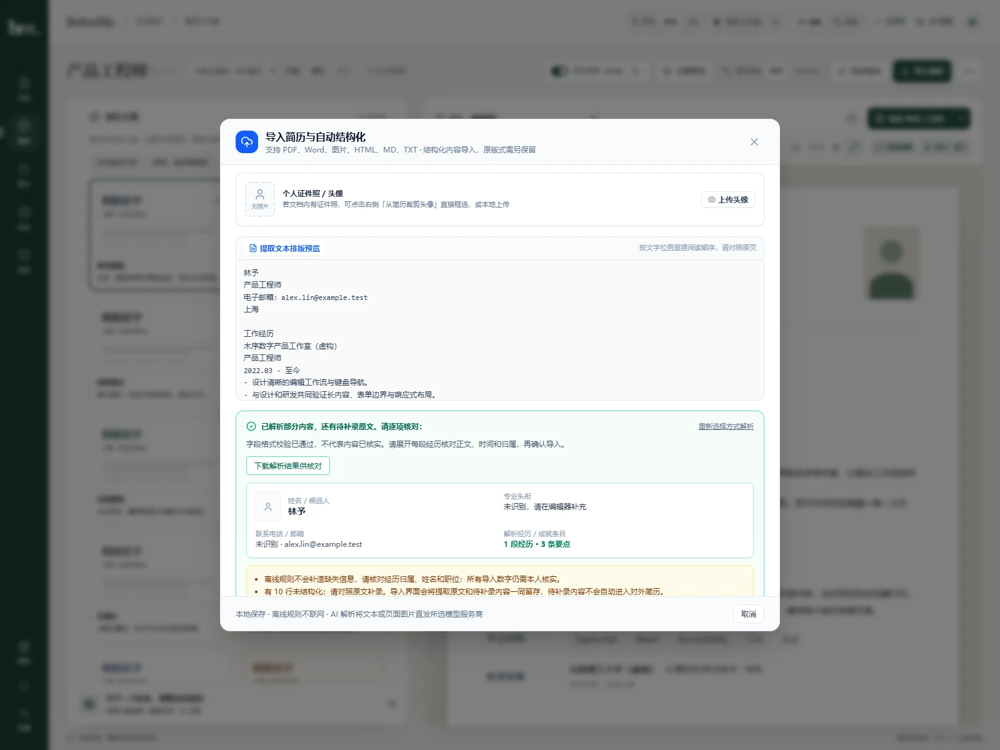

*图中是合成 TXT 样例的实际离线解析结果，保留了待补录警示；解析出部分段落不代表完整导入。*

导入先提取文本，再选择离线规则或 AI 结构化；图片与扫描 PDF 可使用支持视觉输入的模型。手机截图可先裁剪识别区域，避免把状态栏、登录横幅等带入解析。

确认前核对提取文字、模型 OCR 转录、警告与未解析项；确认后，来源文本及待补录内容可在“导入原文与待补录”查看和下载，并随文档 JSON 备份留存。这些材料不进入正式简历。原 PDF、Word 与图片需要自行保存，OCR 转录不能代替原件。

新解析的结构化量化默认未核实，核对数字、单位和上下文后才能确认。AI 解析失败会显示错误，不静默改成另一种结果；缺失职位、日期与业绩不会用默认值补造。当前不支持对任意原稿进行保留坐标、字体和字号的局部编辑。

### 导出选择

| 格式 | 适合用途 | 保留范围与限制 |
| --- | --- | --- |
| PDF / 浏览器打印 | 正式投递、视觉版式 | 当前模板、简历主题和排版；检查 A4、边距、分页与背景图形，关闭不需要的浏览器页眉页脚 |
| DOCX | 继续用 Word 编辑 | 当前语言、展示取舍、顺序、基本格式及可映射的主题字体/颜色/装饰；A4 可编辑单栏，不含照片，不复刻网页分栏 |
| Markdown | 内容审阅、笔记、其他工具 | 当前可见内容、结构及支持的强调/高亮，不复现纸面配色与布局 |
| RenderCV YAML | 自行使用 RenderCV 渲染 | 映射可见内容；9 套 RenderCV 模板对应原生主题，其余回落 classic 并提示；不复现网页主题 |
| 简历 JSON | 完整文档备份与迁移 | Fact、全部简历视图、主题选择/覆盖与已留存的导入核对文本；不含 Key、界面偏好或完整历史链 |
| 机会 JSON / CSV | 求职记录备份、表格分析 | JSON 保留机会、跟进、阶段及材料正文；CSV 仅导出当前筛选结果，不能代替完整备份 |

DOCX 已有 OOXML 结构与正文回读验证，尚未完成所有中文字体和长文逐页视觉验收；RenderCV 引擎不随网页安装或运行。模板名称中的 ATS 只表示简洁排版方向，不构成招聘系统解析或筛选认证。

### 国内 / 全球岗位地图与来源工具

岗位地图连接当前浏览器机会库或独立本机 SQLite 索引，列表、统计和地图使用同一查询。全球点阵地球与国内地图可连续缩放至开放街道底图；国内提供省 → 市 → 区县选择，采用注明时点的 2023 统计区划目录。没有可靠坐标的岗位保持待定位，不因放大地图就变成精确办公地址。

**单击岗位卡片看详情，双击定位地图。** 独立侧栏提供醒目的“打开岗位原文”、每个来源的彩色标签与发布时间、薪资原文、工作地点和职责要求；摘录与完整性未核实的正文会明确提示。已有坐标按实际精度定位并高亮，城市参考点不会放大成办公楼地址，减少动态效果偏好也会生效。

只有地点原文时，连接本机服务查询离线城市候选，由本人明确选择后临时定位；候选继续标为“城市估算 · 非办公地址”，不写回岗位地址、核实状态、距离或已定位统计。换岗与关闭详情会中止旧查询并抑制迟到结果。Google 地图提供原文 / 坐标查询外链，当前未接内嵌地图或通勤服务。

**地点原文可核对后保存行政范围。** 在已连接本机索引的岗位详情中选择“核对并保存地区”，按国家 / 省 / 市 / 区县预览并确认。选择会持久保存、支持撤销并保留来源原文；它用于地区筛选，不产生办公坐标或离家距离。切换地区使岗位退出当前筛选时，旧详情会一同关闭。

获取岗位有三条明确入口：**官网来源预览 / 手动同步**读取已登记公司，**四平台单页工具**通过本机专用浏览器读取当前页卡片，**企业招聘入口发现**先匹配已有来源，可用宿主显式配置的网页搜索发现新入口，或按允许范围读取明确官网，返回证据和待审配置。它们共用岗位与来源契约，避免把公司目录、搜索外链和单岗摘要直接当作完整岗位索引。

**扩展来源不必手写代码。** 打开“来源工具 → 扩展可搜索来源”，选择公开多公司来源或企业官网，点击“添加并启用”；再从主搜索明确获取岗位。内置目录现含 Arbeitnow、Remote OK、Hudl、LaunchDarkly、Sentry 和 Temporal 六个可选配置；已有配置不会被覆盖，也不会打开面板就自动采集。目录以 [JSON](config/sources/catalog.json) 管理，记录字段映射、额度、刷新间隔、原文回链及有限覆盖。技术标签仅说明曾观察到相应关键词，具体要求仍需核对。

“从来源获取岗位”默认并行读取已启用的可用来源，也可指定单源；逐源显示实际回执、条数、页数、新增 / 更新、部分覆盖与错误，先返回的来源先刷新列表。可以取消尚在等待的请求，已提交的岗位保留；已用时间来自实际计时，不虚构预计完成时间。充分读取每源最多 **500 条 / 20 页**，快速读取最多 50 条 / 2 页，仍受各来源更小的配置限额、速率和请求预算限制，不代表全站覆盖。

四平台支持空关键词按地区浏览，直辖市请求使用真实城市名称；搜索面板已接可恢复启动、原请求重试、精确取消和登录 / 验证接续状态，更新后的独立本机宿主已可运行。**LinkedIn 已真实读取并展示当前页 50 张卡片**：关键词 `C#`、未指定地区时原站默认美国，达到 50 条预算后以 `partial` 返回；猎聘新版卡片也已用 `C# / 上海` 真实读取到 22 张带标题、公司和地区的当前页卡片，本轮已准确读出并审核保存一张岗位的 `15-30k` 薪资原文，统一年薪口径仍待核实，招聘者在线时间不作为发布日期；51JOB 本次安全可见投影仍为空，BOSS 尚未完成真实列表验收。这一结果不证明全球覆盖、其他地区或完整 JD 已通过。卡片可预填机会库，也可点击“核对并加入统一索引”，预览变化、勾选确认后作为待核实摘要写入同一搜索索引；已有完整 JD 保留。缺少坐标仍显示待定位，地点原文不自动补成国家 / 行政区事实，不自动遍历全站。操作见 [岗位地图与来源工具](docs/job-atlas.md)，本轮机制与验收见 [聚合搜索和定位交互报告](docs/reports/job-atlas-aggregation-interaction-2026-10-19.md)，历史搜索阶段见 [四平台搜索记录](docs/reports/job-atlas-platform-search-2026-10-18.md)。

**跨来源岗位可以明确核对后归并。** 连接本机索引后打开“重复岗位核对”，读取有限候选，比较双方彩色来源标签、原文和字段差异，明确保留哪条摘要，再确认合并或暂不合并。撤销前先展示实际受影响岗位组；超时沿原请求核对持久回执，来源证据保留。它只整理已收录岗位，不扩大搜索覆盖；本机实读5对均为弱线索，未自动合并。详见[归并核对报告](docs/reports/job-atlas-reconciliation-2026-10-19.md)。

## 快速开始

需要 **Node.js `^24.15.0` 或 `>=26`**，使用仓库指定的 **pnpm 11.9.0**。CI 与 Docker 使用 Node.js 24.15.0；新增岗位服务依赖内置 SQLite，Node 22 不在完整仓库支持范围内。

```bash
git clone https://github.com/nanfengovo/better-me.git
cd better-me

# 已安装 pnpm 时可直接进行下一步
npm install --global pnpm@11.9.0

pnpm install --frozen-lockfile
pnpm dev
```

打开终端中 Vite 提示的地址，默认是 `http://localhost:5173`。首次使用内置演示数据；也可参考 [examples/](examples/README.md) 中的虚构样例。

生产构建与本机预览：

```bash
pnpm build
pnpm --filter @better-me/web preview
```

`preview` 只用于本机检查生产静态构建，**不提供岗位浏览器 API**；单岗读取、四平台搜索等接口由本地 **Vite 开发宿主**提供，需使用上方 `dev` 命令，独立索引另需下方岗位服务。新增服务端代码后应确认运行的是更新后的开发进程；仅刷新旧页面不能使旧服务获得新 API。公共发布方式见 [部署文档](docs/deployment.md)。

### Docker 部署

安装 Docker Engine 和 Compose v2+；Windows / macOS 可使用 Docker Desktop，Windows 需切换到 **Linux containers**。宿主机无需安装 Node 或 pnpm，首次构建需要联网下载官方基础镜像与锁定依赖。

```bash
git clone https://github.com/nanfengovo/better-me.git
cd better-me
docker compose up -d --build
```

启动后打开 **[http://localhost:8080](http://localhost:8080)**。查看状态、日志与停止：

```bash
docker compose ps
docker compose logs --tail=100 web
docker compose down
```

更新到仓库最新版：

```bash
git pull --ff-only
docker compose up -d --build
```

默认只监听本机 `127.0.0.1:8080`。端口占用时可在 PowerShell 执行 `$env:BETTER_ME_PORT = '8081'`，或在 Bash 使用 `BETTER_ME_PORT=8081 docker compose up -d --build`，随后访问相应端口。更换端口会改变浏览器数据来源，迁移前请导出备份。

镜像通过多阶段构建生成生产静态文件，由非 root Nginx 在容器内的 `8080` 端口提供服务；Compose 使用只读文件系统与临时 `/tmp`。`/healthz` 可用于健康检查，`/legal/` 提供模板许可证、署名、适配源码及运行依赖的完整许可文本。源码构建方式不需要镜像仓库账号；目前未发布 Docker Hub / GHCR 预构建镜像。

**Docker 版与 Pages 版提供相同的浏览器工作台能力**：简历编辑、模板/主题、导入导出、本地保存及手动机会管理。岗位抓取、公司源、网络探测和 Windows 专用招聘浏览器仍需本地 Node 服务，容器中的 `/api/*` 明确返回 `501` JSON。简历和 Key 存在访问者浏览器中，不在容器卷里；重建容器不会替你同步或备份这些资料。完整单容器命令、反向代理、验证和更新说明见 [部署文档](docs/deployment.md#docker-自托管)。

### 从第一份简历开始

1. **导入或填写**：先用示例熟悉操作；导入自己的材料时核对原文与待补录项，确认前先备份原有内容。
2. **核实内容**：补齐经历、确认量化依据；点击内容问题可定位字段，修改相关文字后重新核对。
3. **做展示取舍**：选择语言、顺序、经历与要点；多份简历共享事实，各自选择展示重点。
4. **选择视觉**：先选模板，再选简历主题，最后调字号与边距；推荐配色需要显式应用。
5. **保存并投递**：手动保存或按设置自动保存，重要节点建立命名检查点；导出前检查分页与联系方式。
6. **留存过程**：在机会区收藏岗位、创建岗位简历、记录材料快照与实际投递；保存下一步跟进。
7. **定期备份**：分别下载简历 JSON 与机会 JSON，把真实备份放在仓库外的私人位置。

常用快捷键：`Ctrl/Cmd + S` 保存，`Ctrl/Cmd + Shift + S` 打开历史；选中文字后可用 `Ctrl/Cmd + B / I / U` 设置格式。预览可适应宽度或手动缩放，分栏可拖动，聚焦分隔线后也可用键盘调整。

<details>
<summary><strong>岗位读取、本地代理与跟进的详细边界</strong></summary>

### 岗位地图、真实来源与时间标签

左侧 **岗位地图** 打开国内／全球连续三维地图。页面默认读取当前浏览器机会库的公开岗位字段；也可连接本机岗位索引，使用 **来源工具** 管理官网 ATS 与 GitHub 数据源。合成地图样本需要显式选择“合成演示”，不会与真实数据混计。详细操作见 [岗位地图与来源工具](docs/job-atlas.md)。

输入关键词会实时筛选已收录岗位，点击 **从来源获取岗位** 才实际请求已启用来源并更新索引；默认有限并行，快源先显示，逐源进度与失败独立保留。腾讯官网支持远程关键词；公司 ATS 按 board 列举后本地匹配。充分读取最多 500 条 / 20 页，快速读取最多 50 条 / 2 页，均受来源配置的更小额度约束。取消保留已提交岗位，回执未知需重新读取索引核对。技术关键词 `C#` / `C++` / `.NET` 保留完整含义，多词输入与共享查询使用一致匹配口径；要求尚未读取的摘录不冒充确定命中。国内视图默认排除国家 / 地区未知项；明确选择国家或省市区后，未知地点不能满足该范围。

- **四平台搜索与单岗**：51JOB、BOSS 直聘、猎聘和 LinkedIn 有可恢复的单页搜索面板，支持手动再次读取、最多 50 卡，以及门禁／未知布局区分。最新有限实读为猎聘 `C#`／上海当前页 24 卡、LinkedIn／上海当前页 50 卡；逐项核对后分别保留 19 条和 6 条卡片摘要到统一索引，保留原平台、原文链接、地点与发布时间原文。卡片摘要不代表完整 JD 或在招已核实；LinkedIn 完整正文仍可能需要登录。51JOB 的安全投影仍未取得可靠卡片，BOSS 稳定搜索读取尚未完成，不能把未读成功解释为没有岗位。既有单岗读取继续用于核对正文；搜索卡片必须经过明确预览和确认才加入索引，不自动生成地图坐标。
- **国内省市区**：省 → 市 → 区县逐级选择，上级变化清除失效下级；四个直辖市的统计分组不会作为“市辖区”发给平台。目录与平台地区映射独立，未知地区不静默回退；香港按实际 `HK` 映射处理。
- **通用来源工具**：按适配器＋JSON 配置接入 Greenhouse、Lever、Ashby、腾讯及受限 JSON/GitHub JSON；按岗位关键词、地区、公司与明确国家有限预览／手动刷新。GitHub 通用发现、结构抽样与禁用提案供审阅，不把仓库、活动或公司目录直接计作岗位。
- **企业官网发现**：来源工具内输入企业名，先匹配已登记公司来源；新企业可补明确官网，在已审核端点策略内查找招聘入口并生成禁用提案。宿主可显式启用 SearXNG 或实验 DuckDuckGo HTML 搜索，默认关闭；仅企业名不需发现策略，结果仍是待核实线索。配置不代表网络可用，本轮真实 DDG 请求遇验证并正确停止，尚无可用自管实例的实时闭环；选择已有来源或检查提案都不自动同步岗位。配置与证据见[通用搜索报告](docs/reports/job-atlas-career-web-search-2026-10-19.md)。
- **逐来源标签**：每个岗位的每个 listing 分别显示来源色与发布时间色，详情可回原链接；相同岗位的多个来源不会互借发布时间。映射与调色板集中在 [presentation.json](apps/web/src/components/atlas/presentation.json)。
- **发布时间**：不足一个日历月显示小时／天，满一个日历月显示 `YYYY-MM-DD`（默认北京时间，月底钳位）；仅日期保留该精度，相对原文照录，缺失显示未知，未来或冲突标待核对。抓取、仓库更新、记录更新与岗位发布分别保留。
- **详情与地图精度**：单击打开独立详情与原文入口，双击按位置精度飞入并高亮。全球点阵地球、国内省域视图均可缩放到开放街道底图；是否显示建筑／门牌取决于底图。无坐标岗位仍可搜索、计数、看原文；本机城市候选需明确选择，只改变当前浏览视角，不写成已核实办公地址或已定位统计。可撤销行政范围确认与跨来源归并核对已接入；办公坐标仍需独立证据。

地图与列表使用同一模糊搜索／筛选／排序规则，可按人民币税前年薪、原币、企业控股来源、地区及直线离家距离查看。未知薪资、有效汇率或坐标会明确保留；家庭参照点只在当前页面内存中。Google 当前提供官方 Maps 外链，内嵌 SDK／Key 与计费尚未配置。

本机独立服务启动、Origin 与令牌说明见 [job-service](apps/job-service/README.md)，配置样例见 [sources](config/sources/examples.json)。 **刷新后仍看到旧机会库时，先在“连接本机服务”完成一次连接，并确认数据视图为“本机采集索引”。** 连接成功后，本标签页会暂存该 loopback 地址与令牌，刷新自动恢复；恢复连接失败会显示错误，不静默退回当前机会库。可使用“断开并清除会话连接”清除，切换机会库或演示也会移除暂存凭据。旧页面没有保存过连接记录，升级后仍需首次连接；浏览器阻止会话存储时会提示重新连接。有限索引数量和真实交互条件记录在 [本轮聚合与定位报告](docs/reports/job-atlas-aggregation-interaction-2026-10-19.md)；它们不是公开内置数据、全站覆盖或独立在招核验。早期官网联调的原始条件与缺少坐标／薪资的范围保留在 [有限真实来源报告](docs/reports/job-atlas-real-local-index-2026-10-18.md)，不把历史数字改写成当前快照。

Pages 和 Docker 版提供静态网页；认证索引由独立本机服务运行，四平台浏览器读取由本机 Vite 开发宿主提供，独立索引服务尚未提供其 browser companion。本轮临时 `5287` 开发宿主完成有限验收后已关闭；原 `5286` 的 preview 不提供搜索 API，已在同一 Origin 和端口更换为持续运行的新版 dev，浏览器数据来源不变。LinkedIn 美国／上海与猎聘上海的当前页读取已有限验收，并有卡片显式审核进入统一索引；51JOB／BOSS、更多范围和完整 JD 继续分别验证。发布不会把个人岗位库上传 GitHub，静态网页也不能单独启动招聘 Edge。

### 岗位来源

可粘贴 LinkedIn、猎聘、51JOB、BOSS 直聘的官方岗位链接或完整分享消息。静态提取与动态浏览器读取均先进入核对区，确认后采用，保留来源链接和采集时间。登录、验证码、动态页面和 App 专属正文可能导致读取失败。

动态读取在**本地服务所在电脑**打开专用 Microsoft Edge，各平台使用独立持久目录，不接管日常浏览器资料。遇到登录或访问验证由本人完成，再接续原岗位，不自动完成验证码。岗位 Tab 默认 10 分钟到期，可显式再保留 10 分钟；关闭本次岗位页只释放该 Tab，“关闭招聘浏览器”才关闭全部专用窗口。磁盘登录保留不保证网站始终免验证。

公司源支持 Greenhouse/Lever 的指定 board 及腾讯招聘官网关键词预览，勾选后才收藏。ATS 每次最多 300 条；腾讯只读第一页最多 100 条，职责可能只是摘录，截断明确提示。未披露字段保持未知，一次读取失败不代表岗位关闭。

截图识别支持最多 6 张 PNG/JPEG/WebP，每张不超过 10 MB、合计不超过 24 MB。点击识别才发送到配置的图片模型，不是内置离线 OCR。模糊文字、薪资与要求需要核对，原始图片不随刷新恢复。

### 网络与本地服务

“网络与代理”只控制 Node 本地服务的岗位与公司源请求，支持自动检测、直连和手动 HTTP/HTTPS 代理，以及国内三平台独立路线。AI、截图识别、模型列表和外部网页仍走浏览器与系统网络。端口有监听或网站返回响应，都不能证明正文可提取。

Windows 国内独立通路的可选辅助脚本见 [操作说明](scripts/README-domestic-route.md)。它不随静态托管运行，也不改变模型服务的访问路线。

### 个人求职记录

“已投递”表示本人确认已在原站提交；打开链接、生成材料或分析 JD 不会自动登记。沟通日志只记录已发生的行为，不发送消息。时间按北京时间输入与展示，队列不是后台提醒服务。

材料快照保存当时简历的 Markdown、名称与时间，后续修改不会改写旧快照；它不是 PDF/Word 附件库，也不证明材料已发出。JSON 是完整机会备份，CSV 用于查看筛选结果。单岗成功不代表全站与长期覆盖。

</details>

## 部署与自动更新

已使用 **GitHub Pages + GitHub Actions** 部署：[打开在线工作台](https://nanfengovo.github.io/better-me/)。代码和发布流程在同一仓库管理，不需要额外托管账号或部署密钥。

```text
本地修改 → git commit / git push → GitHub Actions 检查 → 构建产物 → GitHub Pages
```

远端 CI/CD 由推送触发，仅在本地保存文件不会发布。主分支检查通过后更新静态网页；具体工作流、仓库 Pages 启用步骤、首次部署与排错见 **[免费部署与 CI/CD](docs/deployment.md)**。

工作流还会实际构建并运行 Docker 镜像，检查健康状态、非 root / 只读运行、JS/CSS/PDF worker、缓存、SPA 刷新、缺失资源、静态版接口及模板授权副本。三个验证任务全部成功才部署 Pages。自托管 Docker 使用上方更新命令；当前工作流不连接你的服务器，也不推送镜像仓库。

2026-10-18 的 [Docker 交付运行](https://github.com/nanfengovo/better-me/actions/runs/39126393123)四个任务均成功；本机镜像约 28.5 MiB，208 次 HTTP 检查及 Compose 实际启动通过，详见 [Docker 验收记录](docs/reports/docker-release-2026-10-18.md)。

2026-10-18 [首次真实发布](https://github.com/nanfengovo/better-me/actions/runs/39124587077)的三个任务均成功，Windows runner 全量 **1251/1251**。公网 HTTPS 已验证加载、模板/简历主题与工作台外观独立、保存刷新、JSON 下载及合成 PDF 的实际文字提取；范围与限制见 [上线验收记录](docs/reports/github-pages-release-2026-10-18.md)。

| 能力 | GitHub Pages / Docker 静态版 | 本地 Vite 开发宿主与独立岗位服务 |
| --- | --- | --- |
| 编辑、模板、主题、预览、浏览器本地保存 | 支持 | 支持 |
| 浏览器生成 PDF、DOCX、Markdown、JSON 等 | 支持 | 支持 |
| 手动管理机会、材料与投递记录 | 支持 | 支持 |
| 用户配置的云模型调用 | 取决于服务商 CORS、网络与浏览器策略 | 同样依赖服务商与网络 |
| 官网来源 / 企业入口发现 / 认证岗位索引 | 可显式连接独立本机服务，受 Origin 与浏览器本地网络策略限制 | 独立 `job-service` 提供，需要另行启动与连接 |
| 单岗提取 / 四平台单页搜索 / 网络检测 | 静态版不含相应后端；Docker 的同源 `/api/*` 返回 501 | Vite 开发宿主提供，preview 不提供；LinkedIn 与猎聘有限单页已验；51JOB／BOSS、更多地区与完整 JD 待验收 |
| 本机专用招聘 Edge 与人工验证接续 | 不能由静态页面独立提供，独立岗位服务的 browser companion 尚待接入 | 在成功运行本机浏览器宿主的电脑使用 |

免费托管提供应用发布与更新，不自动提供数据库、跨设备同步、模型额度或常驻浏览器。需要完整本机岗位读取时继续使用本地版；独立后端的身份校验、环境与访问边界另行设计。Cloudflare Pages、Vercel 可作替代，方案对照见部署文档。

## 数据在哪里，AI 会看到什么

- **文档、草稿、机会与配置**：保存在当前浏览器来源的 `localStorage`；简历历史保存在 IndexedDB。没有项目自建云账号。
- **来源隔离**：本地、线上、不同端口、浏览器和设备的数据彼此独立。发布不会上传本地资料；迁移请分别导出/恢复简历与机会备份。
- **草稿与正式版本**：编辑时尝试保护草稿，未补全字段也可保留；完整文档通过校验并满足保存条件，才成为正式版本。关闭自动保存不关闭草稿保护。
- **版本留存**：最近 50 版包含命名检查点；JSON 备份不包含整条历史链。恢复先保护当前内容，多窗口冲突会暂停自动覆盖。
- **云模型请求**：所需简历文字、JD 或图片直接发送给所选模型提供商，Key 用于鉴权。离线解析无需模型，本地保存不等于云推理全程离线。
- **Key 与环境**：AI 在界面配置，当前不读取 `.env` 的 `BETTER_ME_LLM_*`；不要把 Key 写进源码、示例或前端构建变量。
- **备份与 Git**：真实履历、联系方式、凭据、浏览器 profile 与私人备份不进 Git。忽略规则不保护强制添加或任意重命名的文件，提交前仍须检查。

存储不足、读取失败与历史写入失败会分别提示。清理站点数据、换地址或设备前，先下载有效备份；不要把浏览器存储当成唯一长期副本。

## 架构与开发

技术栈为 **React 19 + Vite + TypeScript + Tailwind CSS 4**，采用 pnpm workspace 与 Turborepo，核心规则和存储独立于网页组件。

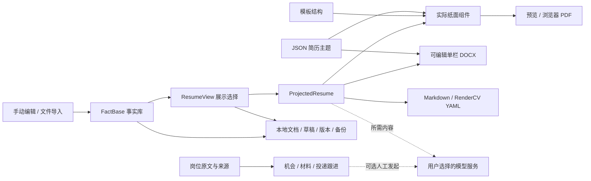

```text
apps/web/
  src/components/      # 编辑器、图库、主题、预览、机会与版本界面
  src/themes/          # 工作台配色与明暗令牌
  server/              # 本地岗位读取、公司源与网络服务
packages/core/
  src/schema/          # Fact / ResumeView / 主题数据契约
  src/themes/          # 10 套 JSON 简历主题与解析器
  src/project/         # 事实投影、展示规则与结构化出口
packages/storage/      # 本地文档、草稿、版本、差异、恢复与备份
packages/opportunities/ # 共享岗位证据域、薪资/距离/配色、查询工具与兼容迁移
packages/source-adapters/ # 受控来源适配、发现候选、平台搜索参数与纯浏览器契约
apps/job-service/       # 独立认证 loopback API、SQLite 索引、来源配置与手动同步
templates/             # 来源目录、固定版本、LICENSE 与 NOTICE
examples/              # 虚构 / 泛化样例
docs/                  # 部署、路线图、来源研究与验收报告
.agent-memory/         # 开发侧续聊记忆，非产品运行时数据库
```

### 开发检查

```bash
pnpm test
pnpm lint
pnpm typecheck
pnpm build
pnpm memory:check
```

最近一次功能分批发布记录（2026-10-18）：**1251/1251 测试通过、Lint 通过、Typecheck 5/5、Build 3/3**。这是对应提交时的结果，最新状态应查看仓库工作流与后续记录。`memory:check` 只检查约定文件存在，不验证业务。

此前交互批次（2026-10-19）的本机检查为 **1778/1778 测试、Lint、Typecheck 10/10、Build 6/6 通过**，另完成 Pages 子路径构建和 Docker 隔离运行 **269 次 HTTP** 检查，覆盖地图资产 / worker、静态资源、许可分发与接口边界。有限真实索引的详情 / 城市候选定位与公开合成截图分别记录；LinkedIn 美国默认范围当前页 50 卡已真实展示，当时其余三站、更多地区及完整 JD 接续仍待验收。对应远端 [Actions 39149227608](https://github.com/nanfengovo/better-me/actions/runs/39149227608) 的 Windows 质量、Linux 构建、Docker 与 Pages 部署四项均已成功；公网新版已加载并完成合成岗位双击详情 / 上海定位核对。详见 [聚合搜索与定位交互报告](docs/reports/job-atlas-aggregation-interaction-2026-10-19.md)，历史 1692 项及局部测试不与本次总数相加。

此前首批针对“C# 只有腾讯一条”的修复与实际范围见 [来源扩展和召回报告](docs/reports/job-atlas-candidate-recall-2026-10-19.md)：当时本机配置可搜索来源从 3 个扩为 9 个，新增 12 岗，C# 索引筛选为 13 岗／8 家企业；最新收录与查询数字见下文国内来源记录。该批只验证有限公开来源，部分来源受刷新间隔、超时或中断限制，不代表全市场覆盖。

2026-10-19 官网协议扩展：新增通用 **SmartRecruiters** 适配与企业入口发现，版本化来源目录可明确添加 Bosch 中国官网。真实 UI `.NET` 查询读取 4 条候选、有限详情 2 条、本地匹配并新增 1 岗，索引为 **51 岗 / revision 29、10 个可抓取来源**；“国内 → 江苏 → 苏州”、来源标签、具体发布日期、详情及原文跳转已核对。最终全球 `C#` 仍为 **14 个文本命中 / 9 家企业**，本批 `.NET` 新岗不算作 C# 增量。列表缺原链时只从同 ID 详情取得来源真实链接，未取得链接的候选不入库；英文地点使用有限可配置别名，不填办公室坐标。完整范围和验证见 [官网来源接入报告](docs/reports/job-atlas-smartrecruiters-2026-10-19.md)。

随后在原工作台以全球 `C#` 明确刷新10个配置来源，9个返回回执、原始返回705条，实际新增10岗（Arbeitnow 3、Temporal官网7），最终为 **61岗 / revision33、C# 24个文本命中 / 13家企业**。另400条候选要求尚未读全，Bosch受3600秒刷新间隔拒绝、腾讯详情超时，仍保留部分覆盖。Temporal新增样本原文和回链已实际核对，C#是多种可选语言之一，不把24条当专职C#或个人适岗。原页披露的薪资与地点尚未完整映射到索引，当前仍有字段缺口。

2026-10-19 国内来源继续补实：原本机索引现85岗／revision59，严格国内C#实际查询26条／22家企业（腾讯官网1、猎聘19、LinkedIn6），全球C#文本命中48条／33家企业；上海25、浦东7、松江3均经共享HTTP查询核对。猎聘当前页24卡选19条，新增18；LinkedIn上海当前页50卡选6条近月标题C#岗位，新增6，原卡地区逐项确认且无办公坐标。通用`jobs.read-detail`已补同版本locations／compensations，独立135/135、types10/10和lint通过，功能`3a56bc6`[远端四任务](https://github.com/nanfengovo/better-me/actions/runs/39174077550)全success。有限卡片摘要与文本命中不等于全部完整JD、在招或个人适岗，51JOB／BOSS继续；详见[国内来源与详情工具报告](docs/reports/job-atlas-domestic-source-expansion-2026-10-19.md)。本文13／14／24条和61岗等记录均为此前批次历史时点。

2026-10-19 字段准确度修复：通用Ashby适配器保留远程岗位的明确国家／主次地点，以及工资、佣金、奖金、股权分项和档位；不从货币或公司猜国家，不把远程范围画成办公室，不推断税前或合并总包。独立真实服务读取Temporal70条、C#匹配7条，浏览器美国＋Chicago与印度筛选、全部分项及原链已核；该隔离验证当时未更新原61岗索引，不将隔离样本当新增。隔离1975/1975、types10/10、lint、build6/6通过，功能`8c8d347`的[远端四任务](https://github.com/nanfengovo/better-me/actions/runs/39165884279)均success；该批当时的服务更新受阻，后续同一服务已恢复；当前85岗范围见国内来源记录，旧Temporal字段须按既有刷新策略重新读取才会补齐。详见[Ashby字段报告](docs/reports/job-atlas-ashby-fields-2026-10-19.md)。

来源扩展发布已核对：旧 Windows TTL 测试抖动修复后，`1da8bcb` 与最终文档批 `ad504ff` 的质量、Linux 构建、Docker 和 Pages 均已成功；最终运行见 [Actions 39154486097](https://github.com/nanfengovo/better-me/actions/runs/39154486097)。后续卡片审核入库批次的发布状态单独记录。

该来源扩展批次的独立冻结产品树通过 **1843/1843 测试、Typecheck 10/10、Build 6/6、Lint 和 Docker 271 次 HTTP**，排除了并行 Agent / 导入改动。`4e98df0`、`f4903ae`、`8ebda82` 已按来源适配、浏览器解析、目录与候选界面三批正常推送；新远端 Actions / Pages 的逐批状态见 [发布记录](docs/reports/github-atlas-feature-batches-2026-10-19.md)，不以本机通过代替公网更新。

视觉验证另有范围：模板批次使用合成长内容生成 126 份 / 416 页 PDF；主题批次验证 119 × 10 × 中英共 2380 个真实 CSS 组合，以及 4 份代表性主题 PDF。两者不能合并解释为全部组合都经过长文打印验收。当前仍有大包提示，按需加载、其他系统字体与浏览器覆盖在 [路线图](docs/ROADMAP.md) 中跟踪。

欢迎围绕可复现问题、已脱敏导入样本、排版、无障碍和来源适配提交 Issue / PR。模板贡献先核对源码与逐文件许可，附中英示例和长文打印检查；不要贡献商业站爬取模板、私人数据或真实 Key。开发 Agent 先读 [AGENTS.md](AGENTS.md) 与项目记忆入口。

### 窄屏也能继续处理

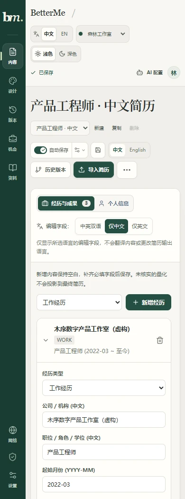

*图为 390 px 宽的中文内容编辑界面。窄屏使用上下布局，桌面支持左右分栏；这是响应式网页，不是独立移动端 App。*

2026-10-19 卡片审核入库追加：原站卡片可经“核对并加入统一索引”预览、明确勾选后提交。猎聘 C# / 上海首读 22 卡；实际核对其中一张后，本机索引 **49→50 岗 / revision 22→23**，清除地区条件后 **C# 14 个文本命中 / 9 家企业**。摘录不覆盖已有完整 JD，未知地点不补国家或坐标，原文可见但未提取的薪资仍待修。独立产品树 **1886/1886、types10/10、build6/6、lint** 通过；浏览器等待修复 `b1fbc6e` 与审核索引 `53b6be6` 已分功能正常推送，两批远端质量 / Linux 构建 / Docker / Pages 均 success（最终产品 [Actions 39156558283](https://github.com/nanfengovo/better-me/actions/runs/39156558283)）。机制、真实证据与限制见 [审核入库报告](docs/reports/job-atlas-reviewed-cards-2026-10-19.md)。

## 开发规划

当前优先级是**稳定的非 Agent 求职工作台**：部署交付、真实文件与导出质量、可信 JD 对比、来源更新保护和本地数据可靠性。先让既有流程可持续使用，再扩职业对话与学习执行。

| 阶段 | 目标 | 核心验收点 |
| --- | --- | --- |
| 当前基础 | 简历、模板/主题、导出、机会记录与恢复 | 已实现；继续处理真实反馈与有限样本以外的问题 |
| 发布与可靠性 | 自动检查/发布、性能与跨环境质量 | 失败不发布、可追溯提交、更多真实文件与字体分页检查 |
| 有依据的匹配 | 区分能力、简历呈现与岗位条件 | 判断关联 JD 原句与事实证据，未知不当作不会 |
| 岗位搜索与三维地图 | 通用来源、有限并行聚合与真实进度、详情 / 原文、国内 / 全球连续 3D 与精度定位 | 可选来源目录、临时城市候选、LinkedIn美国范围50卡及猎聘上海22卡有限实测；已提供卡片显式审核入索引与可撤销行政范围确认；51JOB / BOSS、自动翻页、办公坐标确认与规模性能继续建设；归并已提供预览、明确确认与影响预览撤销 |
| 长期探索 | 职业对话、练习/测评、证据回流、可选宿主 | 独立范围与授权；当前 V1 不做自动投递、学习打卡或插件 |

完整状态与验收事项见 **[ROADMAP](docs/ROADMAP.md)**。阶段不承诺日期，愿景不等于已实现；真实来源接入与地图已提供；精确办公地点确认、全站持续同步、跨设备同步与自动申请尚未提供。

新增岗位地图目标采用**本机自用后台 + 按关注范围手动刷新**：全球 3D 地球与国内 3D 地图连接同一岗位查询，默认按人民币税前年薪比较（可切原币），支持地区、已核实企业归属与直线离家距离。企业分类颜色通过配置管理，未知信息保持待核实。来源目录、适配器和可调用工具供地图、现有机会工作台以及未来 TypeScript LangChain / LangGraph 共用；服务器部署、定时更新和通勤服务保留扩展接口。本段描述开发目标，现有 Pages / Docker 静态版尚未提供这套后台能力。

方案与分阶段验收见 [岗位地图架构](docs/planning/job-atlas-architecture-2026-10-18.md)、[来源实查](docs/planning/job-atlas-sources-research-2026-10-18.md) 和 [三维地图研究](docs/research/job-atlas-map-references-2026-10-18.md)。研究已覆盖用户参考之外的 ATS、结构化招聘页、聚合 API 和 GitHub 来源发现，并记录实际字段、时效与可用范围。

[career-ops 复用评估](docs/research/career-ops-comparison-2026-10-19.md) 与 [总调度 / 两个执行 Agent 分工方案](docs/planning/two-agent-integration-plan-2026-10-19.md) 仍是只读研究和待讨论方案，尚未决定或实施接入；飞书适配、人工 JD 收件箱与产品自主 Agent 不计入当前交付。

已落地的 [共享岗位包](packages/opportunities/README.md) 提供严格 Zod 契约、人民币税前年固定薪资与原币证据、WGS84 直线距离、可配置企业配色、模糊关键词和统一列表/地图统计查询。新增 [独立本机服务](apps/job-service/README.md) 将同一工具注册表接到认证 HTTP API 和 SQLite，支持来源配置、关注范围预览 / 手动刷新、任务取消、重启回执、不可变 JD 和来源观察。旧机会迁移先生成公共白名单预览和独立私人引用，不自动搬迁现有用户数据。

[来源适配器](packages/source-adapters/README.md) 支持 Greenhouse、Lever、Ashby、腾讯、可配置 JSON 和 GitHub JSON 线索；同协议的新公司主要增加配置。通用发现工具可搜索 GitHub 仓库或检查种子链接，有限检查 JSON / CSV / Markdown 的字段并生成**禁用、待审核的来源提案**；企业入口发现先匹配已有公司来源，再读取显式官网的有限招聘链接。公司名未知且无官网 / 搜索 provider 时返回需要补充，不猜域名。这不等于已经接入全部招聘平台或把校招活动当成真实单岗。

服务可独立运行，网页“岗位地图”已接入认证索引、来源工具和连续三维地图。完整仓库安装后，在单独终端启动：

```powershell
pnpm --filter @better-me/job-service start `
  --data-dir "$env:LOCALAPPDATA\BetterMe\job-service" `
  --origin http://localhost:5173
```

默认只监听 `127.0.0.1:5178`，凭据保存在指定私有目录的 `service.token`，日志只显示文件路径。需要受控客户端设置 Bearer 凭据，写请求还需幂等键；来源示例全部默认禁用，不会在启动时采集。如果系统 DNS 使用代理 Fake-IP，可显式添加 `--dns google-doh`；此选项仅作用于服务内的固定可信解析器，仍检查并固定公网地址，不修改系统设置。

本阶段建有 FTS5 / RTree，但模糊查询仍采用完整候选的业务参考实现，尚未承诺大库加速。真实来源读取与在招核验分开，工资、控股方和坐标未知时不补造。API、样例、运行和验证范围见 [服务说明](apps/job-service/README.md)、[M1 报告](docs/reports/job-atlas-m1-2026-10-18.md) 与 [有限来源实测](docs/reports/job-atlas-m1-source-probes-2026-10-18.md)。

## 文档与验收记录

| 想了解什么 | 文档 |
| --- | --- |
| 免费托管、部署与自动发布 | [部署与 CI/CD](docs/deployment.md) |
| 首次线上发布与公网验证 | [GitHub Pages 上线记录](docs/reports/github-pages-release-2026-10-18.md) |
| Docker 构建、容器与许可验证 | [Docker 交付记录](docs/reports/docker-release-2026-10-18.md) |
| 当前完成情况与长期方向 | [开发路线图](docs/ROADMAP.md) · [产品草案](docs/planning/betterme-product-roadmap-2026-10-16.md) |
| 模板全目录、来源与授权 | [目录](templates/CATALOG.md) · [维护与许可](templates/README.md) · [LICENSE/NOTICE](templates/licenses/) |
| 工作台与响应式 | [UI 实施与视觉验收](docs/reports/ui-paper-atelier-2026-10-18.md) |
| 119 套适配与长文 PDF | [来源集成报告](docs/reports/open-source-template-integration-2026-10-18.md) |
| 主题、兼容性与打印 | [主题系统报告](docs/reports/theme-system-2026-10-18.md) |
| 导入、版本与 AI 保护 | [导入修复](docs/reports/resume-import-repair-2026-10-17.md) · [单项恢复](docs/reports/version-field-restore-2026-10-18.md) · [JD 输入保护](docs/reports/jd-analysis-input-guard-2026-10-18.md) |
| 岗位读取与网络 | [浏览器验收](docs/reports/job-browser-reading-2026-10-17.md) · [网络与代理](docs/reports/network-proxy-settings-2026-10-17.md) |
| 机会工作台与来源研究 | [跟进与导出](docs/reports/non-agent-followups-and-export-2026-10-17.md) · [开源做法](docs/research/non-agent-patterns-2026-10-17.md) |
| 岗位搜索 / 三维地图目标 | [架构与里程碑](docs/planning/job-atlas-architecture-2026-10-18.md) · [来源实查](docs/planning/job-atlas-sources-research-2026-10-18.md) · [地图选型](docs/research/job-atlas-map-references-2026-10-18.md) |
| 岗位共享底座 | [包 API 与示例](packages/opportunities/README.md) · [M0 契约 / 迁移 / 查询验收](docs/reports/job-atlas-m0-2026-10-18.md) |
| 岗位本机服务与来源工具 | [运行与 API](apps/job-service/README.md) · [来源适配](packages/source-adapters/README.md) · [M1 验收](docs/reports/job-atlas-m1-2026-10-18.md) · [真实有限来源探测](docs/reports/job-atlas-m1-source-probes-2026-10-18.md) |
| 地区筛选 / 四平台搜索 / 企业官网发现 | [操作说明](docs/job-atlas.md) · [四平台阶段记录](docs/reports/job-atlas-platform-search-2026-10-18.md) · [工具设计与 Agent 边界](docs/planning/company-career-search-tools-2026-10-18.md) |
| 猎聘薪资 / 可撤销地区确认 | [实现、真实闭环与边界](docs/reports/job-atlas-location-confirmation-2026-10-19.md) · [功能分批发布](docs/reports/github-atlas-feature-batches-2026-10-19.md) |
| 多来源进度 / 岗位详情 / 地图定位 | [聚合搜索与定位交互验收](docs/reports/job-atlas-aggregation-interaction-2026-10-19.md) · [公开合成地图截图来源](docs/images/atlas-manifest.json) |
| 后续复用与并行分工提案（未实施） | [career-ops 只读评估](docs/research/career-ops-comparison-2026-10-19.md) · [总调度与两个执行 Agent](docs/planning/two-agent-integration-plan-2026-10-19.md) |
| 分批发布历史 | [首轮发布](docs/reports/github-feature-batches-2026-10-18.md) · [模板与主题发布](docs/reports/github-theme-template-batches-2026-10-18.md) |

## 许可证与致谢

**根项目整体许可证尚未选定。公开可读不等于整个仓库已按 MIT 授权。** 维护者确定整体许可证前，第三方来源仍按具体条款管理。

感谢 RenderCV、JSON Resume、NewFuture/CV，以及由 awesome-resume-for-chinese 等入口发现的模板作者。113 套来源适配分别保留 LICENSE、NOTICE、固定版本与修改说明；MIT、ISC、Apache、LPPL、CC 等许可适用于对应单元，不由目录或根仓库统一覆盖。

**Rick Osborne 主题采用 CC BY-NC-SA 4.0，含非商业使用限制**；商业分发应排除该主题或取得作者单独授权。相关 CC 模板需要的作者、修改与许可署名保留在预览和 PDF 中，详情见 [模板授权说明](templates/README.md)。

项目不打包上游人物履历、照片、字体、二维码或商业站素材，也不爬取商业简历站模板。外部资料链接表示来源导航，不表示其应用、数据库或内容已被镜像或完整集成。

### 真实岗位的城市分布

本机索引可将已明确披露国家与城市的岗位显示为独立“城市分布参考”，双击定位并高亮，详情保留原来源及地名出处。参考点不确认办公地址、不参与离家距离。2026-10-19认证HTTP核验：87个已收录岗位中，C#文本全球50条／35企业、国内26条／22企业；国内26条均可展示城市参考，来源为猎聘19、LinkedIn6、腾讯官网1。这不是全网覆盖或当前在招认证。实现、2155项隔离回归和部署边界见[城市参考报告](docs/reports/job-atlas-city-references-2026-10-19.md)；入口区别见[本机使用说明](docs/job-atlas.md)。


### 通用官网结构化岗位来源

新增 `jobposting-jsonld@1`：JSON 配置受审叶子 sitemap 或静态列表、同源岗位路径和读取额度，提取真实官网的正文、雇主、地点、原链与发布时间，复用预览／同步／查询工具。企业名元数据只关联已登记来源，不补造实际雇主。内置 ABB 示例默认禁用待审；新增公司需另行核对配置，任意网页不保证可用。

本机有限验证后索引为 **89 岗**，C# 文本查询全球 **52 条／36 家企业**、严格国内 **26 条／22 家企业**。ABB 本轮增加 2 条官网岗位；这些是本机时点的文本命中，不是全市场／在招／个人适岗认证。页面须选择“本机采集索引 · 真实来源”，旧“当前机会库”是独立数据入口。来源标签、日期分色和超过一个日历月显示具体日期沿用共享呈现；完整证据、配置与限制见[官网结构化来源报告](docs/reports/job-atlas-jsonld-sources-2026-10-19.md)。
