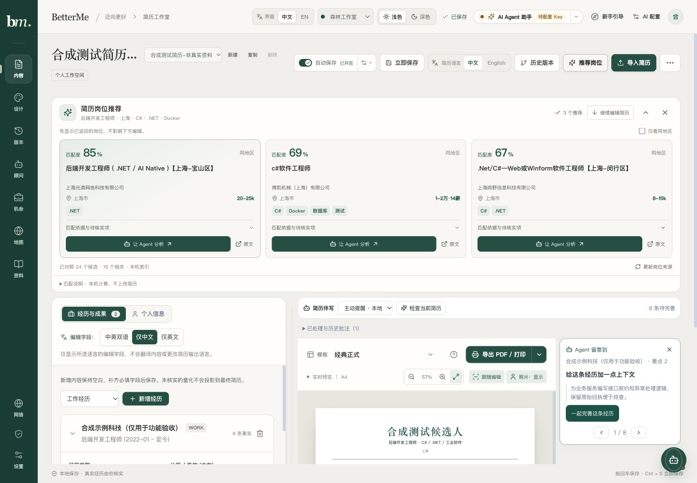
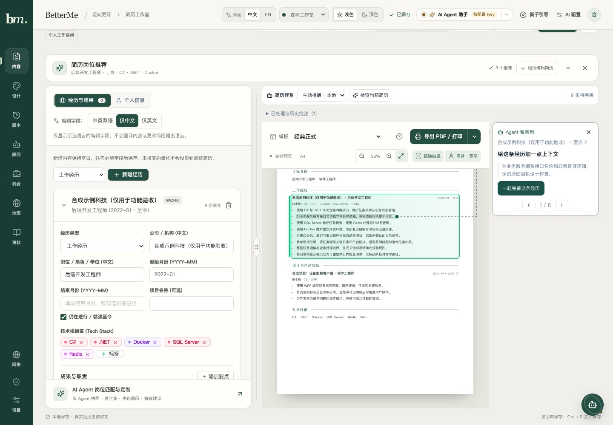
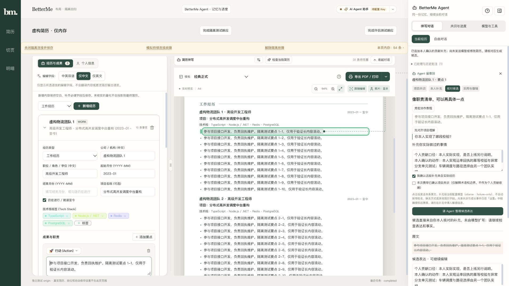
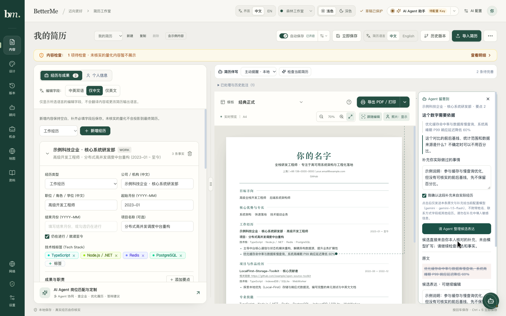
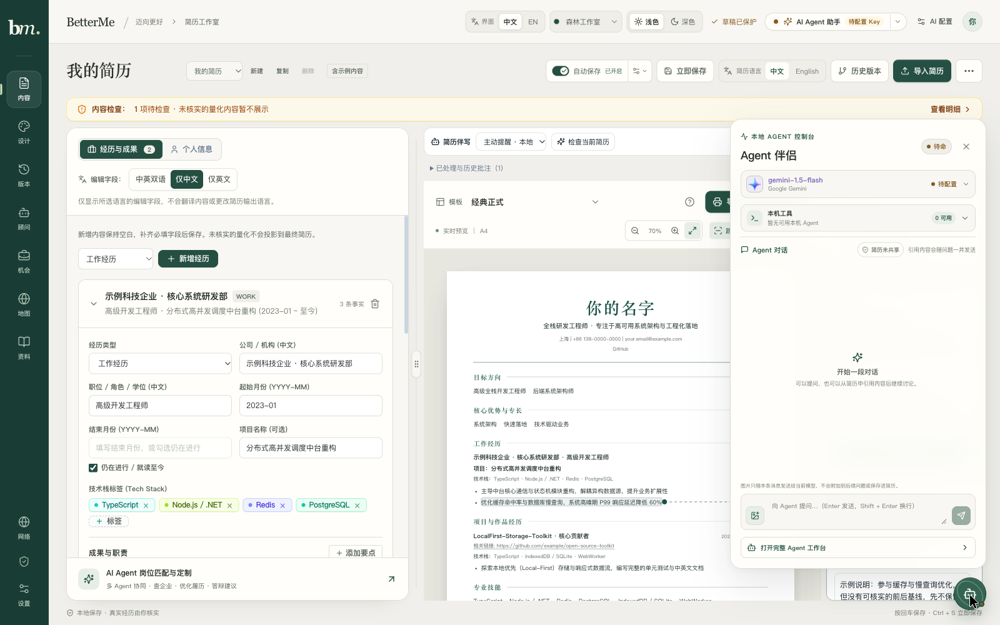

# 迈向更好 · BetterMe

<p align="center">
  
</p>

<p align="center">
  <strong>把真实经历，整理成值得投递的高质量简历；把目标岗位、地理通勤与下一步求职行动紧密串联。</strong>
</p>

<p align="center">
  <a href="https://github.com/nanfengovo/better-me/actions/workflows/ci-pages.yml"></a>
  
  
  
  
  
</p>

<p align="center">
  <strong>119 套经典版式 · 10 套专业简历主题 · 中英双语输出 · 真实经历深度伴写 · 真实 JD 证据对齐 · 3D 通勤地理图谱 · Docker 一键运行</strong>
</p>

<p align="center">
  <a href="https://nanfengovo.github.io/better-me/">🌐 在线体验（网页端预览）</a> · 
  <a href="#-快速开始">🚀 快速开始</a> · 
  <a href="#-核心特性亮点">✨ 核心特性</a> · 
  <a href="#-真实-jd-对齐与岗位匹配">🎯 真实岗位对齐</a> · 
  <a href="#-ai-与-agent-伴写工作流">🤖 Agent 深度伴写</a> · 
  <a href="#-架构与模块边界">🏗️ 架构设计</a> · 
  <a href="#-文档索引">📚 完整文档</a>
</p>

---

## 🌟 核心特性亮点 (Highlights)

市面上大多数 AI 简历工具只是简单的套壳 Prompt，盲目扩写大话套话、甚至虚构经历，不仅容易被面试官一眼识破，还面临极大的个人隐私泄露风险。**BetterMe 坚持「真实经历不可篡改、深度挖掘优于虚构夸大」的理念：**

- 🛡️ **100% 本地优先与数据私密 (Local-First)**：简历数据、事实库、版本历史全部存放在浏览器或本地 SQLite 中；无需强制云端注册，永不拿求职者隐私训练模型。
- 🧠 **不编造假数据的深度 Agent 伴写**：
  - **项目理解深度挖掘 (Project Understanding)**：像资深架构师或面试官一样，多轮对话对齐项目的业务背景、技术选型、指标闭环与真实贡献边界。
  - **红绿对比与删除线 (Visual Diff)**：修改前原句以红色删除线（`<del>`）标出，已采用新表达以翠绿色（`<ins>`）高亮，多轮详细补充折叠收纳，视觉对比一目了然。
  - **逐句依据核验**：生成的候选表达强制要求引用原文或用户亲口确认的事实证据，杜绝模型幻觉编造假指标。
- 🎯 **真实岗位 JD 深度拆解与 1v1 对齐 (JD Alignment)**：
  - 支持直接粘贴 BOSS 直聘、猎聘、51job 等平台岗位详情链接或文本。
  - 自动拆解核心职责、硬性要求、加分项与技术栈，与简历事实库逐条进行 1v1 证据链匹配，针对性指出欠缺项，不盲目海投。
- ⚡ **智能导入补录与 PDF 断行修复**：
  - 导入 PDF / Word 简历时，自动检测因换行导致的文本断裂（如 `...状态反馈与异常处` + `理闭环。`），提供 **一键智能合并断行**。
  - 自动识别并一键补录未能转入结构化事实库的个人/开源项目与教育背景，避免关键经历遗漏。
- 📑 **119 套经典排版 & 10 套专业主题**：
  - 区分小标题、项目名、背景与子职责的多级视觉层次，拒绝所有内容堆成扁平圆点的混乱排版。
  - 支持中文/英文一键切面、实时 A4 纸张排版渲染，无缝导出高保真 PDF、DOCX、Markdown、RenderCV YAML 及 JSON 备份。
- 🗺️ **职位机会库与 3D 通勤地图 (Job Atlas)**：
  - 将投递记录、HR 联系人、企业实际位置、通勤距离与 3D 地理信息联动，把求职变成掌控全局的作战地图。
- 🐳 **Docker 一键启动 & 任意大模型无缝连接**：
  - 内置 Docker 完整单机环境，网页端 + Agent Host + SQLite 岗位服务开箱即用。
  - 自由接入本地 Ollama、DeepSeek、OpenAI、Claude Code CLI 或 ChatGPT 个人账号。

---

## 📸 界面预览

| 沉浸式双栏排版与实时 A4 纸张渲染 | 真实岗位 JD 智能拆解与证据对齐 |
| :---: | :---: |
|  |  |
| **Agent 项目深度理解与记忆共享** | **红绿删除线 Diff 与历史批注追溯** |
|  |  |

> [▶ 查看完整工作台操作演示视频（WebM）](docs/media/betterme-workflow-20261030.webm)

---

## 目录

- [快速开始](#-快速开始)
- [核心设计理念](#-为什么选择-betterme)
- [真实 JD 对齐与岗位匹配](#-真实-jd-对齐与岗位匹配)
- [AI 与 Agent 伴写工作流](#-ai-与-agent-伴写工作流)
- [简历、排版与智能补录](#-简历排版与智能补录)
- [岗位采集与后台流水线](#-岗位采集与后台流水线)
- [三维地图与通勤图谱](#-三维地图与通勤图谱)
- [架构与模块边界](#-架构与模块边界)
- [数据、隐私与安全声明](#-数据隐私与安全声明)
- [开发与测试验证](#-开发与测试验证)
- [常见问题 FAQ](#-常见问题-faq)
- [文档索引](#-文档索引)

---

## 🚀 快速开始

### 方式一：Docker 一键完整启动（最推荐）

包含完整的 Web 界面、本地 Agent Host 服务和 SQLite 岗位数据库，开箱即用：

```sh
# 克隆仓库
git clone https://github.com/nanfengovo/better-me.git
cd better-me

# 启动完整单机服务
docker compose up -d --build --wait
```

访问 **http://127.0.0.1:8080/** 即可进入完整工作台。
- 简历排版、本地规则检查、A4 实时预览与导入导出完全离线可用。
- 如需使用 Agent 深度伴写，在页面内「AI 配置」填入自己的 DeepSeek / OpenAI Key，或直接连接宿主机运行的 Ollama。
- 停止服务：`docker compose down`（数据保留在本地命名卷中）。

### 方式二：本地源码开发启动

- **环境要求**：Node.js 24.x 或 26+，pnpm 11+（推荐锁定 `pnpm@11.9.0`）。

```sh
pnpm install --frozen-lockfile
pnpm dev
```

终端将启动开发服务：
- **简历工作室**：`http://127.0.0.1:5173/`
- **岗位地图 (Atlas)**：`http://127.0.0.1:5173/?workspace=atlas`
- **岗位数据服务**：`http://127.0.0.1:5178/`
- **Agent Host**：`http://127.0.0.1:5179/`

---

## 🎯 真实 JD 对齐与岗位匹配

很多人写简历的最大痛点是：“简历写了一大堆，但投递出去全是已读不回”。核心原因在于**简历表达与目标岗位的真实考核点严重脱节**。

BetterMe 内置专门的 **JD 拆解与证据对齐引擎 (`jd-decomposition`)**：

1. **一键输入真实岗位**：支持粘贴 BOSS 直聘、猎聘等公开招聘链接或完整岗位文本。
2. **结构化拆解**：自动剥离客套招聘套话，提取出：
   - 核心业务职责与技术平台（如：分布式服务、调度系统、高并发治理）
   - 硬性技术栈与经验年限（如：.NET / C#、Docker、微服务）
   - 业务加分项（如：工业控制协议、MES/WCS 对接经验）
3. **1v1 证据链匹配**：与当前简历中的真实经历逐一进行关键词与语义对照：
   - **已具备优势**：指出简历中已体现的直接证据，增强面试信心。
   - **缺失与差距 (Gaps)**：明确指出哪些 JD 重点在简历中没有体现，指导你在下一轮 Agent 伴写中重点补充相关真实细节。
4. **拒绝无脑造假**：不直接替你虚构没做过的技术，而是提醒你：“你是否有做过类似协议对接或业务调度？如果有，请在经历中补充；如果没有，在面试准备中提前复习对应概念。”

---

## 🤖 AI 与 Agent 深度伴写工作流

### 1. 沉浸式双栏工作空间
- **日常编辑模式**：左侧结构化编辑、右侧实时渲染 A4 纸张排版。
- **Agent 协作模式**：点击「呼出 Agent」或针对某条经历点击「一起弄清这个项目」，左侧自动收起手工表单，将大面积留给 Agent 对话、思考过程与对比卡片，彻底解决对话空间狭窄逼仄的问题。

### 2. 项目理解（Project Understanding）深度挖掘
- 不急于直接改写文字，而是先对齐项目共识：
  - 梳理项目的真实背景、软硬件边界、你负责的模块。
  - 追问核心技术细节：例如是“仅参与方案设计”还是“负责全栈开发与调优”？遇到过哪些故障？如何做状态机闭环？
- 确立共识后，记忆**自动打通共享**至单条经历伴写，无需重复向 AI 解释背景。

### 3. 红绿删除线可视化对比 (Diff & Review)
- **修改前原句**：红色底色 + 删除线（`<del>`），一眼辨认被替换的内容。
- **候选新表达**：翠绿色标签 + 翠绿底色（`<ins>`），突出优化后的专业动词与技术表达。
- **用户多轮补充**：长篇补充内容自动折叠为 `💬 你的补充（N 字 · 点击展开）`，主屏只展示高价值改写方案。
- **逐字核验与撤销**：必须勾选「我确认来自实际经历，无夸大虚构」后方可采用入库；采用后支持一键撤销或二次补充修改。

---

## 📑 简历、排版与智能补录

### 层次分明的排版体系
- 自动识别并分类工作经历中的内容属性：
  - **小标题**（`内容：`、`个人职责：`、`业绩：`）：左侧主题色竖条加粗展示，不再显示混乱的前置圆点；未确认业绩指标时自动隐藏空标题。
  - **核心项目与背景**（`核心项目：...`、`项目背景：...`）：独立样式展示，增强阅读条理性。
  - **具体职责条目**：自动缩进成为子项，层次分明，HR 扫一眼就能抓住重心。

### 一键智能补录与断行修复
- 从 PDF 提取文字时经常出现换行截断乱码（例如上一行结尾是 `异常处`，下一行开头是 `理闭环。`）。
- BetterMe 能够自动识别此类跨行残段，并在顶部直观提示：
  - **「✨ 一键补录待核对内容并修复断行」**：自动拼合断句，并将未入库的开源项目、个人项目、教育经历解析为结构化卡片入库。
  - **「✓ 一键核实并展示全部业绩指标」**：恢复因未核实而被隐藏的数字/百分比量化成果。

---

## 🗺️ 三维地图与通勤图谱

求职不仅是改简历，更是衡量生活与工作的平衡。BetterMe 集成了本地 **Job Atlas**：
- **通勤全景**：支持 MapLibre 矢量底图，按真实坐标呈现岗位分布与通勤半径。
- **企业与岗位关联**：点击地图点位直接联动对应企业的招聘 JD 与薪资分布。
- **安全与合规**：所有三维点位与查询完全基于本地 SQLite WAL 只读线程隔离执行，支持断网环境离线运行。

---

## 🏗️ 架构与模块边界

```text
better-me/
├── apps/
│   ├── web/                  # React 19 + Vite + Tailwind：简历工作室、Agent 侧栏、Atlas
│   │   ├── src/components/   # 模块化 UI：ResumeTemplate, IssuesPanel, ImportSourceReview...
│   │   └── server/           # 开发 Broker、安全来源工具、JD 浏览器会话
│   ├── job-service/          # Node:sqlite 岗位索引服务、后台补全、WAL 计算隔离
│   └── agent-host/           # 本机 Agent 进程托管、Runtime 协议、LangGraph 状态编排
├── packages/
│   ├── core/                 # 核心事实库 Schema、JD 拆解器 (jd-decomposition)、AI 客户端
│   ├── storage/              # 本地 localStorage / IndexedDB 容灾备份与 50 版历史时光机
│   ├── opportunities/        # 岗位数据领域模型、增量索引
│   └── agent-contracts/      # 跨进程 Agent 通信规范与审批机制
└── docs/                     # 详细设计、规划与严苛的真实场景验收报告
```

---

## 🔒 数据、隐私与安全声明

| 数据类别 | 存储与传输边界 | 隐私保障 |
| :--- | :--- | :--- |
| **简历与个人档案** | 浏览器本地存储 (`localStorage` / `IndexedDB`) | **绝不上云**，离线完全可用 |
| **编辑历史与版本** | 自动保存最近 50 个独立快照，随时回滚 | 本机受控，支持导出脱敏 JSON |
| **目标岗位与 JD** | 本机独立 SQLite 数据库，WAL 线程安全隔离 | 不与外部服务器同步个人投递偏好 |
| **AI 模型调用** | 用户自备 API Key 直连服务商或本地 Ollama | 不做任何中间数据收集，不拿用户隐私训模型 |

---

## 🧪 开发与测试验证

项目坚持严格的自动化测试与工程规范，绝不将未经测试的代码推向生产：

```sh
# 依赖安装
pnpm install --frozen-lockfile

# 全局类型检查
pnpm typecheck

# 运行全套组件与业务逻辑单测
pnpm test

# 核心真实场景专项测试（含张海东真实工控履历 × 梅特勒托利多真实工控 JD 闭环校验）
node --test packages/core/tests/e2e-jd-resume-flow.test.mjs
node --test packages/core/tests/jd-decomposition.test.mjs
```

---

## 💬 常见问题 FAQ

<details>
<summary><strong>Q: 为什么生成的候选表达不允许我直接复制，必须逐字核验？</strong></summary>
A: 这是 BetterMe 的核心立足点。面试官在面对面提问时，会针对简历上的每一个数字、每一个技术名词深挖背后的原理和细节。如果完全任由 AI 编造假数据，面试时一旦露馅后果灾难。只有你自己真正做过、核验过的内容，才是你的核心竞争力。
</details>

<details>
<summary><strong>Q: 导出的 PDF 能保证打印时不跨页乱断行吗？</strong></summary>
A: 可以。BetterMe 专门适配了标准的 A4 页面比例与打印媒体查询规则（`@media print`），并优化了分页规避机制（`break-inside: avoid`），确保工作经历与项目条目在换页时整块过渡，不被强行截断。
</details>

<details>
<summary><strong>Q: 我可以使用完全离线的本地模型（如 DeepSeek-R1 / Qwen 2.5）吗？</strong></summary>
A: 完全可以。在「AI 配置」中将端点设置为本地 Ollama（如 `http://127.0.0.1:11434/v1`），即可在完全断网的状态下享受完整的 Agent 深度项目挖掘与简历伴写功能。
</details>

---

## 📚 文档索引

- [系统架构与路线图 (Roadmap)](docs/ROADMAP.md)
- [119 套简历模板与主题样式目录](templates/CATALOG.md)
- [Docker 本机完整部署与数据卷持久化指南](docs/docker.md)
- [真实履历与岗位端到端对齐可行性研究](docs/planning/career-os-experience-feasibility-2026-11-06.md)
- [本地 Agent 身份与多账号数据隔离报告](docs/reports/agent-identity-isolation-2026-11-02.md)

---

## 🤝 贡献与鸣谢

欢迎提交 Issue 和 Pull Request！如果你觉得 BetterMe 对你的求职和简历打磨有所帮助，**欢迎在 GitHub 上点亮一颗 ⭐️ Star**，让更多在求职路上的伙伴不再迷茫！

[](https://star-history.com/#nanfengovo/better-me&Date)

---

<p align="center">
  Made with ❤️ by Developers for Job Seekers · 迈向更好
</p>


打开 **http://127.0.0.1:8080/**。默认镜像同时运行网页、Agent Host 和 SQLite 岗位服务，自动建立同源连接，不必分别开三个终端或复制令牌。

- 简历编辑、主动伴写的本地检查、预览、历史与导出无需模型。
- 模型不包含在镜像中；在「AI 配置」选择自己的服务。Agent 的本机 Ollama 地址会转换到宿主机网关，不会自动下载模型或购买额度。
- 容器不接管个人 Chrome/Edge 登录态，也不安装本机 Claude/Codex CLI。需要交互式招聘浏览器或 CLI 时使用下方 `pnpm dev`。
- 默认只开放本机端口；后台数据写入专用命名卷。简历、草稿、历史和模型配置仍由当前浏览器保存。更新前分别备份。

健康状态：`docker compose ps`；日志：`docker compose logs --tail=100 web`；停止：`docker compose down`（保留数据卷）。端口、模型连接、恢复、迁移与静态模式见 [Docker 指南](docs/docker.md)。

### 账号与统一登录

本机账号始终可用，不要求普通用户安装 Casdoor 或申请各平台开发者应用。部署方配置统一身份服务后，登录页只展示当前可用的平台；身份服务离线不阻断本机账号登录。已有账号需先登录原账号、核对密码后显式关联，不按相同邮箱认领资料。

管理员跨环境接入使用 [统一登录部署指南](docs/deployment-auth.md)：现有身份中心通过独立 OIDC 配置接入；只有运营方新建身份中心时才使用可选部署模板。密钥由服务端私有文件或部署 secret 提供，不进入镜像构建、前端变量或 Git；新域名不会自动迁移原账号或浏览器资料。

### 环境与单一开发入口

- Node.js **24.15.0+ 的 24.x，或 26+**，以根 package.json 的 engines 为准。
- pnpm **11+**，仓库锁定 pnpm@11.9.0。
- 岗位数据库使用 Node 内置 node:sqlite；Agent 部分依赖包含原生模块，切换 Node 主版本可能需要重新安装或重建。
- 浏览器建议启用 WebGL/硬件加速。平台读取还需要支持的本机 Chrome/Edge，不要求接管日常浏览器。

```sh
git clone https://github.com/nanfengovo/better-me.git
cd better-me
pnpm install --frozen-lockfile
pnpm dev
```

开发入口先构建所需 workspace 包，再启动 Web。默认简历工作室为 http://127.0.0.1:5173/，岗位地图为 http://127.0.0.1:5173/?workspace=atlas；地址以终端为准。

| 服务 | 默认端口 | 职责 |
| --- | ---: | --- |
| Web / Vite | 5173 | 简历、机会、地图、Agent 界面及仅开发期的受控来源工具 |
| Job Service | 5178 | SQLite 岗位索引、认证查询、同步、入库、后台补全 |
| Agent Host | 5179 | 可选模型代理、本机 Runtime 扫描、Run 与事件流 |

pnpm dev 启动或复用健康配套服务。关闭时只停止自己启动的子进程，不接管外部健康服务；未知端口占用、令牌或 origin 不匹配会明确失败，不强杀其他进程。启动不等于自动采集，也不会自动投递或提交简历。

当前开发岗位目录由 broker 默认选为用户目录下 Library/Application Support/BetterMe/job-atlas；这是当前实现路径，不是跨平台配置保证。已有数据要沿用原目录，不能通过换空目录“修复”连接。

### 单独运行服务

自定义数据目录或 origin 时，可手动运行岗位服务。目录必须在 Git 仓库之外：

```sh
pnpm --filter @better-me/job-service start \
  --data-dir /absolute/path/to/private-job-atlas \
  --origin http://127.0.0.1:5173 \
  --origin http://localhost:5173
```

127.0.0.1 与 localhost 是不同 origin。token 保存在专用目录的 service.token，不要粘贴到公开日志。接口、锁和备份见 [Job Service README](apps/job-service/README.md)。

Agent 独立启动见 [Agent Host README](apps/agent-host/README.md)。开发 broker 使用的固定开发 token **不是生产安全凭据**，不要把开发服务暴露公网。

### 本机账号与 Agent 记忆隔离

本分支完整工作室先核对 BetterMe 本机账号；这不是 ChatGPT、Google 或其他模型账号。首次使用创建本机账号，再从右上角「工作台设置」退出或切换。密码至少 12 个字符，当前没有密码找回功能。

可选接入自部署 Casdoor：已有本机账号先在「工作台设置 → 关联 Casdoor 统一登录」重新核对密码，再绑定外部身份，原数据空间不变。QQ、微信、邮箱、手机是否可用取决于 Casdoor 中实际配置的官方渠道，初始本机安装仅启用用户名密码。确认归属后恢复的旧简历和完整会话可从同菜单的「恢复档案」打开，保留原归档与独立工作副本，不替换当前默认简历。启动、绑定、渠道配置与备份见 [Casdoor 与恢复说明](docs/casdoor.md)。

- 项目理解、对话、确认的共识、成长记录、任务与 ChatGPT 授权保存在本机 Agent Host 的账号专属目录。服务端从登录会话确定归属，不接受客户端指定其他用户。
- 简历、编辑草稿、历史版本和浏览器模型配置按账号分别存放在当前浏览器，**不代表跨浏览器自动同步**。自动保存开关、触发方式等既有偏好保持不变。
- 切换账号会重新建立页面上下文；另一窗口变更身份时，旧页锁定并保留草稿。旧响应不能写入新账号，退出不等于取消已经属于原账号的后台项目理解。
- **旧版无归属资料不自动迁移或认领**。新账号看不到旧资料不等于旧资料丢失；不要清理浏览器存储、重置简历或删除旧目录来处理。归属迁移需另行核对和明确确认。
- 未完成账号级进程与凭据隔离的本机 CLI 暂不在多账号模式执行；不会继承共享系统账号的模型凭据或自动回退付费 API。本账号明确选择的模型/ChatGPT 通道仍可通过只读取证器阅读逐次授权资料。

这是本机单实例的应用层隔离，不是公共 SaaS 的完整多租户认证，也不是操作系统沙箱或端到端加密。拥有本机文件权限、同源开发者工具或恶意扩展的人不在此边界内；共享电脑应同时使用不同系统账号/浏览器配置。新版登录界面需要匹配版本的 Agent Host；旧静态部署不提供这套账号服务。岗位后台索引仍是安装级数据，本批没有改成多租户岗位服务或迁移真实岗位。[实现与隔离验收范围](docs/reports/agent-identity-isolation-2026-11-02.md)。

## 功能状态与边界

| 模块 | 当前源码能力 | 重要限制 |
| --- | --- | --- |
| 简历与事实 | 结构化事实、多份视图、内容核对、119 模板、10 主题、中英字段、精细排版 | AI 不自动创造经历；切语言不等于自动翻译；导入不保证原版式 |
| 岗位推荐 | 导入确认后自动匹配，或手动按当前简历匹配；最多 3 张卡片、可解释匹配度、逐批显示、短期候选缓存、同地区筛选、Agent 入口、停止保留已返回结果与错峰入场 | 匹配度是文本证据分，不是录用概率；只读有限候选，不保证全网最优或仍在招，不自动投递 |
| 保存与恢复 | 草稿、IndexedDB 备用、最近 50 版、检查点、差异/单项恢复、JSON 备份 | 来源隔离的本地数据，不是云端账号同步；仍需自行备份 |
| 机会与投递 | 收藏、阶段/联系人/跟进、材料快照、JSON/CSV 导出 | 不自动投递、不发邮件，不保证后台提醒 |
| 平台采集 | LinkedIn、猎聘、51JOB、BOSS 受控读取、范围采集、分批入库、部分覆盖说明 | 登录/验证由用户完成；站点变化和限制可能导致部分完成，不保证全站覆盖 |
| 后台补全 | 地区/企业独立任务、队列状态、自动发布 revision | 缺证据保留未知，不生成办公坐标或控股结论 |
| 采集恢复 | 本地日志、检查点、未确认回执核对、继续采集入口 | 不绕过验证；已抓卡片不等于已保存岗位 |
| 大库查询 | 首次基线分批读取与只读预览、Worker 隔离、revision 增量、查询索引、有界缓存 | 不支持分页的旧服务回退完整读取；新 revision 仍有索引准备成本 |
| 工作台 UI | 调整地图/列表/JD 分栏、布局预设、拖动排序、焦点模式、可读状态 | 不能据单测认定所有设备 FPS/INP 通过 |
| 三维地图 | MapLibre 工作地图 + 懒加载 Cesium 地球 + 显式 Google/授权 3D Tiles | 上海实景、Google 带凭据请求和真实场景成本仍待验收 |
| AI/Agent | 统一侧栏、项目理解与动态追问、贡献认领、原文旁批、授权共识、对话/任务持久化、协作教程、记录备份恢复 | 浏览器与本机服务分开保存，不是云同步；原生工具须兼容受控协议，不保证全部 CLI / Worker 可执行 |

## 国内平台投递准备与手机协同

在「机会与投递」打开 BOSS、51job 或猎聘岗位，展开「国内平台 · 投递行动卡」：保存发起沟通/共享简历/岗位申请草稿，核对平台账号标记、接收对象、在线简历与材料快照，再由本人去官方平台操作并记录实际结果。

- 打开链接不算投递；发招呼、共享简历、正式申请分开记录。回执是本人核实的记录，不冒充平台自动验证，不自动改原投递看板。
- 岗位或材料变更后旧核对失效；结果不明进入站内待办、阻止重复排队，不靠自动重发“保证成功”。
- 行动卡随机会库 JSON 备份，原多窗口冲突与损坏保护保留。站内提醒不是系统/Web Push，关页后不继续执行。
- Docker runtime/static 与开发版包含同一准备功能；**手机桥接、OpenCV 控制、全自动采集/发送、跨设备同步和防封保证尚未提供**。人工同意不能替代平台许可。

[操作说明、三平台差异、授权与后续设备路线](docs/domestic-delivery.md) · [Docker 与独立验收](docs/docker.md)

**手机岗位工作流（设计中，开发版和 Docker 均未接入）：** Android 由本机 Companion 经 USB 把隔离测试页的读取任务交给 Mika；iPhone 由本人从分享菜单选择岗位文字、链接或截图，不要求电脑是 Mac。两者交回同一种**待核对岗位卡**：先看来源、原文和缺失项，再在同一条可视化流程中补信息、匹配 JD、准备材料，最后生成草稿交给本人。例如只分享了一张没有薪资的截图，流程会显示“薪资未知”，请用户补充或跳过条件，不会猜测或代投。

首版先用同一虚构岗位跑通公共流程，再分别验证 Android 真机委托与 iPhone 实际分享。复核标准包括：字段有出处、刷新不重复派单、换号不能读取旧证据、模拟页外发为零；仅用夹具通过不能算手机已接通。[双入口与工作流设计](docs/planning/desktop-job-agent-workflow-2026-11-05.md#mobile-job-workflow) · [首版实施顺序](docs/planning/desktop-job-agent-workflow-2026-11-05.md#mobile-v1) · [验收矩阵](docs/planning/desktop-job-agent-workflow-2026-11-05.md#mobile-acceptance)

## 简历、事实与恢复

### 第一次使用：沉浸式工作台引导

首次进入内容编辑器时，8 步引导会介绍真实经历、Agent 伴写、预览导出、草稿保护、模型配置和岗位地图。带有浮动简历、轨道粒子、扫描光、区域聚光与完成庆祝动效；可随时上一/下一步、跳过单步、点击进度跳转，或按 Esc 退出。完成或跳过后不再自动出现，可从右上角工作台设置中的「新手引导」重新播放。

支持中英文、小屏布局、键盘左右键、焦点管理、关闭「沉浸动效」及系统减少动态效果。引导只讲解与高亮，不修改简历、不调用模型、不发起采集；只在当前浏览器写入独立的引导偏好。已开始输入或已有弹窗时不会突然打断。[实现与验收边界](docs/onboarding.md)。

### 在现有编辑器中主动伴写

进入「内容」编辑经历时，Agent 以锚定原文的轻量批注提醒缺少上下文、流水账表达或缺乏依据的数字。点击「一起完善」后，围绕个人行动、方法、范围和结果逐步补充；本地检查无需模型，模型追问需要配置和明确同意。

补充内容先生成可编辑候选，对照原文后由你决定是否采用；不会自动编造量化结果、修改事实或标记已核实。支持忽略提示、关闭主动提醒、采用后撤销，草稿与历史继续沿用现有编辑模块的保护机制。[查看实际操作视频](docs/media/betterme-workflow-20261030.webm)。

编辑与 A4 预览各自保留完整可读高度。伴写、共识与进度、模型与工具统一在同一个可收起侧栏；切页面、切 Tab、打开教程不卸载对话组件，不因隐藏而取消任务。原文高亮和宽屏虚线旁批保留；窄屏使用定位入口，不画跨屏连线。自动保存沿用你的原设置，不因改版默认开启。

侧栏右上「Agent 协作教程」可继续上次的 8 个细节章节：资料授权、动态对话、共识确认、贡献认领、旁批候选、记忆备份、工具选择、超时恢复。每节都有操作步骤、安全示例练习和「在界面中找到入口」：高亮当前真实控件，缺少前置步骤时说明下一步，不替你授权、发送或采用。阅读与练习进度按当前工作区独立保存在浏览器，只记章节 ID；不是任务完成度或能力认证。项目理解和旁批内也有定向教程入口。章节切换采用可中断的短淡入，键盘、动效关闭和系统减少动态效果模式即时响应；教程示意与真实任务进度分开，不模拟百分比或伪造读取过程。见[完整交互与存储边界](docs/onboarding.md)。

[查看主动伴写编辑器截图（2026-10-30）](docs/images/resume-copilot-20261030.webp)。历史视频没有包含后续新增的岗位推荐流程。

### 导入简历后，推荐下一站

在现有简历导入弹窗中核对结构化内容，点击「确认替换简历并推荐岗位」后，编辑器内自动展示最多 3 个相关岗位。已有简历可使用顶部「推荐岗位」。按技术栈、经历标签、目标方向匹配，同地区优先；可切换「仅看同地区」、收起推荐或重新匹配。

推荐使用已连接的本机岗位索引，每次按最多 3 个关键词分批读取候选（每批最多 60 个），不导出庞大的采集历史；无法读取时明确提示，仅回退当前机会库。这里是有限候选中的文本相关性排序，不是全网穷举、录用概率或岗位要求核验。已关闭岗位和演示来源不参与推荐；技能命中、异地和在招状态待核实分别展示。JD 提及而简历没有体现的技术只标「还需核实」，不认定求职者不会。

每张卡片显示 0–100% 的匹配度：技术 55%、经历标签 15%、岗位方向 20%、地点 10%，按文本证据命中比例加权；简历未设置的维度不参与，缺失的岗位证据不自动得分。技术项的分母是 JD 明确提到的技术，不是简历全部技能，也不意味着这些技术都是必选要求。「匹配依据与待核实项」默认收起，可展开核对各维度；同地区仍优先排序。

关键词查询并行执行，先返回的候选先显示，其余继续补全；每路查询最多等待 12 秒，整体有截止与停止入口，已返回结果会保留。同页会复用近 2 分钟的完整候选（最多 4 组、仅页面内存），「更新岗位来源」可强制重读；不是永久缓存，也不保证冷启动大库瞬时完成。推荐区、通知与左右编辑/预览栏参与同一页面滚动，不再挤压编辑区高度；「继续编辑简历」会收起推荐、定位并聚焦编辑栏，原有预览跟随编辑继续可用。

卡片依次入场、加载状态与按钮反馈支持系统减少动态效果；等待时可停止，迟到结果不会覆盖已停止或新一轮推荐。推荐只读岗位与简历，不改事实、不投递、不自动调用外部模型。仅公开技术关键词和已披露城市用于配套本机服务查询，姓名、联系方式及简历正文不随推荐请求发送。点击「让 Agent 分析」后进入现有 Agent 工作台，模型分析仍由用户按现有授权流程启动。

推荐流程回归：`pnpm test:recommendations`，覆盖排序与去重、查询鉴权与边界、停止/重试、地区筛选、导入快照与当前画像的区分。

安全体验可使用[合成测试简历 JSON](docs/examples/synthetic-recommendation-resume.json)，仅在空白测试 Origin 或独立浏览器会话中确认导入；不要在真实简历上执行替换。新 Docker 数据卷不会自带公开岗位样本，需连接自己的公开岗位索引或自行导入来源数据；空库不代表没有合适岗位。

### 一份事实，多份呈现

事实库存教育、工作、项目、技能与成果；每份视图分别选择可见条目、模板、语言、排序与排版。更改共享事实可能影响引用它的视图，切换样式不等于复制独立事实。

- 导入 PDF、DOCX、图片、HTML、Markdown、TXT、结构化 JSON 等；旧 DOC 仅尽力提取。
- 导入先保留提取结果、警告与待核对项，再由用户确认。当前按模板重排，不声称保留任意原稿的字号、分栏和分页。
- 数字待核实、空洞表达检查和字段定位帮助修改；Schema 合法不等于事实真实。
- 模板、简历主题、网页配色分别管结构、纸面与工作环境；明暗模式不应改变导出纸张原有配色。
- 支持 PDF/打印、DOCX、Markdown、RenderCV YAML、结构化备份。浏览器打印决定实际跨页，不强制把内容压进一页。
- 机会区记录真实岗位来源、投递阶段、联系人、下一步和当时材料快照，不擅自投递。

### 草稿与正式历史

即时草稿与正式版本分离。localStorage 写入失败时尝试 IndexedDB 备用；两者都失败时应立即导出备份，而不是先清数据。历史保留最近 50 版并支持命名检查点、整版/差异项恢复；命名版本也受总量限制。

清网站数据、更换协议/主机/端口、换浏览器都会影响数据可见性。升级不应通过清理站点存储、强制刷新或换数据目录解决状态问题。

## 岗位采集与后台流水线

搜索已有岗位与获取新岗位是两件事。搜索条件作用于已收录索引；显式采集才操作专用浏览器。登录和人机验证由用户完成，不复用日常 profile。

```text
平台读取 ──分批已核验卡片──> 入库提交 ──revision──> 列表/地图自动更新
                                  └──> 地区/企业后台补全 ──revision──┘
```

- 多平台按有限并发读取，不无上限开页面。
- 入库与补全独立：平台仍在读取时，已确认岗位即可保存、查询和展示；不用等待所有平台或补全结束。
- 发现卡片、成功提交回执、待确认、失败/取消、部分覆盖分别展示；不同口径的数字不能简单相减当作队列。
- 明确失败原因与可执行下一步。未知原因保留未知，分页未确认、登录阻断、超时或预算用尽不叫完整成功。
- 取消保留已核验结果；检查点帮助恢复，重复提交按幂等回执核对，未确认不等于未写入。
- 地区/企业自动后台补全不要求手动点；前端离开不因此停止服务端任务，异常独立诊断，不阻塞搜索。

有限站点样本不代表全站长期稳定。来源卡片、完整 JD、唯一岗位和 listing 不同；原文链接、时间、覆盖与待核实状态应保留。

## 查询、同步与大库计算

性能链路分开实现，不与动画或某个地图供应商耦合：

1. **服务端计算隔离**：单写线程处理入库/补全，只读线程通过 SQLite WAL 读已提交版本，HTTP 主线程负责认证与转发。
2. **增量投影**：从变化来源和反向依赖读取真实受影响片段，沿用 CAS、幂等、人工覆盖及事实规则；大共享公司/归并组仍可能形成大切片，不承诺所有路径 O(delta)。
3. **revision 同步**：已有基线后按 epoch + revision 拉净 upserts/deletes；未变化复用对象；断档/换库/预算超出时明确返回完整快照，不静默截断。
4. **浏览器 Worker**：解析、引用验证、查询和地图几何准备离开 UI 主线程；取消、并发共享、缓存淘汰有独立协议。
5. **查询索引**：按不可变快照准备关系与字段索引，惰性标准化 JD；分页、排序、地图级别复用有界缓存，跨 revision 复用未变实体文本。
6. **三维点位**：按真实坐标分组，批量 billboards，差量更新 GPU；相同输入不重复上传，不因后台进度重建 Viewer 或拉走相机。

**首次基线分页已整合。** 新服务提供有界基线会话、分批实体与引用校验；浏览器 Worker 可显示只读预览，全部读取完成前不会把部分数据交给后台写入或采集恢复。旧服务不支持该协议时回退完整快照，非 Worker 读取路径仍使用兼容导出；列表分页、首次基线分页和 revision 增量同步是三个不同阶段。初始下载、全局引用校验和索引准备仍有成本。见 [分页基线说明](docs/reports/job-atlas-paged-baseline-2026-10-28.md)。

既有 5,000/15,000 合成方法与结果见 [查询索引](docs/reports/job-atlas-query-index-2026-10-28.md)、[增量投影](docs/reports/job-atlas-incremental-projection-2026-10-28.md)、[revision 同步](docs/reports/job-atlas-revision-sync-2026-10-28.md)。历史计时不是本次机器状态的新基准，不代表真实平台耗时或浏览器 FPS。

## 地图与灵活工作台

- 地图、列表、JD 可同屏，支持调整分栏、预设、模块顺序和焦点布局。窄屏优先可读，控件不能遮住署名。
- 地图与列表使用同一查询语义；后台更新尽量保留选中岗位、详情和相机，不强制回总览。
- 地址/街道点和城市参考有不同精度。无精确位置的岗位留在列表，城市中心不冒充办公室，重合点不随机抖动。
- 同坐标多地址/岗位通过选择器显示；地图选择可联动 JD。
- 行政边界保留数据和坐标系来源；显示转换不改变来源事实，也不当作测绘成果。
- UI 插画和 Agent 3D 图标是艺术资产，不是官方认证标识，更不是实景地图。来源在对应 public 目录说明中。

## 实景 3D 配置

### 三种模式

| 模式 | 引擎 / 数据 | 凭据与覆盖 |
| --- | --- | --- |
| 工作地图 | MapLibre 与选定街道/本地概览 | 随底图而定；默认不请求 Google 3D |
| 三维地球 | CesiumJS 1.146.0，本地 Natural Earth II 底图与概略边界 | 不需要 Google/ion；不是卫星实景建筑 |
| 实景 3D | Cesium + Google Photorealistic 3D Tiles，或授权 tileset | 需要合法数据源；Google 需要有效 Key 与计费；上海覆盖未验收 |

引擎懒加载，默认 MapLibre 首屏不预载整份 Cesium。SDK Workers、Assets、ThirdParty、Widgets 和许可文件通过专用插件发布，路径跟随 Vite base，支持 Pages 子路径。

### Google 数据接入

1. 自行在 Google Cloud 配置 Map Tiles API、适用账单、预算/配额和凭据限制。应用不替用户启用计费或创建 Key。
2. 地图上方选择 **3D** 视角，打开 **实景 3D / 数据与画质**。
3. 选择 Google 数据源，输入 Map Tiles API Key，阅读请求和费用说明。
4. 明确确认权限与请求范围后点击“加载实景数据”。无 Key 不调用 factory，不隐式转到 ion。
5. 验证目标街区真实覆盖、位置对齐与署名；仅 tileset 加载成功不证明上海有摄影测量建筑。

Key 仅存在当前地图组件内存，不写 localStorage、IndexedDB、env 或仓库；卸载组件丢失，主动清除立即返回工作地图。浏览器直连中的 Key 对使用者可见，**不是服务端秘密存储**。供应商接收地图请求及可推断的视角区域，应用不主动附带简历、JD 正文或家庭地址字段。

### 自有 / 授权 3D Tiles

填写完整 tileset.json URL 与来源署名；数据需拥有使用许可并允许浏览器 CORS。远端只接受 HTTPS，本机允许 loopback HTTP；URL 不允许嵌入账号密码。影像、网格、地形的许可分别核对。

### 画质、交互与故障回退

| 画质 | DPR 上限 | 屏幕空间误差 | tiles 缓存 / 溢出预算 |
| --- | ---: | ---: | ---: |
| 流畅 | 1 | 32 | 64 / 32 MiB |
| 均衡 | 1.5 | 16 | 128 / 64 MiB |
| 精细 | 2 | 8 | 256 / 128 MiB |

预算只约束 tiles 缓存，不是整个浏览器/GPU 内存上限。采用按需渲染，默认不自动旋转；开启后仍遵循减少动态效果、页面可见性和用户操作暂停。支持缩放、朝北、地址选择、位置聚焦和原生相机恢复。

400/401/403、429、网络超时和 WebGL 失败分别给出脱敏原因与重试/工作地图入口；不展示可能含 Key 的上游 URL，429 不密集自动重建会话，地图失败不清空列表。

保留 Google/Cesium 与动态数据署名。不增加 Google 瓦片离线包、预抓取、网格提取或从影像生成岗位事实；开源引擎不等于数据免费。费用和条款查 [Google 3D 文档](https://developers.google.com/maps/documentation/tile/3d-tiles)、[用量计费](https://developers.google.com/maps/documentation/tile/usage-and-billing)、[数据政策](https://developers.google.com/maps/documentation/tile/policies)，不在 README 固定长期价格。

**验收边界**：无凭据引擎、生命周期、合成 tileset、回退和 5,000/15,000 点位模型可验证；真实 Google、上海覆盖、纹理/坐标对齐、真实场景 GPU/FPS 与成本需授权数据源。本轮浏览器采样仍出现秒级长任务，不能宣称全面性能达标。见 [三维升级报告](docs/reports/job-atlas-cesium-upgrade-2026-10-29.md)。

## AI 与 Agent

### 从项目理解到可核对的简历候选


2026-11-02：实际编辑器、预览与统一 Agent 组件的隔离浏览器验收。图中简历与对话均为虚构测试数据，候选直接来自本人确认补充，未调用真实模型；不是模型质量或本机 Docker 更新成功的证明。[截图边界](docs/images/README.md)。

1. 在具体经历的旁批中选择「先对齐项目理解」，只授权必要文件或目录；每轮另行确认将原文、对话和授权材料交给所选运行方式处理。
2. Agent 整理术语、流程、实现证据、设计方案和未知项，动态生成问题与选项；支持自由纠正，不规定三轮，也不默认选中答案。由你确认本版共同理解。
3. 展开 Agent 生成的贡献线索，区分本人实际实现、仅参与设计、不是本人负责或暂不认领。可补充职责、使用阶段和可公开客户场景；客户真名可留空，私有备注只留本机草稿，不交给模型。
4. 「带入伴写核对」回到同一条原文的高亮和旁批。只把本人确认的补充交给伴写；项目功能、设计目标和推断不自动变成个人成果。
5. 核对候选引用、逐字确认再采用，一次只更新该字段并保留撤销。原文变化会使旧建议失效；共识变更、撤权或过期时需重新核对。

读取预算耗尽会保留历史和已有理解，明确区分本轮已更新与旧卡片；预留整理预算，短期复用同范围目录清单，不每轮从根目录反复遍历。执行过程默认折叠连续重复步骤，保留实际次数、最近进度、等待时间与异常；详情可展开。

### 记忆保存、恢复与跨入口协作

- **浏览器**：当前简历独立空间中的对话索引、共识、任务与成长事件使用 IndexedDB；项目输入、贡献草稿和工具偏好留在本地。不同主机、端口或浏览器不是同一存储空间。
- **Agent Host**：项目完整会话、授权、取证与确认保存在运行目录；Docker 版本由命名卷持久化。浏览器 JSON 不代替服务端备份，Docker 卷也不包含浏览器资料。
- **备份迁移**：「共识与进度 → 记忆保存、备份与恢复」下载记录 JSON、预览后追加为只读档案。恢复不覆盖现有内容、不自动恢复文件授权、不自动共享旧共识、不重发任务；重复文件去重，同 ID 内容冲突拒绝整次导入。该备份不包含未发送草稿、模型凭据或服务端完整会话。
- **恢复连接**：IndexedDB 断连显示可操作提示，重连只重试本地保存，不重发模型请求。检测到另一窗口的新版本时不强行覆盖，先下载本页记录。可显式请求浏览器持久保留，但浏览器是否批准与空间策略有关；这不是云备份保证。

共识是否跨伴写、伴侣和职业成长复用，由你独立授权；每次使用核对有效版本。刷新后核对进行中任务状态，不静默重发。收起或切页不取消任务，不等于关闭整个浏览器后前端任务也能无限继续。

### 模型与本机 Agent 工具选择

在同一侧栏的「模型与工具」分别选择统一推理来源和项目阅读工具。当前明确配置模型与 ChatGPT 账号授权是独立选项；账号权限、可用模型和额度按实际返回呈现，授权失败、额度不足或模型不可用时停止，不自动切换付费 API。

阅读工具列表来自 Agent Host 的实际能力检查，仅兼容且可用的工具可以选择。工具选择保存在当前简历工作空间，只影响下一轮项目理解；运行中的任务不会因切换而被打断。原生工具仍须逐轮资料授权，也可能使用其云端账号。当前严格受控原生阅读适配为 Claude Code；发现 Codex/Gemini 等安装不等于已支持该协议，不可用原因会显示。不会自动安装、登录、复制凭据或把 Docker 之外的宿主机工具冒充为容器内工具。

### 模型对话

可选 Gemini、OpenAI 兼容端点、DeepSeek、本地 Ollama 等；使用实际配置的服务，本机安装 CLI 不等于云模型已配置。

DeepSeek 的模型发现、思考开关与生成请求独立处理；推理字段不冒充最终答复，401 会明确报告鉴权失败。PDF 导入使用随构建发布的 Worker URL，文本/页数提取成功不等于结构化简历解析成功。本轮回归使用合成数据，不证明真实模型凭据可用。

- 默认不带简历。授权后仅发送当前视图可见的简介、技能和经历摘要，排除姓名、联系方式、头像及隐藏字段。
- 引用仅随本次问题发送；图片先本地预览，点击发送才进入模型请求，历史图不反复随之后问题上传。
- 视觉能力区分已知支持、不支持和未验证；未知不冒充支持。
- 表达建议与结构化提案需核对后应用，不自动改事实，匹配分数不是录用概率。

### 本机执行与 LangGraph

agent-contracts 定义 ContextPack、Run、事件、Artifact、Runtime 和审批协议；Host 扫描支持的 CLI，以参数数组、独立运行目录、超时/取消与有序 SSE 管理运行。

Career Orchestrator 提供阶段、产物与审批中断骨架，**不代表**平台发现、公司研究、地图写入等 Worker 全部接上真实执行。已修复 Claude 嵌套工具事件、结构化错误/权限拒绝的结果判定（exit 0 不覆盖失败），审批使用 Command 从中断处继续；工具适配统一经过预算/权限注册表。JD 原文和临时声明不再进入新检查点的输入快照、历史状态或待写入队列；已存在的旧检查点不会被自动删除，派生的待确认建议仍按流程保存。CLI 原生交互式审批桥接和真实 Worker 调度仍需后续实现。见 [历史执行审计](docs/reports/agent-execution-audit-2026-10-29.md)与[整合修复记录](docs/reports/worktree-consolidation-2026-10-31.md)。

职业成长工作区已整合五类引导流程、模型输出契约、版本化本地草稿、明确共享同意及取消恢复。它是独立的本地职业练习闭环，不等于全部 Agent Worker 已接通，也不会未经确认替换真实简历。见 [职业成长 MVP](docs/reports/career-coach-mvp-2026-10-29.md)。

默认 process 隔离是独立目录与 shell:false，**不是 OS 文件权限沙箱**。需要 OS 限制时显式选择 required；macOS sandbox-exec / Linux bubblewrap 不可用则 fail closed。不要给不可信任务宽泛读写路径。

统一 Agent 已接通当前工作空间的共识索引、对话历史和任务状态，但不等于跨设备云同步、无限上下文或所有本机 CLI 的适配。不读取本应用之外的 ChatGPT 私人历史，不擅自作人格诊断，不默认授权投递。历史设计见 [职业对话设计](docs/planning/career-advisor-conversation-2026-10-29.md)，本轮 UI/恢复验收见 [Agent 协作记录](docs/reports/agent-collaboration-ux-2026-11-02.md)。

## 架构与模块边界

```text
apps/web                 React 19 + Vite：简历 / Atlas / Agent
  server/                开发 broker、受控来源工具、Cesium 资源插件
  components/atlas/      同步、计算 Worker、采集恢复、灵活布局
    map3d/               来源校验、纯点位模型、Cesium runtime、React 适配
apps/job-service         SQLite、事务与幂等、后台补全、读写线程
apps/agent-host          模型代理、Runtime/Run、事件、LangGraph
packages/core            简历事实、视图、Schema、AI client
packages/storage         草稿、历史、IndexedDB 与恢复
packages/opportunities   岗位领域、统一查询、索引、工具契约
packages/source-adapters 来源适配与受控读取
packages/agent-contracts 跨进程 Agent 协议
docs/                    规划、研究、分阶段验收
```

地图供应商不拥有查询索引；Cesium 不直接写 SQLite 或简历；后台队列不由动画驱动。SDK 生命周期、业务点位和来源配置分别封装，避免地图失败牵连整个工作台。

## 数据、隐私与安全

| 数据 | 默认存放 / 传输边界 |
| --- | --- |
| 简历、视图、机会、模型偏好 | 当前浏览器 origin 的本地存储；需保护设备与同源脚本 |
| 草稿和历史 | localStorage / IndexedDB；不是云备份 |
| 岗位索引 | 仓库外私有 SQLite 目录，token/WAL/锁不进 Git |
| 采集检查点 | 当前浏览器本地采集日志，帮助回执核对与继续 |
| 模型请求 | 用户选择的服务；“本地模型”仍需检查实际 endpoint |
| Agent Run | 本机运行目录、事件与产物，日志/ContextPack 可能敏感 |
| 三维地图 | 浏览器直连数据源；遵循其许可和隐私条款 |

代码同步不上传用户简历、真实数据库、登录 profile、cookies、token、.env、浏览器原始日志和私人对话附件。忽略规则覆盖运行数据、导出、output/ 和 .playwright-cli/；忽略不等于已跟踪文件自动消失，提交前仍需审查。

Job Service 限 loopback、精确 origin 与 Bearer；采集校验来源/公网地址。不要为了连通而关掉安全检查。来源、未知与人工核对记录应保留，缺证据不生成城市、薪资或控股确定值。

## 开发与验证

```sh
pnpm install --frozen-lockfile
pnpm typecheck
pnpm lint
pnpm build
pnpm test
```

根 test 是显式 glob；Web 的 .test.tsx glob 不包含部分新增 .test.ts 专项。因此 pnpm test 不能代替全部专项，也不证明真实平台、模型、Google 和浏览器视觉验收完成。

历史记录（2026-10-29，非当前分支状态）：8 包类型检查与构建通过；服务/存储/查询/三维专项 496 通过、3 跳过，当时全仓 lint 仍有 68 错误、6 警告。当前提交请以对应 SHA 的 GitHub Actions 结果为准；本轮 Agent 验收命令、隔离浏览器证据、本机 Docker 空间故障恢复及镜像验收范围见 [协作验收记录](docs/reports/agent-collaboration-ux-2026-11-02.md)。

### 三维专项

```sh
pnpm exec tsx --test \
  apps/web/tests/atlas-cesium-model.test.ts \
  apps/web/tests/atlas-cesium-runtime.test.ts \
  apps/web/tests/atlas-map-viewport.test.tsx \
  apps/web/tests/cesium-assets.test.ts
```

覆盖 5,000/15,000 不同坐标的差量模型、无 Key 不外呼、StrictMode 生命周期、延迟请求卸载、回退、清凭据与子路径资源。模型计算耗时不是 FPS。

### 查询与服务规模专项

```sh
pnpm exec tsx --test packages/opportunities/tests/query-index.test.ts
BETTER_ME_SCALE_BENCH=1 pnpm exec tsx --test apps/web/tests/atlas-query-index-scale.test.ts
BETTER_ME_SCALE_BENCH=1 pnpm exec tsx --test apps/job-service/tests/compute-isolation-scale.test.ts
```

环境变量示例为 POSIX；PowerShell 使用 $env:BETTER_ME_SCALE_BENCH='1'。规模压测串行运行，避免与构建竞争后得出错误结论。只用合成临时库，不写真实岗位。

### 隔离 UI 验收

```sh
pnpm --filter @better-me/web exec vite --config tests/ui-lab/vite.config.ts --port 5188
```

在新建验收页打开 http://127.0.0.1:5188/tests/ui-lab/index.html?size=5000 或 ?size=15000。挂载实际工作台与 Worker，但使用合成 API，不连接真实岗位、简历、Agent 或 Google；本机原创合成网格仅验证 SDK 链路。详见 [UI Lab](apps/web/tests/ui-lab/README.md)。

性能记录区分长任务、rAF 节奏、Event Timing 与 GPU 呈现；缺事件不记零，实验室交互值不称 field INP。不能只凭平均 FPS 或单测通过认定全部流畅。

## 部署

### 本机与静态站点

```sh
pnpm build
pnpm --filter @better-me/web preview
```

dist 可部署 HTTPS 静态站点，但不包含 dev broker、来源读取 API、SQLite 或 CLI；不要把 vite preview 当生产 API。远端 HTTPS 页面访问本机 HTTP 另受浏览器网络策略约束，需单独验证。

### Docker

```sh
docker compose up -d --build --wait
docker compose ps
```

默认 http://127.0.0.1:8080，可用 `BETTER_ME_PORT` 调整。默认 `runtime` 镜像包含网页、Agent Host 和岗位服务；`/healthz` 聚合检查两个配套服务。连续三次失败时运行入口退出，由 Compose 的重启策略重新启动；不是仅标记 unhealthy 就宣称已经恢复。

运行用户非 root、根文件系统只读，仅 `/data` 卷和 `/tmp` 可写；不挂载宿主机源码、密钥、Docker socket 或浏览器 profile。旧 Nginx 静态发行保留为 `docker build --target static`，不要与完整运行模式混淆。具体能力和限制见 [Docker 指南](docs/docker.md)。



### GitHub Pages 与分支

[CI workflow](.github/workflows/ci-pages.yml) 对 `main` / `agent-os` 的 push、相应 PR 和手动触发执行检查；Pages 发布仍仅限 `main`。开发特性集中在现有 `agent-os`，稳定 `main` 不自动合入。固定两个工作区分别为 `简历Agent/better-me`（main）与 `简历Agent/better-me-agent-os`（agent-os）；不再保留临时功能副本。推送不等于远端 CI 已通过或 Pages 已更新。

`pnpm test` 先构建共享依赖，再覆盖 Web `.test.ts` / `.test.tsx` 与服务/包测试；`pnpm typecheck`、`pnpm lint`、`pnpm build` 和 `pnpm test:docker` 是独立验证。Docker 验收使用随机项目与独立卷，只清理自己创建的测试资源。性能压力用例需显式环境开关，默认跳过不能表述为完成性能验收。

```sh
pnpm --filter @better-me/web exec vite build --base=/better-me/
node scripts/check-atlas-distribution.mjs apps/web/dist
```

Cesium Workers/WASM/纹理/许可证必须一起发布，不能只复制 JS。生产构建仍有大 chunk 等警告；懒加载减轻默认入口，不消除首次开三维的下载/编译成本。

## 常见问题

| 现象 | 先检查 |
| --- | --- |
| 岗位很多、地图点很少 | 核对真实坐标口径；无坐标岗位仍在列表，不伪造落点 |
| 平台部分完成 | 查看具体来源；登录/验证、分页未确认、预算和网络分别处理，保留已有结果 |
| 刷新后像丢了数据 | 检查原数据目录、endpoint/token、origin；不要立即建空库或清站点数据 |
| 大库首次慢 | 新协议分批读取并提供只读预览；旧服务回退完整基线，首次索引仍有成本 |
| Google 加载失败 | 检查 API/Key/账单/限制/CORS/网络；403/超时不证明城市无覆盖 |
| 加载成功但没逼真建筑 | 验证目标街区，不能把 globe/影像或海外示例当上海摄影测量 |
| Agent 要审批却未执行 | 查 CLI 原生审批和 Run 事件，该协议链路仍有待办，不以正常退出当成功 |
| 保存配额不足 | 先导出 JSON 备份，检查 IndexedDB 备用，不先清数据 |
| 端口已有未知服务 | 根据健康/认证错误处理，不杀未知进程 |

## 文档索引

- 本轮交付：[模块化提交清单与未完成项](docs/reports/modular-release-2026-10-29.md)。

- 产品：[Roadmap](docs/ROADMAP.md)、[模板目录](templates/CATALOG.md)。
- 本机：[Job Service](apps/job-service/README.md)、[Agent Host](apps/agent-host/README.md)。
- 性能：[计算隔离](docs/reports/job-atlas-compute-isolation-2026-10-28.md)、[revision 增量](docs/reports/job-atlas-revision-sync-2026-10-28.md)、[增量投影](docs/reports/job-atlas-incremental-projection-2026-10-28.md)、[查询索引](docs/reports/job-atlas-query-index-2026-10-28.md)。
- UI：[接入](docs/reports/job-atlas-ui-integration-2026-10-28.md)、[精修](docs/reports/job-atlas-ui-polish-2026-10-28.md)、[布局/图标](docs/reports/job-atlas-flex-brand-2026-10-28.md)、[状态可读性](docs/reports/job-atlas-status-clarity-2026-10-28.md)、[控件/边界](docs/reports/job-atlas-map-controls-alignment-2026-10-28.md)。
- 三维：[方案](docs/planning/job-atlas-photorealistic-map-2026-10-29.md)、[研究](docs/research/photorealistic-map-providers-2026-10-29.md)、[SDK 清单](docs/research/cesium-atlas-integration-checklist-2026-10-29.md)、[本轮验收](docs/reports/job-atlas-cesium-upgrade-2026-10-29.md)。
- Agent：[审计](docs/reports/agent-execution-audit-2026-10-29.md)、[审批研究](docs/research/agent-tools-and-approval-study-2026-10-29.md)、[LangGraph 研究](docs/research/langgraph-js-documentation-study-2026-10-29.md)、[职业对话设计](docs/planning/career-advisor-conversation-2026-10-29.md)。

报告按日期保留证据。“研究/设计/待验收”不是完成特性，历史数据量与计时不是本轮当前值。

## 来源与许可证

- 根级许可证尚未选定，不因 GitHub 可读就默认允许所有用途。
- 模板逐来源保留 LICENSE/NOTICE；部分主题如 RickOsborne CC BY-NC-SA 有非商业限制，使用前查 [模板目录](templates/CATALOG.md)。
- CesiumJS 为 Apache-2.0，MapLibre 等遵循各自许可；构建携带 Cesium 和第三方许可清单。
- Natural Earth、行政边界、OpenFreeMap/OpenMapTiles/OSM 各有署名与适用范围，不能混成无限制数据许可。
- Google 3D Tiles 是受许可/计费约束的数据服务，不因引擎开源变为可离线或任意再分发。
- public/agent-icons 与 public/atlas-art 注明生成来源及艺术用途，品牌启发图标不表示授权、认证或隶属。
