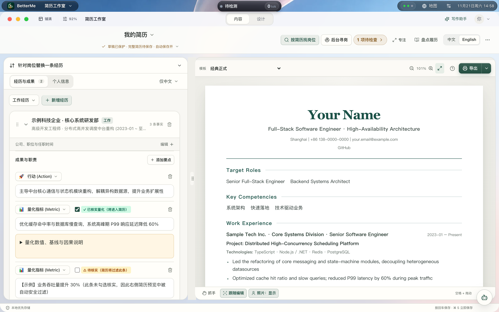
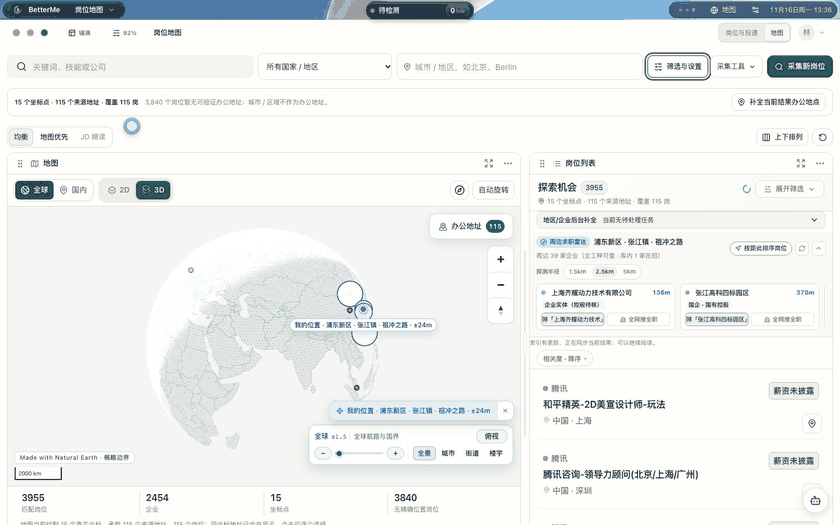
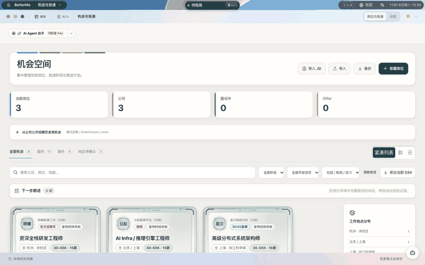
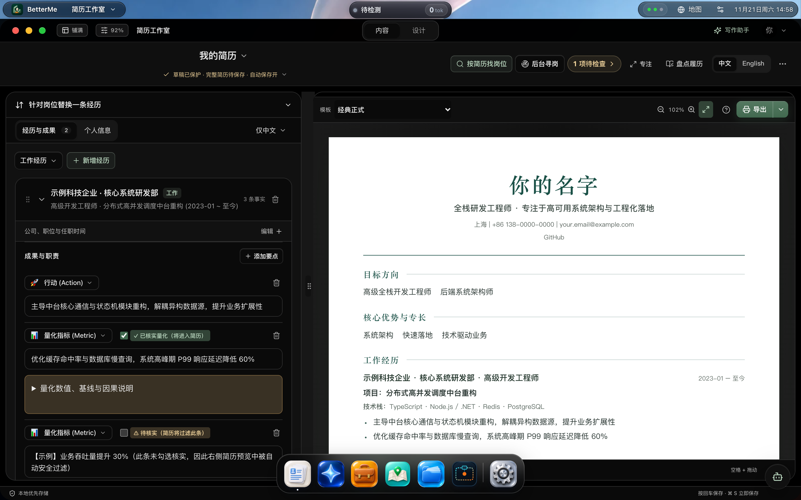
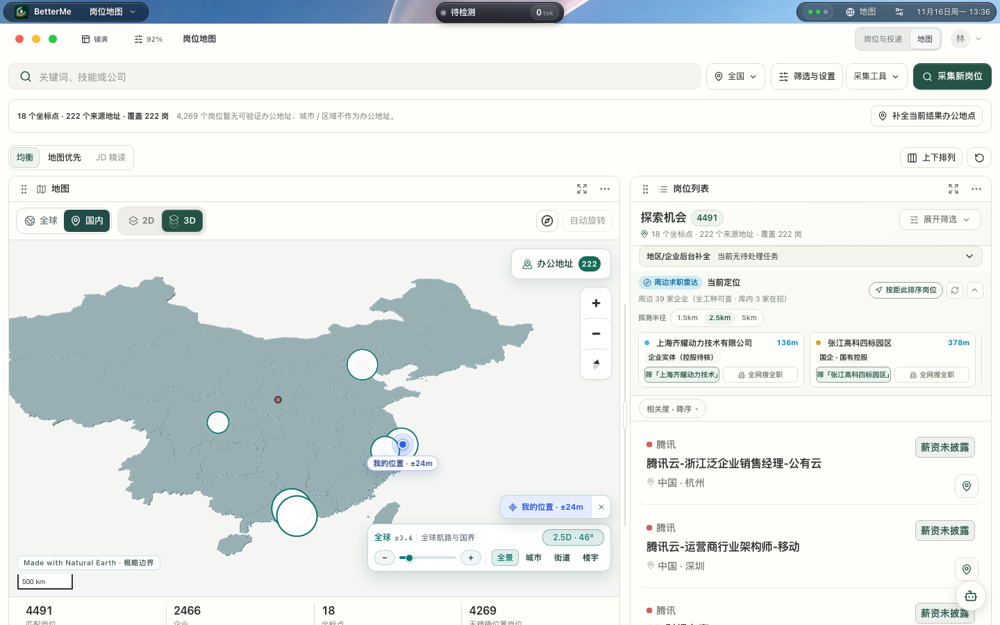
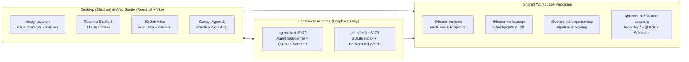

<div align="center">
  

  <h1>BetterMe</h1>

  <p>
    <strong>Local-First Career OS &amp; Evidence-Grounded AI Agent Workspace</strong><br/>
    Turn real experience into structured career assets, explore real employers in 3D, and stay in full control of your data.
  </p>

  <p>
    <strong>English</strong> · <a href="./README.zh-CN.md">简体中文</a>
  </p>

  <p>
    <a href="https://nanfengovo.github.io/better-me/"><strong>🌐 Live Web Preview</strong></a> ·
    <a href="https://github.com/nanfengovo/better-me/releases/latest"><strong>📦 Download Desktop App</strong></a> ·
    <a href="#-quick-start"><strong>🚀 Quick Start</strong></a> ·
    <a href="CONTEXT.md"><strong>📐 Product Boundaries</strong></a> ·
    <a href="docs/ROADMAP.md"><strong>🗺️ Roadmap</strong></a>
  </p>

  <p>
    <a href="https://github.com/nanfengovo/better-me/actions/workflows/ci-pages.yml"></a>
    <a href="https://github.com/nanfengovo/better-me/releases/latest"></a>
    
    
    
  </p>
</div>

<p align="center">
  <picture>
    <source media="(prefers-color-scheme: dark)" srcset="docs/media/showcase-20261121/02-resume-studio-dark-hd.png" />
    <source media="(prefers-color-scheme: light)" srcset="docs/media/showcase-20261121/04-resume-studio-en-hd.png" />
    
  </picture>
</p>

---

## Why BetterMe?

Most "AI resume builders" are single-shot prompt wrappers: models invent metrics out of thin air, switching templates scatters your edits, and job applications disappear into disconnected tabs.

**BetterMe separates Career Assets from Controlled Agent Execution:**

| Capability | Typical AI Resume Tools | **BetterMe** |
| :--- | :--- | :--- |
| **Data Ownership** | Cloud lock-in, opaque retention | **100% Local-First** — SQLite + IndexedDB, exportable JSON & checkpoints |
| **Factual Integrity** | Hallucinated numbers & silent rewrites | **Evidence-Grounded** — unverified metrics stay isolated from exported resumes |
| **Templates & Export** | A handful of rigid layouts | **119 layouts** (Native / RenderCV / JSON Resume) → PDF, DOCX, Markdown, YAML |
| **Job Exploration** | Flat lists with stale links | **3D Job Atlas** + Official ATS discovery (Workday, Eightfold, Workable, SmartRecruiters) |
| **Desktop Craft** | Generic web forms | **Calm Craft OS** — tactile UI primitives, drag-to-reorder, customizable global shortcuts & Undo/Redo |

---

## ✨ Key Features

### 1. Evidence-Grounded Resume Studio (`Calm Craft OS`)
- **Single Source of Truth (`FactBase`)**: Maintain experiences, verified metrics, causal context, and bilingual fields once; project into multiple role-targeted resume views without duplicating edits.
- **Tactile Desktop Editing**: Smooth 60fps pointer drag-and-drop sorting for experiences, auto-growing text inputs with focus-reveal formatting toolbars, live A4 pagination follow, and zero-hallucination metric guards.
- **119 Templates & Multi-Format Export**: Switch seamlessly across curated, RenderCV, and JSON Resume themes; export print-ready **PDF**, editable **DOCX** (with optional photo), **Markdown**, and **RenderCV YAML**.

<p align="center">
  
</p>

### 2. Customizable Global Shortcuts & Document Undo/Redo
- **Built-in Desktop Shortcuts**: `⌘/Ctrl + Z` Undo, `⇧ ⌘ Z / Ctrl + Y` Redo, `⌘/Ctrl + S` Save, `⇧ ⌘ S` Version History, `⇧ ⌘ F` Focus Mode, `⇧ ⌘ D` Content/Design toggle, `⌘/Ctrl + K` Find Jobs, `⌘/Ctrl + ,` Settings, and `⌥/Alt + 1–4` Workspace switching.
- **Live Keycap Recorder**: Rebind any shortcut inside **Settings → Keyboard Shortcuts** with instant conflict detection and global effect.

<p align="center">
  
</p>

### 3. 3D Job Atlas & Official Employer Discovery
- **Multi-Scale 3D Rendering**: Seamless zoom from global/national clusters to street-level 3D buildings powered by **MapLibre GL WebGL2** and **Cesium**, with offline Natural Earth fallback.
- **Official Career Discovery & Background Watch**: Discover real openings directly from employer ATS platforms (**Workday, Eightfold PCS, Workable, SmartRecruiters**) using your resume's skills, role, and location—with background watch notifications and zero silent auto-apply.

<p align="center">
  
</p>

### 4. Controlled Career Agent, Practice Workshop & Autopilot
- **Unified `AgentTaskKernel`**: JD breakdown, resume alignment, mock interviews, and multi-role review committees share one auditable task protocol, SHA-256 artifact storage, and pause/resume lifecycle.
- **On-Demand Practice Workshop**: Turn real JD gaps into targeted exercises (writing, tradeoffs, scheduling, or sandboxed QuickJS coding tasks) with 24-hour independent transfer retests—works with local Ollama models.
- **3D Opportunity Pipeline & 20-Node Autopilot**: Track applications across stages and orchestrate reviewable workflows while keeping login, CAPTCHAs, and final submissions strictly under human control.

<p align="center">
  
</p>

<details>
<summary>📸 View More High-Resolution Screenshots (Light / Dark / Modules)</summary>
<br/>

| Light Mode (ZH) | Dark Mode |
| :---: | :---: |
|  |  |

| 3D Atlas Panorama | Nearby Company Radar |
| :---: | :---: |
|  |  |

| AI Career Advisor | Autopilot 20-Node DAG Studio |
| :---: | :---: |
|  |  |

</details>

---

## 📦 Download & Try Now

### 🌐 Online Preview
Try the UI, 119 resume templates, and design system directly in your browser (static build, no local backend):
👉 **[https://nanfengovo.github.io/better-me/](https://nanfengovo.github.io/better-me/)**

### 💻 Desktop Installers (macOS / Windows / Linux)
Pre-built native Electron installers with bundled local services (`agent-host` + `job-service`) and verified `SHA256SUMS` are published on **[GitHub Releases](https://github.com/nanfengovo/better-me/releases/latest)**:

| Platform | Architecture | Installer / Archive | Checksums |
| :--- | :--- | :--- | :--- |
| **macOS** | Apple Silicon (`arm64`) | [`.dmg`](https://github.com/nanfengovo/better-me/releases/latest) · [`.zip`](https://github.com/nanfengovo/better-me/releases/latest) | `SHA256SUMS-darwin-arm64.txt` |
| **macOS** | Intel (`x64`) | [`.dmg`](https://github.com/nanfengovo/better-me/releases/latest) · [`.zip`](https://github.com/nanfengovo/better-me/releases/latest) | `SHA256SUMS-darwin-x64.txt` |
| **Windows** | `x64` | [`-setup.exe`](https://github.com/nanfengovo/better-me/releases/latest) | `SHA256SUMS-win32-x64.txt` |
| **Linux** | `x64` (glibc ≥ 2.34) | [`.AppImage`](https://github.com/nanfengovo/better-me/releases/latest) | `SHA256SUMS-linux-x64.txt` |

> **Note**: macOS builds use ad-hoc signing and Windows builds are currently unsigned. Verify the published SHA-256 checksums before installation.

---

## 🚀 Quick Start

### Option 1: Run from Source (Recommended for Developers)

Requirements: **Node.js `^24.15.0 || >=26`** and **pnpm `11.9.0`**.

```bash
git clone https://github.com/nanfengovo/better-me.git
cd better-me
pnpm install --frozen-lockfile
pnpm dev
```

Open `http://localhost:5173/`. The dev entrypoint automatically launches the Web Studio (`5173`), `agent-host` (`5179`), and `job-service` (`5178`).

### Option 2: Docker Compose (Self-Hosted)

```bash
git clone https://github.com/nanfengovo/better-me.git
cd better-me
docker compose up -d --build --wait
```

Open `http://127.0.0.1:8080/`. See [docs/deployment.md](docs/deployment.md) for persistent volume and OIDC options.

---

## 📐 Architecture



### Verification Commands

```bash
pnpm lint               # ESLint (--max-warnings 0)
pnpm typecheck          # Full Turborepo TypeScript check
pnpm test               # Complete unit & resume-quality suites
pnpm desktop:build      # Build & sync native Electron desktop runtime
```

---

## 🛡️ Privacy & Safety Boundaries

- **Local by Default**: Resumes, checkpoints, job indices, and learning logs stay on your machine—zero telemetry, zero forced cloud sync.
- **No Silent Fabrication**: Unverified metrics are visually flagged and filtered out of exported resumes until explicitly confirmed.
- **Human-in-the-Loop**: External logins, CAPTCHAs, final submissions, and sandboxed tools always require explicit user confirmation.
- **Isolated Local Bridge**: Development bridge routes bind to loopback with one-time expiring bearer grants and custom origin checks.

---

## 📄 Documentation & Releases

- [简体中文 README](README.zh-CN.md)
- [Product Boundaries (`CONTEXT.md`)](CONTEXT.md)
- [Roadmap (`docs/ROADMAP.md`)](docs/ROADMAP.md)
- [Docker Deployment (`docs/deployment.md`)](docs/deployment.md)
- [Release Notes (`docs/releases/v1.3.0.md`)](docs/releases/v1.3.0.md)
