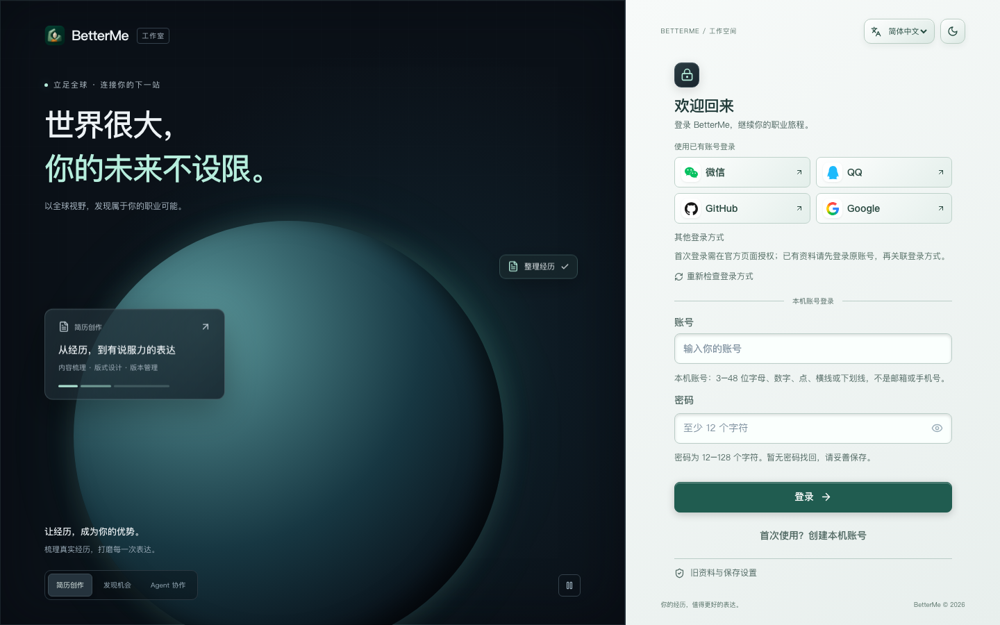
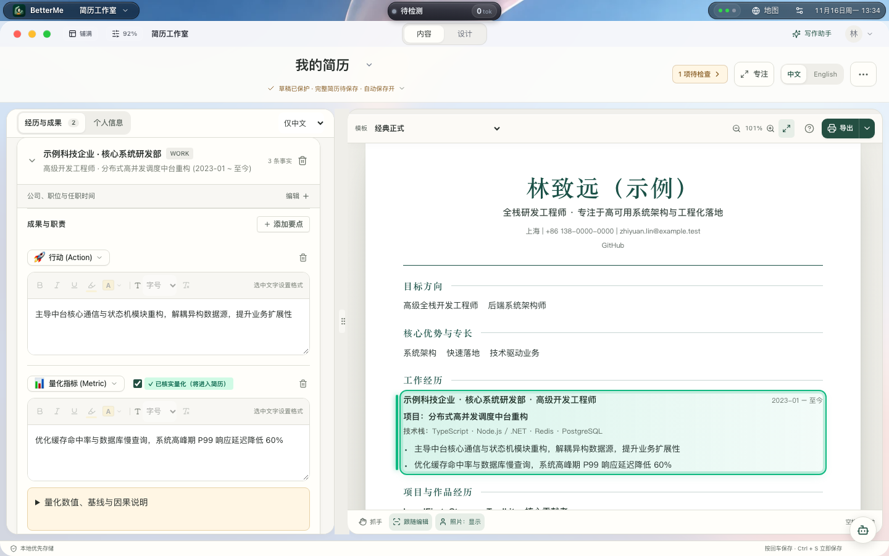
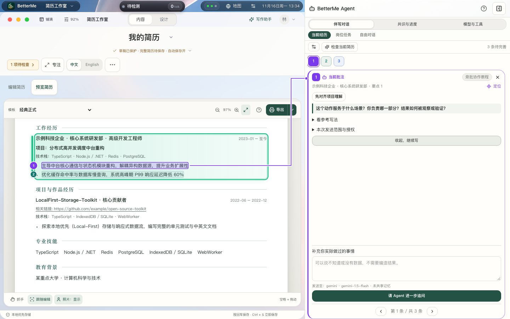
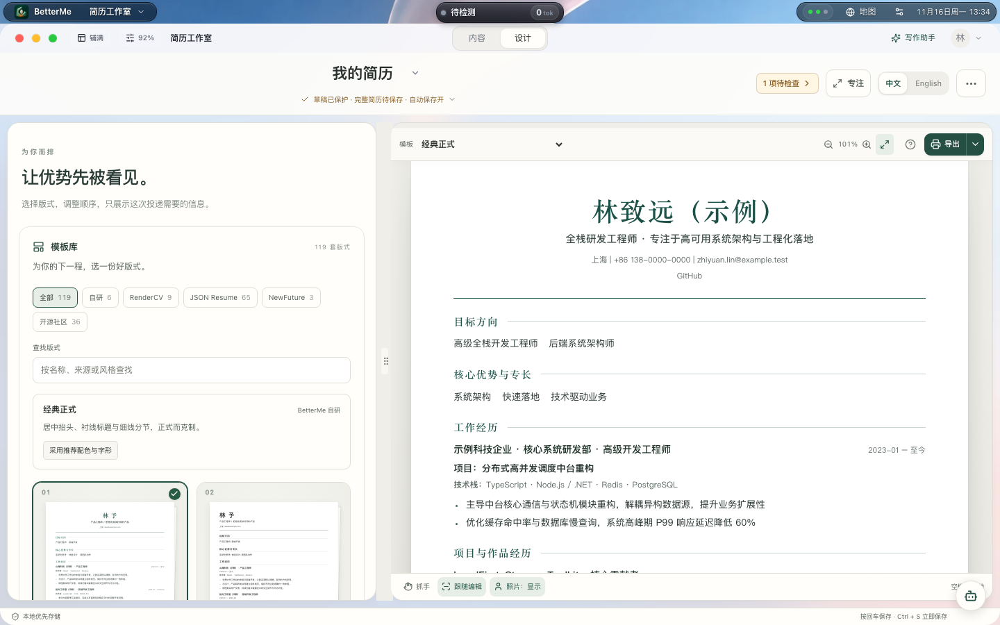
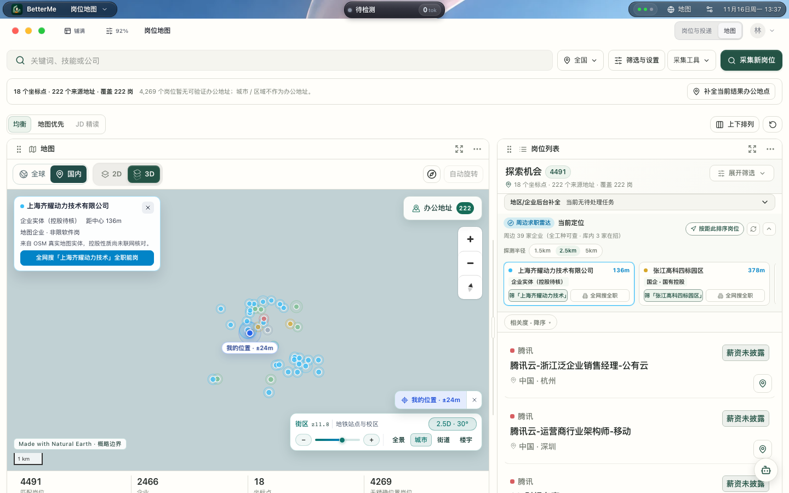
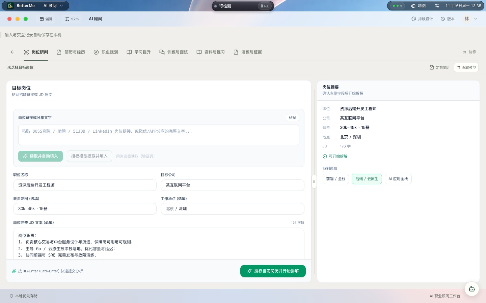
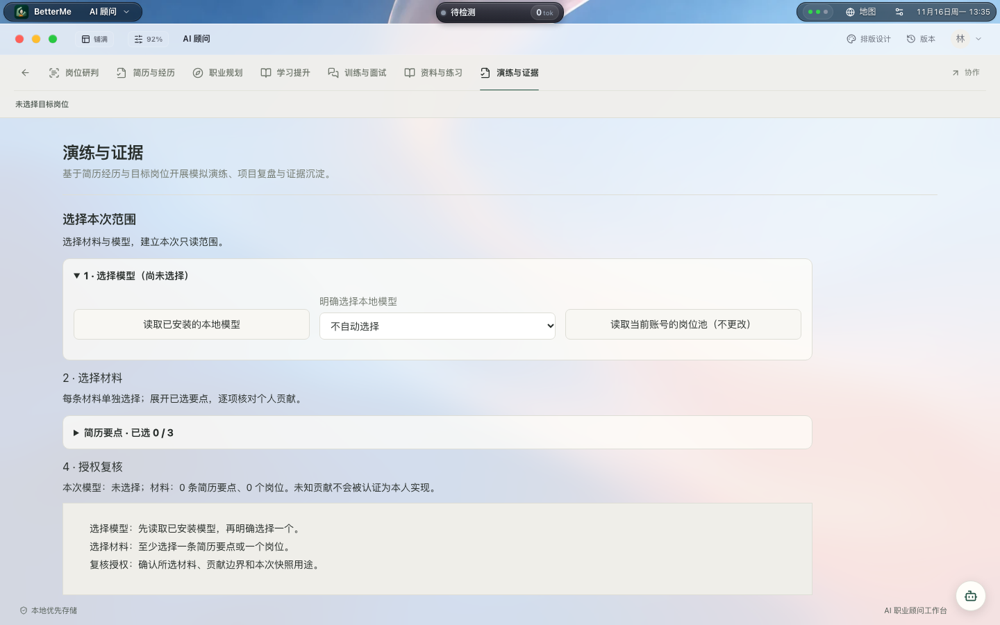
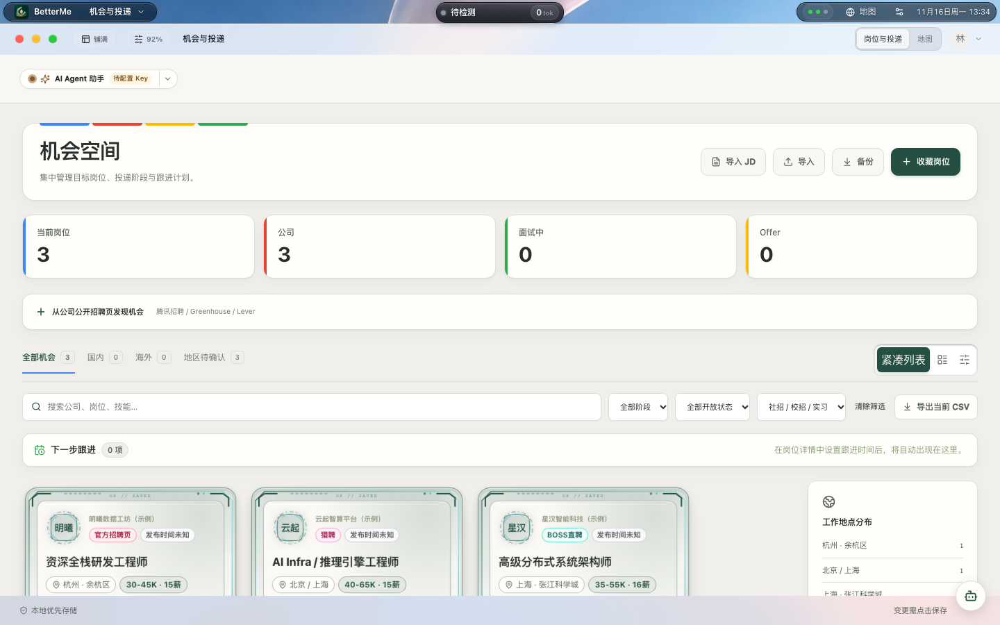

<div align="center">
  

  <h1>BetterMe · 迈向更好</h1>

  <p>
    <strong>本地优先的 Personal Career OS & 全链路求职 Agent 工作台</strong><br/>
    让真实经历成为可积累的职业资产，让 Agent 在可追溯、可核对的边界内帮你把目标推进到有依据的结果。
  </p>

  <p>
    <sub>Local-first Career Workspace & Personal Agent OS — ground experience in evidence, explore opportunities in 3D, and stay in control of your data.</sub>
  </p>

  <p>
    <a href="https://github.com/nanfengovo/better-me/actions/workflows/ci-pages.yml"></a>
    <a href="https://github.com/nanfengovo/better-me/releases"></a>
    
    
    
  </p>

  <p>
    <a href="#-实机动态演示">🎬 动态演示</a> ·
    <a href="#-核心工作区与实拍界面">✨ 核心界面</a> ·
    <a href="#-按需训练工坊">🧩 按需训练</a> ·
    <a href="#-三种运行方式">🚀 快速运行</a> ·
    <a href="#-桌面客户端下载与安装">📦 桌面安装包</a> ·
    <a href="#-系统架构与源码开发">📐 架构与开发</a> ·
    <a href="CONTEXT.md">产品边界</a> ·
    <a href="docs/ROADMAP.md">路线图</a>
  </p>
</div>

<p align="center">
  
</p>

<p align="center">
  🎬 <a href="docs/media/showcase-20261116/betterme-walkthrough-20261116.webm"><strong>观看 / 下载完整无剪辑实机录屏 walkthrough (WebM, 960×600)</strong></a> ·
  📄 <a href="docs/media/showcase-20261116/manifest.json">查看自动化录制清单</a>
</p>

---

## 为什么做 BetterMe？

市面上大多数「AI 写简历」工具只是单次对话改写器：模型随手补数字、换个模板数据散落、投完就忘，也不知道真实企业到底分布在哪里。

**BetterMe 把「职业资产管理」和「受控 Agent 执行」分成两个职责清晰的层：**

- **Career Workspace（职业工作台）** 是唯一事实源：统一沉淀个人经历 `FactBase`、多版本简历视图、检查点历史、投递记录与来源证据。
- **Personal Career Agent（个人职业 Agent）** 是受控协作引擎：围绕目标岗位拆解 JD、发起基于证据的伴写提问、多角色模拟演练、管理本地/云端模型与根预算，**绝不静默改写未经本人确认的职业事实**。

---

## 🎬 实机动态演示

> 以下动图与截图均由仓库内置自动化脚本通过真实 Chromium + WebGL2 录制（使用**隔离测试账号**与**合成示例简历「林致远（示例）」**，搭配本地岗位索引示例与公开地图实体探测，无任何个人隐私外泄与伪造数据）。

### 1. 简历工作室 & 证据锚定 AI 伴写 + 119 套版式切换

- **双栏实时联动**：左侧结构化编辑经历/行动/量化指标与因果依据，右侧 A4 实时分页预览与焦点高亮同步。
- **AI 伴写锚点连线**：逐条诊断缺少上下文或未经确认的数据，先对齐项目贡献与本人补充，再生成对照 Diff 草稿。
- **履历盘点（Career Inventory）**：支持语音（本机离线普通话识别）或文字回溯经历变化，沉淀选材策略而不污染原始事实。

<p align="center">
  
</p>

<details>
<summary>查看高分辨率界面截图：登录页 / 简历工作室 / AI 伴写锚点 / 119 套版式库</summary>
<br/>

| 入口展示与本机隔离认证 | 双栏编辑与实时 A4 分页联动 |
| :---: | :---: |
|  |  |

| AI 伴写批注与正文精准连线 | 119 套排版模板（自研 / RenderCV / JSON Resume） |
| :---: | :---: |
|  |  |

</details>

---

### 2. 3D 岗位地图（Job Atlas）× 街道级精准定位 × 全行业周边企业雷达

- **连续多尺度 3D 渲染**：支持 **MapLibre GL WebGL2（全景地球 → 国内省域 → 街道 → 自定义 3D 建筑挤出、FBO 阴影与环境光遮蔽 AO）** 与 **Cesium 三维地球**，并在无外网/离线环境下毫秒级回退本地 Natural Earth 边界渲染。
- **高精度位置与全行业企业雷达（Nearby Company Radar）**：一键获取街道级位置或自由缩放视野，直接探测 **1.5km / 2.5km / 5km** 范围内所有真实企业与产业园区（不限于已入库或软件研发岗），显示控股性质标签，并支持一键跨平台检索全职能岗位。
- **跨平台实时采集与 WebWorker 检索**：本地索引由 WebWorker 异步计算分桶与重叠点堆叠，保持多平台 SSE 流式采集期间地图与列表交互流畅不阻塞。

<p align="center">
  
</p>

| 全国/全球 3D 岗位集群全景 | 街道定位（±24m）× 周边 39 家企业雷达与企业实体浮窗 |
| :---: | :---: |
|  |  |

---

### 3. AI 职业顾问 × Career Studio 演练 × 20 节点 Autopilot 自动化工坊

- **AI 顾问工作台**：支持粘贴 BOSS直聘 / 猎聘 / 51Job / LinkedIn 链接或原文拆解 JD，覆盖岗位研判、简历定制、职业规划、隔时复习训练与模拟面试，所有任务共享同一 `AgentTaskKernel` 与根额度账本。
- **Career Studio（演练与证据）**：提供多角色**抗压测试委员会**、**技能推演**、**排版闭环编译**、**证据星图**、**架构面试白板**与**隐私发布校验**；进入前明确锁定 30 分钟只读授权快照。
- **机会空间 & 20-Node Autopilot DAG 工坊**：以 3D 卡片管理全阶段投递与沟通跟进，并用可视化 20 节点有向无环图编排检索、Guard 清洗、定制、ATS 验版与沙箱微应用（QuickJS）扩展。

<p align="center">
  
</p>

<details>
<summary>查看高分辨率界面截图：AI 顾问 / 演练与证据 / 3D 机会空间 / Autopilot 自动化工坊</summary>
<br/>

| AI 顾问 · JD 智能拆解与匹配准备 | Career Studio · 只读快照与贡献边界授权 |
| :---: | :---: |
|  |  |

| 机会与投递管理 · 3D 卡片与地点分布 | Autopilot Studio · 20 节点全链路工坊与玻璃 Dock |
| :---: | :---: |
|  |  |

</details>

---

## ✨ 核心功能模块明细

1. **统一 Agent 任务内核（`AgentTaskKernel`）**
   - 顾问聊天、经历润色、项目对齐、JD 拆解、链接/截图 OCR、模拟面试与 Studio 委员会共用同一任务协议与根额度账户。
   - 支持暂停、恢复与断线核对，超长输出按完整 Artifact 存储并校验 SHA-256，不将截断内容或工具报错伪装成完成。
2. **有依据的简历写作、盘点与多格式导出**
   - 区分工作/开源/教育经历的「行动」与「可证量化指标」；不把团队成果、外部基准写成个人业绩。
   - 支持 PDF、DOCX、Markdown、JSON 及 RenderCV YAML 导出；包含命名版本检查点、字段级 Diff 与一键回溯恢复。
3. **3D 岗位地图与实时岗位采集流水线**
   - `job-service` 基于 SQLite 持久化多源职位与公司控股结构，前端通过 `compute-worker` 离线程计算距离、薪资区间与地图聚类。
   - 多平台实时检索通过 SSE 流式回传卡片与进度，登录与反爬验证码明确交还用户本人处理，绝不静默代投。
4. **Career Studio 与受审沙箱工具（实验能力）**
   - 包含多角色审阅委员会、架构白板、技能星图与真实分页布局诊断（拒绝通过缩字裁页伪造“一页简历”）。
   - Coding Sandbox 在隔离 QuickJS 运行时验证白名单微应用，安装或调用均须单独人工授权。
5. **macOS 风格桌面壳 & 草稿隔离保护**
   - 集成灵动岛（Dynamic Island）实时 Token/状态指示、弹性缩放玻璃 Dock、自定义壁纸与自动隐藏菜单栏。
   - 所有编辑草稿、盘点进度与沟通记录按本机账号严格隔离，支持外部变更冲突检测与损坏恢复备份。
6. **可复现的简历质量评测与合成成长闭环**
   - 内置脱敏评测基线检查 JD 对齐度、STAR 信号与真实 A4 分页：`pnpm test:resume-quality`、`pnpm evals:resume-quality`、`pnpm evals:career`。
7. **按需训练工坊（学习提升）**
   - 描述目标和一次具体困难，本机模型先提出待核对的判断；认可后再组合练习界面，或编写受限计算代码。可记录初练、保留同一版本，并在 24 小时后换情境复测。
   - 新主题可以组合书写、策略选择与主观自评；可独立验算的邮件词数、并行排期逻辑在 QuickJS 内执行并由宿主复查，不以完成填写代替能力证明。

---

## 🧩 按需训练工坊

入口：**AI 顾问 → 学习提升 → 训练工坊**，或 **资料与练习 → 按需训练工坊**。网页与桌面共享同一实现；工具架属于当前 BetterMe 账号和当前 Host，不自动跨设备同步。

```text
目标 + 一次具体困难 → 模型提出假设 → 本人确认方向 → 构建并校验
                                                     ↓
                       明日换情境复测 ← 保留此版本 ← 试做与反馈
```

| 具体困难 | 生成的工具 | 反馈边界 |
| --- | --- | --- |
| 给非技术同事解释概念时，总是在堆术语 | 模型按主题编排情境、书写、策略选择及 1–5 自评，不需要预先开发这个主题的页面 | 只记录有效填写和原始作品；自评不是专业正确率 |
| 英文邮件压短后，常漏掉请求或截止日期 | 两封不同情境的邮件素材，以及模型编写的词数计算程序 | 核对词数与指定词；不评分语法、语义或真实英语水平 |
| 把并行任务的延期直接累加到交付日 | 任务依赖表、延期滑块、总工期预测与模型编写的模拟程序 | 宿主独立核对工期；不保证真实项目交付 |

**怎么用：** 填写目标和具体经历，点「同意并分析难点」，核对建议后点「认可方向，构建试用版」。信息不足时会先追问，一次解释足够时不创建应用。下方另有明确标识为非 AI 生成的内置示例，无需调用模型即可体验。

- **模型与费用**：自行安装并启动本机 Ollama，在输入框填写已安装的模型标签。当前本机协议只放行已审计的 `0.40.15` / `0.40.16`；已实际验证 `gemma4:e2b-it-qat`。本路径不需要云端 API Key、不会转用云模型或自动下载权重，无按次云端模型费用，但仍占用本机算力与电力。
- **调用上限**：分析一次；开放式练习再设计一次。计算工具最多再用三次完成题目设计、代码生成和一次有明确失败结果的修复。断线或结果不明确时不自动重发。保留后重开、练习和复测不再调用模型。
- **沙箱与授权**：模型不能输出可执行 HTML、安装插件或获取文件、网络、麦克风、密钥和 Node 权限。计算程序只在有时间/内存限制的 QuickJS worker 中处理 JSON；验收标准与参考计算由宿主掌握。
- **保存与复测**：试用最长两小时，只有点「保留此版本」才持久保存工具内容和本版作答。首次提交满 24 小时后解锁另一情境，保留两次原答及是否先看过反馈；不自动写入简历或 FactBase。舍弃前需确认，只移除所选版本和它的作答。
- **尚未提供**：Gemini Live 式实时语音陪练、任意原生应用安装、专业能力认证及长期学习效果保证。静态 GitHub Pages 也不自带本机 Host、模型或持久工具架。

实现、隔离验收和复验命令见 [按需训练工坊报告](docs/reports/personal-training-workshop-2026-11-17.md)。版本更新说明见 [v1.2.0 发布说明](docs/releases/v1.2.0.md)；安装包是否可下载，以 [GitHub Releases](https://github.com/nanfengovo/better-me/releases) 的实际附件为准。

---

## 🚀 三种运行方式

| 方式 | 适用场景 | 能力边界 |
| --- | --- | --- |
| **桌面客户端（Electron）** | 日常本地使用 | 应用窗口与本机后台一体启动；云模型/外部 CLI 另行配置 |
| **Docker 完整版** | 自托管或浏览器访问 | 启动 Web、Agent Host 与岗位 SQLite；容器不接管宿主机浏览器登录态 |
| **GitHub Pages 在线预览** | 快速体验 UI 与编辑器 | 纯静态站点（[网页预览](https://nanfengovo.github.io/better-me/)），不带本机后台与招聘抓取 |

### 源码本地开发（推荐）

环境要求：**Node.js `^24.15.0 || >=26`** 与 **pnpm `11.9.0`**。

```sh
git clone --branch agent-os https://github.com/nanfengovo/better-me.git
cd better-me
pnpm install --frozen-lockfile
pnpm dev
```

启动后访问 `http://localhost:5173/`（或 `http://127.0.0.1:5173/`），开发入口将自动拉起前端工作台、`agent-host (5179)` 与 `job-service (5178)`。

#### 本机招聘桥接的授权方式

Vite 开发/预览服务中的岗位同步与 Cookie 导入仅面向本机回环地址，不应映射到公网。工作台自身的同步轮询、手工导入与浏览器控制使用同源请求及 `X-BetterMe-Bridge: 1` 请求头；外部网页不能读取同步结果或操作浏览器。

- 招聘网站书签同步：在「平台登录 / 会话」中显式生成一次性书签，再在支持的 HTTPS 招聘网站使用。授权 10 分钟内有效、仅可成功提交一次；旧的无令牌书签需重新生成。该操作只导入页面可见的 Cookie，不读取 HttpOnly Cookie。
- 扩展岗位同步：先填写扩展的完整来源（如 `chrome-extension://扩展ID`），再复制一次性配对信息。扩展向给定 `endpoint` 发送 JSON 岗位数据，使用 `Authorization: Bearer <token>` 请求头；来源必须完全一致。令牌只允许写入一次岗位，不允许读取岗位、导入 Cookie 或控制浏览器。
- 令牌不放入 URL、不写入服务端磁盘；重新生成会撤销同一工作台和用途的旧令牌。同步岗位仅保留在服务内存中，10 分钟后失效。导入结果不明确时不会自动重试，需要本人重新确认授权。

这是一层本机 HTTP 桥接防护，不是操作系统沙箱或多用户服务认证。生产桌面内置网关不开放这些 Vite 桥接路由；部署时不要额外公开开发服务端口。

#### 自动重制本 README 演示截图与动图 / 视频

启动 `pnpm dev` 后，可执行仓库内置自动化脚本一键重采最新实机素材（默认输出到 `docs/media/showcase-20261116/`）：

```sh
node scripts/capture-readme-showcase.mjs
python3 scripts/render-readme-gifs.py
```

### Docker Compose 一键运行

```sh
git clone --branch agent-os https://github.com/nanfengovo/better-me.git
cd better-me
docker compose up -d --build --wait
```

访问 `http://127.0.0.1:8080/`。停止服务请使用 `docker compose down`（保留数据卷）；完整配置说明见 [Docker 部署文档](docs/deployment.md)。

### 桌面端开发与打包

```sh
pnpm desktop          # 启动 Electron 开发窗口
pnpm desktop:build    # 编译 Web 页面、主进程、预加载脚本与后台服务
pnpm desktop:dist     # 为当前系统与架构构建安装包（输出至 release/）
pnpm desktop:smoke    # 使用全新临时目录对打包成品做真实启动烟测
```

---

## 📦 桌面客户端下载与安装

从 [GitHub Releases](https://github.com/nanfengovo/better-me/releases) 下载对应平台安装包（附件上传完成代表正式发行，可配合同页 `SHA256SUMS-*` 校验完整性）：

| 平台 | 发行格式 | 支持架构 |
| --- | --- | --- |
| macOS | `.dmg`、`.zip` | Apple Silicon `arm64`、Intel `x64` 分开提供 |
| Windows | `.exe` 安装程序 | `x64` |
| Linux | `.AppImage` | `glibc x64`（要求 glibc ≥ 2.34；CI 基于 Ubuntu 22.04） |

- 桌面包已内置 Electron 运行时、应用前端及本地后台依赖，无需预先安装 Node、pnpm 或 Docker；本机服务默认仅绑定 loopback（`http://127.0.0.1:32741`）。
- 当前桌面端采用 macOS ad-hoc 签名，**暂未配备 Apple Developer ID 公证或 Windows Authenticode 证书**。请仅从官方 Releases 下载并按系统自带人工确认流程信任运行，勿全局关闭系统防护。
- 升级保留原用户数据目录；更新前建议先导出 JSON 备份。

---

## 🔒 可信协作流程与数据隐私边界

```text
[1. 确认目标与范围] ──▶ [2. 理解与来源核对] ──▶ [3. 生成候选与差异] ──▶ [4. 人工逐项采纳] ──▶ [5. 持续复盘沉淀]
```

“本地优先”指个人核心职业资产与草稿保存在本机数据目录，**不等于所有联网步骤都离线**：

| 操作类型 | 数据去向与控制策略 |
| --- | --- |
| 本地编辑、规则检查、版本与导出 | 仅保存在当前浏览器 / 桌面应用账号隔离目录 |
| 云模型分析、AI OCR、智能伴写 | 仅在本人显式授权后，将选定片段发送至所配模型端点 |
| 本机 Ollama 模型 | 仅通信本机配置的 Ollama 服务端口，不出本机 |
| 招聘平台采集与地图周边探测 | 访问对应公开平台 / OSM / 高德接口；登录或验证码交由用户本人完成 |
| 原生 CLI 与受审微应用沙箱 | 受限于平台隔离检查与显式批准；不私自读取外部个人隐私目录 |

> ⚠️ 切勿向公共仓库提交 `.env`、API Key、登录凭据、真实个人简历或私人 SQLite 数据库。

---

## 📐 系统架构与质量门禁

```text
apps/web          职业工作台、简历编辑预览、3D 岗位地图（MapLibre + Cesium）与 Dev 网关
apps/desktop      Electron 桌面壳、macOS/Win/Linux 打包与私有持久化后台
apps/agent-host   统一 AgentTaskKernel、身份隔离存储、能力路由与执行记录
apps/job-service  多源岗位抓取、企业控股归类、地理编码与 SQLite 持久化
packages/core     个人事实模型 FactBase、规则检查、JD 拆解与简历投影
packages/storage  版本检查点、字段级 Diff 恢复与持久化存储适配
packages/*        岗位查询领域引擎、来源适配器与跨进程契约
evals/            简历质量基线、脱敏金标对比与职业分析评测集
scripts/          自动化视觉基线、README 实机录屏与 GIF 编译脚本
```

全量研发质量检查命令：

```sh
pnpm lint             # ESLint 全仓零警告检查
pnpm typecheck        # TypeScript 多包联合类型检查
pnpm test             # 单元测试与脱敏简历质量回归
pnpm test:runtime     # 运行时网关与桌面接口测试
pnpm test:desktop     # Electron 生命周期与隔离烟测
```

---

## 📎 当前边界与延伸文档

- **已知边界**：复杂多栏/扫描件 PDF 原稿仍需人工核对提取结果；岗位坐标、周边企业披露与薪资范围受制于招聘源与开放地图数据覆盖；`vork/Metal`、Career Studio 演练与 Coding Sandbox 仍在持续演进中，不替代本人对真实经历与投递行为的最终判断。
- **核心文档索引**：
  - [产品领域语言与边界 (CONTEXT.md)](CONTEXT.md) · [开发路线图 (ROADMAP.md)](docs/ROADMAP.md)
  - [岗位地图专题文档](docs/job-atlas.md) · [模板与授权目录](templates/CATALOG.md)
  - [部署说明](docs/deployment.md) · [账号与身份部署](docs/deployment-auth.md)
  - [实机媒体清单与历史截图说明](docs/media/README.md) · [过往版本报告目录](docs/images/README.md)
  - [工作区功能验收汇总 (2026-11-13)](docs/reports/agent-os-workspace-publish-2026-11-13.md) · [履历盘点 (2026-11-14)](docs/reports/career-inventory-2026-11-14.md)
  - [按需训练工坊 (2026-11-17)](docs/reports/personal-training-workshop-2026-11-17.md) · [v1.2.0 发布说明](docs/releases/v1.2.0.md)
- **许可说明**：仓库内置第三方代码、排版模板、地图数据与图标资源均遵循各自 `LICENSE / NOTICE`。目前项目整体尚未声明单一开源许可证；欢迎通过 Issue 或 Pull Request 交流建议与贡献改进。
