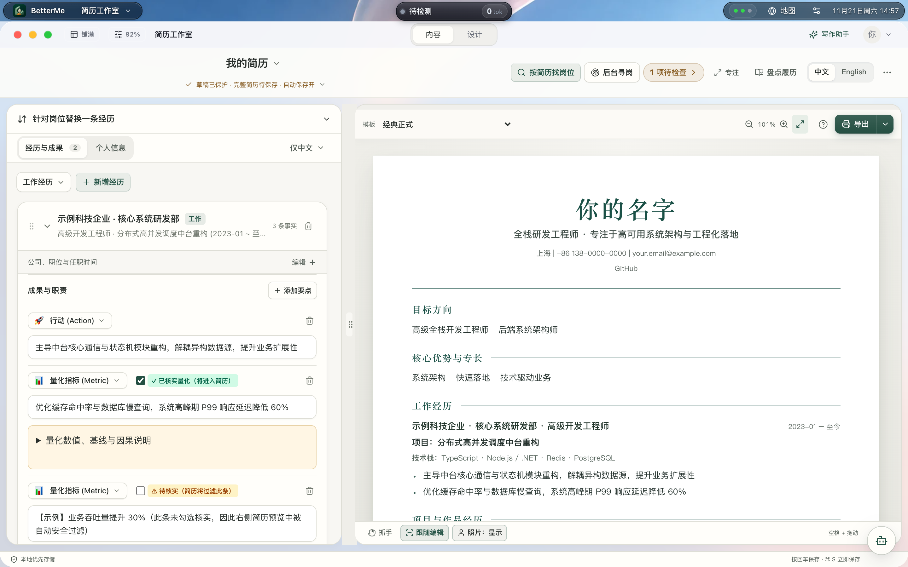
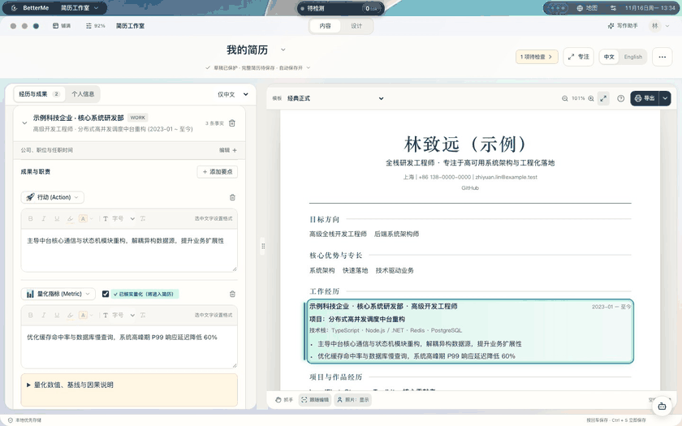
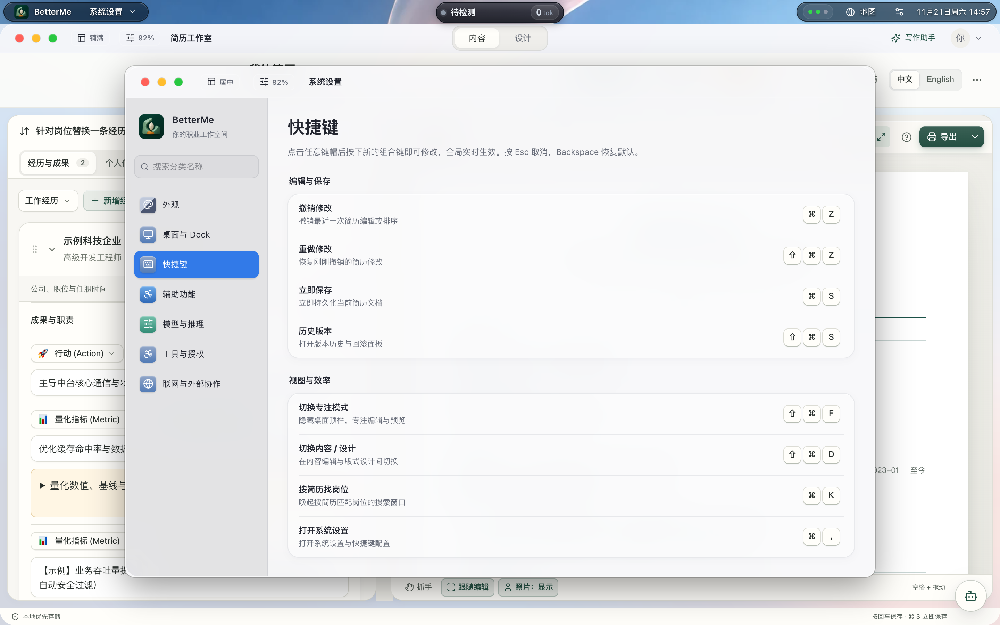
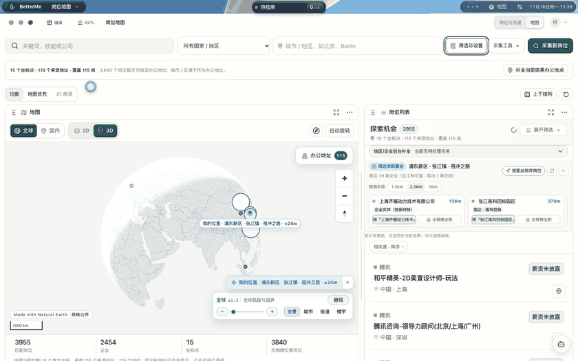
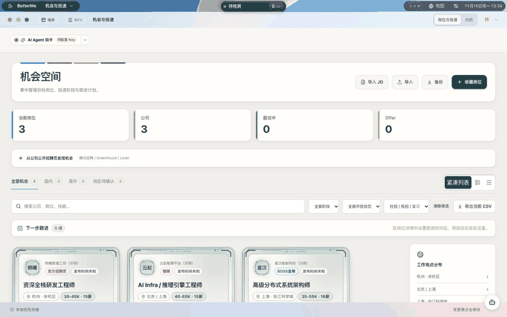
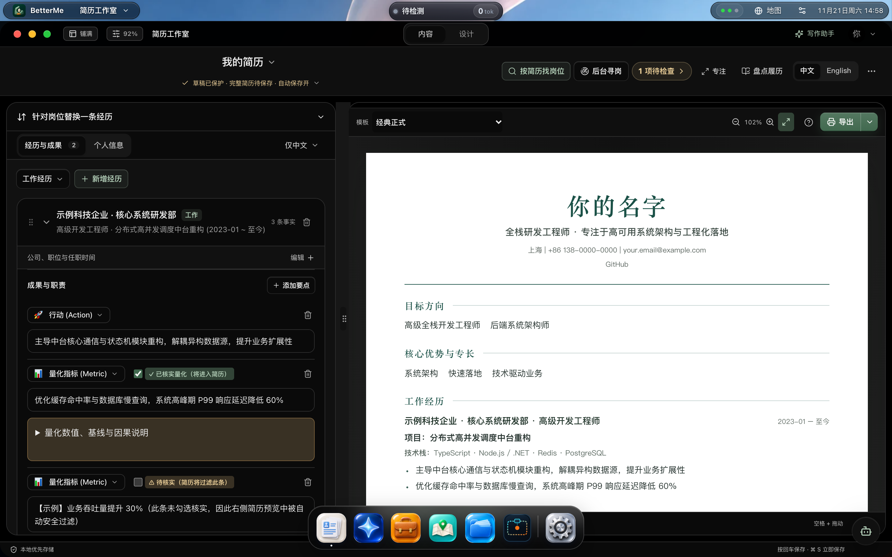
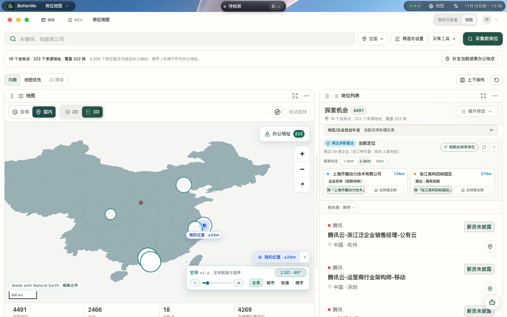
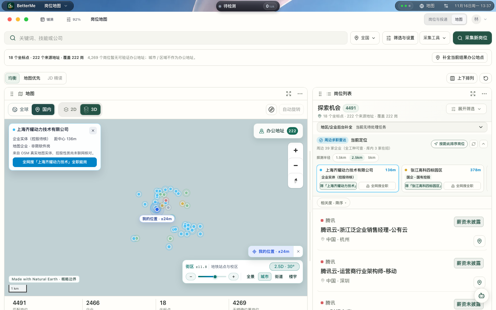
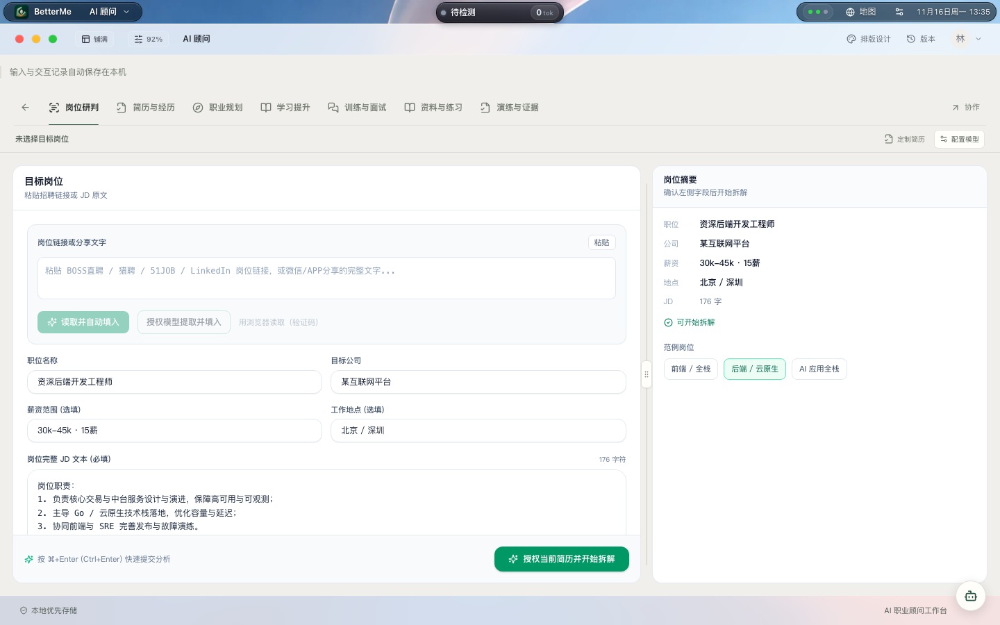
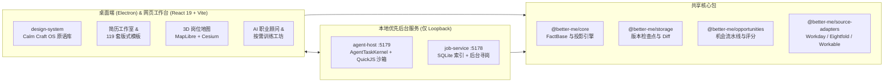

<div align="center">
  

  <h1>BetterMe · 迈向更好</h1>

  <p>
    <strong>本地优先的个人职业工作台 &amp; 有依据的 AI Agent 协作操作系统</strong><br/>
    把真实经历沉淀为可积累的职业资产，在 3D 地图中探索真实企业，让 AI 在可追溯的边界内替你推进目标。
  </p>

  <p>
    <a href="./README.md">English</a> · <strong>简体中文</strong>
  </p>

  <p>
    <a href="https://nanfengovo.github.io/better-me/"><strong>🌐 在线网页预览</strong></a> ·
    <a href="https://github.com/nanfengovo/better-me/releases/latest"><strong>📦 下载桌面客户端</strong></a> ·
    <a href="#-快速开始"><strong>🚀 快速开始</strong></a> ·
    <a href="CONTEXT.md"><strong>📐 产品边界</strong></a> ·
    <a href="docs/ROADMAP.md"><strong>🗺️ 路线图</strong></a>
  </p>

  <p>
    <a href="https://github.com/nanfengovo/better-me/actions/workflows/ci-pages.yml"></a>
    <a href="https://github.com/nanfengovo/better-me/releases/latest"></a>
    
    
    
  </p>
</div>

<p align="center">
  <picture>
    <source media="(prefers-color-scheme: dark)" srcset="docs/media/showcase-20261121/02-resume-studio-dark-hd.png" />
    <source media="(prefers-color-scheme: light)" srcset="docs/media/showcase-20261121/01-resume-studio-light-hd.png" />
    
  </picture>
</p>

---

## 为什么做 BetterMe？

大多数「AI 写简历」工具只是一次性对话改写器：模型随手编造量化数字、换套模板内容散落、投完就忘，也看不到真实企业到底分布在哪里。

**BetterMe 把「职业资产管理」与「受控 Agent 执行」彻底分层：**

| 维度 | 常见 AI 简历工具 | **BetterMe** |
| :--- | :--- | :--- |
| **数据主权** | 云端锁定，迁移困难 | **100% 本地优先** — SQLite + IndexedDB、标准 JSON Resume、版本检查点与本地 **MCP Server** |
| **真实性边界** | 随手编造数字、静默篡改经历 | **零虚构门禁 + 改写数字守卫** — 未核实指标自动隔离；AI 改写引入未知数字自动拦截 |
| **排版与导出** | 少数固定样式 | **119 套版式** → PDF、DOCX、Markdown、RenderCV YAML、**JSON Resume** 与 **双模式交互主页 HTML** |
| **岗位探索** | 静态列表、失效链接 | **3D 岗位地图** + 官方 ATS 直连发现（Workday / Eightfold / Workable / SmartRecruiters）+ **免登录 ATS 诊断** |
| **桌面交互质感** | 普通后台表单 | **Calm Craft OS** — `⌘ K` 全局命令面板、技能-证据图谱、实时 A4 分页线、可配置快捷键与撤销/重做 |

---

## ✨ 核心亮点

### 1. 有依据的简历工作室（Calm Craft OS）
- **唯一事实源（`FactBase`）**：一份结构化履历库同时驱动多版本岗位定制简历与中英双语切换，改一处全局同步。
- **桌面级写作手感 & ATS 视图**：60fps Pointer 丝滑拖拽排序、选中即现的局部写作气泡（含不编造数字的 `[X]` 量化占位支架）、实时 A4 页数统计与虚拟分页提示线、点击纸张段落直达编辑区，以及 **视觉 | ATS 解析** 一键切换。
- **技能-证据图谱 & 双模式交互主页导出**：零 WebGL 负担的触感 CSS-3D 技能键帽映射真实经历证据，支持按简历视角勾选/隐藏条目；一键导出 100% 离线单文件 `.html` 个人职业主页（支持「探索图谱 / 经典打印简历」双模式、深浅色与减弱动效切换，默认脱敏个人联系方式）。
- **119 套模板与多格式导出**：一键导出高保真 **PDF**、可编辑 **DOCX**（支持可选照片）、**Markdown**、**RenderCV YAML**，并支持标准 **JSON Resume (`jsonresume.org`)** 双向导入导出。

<p align="center">
  
</p>

### 2. 全局命令面板、可配置快捷键 & 文档级撤销/重做
- **全局命令面板（`⌘/Ctrl + K`）**：无需鼠标即可快速切换工作台、明暗主题、专注模式、导出 JSON Resume / 双模式交互主页或直达 MCP 本地连接向导。
- **内置主流桌面快捷键**：`⌘/Ctrl + K` 命令面板、`⌘/Ctrl + J` 按简历找岗位、`⌘/Ctrl + Z` 撤销、`⇧ ⌘ Z / Ctrl + Y` 重做、`⌘/Ctrl + S` 立即保存、`⇧ ⌘ S` 历史版本、`⇧ ⌘ F` 专注模式、`⇧ ⌘ D` 内容/设计切换、`⌘/Ctrl + ,` 打开设置、`⌥/Alt + 1~4` 切换工作台。
- **系统设置可视化录键**：打开 **系统设置 → 快捷键**，点击任意实体键帽按下新组合键即可实时录制、自动冲突检测并全局生效。

<p align="center">
  
</p>

### 3. 3D 岗位地图（Job Atlas）与官方招聘源发现
- **连续多尺度三维渲染**：融合 **MapLibre GL WebGL2**（自定义 3D 建筑挤出与阴影）与 **Cesium 三维地球**，无外网时毫秒级回退本地 Natural Earth 边界。
- **周边企业雷达 & 官方 ATS 后台寻岗**：按当前简历的方向、技能与城市直接检索 **Workday、Eightfold PCS、Workable、SmartRecruiters** 等企业官网岗位，并支持后台监控提醒，登录与投递全程由本人确认。

<p align="center">
  
</p>

### 4. 受控职业 Agent、改写事实守卫与本地 MCP Server
- **统一 `AgentTaskKernel` 与改写事实保真守卫**：JD 拆解、证据伴写、模拟面试与多角色审阅委员会共享同一任务协议与 SHA-256 产物校验。所有 AI 改写提议均须通过确定性新增数字守卫校验，若出现原 `FactBase` 中不存在的数字指标将被自动拦截并要求核验。
- **BetterMe 本地 MCP Server**：通过标准 stdio 协议（`pnpm mcp:start`）将本地 `FactBase`、已核实经历证据、ATS 评分与改写事实守卫安全暴露给 **Claude Desktop**、**Cursor** 或 **Antigravity** 调用（默认脱敏 PII），可在 **系统设置 → MCP 本地连接** 一键复制客户端 JSON 配置（详见 [docs/guides/mcp-server.md](docs/guides/mcp-server.md)）。
- **按需训练工坊 & 20 节点 Autopilot**：围绕具体岗位短板生成针对性练习（表达改写、架构取舍、排期判断或受限 QuickJS 编程题，支持本机 Ollama 模型），并可视化编排投递与求职任务，登录、验证码与最终提交全程保持人工授权。

<p align="center">
  
</p>

<details>
<summary>📸 查看更多超高清界面截图（浅色 / 深色 / 各功能工作台）</summary>
<br/>

| 浅色模式 · 简历工作室 | 深色模式 · 玻璃质感 |
| :---: | :---: |
|  |  |

| 3D 岗位地图全国全景 | 街道定位 × 周边企业雷达 |
| :---: | :---: |
|  |  |

| AI 顾问 · JD 智能拆解 | Autopilot 20 节点自动化工坊 |
| :---: | :---: |
|  |  |

</details>

---

## 📦 在线预览与全平台桌面安装包

### 🌐 在线网页预览 & 免登录工具
无需安装或登录，立即在浏览器体验 Agent OS 工作台、119 套简历模板与纯本地 ATS 诊断工具（纯静态托管，不上传数据）：
- **Agent OS 工作台**：👉 **[https://nanfengovo.github.io/better-me/](https://nanfengovo.github.io/better-me/)**
- **免登录 ATS & JD 纯文本诊断**：👉 **[https://nanfengovo.github.io/better-me/?view=ats](https://nanfengovo.github.io/better-me/?view=ats)**（纯浏览器确定性评分，无需 API Key）
- **产品概览 Landing Page**：👉 **[https://nanfengovo.github.io/better-me/?view=landing](https://nanfengovo.github.io/better-me/?view=landing)**

### 💻 桌面客户端下载（macOS / Windows / Linux）
完整内置前端工作台、`agent-host` 与 `job-service`，所有平台均附带 `SHA256SUMS` 校验文件，前往 **[GitHub Releases](https://github.com/nanfengovo/better-me/releases/latest)** 下载：

| 平台 | 架构 | 安装包 / 压缩包 | 校验文件 |
| :--- | :--- | :--- | :--- |
| **macOS** | Apple Silicon (`arm64`) | [`.dmg`](https://github.com/nanfengovo/better-me/releases/latest) · [`.zip`](https://github.com/nanfengovo/better-me/releases/latest) | `SHA256SUMS-darwin-arm64.txt` |
| **macOS** | Intel (`x64`) | [`.dmg`](https://github.com/nanfengovo/better-me/releases/latest) · [`.zip`](https://github.com/nanfengovo/better-me/releases/latest) | `SHA256SUMS-darwin-x64.txt` |
| **Windows** | `x64` | [`-setup.exe`](https://github.com/nanfengovo/better-me/releases/latest) | `SHA256SUMS-win32-x64.txt` |
| **Linux** | `x64` (glibc ≥ 2.34) | [`.AppImage`](https://github.com/nanfengovo/better-me/releases/latest) | `SHA256SUMS-linux-x64.txt` |

> **说明**：macOS 使用 ad-hoc 签名，Windows 暂未签发商业代码证书，安装前请核对对应 `SHA256SUMS-*` 并遵循系统人工确认流程。

---

## 🚀 快速开始

### 方式一：源码本地运行（推荐）

环境要求：**Node.js `^24.15.0 || >=26`** 与 **pnpm `11.9.0`**。

```bash
git clone https://github.com/nanfengovo/better-me.git
cd better-me
pnpm install --frozen-lockfile
pnpm dev
```

打开 `http://localhost:5173/`，开发入口会自动拉起前端工作台（`5173`）、`agent-host`（`5179`）与 `job-service`（`5178`）。

### 方式二：Docker Compose 一键自托管

```bash
git clone https://github.com/nanfengovo/better-me.git
cd better-me
docker compose up -d --build --wait
```

访问 `http://127.0.0.1:8080/`，完整持久化与 OIDC 配置见 [Docker 部署文档](docs/deployment.md)。

---

## 📐 系统架构



### 常用工程命令

```bash
pnpm lint               # ESLint 零警告检查
pnpm typecheck          # 全仓库 TypeScript 类型检查
pnpm test               # 全量单元测试与简历质量回归
pnpm desktop:build      # 构建并同步本地 Electron 桌面运行包
```

---

## 🛡️ 隐私与安全边界

- **本地优先**：简历、检查点、岗位索引与学习记录默认保存在本机，无遥测、无强制云同步。
- **拒绝幻觉**：未确认的量化指标会被标记并从导出简历中自动过滤，杜绝 AI 静默捏造数据。
- **人在回路**：第三方登录、验证码、最终投递以及受审沙箱工具均需本人显式确认。
- **回环桥接防护**：本地开发桥接仅监听回环地址，使用一次性过期 Bearer 令牌与严格来源校验。

---

## 📄 相关文档与版本记录

- [English README](README.md)
- [产品边界 (`CONTEXT.md`)](CONTEXT.md)
- [路线图 (`docs/ROADMAP.md`)](docs/ROADMAP.md)
- [Docker 部署文档 (`docs/deployment.md`)](docs/deployment.md)
- [v1.3.0 发布说明 (`docs/releases/v1.3.0.md`)](docs/releases/v1.3.0.md)
