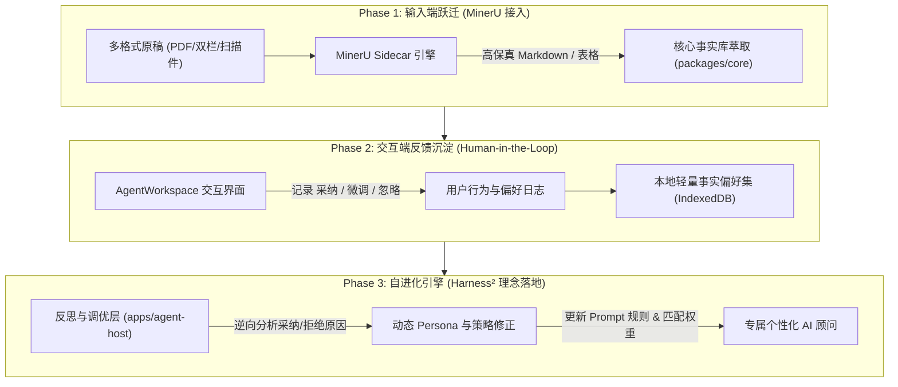

# Agent 自进化与智能文档导入（MinerU & Harness²）技术演进方案

状态：**规划与设计草案（暂不落地编码，写入文档沉淀）**  
基线日期：2026-10-22  
关联项目：
- [OpenDataLab / MinerU](https://github.com/opendatalab/mineru)：高精度文档抽取、版面分析与多模态 OCR
- [Google Research / Harness²](https://github.com/google-research/harness2)：开放世界递归 Agent Harness 框架与自进化理念

---

## 一、 背景与核心诉求

BetterMe（迈向更好）定位为 Local-First 的求职与职业成长工作台。随着求职顾问（Career Copilot）、岗位画像与多 Agent 协同体系的建立，系统面临两个关键维度的演进诉求：

1. **输入端精准度（文档导入与 OCR）**：
   - 用户的存量简历形态各异：包含大量双栏排版、复杂经历表格、设计稿、扫描件或图片证书。
   - 现有的轻量级文本抽取库（如 `pdfjs-dist`、`mammoth`）在处理双栏简历时左右文字穿透错乱，表格经历行列解构丢失，缺乏真正的版面语义理解能力，严重制约了结构化事实库（`FactBase`）的萃取质量。
2. **认知端长效演进（Agent 的自进化）**：
   - 现阶段 AI 顾问的诊断与润色规则主要基于静态提示词（System Prompt）和固化规则。
   - 面对不同行业、技术层级和沟通风格的求职者，Agent 需要具备“越用越懂用户”的自适应能力，即在不微调底层模型权重的前提下，通过用户的交互反馈（采纳、微调、忽略、面试结果）实现外壳（Harness）与策略的自主迭代。

---

## 二、 开源项目深度评估与技术选型

### 1. MinerU：强契合的输入端高精解析引擎

- **定位**：OpenDataLab 开源的高精度文档提取工具，专注于将复杂排版的 PDF、图片、Office 文档转化为干净、结构化且对 LLM 友好的 Markdown 和 JSON。
- **解决的核心痛点**：
  - **版面分析（Layout Analysis）**：精准识别双栏/三栏布局，按人类视觉阅读流正确切分段落，杜绝左右穿透；
  - **复杂表格重建**：自动识别工作经历、技能矩阵等嵌套表格，完整还原为 Markdown 表格；
  - **内嵌多模态 OCR**：无需预先区分纯文本 PDF 或扫描件，统一完成图片文字抽取。
- **与当前工程的集成方式**：
  - **避免直接打包**：MinerU 基于 PyTorch 与深度学习模型，体积达数 GB，不能且不应直接作为前端 Node.js 依赖打包；
  - **推荐 Sidecar 微服务架构**：
    - 作为可选的本地 Python（FastAPI）独立进程或轻量 Docker 容器运行，针对 Apple Silicon（MPS）或本地 GPU 加速；
    - Web 前端上传文件后，调用本地 `http://127.0.0.1:8000/api/parse` 接口，接收标准 Markdown / JSON；
    - 输出内容直接输入现有的 `packages/core/src/schema/fact.ts` 管道进行结构化事实萃取。
    - **云端降级备选**：对于无独立显卡或低配环境，提供可选的 MinerU 官方 API / 自建轻量中继通道。

### 2. Harness²：作为 Agent 自进化理念的架构参考

- **定位**：Google Research 提出的递归 Agent Harness 框架，探索在冻结大语言模型权重（Frozen LLM）的前提下，通过元代理（Meta-Agent）自动改写、调试和组合外层的 Prompt、工具链、记忆机制与环境沙箱，实现 Agent 面对未知场景时的自主进化。
- **适用性评估与工程取舍**：
  - **不建议直接生搬学术源码**：Harness² 属于学术级 Benchmark 验证套件（主要面向 SWE-bench、GAIA 等复杂长程代码生成任务），运行依赖重量级沙箱与复杂递归评测，无法直接嵌入客户端桌面产品。
  - **核心灵魂的工程化吸纳**：
    我们将吸纳其 **“外壳自我调节（Self-Refining Harness）”** 的核心设计哲学，在 `apps/agent-host` 中构建轻量级的**求职反馈自适应闭环**。

---

## 三、 推荐落地演进路线图

遵循“先夯实输入、再沉淀反馈、后实现进化”的渐进原则，规划为三个清晰阶段：



| 阶段 | 引入技术 / 模块 | 核心目标 | 预期体验提升 |
| :--- | :--- | :--- | :--- |
| **Phase 1** | **MinerU** (本地轻量 Sidecar / 容器) | 彻底解决复杂 PDF、双栏简历、扫描件导入乱码问题 | 简历导入准确率从 60% 飙升至 95%+，完整保留 Markdown 骨架与多经历表格 |
| **Phase 2** | **反馈数据沉淀** (已有 Human-in-the-Loop) | 记录用户在 `AgentWorkspace` 中的采纳、拒绝与修改痕迹 | 建立用户真实的个性化偏好数据集（如偏好工程量化、抗拒空泛修辞） |
| **Phase 3** | **吸纳 Harness² 理念** (轻量自进化引擎) | 在 `apps/agent-host` 增加反思调节层，动态优化诊断规则与 Prompt | 越用越懂用户，不同求职者拥有完全贴合其专业领域的私有化专属 AI 顾问 |

---

## 四、 详细方案设计与契约设想

### 1. Phase 1：MinerU Sidecar 契约设想
- **服务形态**：独立本地服务（如 `better-me-mineru-service`）
- **接口定义**：
  ```typescript
  interface DocumentParseRequest {
    fileBlob: Blob;
    parseTier: 'fast' | 'standard' | 'high_ocr';
    languageHint?: 'zh' | 'en' | 'auto';
  }

  interface DocumentParseResponse {
    markdownContent: string;
    detectedTables: Array<{ id: string; rawMarkdown: string }>;
    rawJsonLayout: Record<string, unknown>;
    confidence: number;
  }
  ```
- **安全与本地化边界**：
  - 用户文件全程仅保留于本机内存与临时目录，解析完成后立即清理；
  - 严格遵守 Local-First 隐私底线，不向第三方商用大模型上传未经脱敏的原始扫描件。

### 2. Phase 2：反馈数据模型（`AgentFeedbackEvent`）
在用户操作工作台时，沉淀行为证据：
```typescript
interface AgentFeedbackEvent {
  id: string;
  timestamp: number;
  jobId?: string;
  sourceDiagnosticRuleId: string; // 触发该建议的诊断规则，如 STAR 完整性、技能缺口
  action: 'accepted' | 'tweaked' | 'ignored';
  originalSuggestion: string;
  userEditedContent?: string;      // 用户若微调，记录微调后的实际内容
  userTonePreference?: string;     // 如：更加务实、硬核、精简
}
```

### 3. Phase 3：Harness 自适应优化器机制
- **执行时机**：后台空闲状态或用户显式触发“生成我的求职风格偏好”；
- **优化动作**：
  1. **Prompt 注入增强**：将频繁被采纳的用词风格（如“突出高并发 TPS 与状态机解耦”）与被忽略的建议类型归纳为用户专属的 `PersonaGuide`；
  2. **诊断阈值动态调整**：根据用户的求职段位（初级、资深、架构师），自动调节对“架构治理”、“团队管理”诊断项的触发敏感度；
  3. **快捷指令自生成**：针对特定目标技术栈，自动在底栏生成最相关的快捷提问动作（如针对 .NET 岗位的“ABP 架构演进防守”、针对大前端的“首屏与动效治理”）。

---

## 五、 实施结论

1. **MinerU 立即可行且价值极其明确**：作为未来简历导入功能的终极增强方案，解决长期困扰传统 OCR 的多栏简历排版紊乱问题，建议在启动文档导入大版本时以 Sidecar 微服务形式试点；
2. **Harness² 宜取其神、不拘其形**：不照搬学术研究代码，而在工程中实现求职反馈闭环与 Prompt 动态自适应，让 BetterMe 真正具备“伴随用户求职历程共同自进化”的长效生命力。
