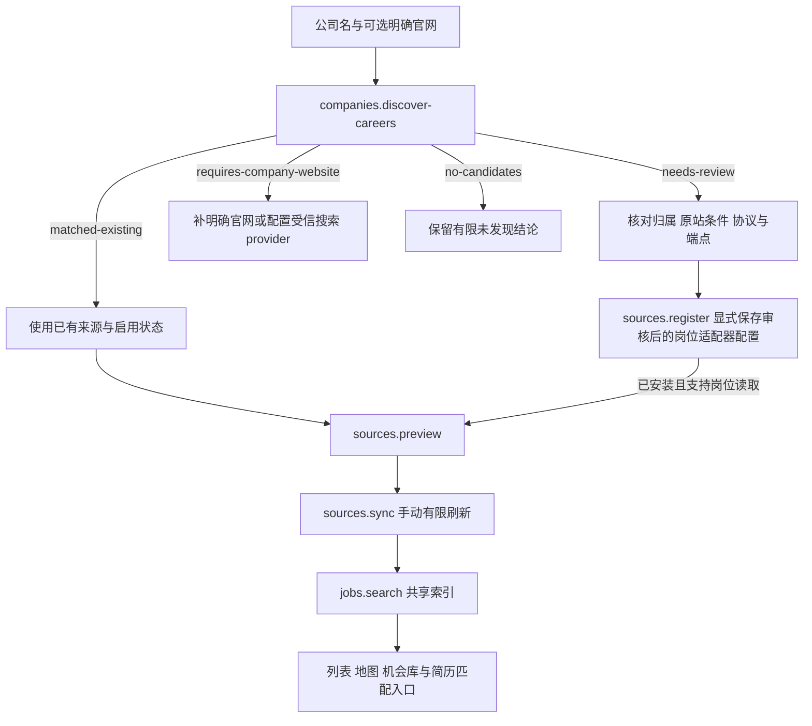

# 公司招聘发现与岗位搜索工具

日期：2026-10-18；搜索启动恢复协议及宿主搜索provider接线更新：2026-10-19。本文同时记录已经实现的工具、有限验收与后续浏览器搜索设计。总体目标见[岗位地图架构](job-atlas-architecture-2026-10-18.md)，来源研究见[信息源核验](job-atlas-sources-research-2026-10-18.md)，实现入口见[来源适配器](../../packages/source-adapters/README.md)与[本机服务](../../apps/job-service/README.md)。

## 能力边界

从“公司名”到“可搜索岗位”包含来源发现、审核、登记、获取、索引与查询。当前已实现公司招聘入口发现、已安装官网适配器、来源登记 / 预览 / 手动同步及同一索引上的 `jobs.search`；没有因为找到招聘链接，就自动认定已找到单岗或完成平台采集。

| 能力 | 当前实现 | 输入与结果的边界 |
| --- | --- | --- |
| 公司来源匹配 | `discoverCompanyCareers()` / `companies.discover-careers` | 先匹配已登记来源。名称、配置别名与入口匹配是配置关系，不是独立企业核验。 |
| 官网入口发现 | 同一工具 | 显式官网 / 种子、同 origin 有限静态链接、五类已知 ATS / 官网入口识别；输出待审证据与禁用提案。 |
| 从公司名发现互联网招聘入口 | 宿主可显式注入DDG实验HTML／SearXNG provider，默认关闭 | 仅名无需sourceId；无已有匹配时有限搜索，候选仍未核实，不自动跟随或抓岗；真实网络受限范围见[本轮报告](../reports/job-atlas-career-web-search-2026-10-19.md)。 |
| 获取已登记官网岗位 | `sources.preview` / `sources.sync` | 已安装 Greenhouse、Lever、Ashby、SmartRecruiters、腾讯及有限 JSON 适配器，受实际配置、端点与预算限制。 |
| 查询与地图 | `jobs.search` | 读同一个公共岗位索引，返回列表、全量统计 / 地图桶、覆盖与未知值；不会自动发起来源采集。 |
| 四平台搜索入口 | `buildPlatformSearchRequest()` | 按官方固定入口与平台独立地区映射生成搜索请求；允许空关键词按地区浏览，入口生成本身不捕获结果或写入索引。 |
| 四平台单岗正文 | 既有 JD 浏览器会话 | 保留原有打开具体岗位、人工验证与读取流程；搜索列表明确不会作为 JD。 |
| 四平台搜索列表读取 | `startSearchRequest()` / `cancelSearchStart()` / `readSearch()` 与本机 search session HTTP | 已写可恢复启动、精确取消、单页可见卡片读取与详情 / 搜索共享浏览器租约；最多 50 卡、部分覆盖。四站真实列表尚未逐站验证，自动翻页与自动索引仍未实现。 |

“只搜岗位”仍然需要选择实际来源；“找公司官网”必须有来源证据。两者共享公司、岗位、来源观察和不可变 JD，但不混淆工具职责。

## 已实现的公司发现契约

纯 Schema / 类型位于 [`career-discovery-contracts.ts`](../../packages/source-adapters/src/career-discovery-contracts.ts)，实现位于 [`career-discovery.ts`](../../packages/source-adapters/src/career-discovery.ts)。浏览器只导入 `@better-me/source-adapters/browser-contracts`；Node 网络实现由本机服务持有。

函数签名：

```ts
discoverCompanyCareers(request, execution)
```

`request` 的真实字段：

| 字段 | 约束 |
| --- | --- |
| `companyName` | 必填，去首尾空白后 1–240 字符。 |
| `companyWebsite` | 可选，显式提供的 HTTP URL 结构；实际工具只接受无凭据、无私网字面地址的安全 HTTPS URL。传入 URL 不代表工具已核实其归属。 |
| `seedUrls` | 可选，1–20 个显式种子，遵守相同 URL 约束。 |
| `limit` | 默认 10，1–20，限制返回候选。 |
| `maxPages` | 默认 3，1–10，实际还受发现来源 `refreshPolicy.maxPages` 限制。 |

`execution` 是可信 host 提供的 `source`、`context` 和 `transport`，可另含 `registeredSources`、按 `sourceId` 配置的 `companyAliases` 及 `searchProvider`。普通 HTTP 和 Agent 调用不能传执行代码、网络实现、公司别名表、自授权限、任意选择器或扩大的允许主机列表。

已登记来源先按显式公司名 / 别名、来源名或明确公司官网 / 入口匹配。公司名会做 Unicode、空白和大小写规范化，不做品牌印象推断。共享 ATS board 和仓库 URL 不因主机相同就匹配另一公司。命中后立即返回已有来源，保持其启用状态，不发网页请求。

有限发现只读取原策略内页面，跟随同 origin 招聘链接，保留原页、目标链接与锚文本。跨域招聘链接进入待审证据，不访问；识别 Greenhouse、Lever、Ashby、SmartRecruiters 与腾讯已知 URL 形式后可以映射到安装的适配器，但识别过程不调用其 API。脚本和浏览器渲染不执行，因此静态 HTML 没有入口不能解释成企业没有岗位。

结果固定包含：

```ts
{
  status: "matched-existing" | "requires-company-website"
    | "needs-review" | "no-candidates",
  companyName,
  observedAt,
  matchedSources, // sourceId、名称、matchedBy、enabled、status、可选 entryUrl
  candidates,    // SourceCandidate + entryKind、matchedBy、unverified 归属、evidence
  proposals,     // 现有 SourceRegistrationProposal，禁用且待审
  visitedUrls,
  search?, // providerId、label、query、resultCount，搜索线索和官网页数分开
  partial,
  warnings
}
```

候选 `entryKind` 为 `greenhouse | lever | ashby | tencent | smartrecruiters | html`，`companyAssociation` 始终为 `unverified`。证据包含 `kind`、`sourceUrl`、`targetUrl` 和可选 `quote`。`observedAt` 是本次发现时间，不能转换为岗位发布时间。`no-candidates` 只描述本次有限发现；页数 / 候选 / 静态扫描等上限在 `partial` 和 `warnings` 中说明。

已知协议提案保持 `enabled: false`、`status: "needs-review"`，待核对企业归属、原站条件、请求范围和实际解析结果。HTML 提案为 `adapterId: "review-required-html"`、`capabilities: []`、`entityType: "company-directory"`；当前没有通用 HTML 岗位解析器，登记禁用草案也不会变成可采集来源。

application 已支持宿主注入 Web 搜索provider，并由CLI显式配置；默认关闭，公司别名表仍未注入。搜索结果通过Schema校验并作为未核实候选，不自动成为官网、不自动跟随或登记。`companies.discovery-capabilities`只返回非秘密配置投影，不探测网络。DDG实验适配本轮实际遇202挑战并正确停止；SearXNG需自备可用公开HTTPS JSON实例，未完成真实闭环。

## HTTP 与应用工具

请求必须通过本机服务既有身份和精确 Origin 校验，正文使用 `application/json`；具体服务连接方式见[服务说明](../../apps/job-service/README.md)。以下是参数结构示例，域名和来源 ID 不会自动安装。

```http
POST /api/v1/companies/discover-careers
Content-Type: application/json

{
  "sourceId": "my-reviewed-discovery",
  "request": {
    "companyName": "示例企业",
    "companyWebsite": "https://company.example.com/",
    "limit": 10,
    "maxPages": 3
  }
}
```

仅名称请求可传 `{ "request": { "companyName": "示例企业" } }`；明确官网／种子则必须指定策略。这里的 `sourceId` 是**发现策略来源**：必须已登记、启用、`status: "active"`、包含 `discover-sources` 和 `local-service`，且不能需要当前服务尚未提供的来源凭据。它控制能读哪些外部端点；它不必是目标公司的岗位来源。目标企业有待发现的来源 ID 放在结果中，不能凭空作为请求的已登记 `sourceId`。

如果该策略仅允许 GitHub API，给它增加一个 `companyWebsite` 参数不会获得访问企业官网的权限。可信配置需要先明确审核允许范围；URL 不在策略内时不会自动扩张。仅匹配已登记公司名的分支不需要网页读取。

成功 HTTP 响应沿用工具信封：

```ts
{ ok: true, requestId: string, value: CompanyCareerDiscoveryResult }
```

工具失败返回 `{ ok: false, requestId, error: { code, message } }`。无官网而未配置 provider 是正常的 `requires-company-website` 业务结果，不是伪造空岗位列表；输入 / 上下文错误、未授权、超时、429 等使用现有固定错误码与 HTTP 映射。网络字节、请求、取消、速率和 DNS 约束仍由受控 transport 执行。

相关现有端点和真实输入结构：

| 工具 / HTTP | 输入 | 副作用 |
| --- | --- | --- |
| `companies.discover-careers` / `POST /companies/discover-careers` | `{ sourceId?, request: { companyName, companyWebsite?, seedUrls?, limit?, maxPages? } }` | 外部只读；可能零请求，不登记来源。 |
| `sources.register` / `POST /sources` | `{ source: SourceDefinition, expectedRevision? }` | 保存来源；写入要求独立幂等键，更新可约束 revision。 |
| `sources.preview` / `POST /sources/:sourceId/preview` | `{ scope?, maxRecords? }` | 有限读取一页，不写岗位索引；路径绑定 `sourceId`。 |
| `sources.sync` / `POST /sources/:sourceId/sync` | `{ scope?, maxRecords?, maxPages? }` | 手动写索引和持久任务；路径绑定 `sourceId`，要求幂等键。 |
| `jobs.search` / `POST /jobs/search` | 直接传 `JobQuery`，例如 `{ search, market, sourceIds, sort, page }` | 只读索引，不外部采集。 |
| `jobs.read-detail` / `GET /jobs/:jobId` | 路径绑定 `jobId` | 返回来源、观察、不可变 JD 及公共详情。 |

表中 HTTP 路径统一加 `/api/v1` 前缀；应用 registry 调用 `sources.preview` / `sources.sync` 时，`sourceId` 直接放输入对象。HTTP 写入把幂等键放 `Idempotency-Key`，不是 JSON 字段。重试同一次写入复用键；新的刷新使用新键，不能用重试键偷偷更改参数。

`scope` 当前为 `{ roles: string[], regions: string[], companyNames: string[], countryCodes?: string[] }`。例如：

```json
{
  "scope": {
    "roles": [".NET"],
    "regions": ["上海"],
    "companyNames": [],
    "countryCodes": ["CN"]
  },
  "maxRecords": 50,
  "maxPages": 2
}
```

这些是关注范围；实际远程过滤由适配器能力声明，缺失能力时仍可能先读该 board 的记录再本地筛选。腾讯当前远程执行 `roles`；地区、公司与结构化国家条件由应用层匹配。国家和城市条件需要落在同一工作地点证据上，不能用一个办公室的国家和另一个办公室的城市拼成匹配。

`JobQuery` 是独立查询契约，地区字段不等于来源 `scope`。例如读取已同步的国内 `.NET` 索引：

```json
{
  "schemaVersion": 1,
  "search": { "text": ".NET", "mode": "fuzzy" },
  "market": "domestic",
  "workCountryCodes": ["CN"],
  "sort": { "field": "relevance", "direction": "desc" },
  "page": { "limit": 30 }
}
```

它返回同一快照的分页列表、全量地图桶 / 统计、来源覆盖与未知字段。继续分页需使用返回的游标及一致查询；不能把第一页长度当全量岗位数，也不能在 UI、地图和 Agent 各维护一份独立过滤结果。

## 编排与未来 Agent 薄适配



应用不会自动串行完成以上所有动作。编排器根据 status 分支，保留候选原证据、来源 ID、任务 ID 与后续岗位 / 快照引用；已有来源的禁用状态也不能被发现步骤绕过。发现失败或列表缺席不更新岗位为已关闭。薪资、坐标与企业控股来源仍使用各自证据，不能由发现器补猜。

未来 LangChain 包装应调用已经运行的 registry / HTTP 应用服务，不在模型工具内复制解析器或直接获得 token、浏览器 profile、任意 URL 请求能力。下面是**未来宿主集成示意**，企业招聘搜索尚未接入 LangChain / LangGraph Agent；`application` 和 `createTrustedContext` 由可信宿主创建：

```ts
import { tool } from "@langchain/core/tools";
import { DiscoverCompanyCareersRequestSchema } from
  "@better-me/source-adapters/browser-contracts";

const discoverInput = DiscoverCompanyCareersRequestSchema;

const discoverCompanyTool = tool(async (input) => {
  // 身份、外部只读权限、预算和取消信号都由宿主提供。
  const context = createTrustedContext({
    allowedEffects: ["external-read"],
  });
  return application.registry.execute(
    "companies.discover-careers", input, context,
  );
}, {
  name: "discover_company_careers",
  description: "匹配已有企业来源或发现带证据的待审招聘入口。",
  schema: discoverInput,
});
```

`createTrustedContext` 是此例的宿主占位函数，不是已新增的项目 API；必须返回真实 `TrustedToolContext`，包括 `requestId`、`actorScope`、`signal`、`budget` 与 `allowedEffects`。不要将这些字段加入模型输入。SDK 工具名是包装层名称，底层业务工具仍为 `companies.discover-careers`。

LangGraph 节点可复用同一调用，状态只保存版本化查询、候选 / 来源 / 任务 / 岗位引用及审查结果。`discover` 节点按四种业务 status 分支；候选到 `review`，缺官网到 `request-website`，已有来源到 `preview`。核对完成后才由宿主执行 `sources.register` / `sources.sync`，并分别提供 `local-write` 权限、独立幂等键与需要的 revision；模型输入不得自行声明“已审查”。人工登录也应暂停并接续同一个浏览器会话，而不是无限重试。

统一查询节点可以直接调用现有工具：

```ts
// LangGraph 节点函数示意；state.query 已按 JobQuerySchema 校验。
async function queryJobsNode(state) {
  const result = await application.registry.execute(
    "jobs.search",
    state.query,
    createTrustedContext({ allowedEffects: ["read-index"] }),
  );
  return { searchResult: result };
}
```

返回的岗位 ID、listing、原文来源和不可变 JD 引用进入既有机会 / 简历流程。个人 Fact、履历、家庭坐标、投递联系人和模型配置继续由各自主库管理，不因搜索工作流而进入公开岗位源。

## 四平台 search session 当前实现与缺口

[`platform-search.ts`](../../packages/source-adapters/src/platform-search.ts) 已有 `PlatformSearchInputSchema` 与 `buildPlatformSearchRequest()`，接受 `{ provider, keyword, regionId? }`，provider 为 `51job | boss | liepin | linkedin`。输出固定官方 URL、规范关键词、明确地区 / 平台默认地区及原参数证据。空关键词可以按已选地区浏览；未知或冲突地区仍拒绝，不静默回退。省市区目录或外部搜索链接变化不等于真实平台采集已验收。

国内已补省 → 市 → 区县的独立目录选择，采用 2023 统计区划快照，修改上级清除失效下级。空关键词不再禁用地区浏览；四个直辖市的“市辖区”等统计分组在目录中保留原名，平台请求显式使用所属直辖市真实名称。香港使用实际 `HK` 条件，避免被固定 `CN` 造成冲突。地区目录不意味着四站都有对应搜索代码，也不补造岗位地点事实；目录范围与修复证据见[四平台搜索报告](../reports/job-atlas-platform-search-2026-10-18.md)。

新增搜索用途使用专门的 `startSearch()` / `readSearch()` 后端，不会把搜索页传给原有单岗正文解析器。入口位于 [`jd-session-router.ts`](../../apps/web/server/jd-session-router.ts)、标准浏览器与原生浏览器后端；详情和搜索先取得同一全局页面租约，共用已有所有权、启动中 / 关闭中、超时、取消和清理边界。搜索读取核对原平台、路由、关键词与地区，导航条件变化不能混入旧查询。HTTP 现通过 `startSearchRequest(owner, input, requestId)` 启动，并通过 `cancelSearchStart(owner, input, requestId)` 精确结束；owner、用途、计划 URL 和请求标识共同绑定同一次逻辑启动。

[`jd-search-api.ts`](../../apps/web/server/jd-search-api.ts) 提供开发工作台的 `POST /api/jd/search-session`：`action: "start"` 接收规范 `input` 和合法 `requestId`；`action: "cancel-start"` 接收原始 `input` 和同一个 `requestId`；`action: "read"` 接收已确认的 `sessionId`。接口使用原有本机同源请求校验和浏览器 owner，不能传任意 URL、脚本、Cookie 或浏览器协议命令。这个接口属于 Web 开发宿主，**不是**独立岗位服务的 `/api/v1` 端点，也不运行在静态 Pages / Nginx Docker 中。

面板先保存原条件和 `requestId`，启动响应未知时不丢弃；重试复用同一输入 / 标识，后续修改上方筛选不改变本次启动。取消等待仅中止当前等待；结束操作按原绑定精确取消，并在服务确认 `cancelled: true` 与 `closed: true` 后清理状态。取消请求最多等待 8 秒，超时或关闭未确认继续保留绑定，允许重试。组件卸载时中止在途读取，并用 `keepalive` 对原绑定发出取消；这是尽力清理，不能把卸载或超时当作页面已关闭的证明。

列表抽取由 [`jd-search-capture.ts`](../../apps/web/server/jd-search-capture.ts) 的版本化代码配置管理四站选择器；纯结果类型位于 [`job-search-types.ts`](../../apps/web/src/lib/job-search-types.ts)。只接受可见卡片内的官方 HTTPS 单岗链接及有限路由身份，保留标题、可用企业 / 明确地点 / 薪资 / 发布时间原文与逐字段证据；同一平台岗位 ID 去重，单页最多 50 卡。原生搜索投影新增保留可见 `A.href` 和 `TIME.datetime`；标准 DOM 快照不读取 storage、Cookie、表单值或隐藏 JSON。发布时间只来自明确的发布时间字段，不从 `datetime`、更新时间或抓取时间补造。

成功卡片结果保持 `partial: true`，只说明本次已渲染单页。`empty` 需要原站明确的可见空结果依据；`login_required`、`verification_required`、`unknown_layout`、`oversized`、`unsupported_page` 分别保留，不能转换成“0 个匹配岗位”。会话故障继续使用既有结构化错误。HTTP 读取完成后由可信宿主增加 `capturedAt`，解析器不生成观察或发布时间。

仍需完成并逐项验收：

1. 在真实 51JOB / BOSS / 猎聘 / LinkedIn 搜索页核对可见卡片、实际岗位链接、地区、字段和人工验证后的接续；当前合成测试不证明四站最新布局兼容。历史真实单岗样本也不能代替列表验收。
2. 各站有限翻页 / 滚动、跨页稳定去重、停止原因和后续游标；当前没有自动翻页，50 卡上限不是全站结果数。
3. 有限详情补全及审核后的索引投影。当前只支持手动触发的单页卡片摘要读取和显式核对入口，结果留在面板，不自动进入本机规范岗位索引或地图；不能据卡片推断在招、可比年薪、精确地点或控股国别。
4. 独立本机岗位服务的 companion 注入、部署边界与端到端取消 / 恢复。现有开发宿主接口不等于已部署独立采集后端，不能由两个进程竞争同一个浏览器配置目录。

本次截图参数修复、省市区目录与四平台单页工具的阶段记录见[四平台搜索报告](../reports/job-atlas-platform-search-2026-10-18.md)。Hopetree 只用于公开研究旧采集分层，未复制、执行或集成其代码，不能替代当前四站验收。LangChain / LangGraph 后续只包装已有的受控输入与状态，不向模型暴露底层浏览器能力。

## 本轮验证与下一步

`career-discovery.test.ts` 的 14 项自动化使用合成输入、固定 HTML / provider 返回和受控 mock transport，验证公司名 / 别名优先匹配、共享域名隔离、有限静态链接、已知协议禁用提案、无 parser 的 HTML、恶意链接 / 属性文本、预算 / 取消 / 错误状态和 provider 契约。类型与代码检查通过；这些测试不访问任意真实企业官网。

2026-10-18 15:35 UTC，对实际运行的本机 HTTP 新接口做了两项有限验证。使用已有、启用且具备发现能力的配置来源，以已登记腾讯配置中的公司名查询，返回 `matched-existing` 并指向既有腾讯岗位来源；未登记的合成公司名未附官网，返回 `requires-company-website`。两次 `visitedUrls` 均为空，未同步、未新增候选岗位；前后完整公共数据集与来源配置一致。该结果证明实际路由 / 工具 / 已有来源匹配和缺官网分支可用，**没有证明腾讯官网 HTML 发现、任意公司网站识别、通用 Web 搜索或四平台列表采集可用**。

四平台新解析器的 20/20、会话 / 路由相关测试的 167/167、HTTP / 客户端组合的 5/5 是各自阶段时点的局部结果。其后根目录完整测试在一个快照达到 **1692/1692**；新增面板 13 项和防护 2 项位于该快照之后，分别记录，不相加成新的全仓通过总数，也不能用 1692/1692 覆盖后续改动。**这些结果都不是四个真实站点验证，最终全仓检查仍需覆盖新增代码。** 后续首先补真实官网静态入口与四平台列表的有限样本、人工验证接续、重定向 / 多语言 / JS 渲染边界，并为受信搜索 provider 建立明确来源配置及验收。行政目录继续提供显式地区输入和过滤映射。LangChain / LangGraph 最后只包装已经能独立执行和验证的业务工具。

2026-10-19 搜索provider接线及验证范围见[本轮报告](../reports/job-atlas-career-web-search-2026-10-19.md)。以上2026-10-18数字和四平台停点属于历史时点，最新国内索引与各站有限实证见[国内来源报告](../reports/job-atlas-domestic-source-expansion-2026-10-19.md)。显式官网可使用已安装的`discovery-policy@1`纯访问策略（只声明discover-sources），默认禁用[配置示例](../../config/sources/company-career-discovery.example.json)须核对精确范围后明确启用。策略不匹配成招聘来源、不支持preview／sync，不需捏造list-jobs；已有含list-jobs来源的注册语义保留。
