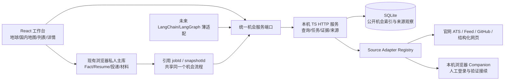

# 岗位地图与统一机会工具：可执行架构方案

日期：2026-10-18，Asia/Shanghai。状态：**需求与研究方案，产品代码尚未实施**。本文对应已建立的工程目标，定义实现阶段、契约和验收门槛；写完方案不代表地图、后台、来源、搜索或 Agent 已交付。

本轮只读核对现有源码、规划和来源研究，并做了一次不落盘的 SQLite 内存能力探测；没有创建岗位数据库、定时任务或模型调用，没有迁移个人数据，也没有改动正在运行的工作台。

相关研究：[信息源与通用接入](job-atlas-sources-research-2026-10-18.md)、[地图与三维参考](../research/job-atlas-map-references-2026-10-18.md)。历史依据：[产品总规划](betterme-product-roadmap-2026-10-16.md)、[自用聚合定位](recruitment-aggregation-assessment-2026-10-17.md)、[真实技能匹配闭环](job-skill-matching-loop-2026-10-17.md)。本文中的最新用户选择覆盖历史文档里“先二维、三维后置”的建议。

## 1. 目标与已经确认的范围

BetterMe 的长期目标是本地优先的职业成长与求职工作台：把真实经历与证据、目标岗位、差距分析、学习验证、简历材料、投递跟进和 Offer 决策连起来。机会地图进入同一个业务闭环，不另建与机会库、简历或投递记录隔离的数据孤岛。

本次用户已确认以下五项，无需再次重复询问：

| 事项 | 已确认选择 |
| --- | --- |
| 运行方式 | 本机自用后台，API 保留未来服务器部署的能力；当前不建立公开多人岗位池 |
| 离家距离 | 首版为直线距离，后续扩展通勤距离和时间 |
| 数据更新 | 用户选择关注的岗位、地区、公司范围，手动刷新；架构预留定时任务，当前不创建实际定时采集 |
| 薪资比较 | 默认人民币税前年薪，可切换查看原币薪资 |
| 企业分类 | 依据证据核实最终控股方来源；未知单列，允许人工修订 |

用户还明确要求：国内/全球可切换、高质量 3D 地球和国内 3D 地图、关键词模糊查询、薪资/企业性质/来源国或地区/工作地区/离家距离筛选、薪资与距离正反序、醒目的来源标识、可配置企业色彩，以及未来 TS LangChain/LangGraph 接入。三维是正式体验目标，不能把二维图当成三维需求已经完成。

以下为工程默认，**不是用户额外确认的事实**；实施时写入配置并允许调整：

- 薪资区间默认按下限排序，可切下限/中位/上限；升降序中未知和不可比项均放最后。
- 首版采用模块化 TS 本地服务与 SQLite；无须先引入微服务、PostGIS、向量库或 Agent SDK。
- MapLibre 的 globe + 按需 deck.gl 图层为基线候选，R3F/Three 的艺术地球为备选；先过实际原型门槛再定，领域和查询不绑定任何渲染器。
- 颜色采用用户要求的分类和深浅关系，初始具体 Hex、排序优先级及其他外企的颜色属于可修改的工程默认。
- 地图平移/缩放只改变视野；明确开启“只看当前地图范围”后才影响岗位查询。
- 仍沿用用户已确认的自用、Fact 防编造和人工投递边界；不新增自动发消息或投递。

## 2. 可复用基础与必须补齐的能力

本轮源码核对得到以下基线，不把既有有限样本读取结果外推为全平台搜索可用：

| 现有模块 | 已有能力 | 本次缺口 |
| --- | --- | --- |
| `apps/web/src/lib/opportunities.ts` | 机会列表、市场/状态/招聘类型等筛选、来源与时间、私人阶段/沟通/材料；同源规范化 URL 防重复；revision 防跨窗口陈旧覆盖 | 一个 Opportunity 同时保存公共岗位和私人记录；没有多源观察历史、跨源同岗、数值薪资、坐标、企业控制方、距离和排序 |
| `apps/web/src/components/OpportunityWorkspace.tsx` | `queryOpportunities()` 的同一份 jobs 驱动列表和摘要；有文字地点分布 | 没有真实地图；关键词仅大小写无关子串匹配；图/列表/统计尚无持久查询快照 |
| `apps/web/server/opportunity-sources.ts` | Greenhouse、Lever 的指定公司和腾讯官网按需读取；超时、响应大小与固定源边界 | provider 是固定联合类型；腾讯仅第一页；没有来源目录、统一能力注册、增量刷新及跨源搜索 |
| `apps/web/server/jd-*`、`src/lib/jd-*` | LinkedIn/51job/BOSS/猎聘单岗链接、截图和受控浏览器读取；人工验证接续与会话恢复 | 单岗读取不是来源搜索、批量枚举或常驻同步；平台能力要逐项登记 |
| `packages/core` | Fact/ResumeView 分离、Zod、简历投影和 JD 匹配真实性边界 | 机会领域主要仍在 Web 内；缺少可供服务/UI/Agent 共享的独立领域契约 |
| 机会存储 | localStorage schema v1，最多 2,000 岗，JSON 备份上限 4 MiB，损坏保护与冲突阻断 | 不适合长期岗位索引、全文快照及来源历史；不能简单提高上限当成数据库方案 |
| Pages/当前 Docker | 生产静态工作台、本地浏览器保存与导入导出 | 来源和招聘浏览器通过 Vite dev/preview 插件提供，不在 dist；静态 Docker `/api/*` 返回 501 |

实现应增量迁移并保留当前简历、机会库、备份和原 localhost 数据；不重写整个产品，不把“3D 画面出现”当作来源、查询与联动全部完成。

## 3. 运行架构与数据主库



保留现有 React/Vite、TS Core 与存储端口。建议新增的目录是目标结构，**不代表已存在**：

```text
packages/
  opportunities/       # 领域 Schema、值对象、查询/工具契约、纯规则
  source-adapters/      # 已验证协议与解析器、来源能力注册
apps/
  job-service/          # 独立 TS 服务、SQLite repository、同步任务执行
  web/                 # 现有 UI，按需加载地图与来源面板
config/
  sources/             # 来源配置/能力/使用范围，不含 Key
  opportunity-colors/  # 版本化分组、颜色、图例和优先级
```

目录边界可在 M0 按现有 workspace 调整，但依赖方向应固定：领域不依赖 React、Vite、地图 SDK、SQLite 驱动或 LangChain。HTTP、UI、Agent 通过相同应用服务调用业务逻辑。

### 3.1 首版部署形态

- 本机 TS 服务绑定 loopback，独立于 Vite；由本地生产 UI 同源代理最容易复用安全边界。接口以 `/api/v1/` 版本化，浏览器 companion 作为可替换执行端。
- Pages 保留静态体验与本地数据能力。公网 HTTPS 页面直连本机 HTTP 会受跨源、浏览器本地网络权限及安全上下文规则影响，因此不默认承诺 Pages 一键访问本机服务；首版完整地图后台体验从本机 UI 启动。
- 后续可把公开来源适配器和索引放进 Docker 服务，Windows 浏览器 companion 留在本机。Linux 容器不假装拥有 Windows Edge、既有 profile 或人工验证窗口。
- 将来服务器部署要补身份、会话归属、来源访问策略、TLS、备份及配额；本轮预留端口，不提前开放公网监听。

loopback 不等于任意网页都能调用工具：本地 UI 会话采用明确的允许 Origin、会话凭证和请求大小限制，状态变更接口校验调用归属；来源请求遵守配置的 endpoint policy。不能为解决跨源直接允许所有 Origin，或让 Agent 传任意 URL 请求本机内网。

### 3.2 单一主库边界

| 数据 | 首版主库 | 更新与公开边界 |
| --- | --- | --- |
| CanonicalJob、公司、来源、观察、JD 快照、位置、薪资、同步任务 | 本机 SQLite | 来源领域管理，不存整份个人 career；字段可导出但是否再分发依来源策略 |
| Fact、ResumeView、个人经历、私人投递/沟通/材料 | 现有浏览器存储/历史 | 不为地图复制到后台；UI 持 jobId/snapshotId 引用和必要的离线快照 |
| 家庭地址和个人偏好 | 独立的本机私人设置，默认留浏览器 | 不写公开岗位表、Git、静态资源、模型上下文或普通查询日志 |
| 来源 API Key/会话 | 本机凭据配置或受控 companion | Registry 仅保存 secret reference；不导出 Key，不进入前端构建 |
| 未来 Graph checkpoint | 独立任务状态存储 | 保存运行状态与领域 ID，不成为 Fact、岗位或计划的第二主库 |

后台的备份接口不自动打包私人简历；现有机会 JSON 中的个人备注、材料与沟通也不能因导入索引而全量上传。

## 4. 领域契约与证据

以下 TypeScript 为**设计草图**，不是可直接引用的已实现 SDK。落地时以 Zod Schema 生成类型、做运行时输入输出校验，并保留 schemaVersion 与迁移器。

```ts
type EvidenceRef = {
  observationId: string;
  sourceUrl: string;
  selector?: string;        // 原文片段/JSON path，可定位
  quote?: string;
  observedAt: string;
};
type Evidenced<T> = {
  value: T;
  evidence: EvidenceRef[];
  method: "source-structured" | "parser" | "model-proposal" | "manual";
  verification: "verified" | "unverified" | "conflicting" | "unknown";
  revision: number;
};
type Company = {
  id: string;
  names: string[];
  domains: string[];
  legalEntity?: Evidenced<string>;
  parentCompanyIds: string[];
  ultimateControllers: Evidenced<Array<{
    name: string;
    jurisdictionCode?: string; // 国家/地区编码，非工作地点
    kind: "state" | "private" | "dispersed" | "joint" | "unknown";
  }>>;
  overrides: Array<{ field: string; value: unknown; reason: string; at: string }>;
};
type CanonicalJob = {
  id: string;
  companyId: string;
  title: Evidenced<string>;
  roleFamily?: Evidenced<string>;
  seniority?: Evidenced<string>;
  locationIds: string[];
  compensationIds: string[];
  listingIds: string[];
  selectedSnapshotId?: string;
  revision: number;
};
type SourceListing = {
  id: string;
  sourceId: string;
  sourceRecordId?: string;
  canonicalUrl: string;
  applicationUrl?: string;
  canonicalJobId?: string;
  observationIds: string[];
};
type SourceObservation = {
  id: string;
  listingId: string;
  fetchedAt: string;
  sourcePublishedRaw?: string;
  sourcePublishedAt?: string;
  sourceUpdatedRaw?: string;
  sourceUpdatedAt?: string;
  contentHash?: string;
  snapshotId?: string;
  result: "read" | "partial" | "failed" | "needs-human";
  availability: "open" | "closed" | "unknown";
  availabilityMethod?: string;
  completeness: "detail" | "excerpt" | "lead";
};
```

实际模型还需要：

| 对象 | 必需职责 |
| --- | --- |
| `RecruitmentCampaign` / `DiscoveryLead` | 校招批次、公司目录、岗位方向集合先作为线索；未取得精确岗位详情，不计入已核验岗位或深度 JD 匹配 |
| `JdSnapshot` | 不可变正文版本、内容 hash、来源与提取方法；采集时间不是发布时间 |
| `JobLocation` | 原文、标准行政区 ID、WGS84 坐标、原坐标系、精度/提供商/时间/核验状态；岗位可多地点 |
| `Compensation` | 原文、数额/币种/周期/税制/固定与浮动、可比性与换算证据 |
| `SourceDefinition` / `SourceConfig` | 能力、协议、范围、状态、授权、归属展示、使用限制和 secret reference |
| `SyncRun` / `ActionExecution` | 任务范围、分页、进度、预算、幂等、取消、真实失败、部分结果与完成回执 |
| `WorkspaceOpportunity` | 私人收藏、目标方向、跟进、申请、关联 resumeViewId 及采用的 snapshotId |
| `MergeCandidate` / `MergeDecision` | 跨源同岗候选及确认/拒绝/撤销的依据，支持拆分回滚 |

来源结构化字段也需要证据。LLM 提取只产生待校验字段或候选，不能凭公司英文名、ATS 域名、职位所在国家、签证信息或 Schema 通过就认定企业控股来源。

### 4.1 时间与状态

分别记录 `sourcePublishedAt`、`sourceUpdatedAt`、`firstDiscoveredAt`、`feedFetchedAt`、`recordLastSeenAt`、`detailFetchedAt` 和 `availabilityVerifiedAt`；保留来源原始时区/时间文案。上游 README 更新时间不能填入每条岗位的最近核验时间。

HTTP 200、出现在 feed、详情明确在招、人工核验是不同状态。一次失败、登录要求、验证码、截断列表或分页未完成都不能自动将旧岗位改成 closed。

## 5. 来源能力注册与通用工具

来源接入采用“配置 + 已验证适配器”，不把用户给出的几个仓库名称写死在 React 里。新增同协议公司 board、JSON feed 或 GitHub 文件主要加配置；新认证协议/新结构才增加实现。

```ts
type SourceCapability =
  | "discover-sources" | "search-remote" | "list-jobs"
  | "read-detail" | "verify-status" | "delta-sync";
type SourceDefinition = {
  sourceId: string;
  adapterId: string;
  adapterVersion: string;
  capabilities: SourceCapability[];
  runtime: Array<"local-service" | "browser-companion" | "server">;
  entityType: "job-posting" | "recruitment-campaign" | "company-directory";
  remoteFilters: string[];
  endpointPolicyId: string;
  attributionPolicyId: string;
  secretRef?: string;
};
type SourcePage<T> = {
  records: T[];
  nextCursor?: string;
  observedAt: string;
  coverage: { requested: unknown; completed: unknown; partial: boolean };
  stopReason?: "budget" | "rate-limit" | "needs-human" | "source-error";
  warnings: string[];
};
```

能力族：现有官网 ATS、公司 JSON-LD、RSS/Atom/Sitemap 发现、GitHub JSON/CSV/Markdown 清单、官方/授权搜索 API、已验证平台详情与用户截图/粘贴。动态来源发现进入 candidate/needs-review；不自动执行陌生仓库脚本或把未知 URL 交给服务器无限制抓取。

每个适配器都声明：支持的远程筛选、分页完整性、请求/时间/字节预算、允许域/路径/重定向、认证要求、限速和 Retry-After、ETag/Last-Modified、返回实体类型、字段完整性、出处/回链和可再使用范围。搜索、列举公司岗位、读取详情和核验在招分开。

只支持 `list-jobs` 的 ATS 在用户范围内刷新统一索引，再由本地搜索模糊查询；不伪称上游具有全文搜索。51job/BOSS/猎聘/LinkedIn 未验证的搜索能力如实显示，保留“去原站搜索，再读取用户所选岗位”的入口。

岗位列表、地图 tooltip、详情和导出均显示醒目的来源：例如“详情：公司官网 / 发现：GitHub 清单 / 另有 2 个来源 / 最近核验日期”。企业类别色用于标记企业，来源使用明确文字 badge 与原链接，不混用同一个图例语义。去重不能丢掉来源要求的归属/回链。

## 6. 多源去重、刷新与人工更正

1. 同源身份优先采用 `sourceId + sourceRecordId`，其次规范化原始 URL；清理追踪参数时保留岗位身份参数。
2. 官网职位号或明确的跨源申请 URL 能提供强关联；公司身份、标题、地点、级别、部门、职责只产生可解释的归并候选。仅“同公司 + 同标题”不能自动合并。
3. 同岗保留全部 Listing、观察和字段冲突。采用哪一个薪资/地址/状态要记录依据；官网不是无条件覆盖较新平台字段的命令。
4. 每次刷新追加不可变观察/快照并更新当前投影；未变化可以记核验而不复制长正文。来源失败保留上次成功记录。
5. 人工修订作为独立 override，保留原来源值和原因；新抓取不静默覆盖 override，变化时提示核对。
6. 任务带 runId、幂等键、输入版本、预算和取消；同源并发合并或排队。旧 run 的迟到结果不得覆盖新版本。
7. 单次同步回执区分新增/实质变化/未变/确认关闭/失败/需人工/部分覆盖，旧岗位未出现在截断结果中不能判关闭。
8. 正文来源更新不修改私人 application、沟通、备注、ResumeView 或材料快照；用户当前采用的 JD 版本独立保留。

## 7. 统一查询：地图、列表、统计使用同一结果口径

关键词、市场、地区、公司性质/控股来源、来源、招聘类型、工作方式、薪资、距离、排序由一个版本化 Query 表示。UI、HTTP 与未来 Agent 调同一个 QueryService，不在渲染器、React 和 Graph 节点分别写业务筛选。

```ts
type JobQuery = {
  schemaVersion: 1;
  search?: { text: string; mode: "fuzzy" | "exact" };
  market: "domestic" | "global" | "overseas";
  workRegionIds?: string[];
  companyIds?: string[];
  controllerJurisdictions?: string[];
  ownershipKinds?: string[];
  sourceIds?: string[];
  employmentTypes?: string[];
  workModes?: string[];
  salary?: {
    currency: "CNY";
    basis: "gross-annual-fixed";
    range?: { min?: number; max?: number };
    metric: "min" | "mid" | "max";
    includeEstimates: boolean;
    includeUnknown: boolean;
  };
  distance?: { anchorRef: string; maxKm?: number; allowCityEstimate: boolean };
  viewport?: { enabled: boolean; bounds: number[] };
  sort: { field: "relevance" | "salary" | "distance" | "updated"; direction: "asc" | "desc" };
  page?: { cursor?: string; limit: number };
};
type JobQueryResult = {
  queryId: string;
  snapshotVersion: string;
  totalJobs: number;
  companyCount: number;
  mappedJobs: number;
  unlocatedJobs: number;
  locationPinCount: number;
  items: unknown[];
  nextCursor?: string;
  mapBuckets: unknown[];
  facets: unknown;
  sourceCoverage: unknown;
  partialSourceErrors: unknown[];
};
```

实现约定：

- mapBuckets 和总计基于**完整筛选结果**，不是当前列表页；列表分页不改变地图总数。
- 一个岗位多个工作地点产生多个 pin，但只计一个岗位。公司数按公司实体 ID，不能再只按字符串去重。
- 远程资格地区、工作地点和最终控制方国家/地区分开。国内外企按工作地点归国内；在国外发布而允许国内远程的岗位按资格单独筛选。
- 国内/全球切换同步指标、地图范围、地区选项、详情与列表；保留兼容筛选，对不兼容城市条件显示清理提示。
- 标明来源覆盖、索引新鲜度、已核验/未核验、未定位和部分失败；没有源覆盖不表示当地没有岗位。
- 地理位置/企业性质/薪资未知都保留显式桶。未知工资不当 0，远程不当距离 0，城市中心不伪称门牌坐标。
- 默认结果状态与覆盖来自固定读快照；异步刷新完成后提示新结果或明确切换 snapshotVersion，不能同屏计数来自旧版、列表来自新版。
- 游标含查询/索引版本与稳定 tie-break；排序相同按稳定 jobId。游标失效清楚要求重新查询，不能跳漏/重复。
- 分面计数注明是否排除自身维度；首版统一按当前完整筛选结果计数，避免各控件口径不同。
- 保存搜索预设可以复用 Query，但不把精确家庭坐标写进公开 URL、可分享查询或日志。

### 7.1 本地模糊查询

先做大小写/全半角与空白归一、技术词别名（如 .NET/dotnet）、中英文公司别名、短语和容错查询，保留命中字段。FTS 参数使用绑定和受控查询构造，用户文本不直接拼入 MATCH 或 SQL。

FTS5 的 unicode61 不等于中文分词，也不自动实现拼写纠错。首版需要可替换的文本规范化/分词端口：英文词项与技术词保留，中文使用经过样例验证的分词或字符 n-gram 召回；拼写相似度在有限候选上计算。中英文混排、短关键词和 .NET/C++/C# 是独立验收样例，不能仅用英文 FTS 演示宣称模糊查询完成。

语义向量检索属于后续可选补充，不让普通关键词筛选必须调用云模型。

## 8. SQLite：适用范围与实现约束

本轮在 `node v24.15.0` 使用内置 `node:sqlite` 的 `:memory:` 数据库探测，SQLite 报 `3.51.3`，成功创建 FTS5 和 RTree 表；没有写本地数据库文件。这证明当前运行时具备能力，不代表已完成 repository、持久化、中文检索或跨平台生产验收。

SQLite 适合当前单用户、选择范围的本地岗位索引：事务维护关系与证据，FTS5 提供候选召回，RTree 提供地理包围盒候选，无须现在引入远程数据库。驱动放在 repository adapter 后；服务目标 Node 版本在实施时固定并在 Windows/Linux 验证，不因根项目支持 Node 22 就假设任意版本的 `node:sqlite` 行为一致。

建议逻辑表：companies/company_aliases、jobs/job_listings、source_observations/jd_snapshots、job_locations、compensations、field_evidence、manual_overrides、source_definitions/configs、sync_runs/actions、merge_decisions、schema_migrations；FTS 与 RTree 为可重建派生索引。

- 采用事务迁移、外键、明确 schema 版本；正文按 hash 去重，索引损坏可以从领域表重建。
- WAL 和单写入者适合手动刷新；网络读取与浏览器等待在事务外，不长时间占 SQLite 写锁。数据库操作通过异步 repository 端口，耗时批量解析/索引可放 worker，避免 Node 主线程长时间阻塞。
- RTree 只做半径/视窗的包围盒初筛，最终按 WGS84 球面距离计算并过滤/排序；处理跨 180°经线、极区和数值边界，不能把包围盒命中当实际圆内。
- 默认不加载外部 SQLite 扩展；按固定构建验证 FTS5/RTree。索引能力不足时清楚失败或使用已验过的有限降级，不能静默变成不一致结果。
- 备份使用 SQLite 一致性备份/正确 checkpoint 流程；不能只在运行中拷一个主文件而遗漏 WAL。恢复先校验 schema/完整性再切换，保留原库。
- 容量阈值和快照保留策略可配置：优先保留私人采用的 JD 引用与其证据；清理正文前检查引用。首版不删除当前机会依赖的快照。

## 9. 薪资：人民币税前年薪与原币并存

用户确认的默认比较单位为人民币税前年薪。归一化是可解释的派生值，原文和原币区间始终保留。

| 来源情况 | 处理规则 |
| --- | --- |
| 已明确税前年固定薪资、币种与区间 | 直接保留区间；非人民币按选定 FX 快照换算，记录汇率、日期、提供商和规则版本 |
| 已明确税前月薪和发薪月数 | 固定月薪 × 明确月数；单独处理是否保证的奖金，不默认包含浮动部分 |
| 已明确税前月薪但未披露薪数 | 可提供“按全年 12 个月估算”的派生值，标为 estimate 并显示假设；不标已核实年总包，不擅自补 13/14/16 薪 |
| 小时/日薪，未披露可工作时数/天数 | 不年化、不参与统一年薪排序；保留原币/周期，显示不可比原因 |
| 税后或税制未知 | 不猜税前值；税前比较列标不可比。未来有独立税制假设时也只能是估算模式 |
| “面议”、只写薪资上限、币种符号歧义、混合股权/奖金 | 保留原文及明确的单边值；只有可复现规则与足够字段才进入相应比较，不造完整区间 |
| 年 base 与总包混用 | 固定收入、保证奖金、目标奖金/股权分开；统一排序的 basis 一致，不能把 total compensation 当 base |
| FX 过期/缺失或服务失败 | 继续显示原币，换算值带日期/过期提示或标不可比；不静默沿用未知汇率 |

区间筛选的工程默认是“与用户区间有交集”，可切换“下限达到/整个区间落入”；当前使用的规则必须可见。排序 metric 默认下限，用户可切中位/上限；双边缺一时中位不存在，不填 0。升降序均把不可比/未知项置后，单独显示数量。

`includeEstimates` 控制是否包含按 12 个月等假设得到的值；即使包含，也要在卡片和详情标明。仅切查看原币不能让 USD 100,000 与 CNY 100,000 按相同数字混排，跨币种排序仍遵循已显示的统一比较单位。

## 10. 企业控股来源、分类与颜色配置

已确认按有证据的最终控股方来源分类，未知单列并可人工修订。分别保存招聘法人、品牌、母公司、注册地、总部、最终控制方、所有制与工作地点；公开招聘数据很可能不包含控制关系，不能把缺项补成私企或美企。

已核实的公司关系附来源、核验时间和理由；有争议、合资/多方控制、无实际控制人的企业允许多值/冲突状态，不强迫落入单一国别。模型只能提出查证候选；人工覆盖不删除原证据，来源刷新不覆盖用户修订。

用户要求的初始视觉方向：欧洲深绿，北欧最深、德国法国次深；美国浅绿；新加坡/香港更浅；国企黄、私企红。具体 Hex 与规则优先级是工程默认，可导入导出和修改；颜色不改公司事实。

下面为**配置草图**。匹配条件来自有限字段/运算符枚举，不执行任意 JS/CSS；公司分类、市场分组与色彩主题三者独立。

```json
{
  "schemaVersion": 1,
  "id": "ownership-origin-default",
  "defaultColor": "#84908A",
  "rules": [
    { "id": "nordic", "priority": 100, "group": "nordic", "color": "#052E16", "label": "北欧控股" },
    { "id": "de-fr", "priority": 90, "jurisdictions": ["DE", "FR"], "color": "#14532D", "label": "德国 / 法国控股" },
    { "id": "europe", "priority": 80, "group": "europe", "color": "#287447", "label": "其他欧洲控股" },
    { "id": "us", "priority": 70, "jurisdictions": ["US"], "color": "#76BD8A", "label": "美国控股" },
    { "id": "sg-hk", "priority": 60, "jurisdictions": ["SG", "HK"], "color": "#B5DDBE", "label": "新加坡 / 香港控股" },
    { "id": "domestic-state", "priority": 50, "group": "domestic-control", "ownership": "state", "color": "#D6A627", "label": "国有控股" },
    { "id": "domestic-private", "priority": 40, "group": "domestic-control", "ownership": "private", "color": "#D75E61", "label": "民营控股" },
    { "id": "other-known", "priority": 10, "group": "other-verified-foreign", "color": "#5F8B7A", "label": "其他已核实控股来源" }
  ]
}
```

分组另有版本化 jurisdiction 列表，北欧、欧洲、国内控制来源由配置定义。未知/未核实字段不参加“已核实”规则。外资同时为国有控制时，上述默认优先显示来源地区色并附国有控制文字标签；这一冲突优先级只是可修改工程默认，不宣称用户已单独确认。

地图底色、面板、文字、边框和阴影响应现有 4 套工作台配色及明暗偏好；企业分类色来自独立版本化规则，切网页主题不能把“欧洲深绿/国企黄/私企红”的语义替换成工作台 accent。简历 `themeId` 仍独立，地图或网页主题变化不修改纸张、导出或已保存简历的风格。

深色地图、小点和浅色类别需要描边/halo、文字与筛选图例；不能只靠颜色区分。图例支持点击筛选和色觉差异。聚合点包含多企业类别时，用分段环/构成摘要和可展开明细表示各类别数量，不只用多数类颜色掩盖其余类别；未知类别也参加构成，比例基数与岗位/地点计数口径可查。香港等名称按国家/地区编码及展示分组处理，颜色策略不改写行政或公司事实。

## 11. 位置、家庭隐私和距离

位置规范化以 WGS84 为内部交换坐标；保留原始坐标系/提供商与变换版本。中国境内服务常使用 GCJ-02/BD-09，输入输出适配层转换并验证，不允许直接混算后显示偏移点。行政区数据、底图/瓦片、字体、地理编码分别核验许可、覆盖和署名；开源渲染器不代表瓦片无限免费。

`JobLocation` 精度至少区分国家/地区、城市、街道、门牌、用户点选；显示真实精度。只知道“Europe/remote”的岗位不能分配某城市中心。多个可选城市分别作为可选地点，不把他们加总成多个岗位。

家庭位置从独立个人设置输入/地图点选并确认，不写简历 Profile 的公开字段。默认地址留浏览器，查询仅在当前本机会话使用临时 anchorRef；本地服务如需坐标计算，精确坐标只在受控 loopback 请求和内存上下文中传递，日志/错误/可分享 URL/Agent 输出均不包含原始地址和坐标。未来改远程 server 前，明确位置发送范围，不能沿用“本机”承诺。

地址 geocoding 会向选定提供商发送地址，应在用户执行该操作时说明；地图点选可避免发送家庭地址文本。工具默认不把完整家庭地址送入模型。关闭距离功能或清除家庭设置后，失效的 anchorRef 不再可用。

直线距离采用可复算球面公式并显示“约 X km · 直线”，不是道路距离/通勤时间。城市中心级地点可在允许估算时参与并标“城市级估算”，不称精确办公距离；精度不足或远程资格区域无固定办公点时距离未知，不能设 0。路线服务后续扩展 `DistanceProvider`，增加模式、费用、配额、交通条件和结果时间，不改岗位主模型。

## 12. 三维地图方案与原型门槛

基线候选是 MapLibre globe 与国内区域视图共享相机/图层服务，岗位密度与聚合按需使用 deck.gl；R3F/Three 艺术地球为备选。最终选择必须基于已核实参考、国内边界/标签/交互、跨设备性能和实际视觉对比，不能把技术名当成高端视觉验收。

地图领域服务只输出 `MapSceneModel`：标准坐标、范围、聚合桶、类别/颜色、选中 jobId、可访问标签和覆盖状态。`GlobeRenderer`/`ChinaRenderer` 消费它；以后更换渲染器不改变检索、距离、薪资或去重规则。

正式体验包含：

- 世界地球与中国范围的明确切换和可返回下钻；省/城市选择同步共享 query，选点打开同一个岗位详情。
- 稳定的光照、海陆层次、克制的景深/大气、清晰边界、细腻的选择/聚合/过渡；岗位数量和颜色准确优先，避免装饰遮住数据。
- 分层聚合及屏幕空间密度控制，选中/悬停层置顶，企业颜色与来源 badge 可读；没有坐标的真实岗位仍可访问。
- 地图为按需加载模块，静止时减少渲染、离屏/后台暂停；遵循 reduced-motion，处理 WebGL context lost，不能干扰简历编辑/导出。
- 无 WebGL 时提供 SVG 静态分布/可访问列表；低性能但可用 WebGL 时可降为二维 MapLibre 或列表，窄屏优先列表与可展开地图。二维 MapLibre 本身仍依赖 WebGL，不能当作无 WebGL 兜底。降级清楚说明，正式桌面三维体验仍单独验收。

M3 的工程测试集建议先用明确标为合成的 1,000/10,000 个岗位、多地点与密集城市样例；合成集不得进入正式岗位总数。使用真实来源小样核对业务。记录设备/GPU/浏览器、分辨率、网络和 p50/p95 帧时间、首次可用时间、内存与上下文丢失。工程门槛暂定中等桌面设备连续交互稳定达到 30fps 量级（目标 60fps）、密集城市选点/详情可操作；具体阈值在固定测试设备后写入验收报告，不把此建议当已测结果。

原型比较失败时记录瓶颈和选择理由；若改 R3F 路线，仍必须通过国内地图下钻、标签、聚合和同一查询契约，不只展示可旋转球体。

## 13. 现有机会库的增量迁移与闭环

地图首版必须连回现有机会库，而非要求用户放弃已有岗位：

1. 读取旧 schema v1，先保留原文 JSON 备份并解析，不写服务端。
2. 在浏览器通过白名单纯投影提取公共字段：公司/标题、JD、来源/发现/申请链接、地点、薪资、源时间与状态；**不包含**个人备注、投递/沟通、材料、Fact、API Key 或整份 BetterMeDocument。
3. 预览将产生的公司/岗位/Listing/快照、重复候选和缺失字段；用户执行迁移时调用幂等导入，服务返回 stable jobId/snapshotId 映射。
4. 浏览器将旧 Opportunity.id 保留为私人工作区 ID，加 canonicalJobId、selectedSnapshotId；私人材料与跟进继续保留原 ID/时间/正文。
5. 只有服务导入和浏览器引用保存均成功，才标记该条 migrated；失败可重试且不重复。原 v1 备份先保留，不先清空 localStorage。
6. 新地图“收藏/关联”定位同一个私人机会；重复来源新增 Listing，不复制私人投递记录。后台离线时现有机会和采用的 JD 快照仍能打开。

对既有导入格式继续提供兼容迁移，新增统一备份版本要说明分属公开索引和私人工作区，跨源合并/拆分后更新引用的重定向映射，不能留悬空 jobId。

联动流程是：筛选/地图选岗 → 查看原文和多源差异 → 收藏/关联目标 → 使用所选 JD 快照分析 → 区分能力匹配、简历呈现、个人偏好 → 提出材料修改 → 用户确认 → 保存当时材料 → 原平台申请 → 记录实际阶段/跟进。

岗位/JD 变更使相关 MatchReport 标过期；确认的 Fact/证据变更才影响能力判断；字体和地图颜色变化不触发能力分析。来源同步不自动把企业或岗位信息写成个人经历，不因改简历措辞提高真实能力评分。此阶段只接现有匹配入口，完整技能证据/推荐/学习闭环以独立规划逐步实现，不假定已经具备。

## 14. 工具 Schema、API 与 Agent 薄适配

领域工具输入输出为 JSON 可序列化 Zod Schema，统一声明副作用、预算、取消、超时、权限和证据；业务逻辑不放在 prompt、React event 或 Graph 节点中。

```ts
type ToolDefinition<I, O> = {
  name: string;
  version: number;
  inputSchema: unknown;     // 实施时为 Zod schema
  outputSchema: unknown;
  effect: "read-index" | "external-read" | "local-write" | "external-action";
  execute(input: I, context: {
    requestId: string;
    signal: AbortSignal;
    budget: { requests: number; timeoutMs: number; bytes: number };
    idempotencyKey?: string;
    actorScope: string;
  }): Promise<O>;
};
```

| 工具 | 职责 | 边界 |
| --- | --- | --- |
| `sources.list` / `sources.discoverCandidates` | 查来源能力、受控发现候选 | 发现不自动启用未知源或执行外部代码 |
| `sources.preview` / `sources.sync` | 范围预览与手动刷新 | 外部读取 + 索引写入，限速/预算/幂等/部分结果；不创建定时任务 |
| `jobs.search` / `jobs.facets` | 相同 QueryService 产生列表/地图/计数 | 读索引，返回覆盖、快照、未知项；Agent 不另行过滤一份数据 |
| `jobs.readDetail` / `jobs.compareSources` | 读取指定观察和多源差异 | 保留原文、来源、状态和冲突，不自动采纳模型结论 |
| `jobs.verifyAvailability` | 逐源在招核验 | 需人工时返回 typed 状态，不绕过登录/验证 |
| `companies.resolve` / `companies.proposeCorrection` | 企业关系和待核实建议 | 模型只提案，人工修订可追溯且不被刷新覆盖 |
| `locations.resolve` / `distances.compute` | 地理编码与直线距离 | 精度/坐标系可见，家庭 anchor 私密，不向模型暴露原地址 |
| `opportunities.save` / `opportunities.link` | 收藏并连回现有工作区 | 通过私人存储端口，不让后台复制完整 career |
| `resumes.matchJob` / `resumes.proposeChanges` | 选定 JD 与真实 Fact/Resume 的可追溯对比 | 继续 Fact 真实性与用户确认；不把来源字段写成个人事实 |

API 草案可为 `POST /api/v1/jobs/search`、`GET /api/v1/jobs/:id`、`POST /api/v1/sources/:id/sync`、`GET /api/v1/runs/:id`、`POST /api/v1/runs/:id/cancel`；这些路径尚未实现。请求与响应 Schema、typed error、JSON/OpenAPI 描述可供 TS 客户端和 Agent 共用。

错误应区分 unsupported-capability、needs-auth、needs-human-verification、rate-limited、partial-result、source-changed、timeout、cancelled、stale-version、incomparable-salary、location-unresolved，不统一包成“成功但空数组”。

### 14.1 LangChain/LangGraph TS 适配

本轮已核实的官方 JavaScript 文档：

- [LangChain tools](https://docs.langchain.com/oss/javascript/langchain/tools)：使用 `tool()` 和 Zod input schema 包装能力。
- [LangGraph persistence](https://docs.langchain.com/oss/javascript/langgraph/persistence)：checkpointer 与 store 职责不同；内存 `MemorySaver` 不提供跨进程重启恢复。
- [LangGraph interrupts](https://docs.langchain.com/oss/javascript/langgraph/interrupts)：需要 checkpointer 和 thread_id；`interrupt()` 使用 JSON 可序列化 payload，`Command` resume 在相同 thread 继续检查点。

当前不引入 SDK。后续 wrapper 复用上述工具执行器，Graph 仅编排：用户意图/范围 → 选能力 → 并行读取 → 必要时人工接续 → 规范化/去重 → 返回共享查询 → 推荐或提案。

持久 checkpoint 保存 queryId、runId、cursor、对象/快照版本、待确认提案与执行状态，不复制第二份岗位、Fact 或正式计划。恢复可能重放节点，所有外部/写入副作用都需幂等键或拆成可查结果的 action；在 `interrupt` 前随意发送请求/写库会造成恢复重复执行。

浏览器人工验证、企业更正、正式材料/计划接受等有明确等待状态；确认 payload 绑定对象版本与提案 ID，旧确认不能作用于新数据。网页/JD/仓库内容均为不可信数据，不提供工具权限。Agent 默认只获取完成任务所需字段；精确家庭地址、Key、Cookie 和无关私人履历不进入其上下文。

## 15. M0–M5 阶段、依赖和验收

阶段不是承诺日期，实施范围和完成证据逐阶段记录。当前所有产品阶段均待实施；本轮文档和只读研究是 M0 的输入，不能据此勾选 M0 全部完成。

| 阶段 | 工作与依赖 | 阶段出口与实际验收案例 |
| --- | --- | --- |
| M0：锁契约与迁移保护 | 固定用户五项选择；领域/工具/Query Schema、存储主库边界、来源能力与颜色配置；合成 fixture 和现有 v1 迁移/回退样例；独立服务方案 | 旧机会含私人备注/沟通/材料时，仅白名单公共字段进入服务预览；旧 ID/时间/正文无丢失，失败不清库；同一领域可被假 HTTP/UI/工具调用，不依赖地图或 Agent SDK |
| M1：本地索引与手动同步 | 独立 TS 服务、SQLite migration/repository、来源注册；提炼现有 GH/Lever/腾讯和四平台读取；按研究选至少不同适配器家族真实小样，能力如实标注 | 同一 board 重复刷新不重复建岗；完整分页/截断/429/需人工验证可区分；一次失败旧岗位不关闭；同标题不同部门/城市不误合并；二次 GitHub 清单线索保留发现链且不虚算完整岗位 |
| M2：共享检索与计量 | QueryService、FTS/CJK/技术词模糊、筛选/稳定排序、薪资、企业证据、地理编码与直线距离、RTree候选；依赖 M1 数据 | 同一 query 的完整计数/地图桶/列表分页一致；10 个多地点岗位仍计 10 岗；未知薪资/控制方/位置单列；12个月估算明确标注、小时无工时不年化；WGS84/GCJ02样例与跨经线距离正确；原币切换不产生数值混排 |
| M3：正式 3D 地图 | 候选真实原型对比、世界/国内渲染、聚合下钻、选中详情、企业图例和来源、按需加载/降级；消费 M2，同步可用合成集开发但不计实际市场 | 世界→中国→省/城市返回与列表/数量一致；密集地区能选择岗位；来源醒目；企业颜色可编辑并保存；固定设备视觉/性能报告、四视口/reduced-motion/WebGL失效入口通过；正式三维目标不能以二维降级代替 |
| M4：接入私人机会与材料 | 迁移、收藏关联、原始 JD 快照、现有匹配/ResumeView/材料/投递入口；依赖 M1/M2，地图交互依赖 M3 | 同岗地图收藏两次只关联一个私人机会；原页岗位更新不改已投递材料；删除/修改简历不改旧材料；后台离线仍可查看私人机会；JD 变更标旧匹配过期，未知技能不自动算不会，改颜色不触发能力重评 |
| M5：稳定交付与 Agent 适配预留 | 取消/恢复/幂等/备份、来源健康、Windows/Linux、生产部署与 CI、README/截图/覆盖报告、工具 schema 示例；可选后续 TS SDK wrapper 仅做验收适配 | 重启/取消后不重复写入或关闭新 run；持久库备份可恢复；API 坐标/Key不进日志；静态模式无后台时清楚显示能力；工具可独立被测试客户端调用并返回与UI相同query；不创建定时、推送或实际投递；LangGraph checkpoint与SSOT边界有可测样例后再引SDK |

M1/M2 与 M3 视觉原型可在固定契约和合成数据边界后并行，最终必须接回同一真实服务。M4 的迁移保护应在 M0 先验证，不能等漂亮地图完成后才考虑旧数据。每阶段通过后再扩覆盖，不以实现一个适配器承诺整个招聘平台长期稳定。

### 15.1 必须保留的回归案例

- 一个岗位同时来自官网和平台，薪资/地点/状态冲突：只计一个确认同岗，保留两份观察，显示摘要采用依据。
- 公司同名、岗位同名、不同法人/地点/级别：不误合并；人工合并后可拆回，私人关联不丢失。
- 腾讯返回第一页，其他源完整分页：覆盖摘要为部分；未出现的旧岗位不判关闭。
- GitHub 校招批次列 20 个岗位方向但无单岗：计 campaign/lead，不生成 20 个已核验岗位和随机坐标。
- 美元年 base、人民币 13 薪、人民币未披露月数、小时薪未知工时、税后薪：分别可比较/估算/不可比；中位/上下限切换可复算。
- 欧洲母公司、国内办公、官网 ATS 在美国：工作市场国内、企业按已核实欧洲控制方分类，来源为实际官网 ATS；三者不串用。
- 用户更正企业控制国后刷新同源：更正保留，原证据仍可查看，颜色只跟分类投影变化。
- 城市级地址、精确门牌、远程 EU-only、未知地点：精度与距离可见，后两者不编坐标，未知仍能搜索。
- 升/降序 + 翻页 + 刷新同时发生：稳定游标或明确失效，不同页不重复/漏项，图和总计保持快照一致。
- 后台取消/重启、浏览器人工验证迟到、数据库写锁：真实状态可恢复，不以空 JD、假关闭或成功空数组掩盖失败。
- map theme/工作台深色/简历主题分别切换：语义颜色可读，私人事实和正式材料不变化。
- 数据从旧 localStorage 迁移时故障：原备份可回退，重新运行不重复入库，不把私人 career 送后台。

## 16. 风险、控制点与延期能力

| 风险 | 具体控制点 | 可接受的首版边界 |
| --- | --- | --- |
| 平台搜索/反自动化与长期漂移 | 能力逐源声明，人工接续，fixture+真实有限样例，模式变化停用受影响功能 | 已验证单岗和选择范围；不承诺全国全平台完整实时搜索 |
| 信息源陈旧/许可和归属 | 候选审核、时间分层、usage policy、原页回链和来源 badge | 未获完整详情的线索单列；未核实再分发范围时只记录必要元信息/链接 |
| 最终控制方证据不足 | 企业关系独立、证据与冲突、unknown、人工更正 | 未知是正常结果，不让模型把公司强行分色 |
| 薪资制造精确错觉 | 原文/币种/基准/FX/估算并存，不可比独立 | 统一人民币税前年固定收入；复杂税制/股权估值不自动推断 |
| 地址精度与隐私 | 本机私密 anchor、坐标系适配、日志脱敏、城市估算标注 | 首版直线约距；真实通勤与实时交通延期 |
| 3D 视觉过重和供应成本 | renderer隔离、真实原型门槛、按需加载/聚合、底图许可与预算 | 正式桌面3D + 可用降级；不承诺无限免费瓦片 |
| 旧数据/私人材料丢失 | 白名单公共投影、v1备份、分步幂等迁移、旧ID和快照保护 | 无后台仍可使用现有私人工作区，不一次性改主库 |
| SQLite并发/长期历史 | WAL短事务、单写入、快照去重、引用保护与可重建索引 | 本机单用户；大规模多人查询另评估服务器方案 |
| Agent 重放/越权/提示注入 | 业务端口、Zod、幂等Action、版本绑定Proposal、数据不授予权限 | 当前只预留工具；不引SDK、不无人值守执行外部动作 |

首版之外：服务器多用户账号/同步、跨设备私人 career 主库、常驻定时和推送、真实通勤路线、大规模趋势分析、自动投递、完整学习 Agent。它们保留可扩展端口，不因方案提到就被视为授权执行或已交付。

## 17. 当前真实状态与下一施工停点

截至 2026-10-18：用户五项关键选择已确认；来源研究、地图研究和本架构方案为工程目标输入。现有产品仍是已交付的简历/主题/机会工作台和本地单岗读取；**尚无本轮新增岗位服务、SQLite 索引、模糊搜索、薪资归一化、企业控制方库或 3D 岗位地图**。

下一施工停点为 M0：在不修改私人主库和运行实例的条件下，落实可评审的领域/工具/查询契约、迁移 fixture 和独立 TS 服务骨架，确认这些边界后推进 M1/M2 与 M3 原型。每阶段交付时更新实现、真实测试/视觉/来源覆盖报告及路线图；功能截图和计数必须来自实际或明确标注的合成数据，不能把研究计划包装成完成。
