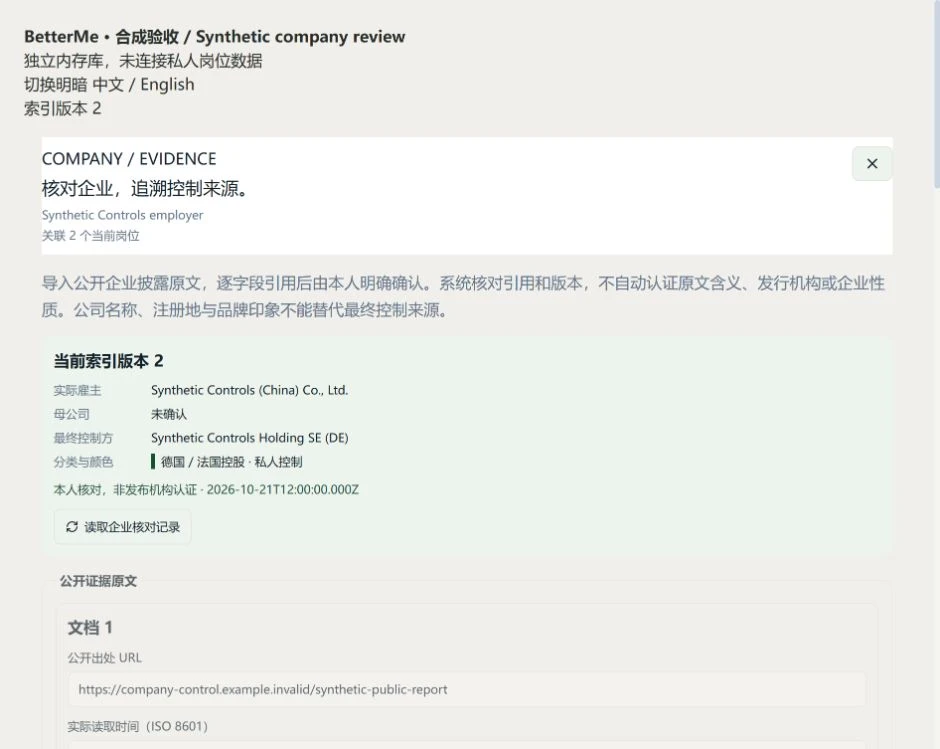

# 企业最终控股证据核对

本批为岗位地图增加企业控股核对流程：保留公开材料的原文、出处、实际读取时间与 SHA-256，逐字段引用原句，预览后由本人明确确认，再以同一索引版本更新企业分类、筛选、列表、统计和地图颜色。它补齐的是可追溯的人工核对能力，没有自动识别企业最终控制方，也没有批量核实真实岗位的企业性质。

最终 32 文件独立源码树 `3125e9c400c3341ce364640d268d9a0140c4f050` 已通过 2742/2742 全量测试、10 项类型任务、Lint、6 项构建和隐私检查。产品提交 `b67463d` 已推送 main；真实后台在完整备份和隔离迁移后升为 V7，仍为 89 岗／revision 85、0 条企业控股核对。[产品 Actions 39633577117](https://github.com/nanfengovo/better-me/actions/runs/39633577117) 的 Windows 质量、Linux 构建、Docker 和 GitHub Pages 部署四项全部成功；已核远端实际 2742/2742、失败／取消／跳过／todo 均为 0，公开首页、主程序、Atlas、新核对面板及两项 CSS 共六个资源 HTTP200。此为发布资源核对，不代表私人页面或真实企业已审阅。后续发布状态以 [main 工作流](https://github.com/nanfengovo/better-me/actions/workflows/ci-pages.yml?query=branch%3Amain) 为准。

## 网页操作

1. 连接本机采集索引，打开岗位详情中的企业控股核对入口，读取当前来源公司及核对历史。目标绑定当前岗位和确切的 `companyId`。
2. 手工填入公开材料的原文链接、实际读取时间和原文。这个流程只处理本人提供的材料，不会自动访问该链接或搜索公司。
3. 分别填写实际雇主法定名称、可选母公司名称、核对状态与控制模式。已明确控制时逐个填写最终控制方名称、性质和可选来源国家／地区。
4. 为每项字段选择材料并引用原句。每个控制方还必须引用其实际最终控制雇主的关系；出现一个公司名称不等于证明控制关系。母公司名称也需引用支持母子关系的原句。
5. 填写说明后预览来源值、当前值、拟保存值和受影响岗位范围。独立勾选本人已核对后才保存；修改字段、说明或索引版本后须重新预览。
6. 保存成功后重读共同索引；撤销需要说明和另一次明确确认。撤销保留全部历史，可恢复上一份仍有效核对或来源值。

列表和详情使用专门的“本人核对”标记。`manual`／`verified` 表示本人依据引用材料完成核对，不能解释为材料发布机构、监管机构或招聘平台已经认证。原文引用检查只验证逐字引用存在、字段对应和结构约束，不自动认证原句的法律含义、披露主体或控制关系是否成立。

## 字段与分类边界

| 字段／模式 | 保存要求与含义 |
| --- | --- |
| 实际雇主法定名称 | 必填，并附独立字段引用；不以品牌、招聘网站名称或办公室名称代替 |
| 母公司名称 | 可选；附支持母子关系的引用，只保留名称，不据此创建或合并另一个公司实体 |
| 最终控制方 | 每个控制方分别引用名称、性质、实际最终控制关系；来源国家／地区填写时另附引用 |
| 单一控制 `single` | 恰好一个明确的最终控制方；性质区分国有控制和私人控制 |
| 共同控制 `joint` | 至少两个控制方，逐个保留关系及已披露国家／地区；不任取第一方作为企业来源国 |
| 无实际控制人 `dispersed` | 明确保留“无实际控制人”模式；控制方列表、控制方名称及控股来源国家均为空，集团母公司仍是另一个字段 |
| 待核实 `unknown`／冲突 `conflicting` | 保留本人已审阅的原文与状态，不据此填入私企、国企或外企结论 |

雇主注册地、工作地点、母公司注册地址和品牌印象都不能自动成为最终控股来源。缺少控制方国别时可以保留已明确的控制性质，但不能满足需要完整国别依据的地区配色规则。现有可配置配色仍决定具体颜色，共同控制有独立规则，无实际控制人不再因注册地被染成某一国家的控股色。

单次最多 10 份材料、20 个控制方。每份原文最多 256 KiB UTF-8 字节，总原文最多 1 MiB；每项实际填写字段必须有引用。保存与备份恢复会从原文重算 SHA-256，并拒绝未来读取时间或未来决议。URL 是材料出处，导入不会授予它抓取权限；不接受任意 CSS、代码、执行身份或网络端点配置。

## 共享工具与认证 HTTP

| 共享工具 | 认证 POST 路由 | 效果 |
| --- | --- | --- |
| `companies.read-control-review` | `/api/v1/companies/control-review/read` | 读取原始公司、当前有效公司、受影响岗位及核对历史 |
| `companies.preview-control-review` | `/api/v1/companies/control-review/preview` | 校验字段引用和来源绑定，返回同版预览及指纹，不写库 |
| `companies.confirm-control-review` | `/api/v1/companies/control-review/confirm` | 明确本人核对后追加决议、保存有效投影与耐久回执 |
| `companies.revoke-control-review` | `/api/v1/companies/control-review/revoke` | 撤销本人的指定决议，保留历史和回执 |

读取参数为 `{ jobId, companyId, expectedRevision }`。预览增加 `proposal` 与 `reason`；确认重交同一输入，并增加 `previewFingerprint`、`reviewed: true` 和 `Idempotency-Key`。撤销输入为 `{ jobId, companyId, decisionId, expectedRevision, reason, reviewed: true }`，同样需要幂等键。

`proposal` 的 `basis` 固定为 `manual-evidence-review`。`documents` 保留 `{ sourceUrl, retrievedAt, rawText }`；`supports` 使用 `{ field, documentIndex, quote, controllerIndex? }` 指向具体原文。`controllerName`、`controllerKind`、`controllerControl` 以及填写时的 `controllerJurisdiction` 均绑定对应控制方下标。

四项工具均不联网；读取和预览只读索引，确认和撤销才写入。服务验证 Bearer 身份、精确 Origin 和可信执行权限；网页同源网关只代理固定路由，宿主保管令牌，前端与未来 Agent 不能自填 `actorScope`、权限或预算。工具与 HTTP 共享领域契约，便于后续 LangChain／LangGraph 使用薄适配。

## 公司作用范围与来源失效

核对只作用指定 `companyId` 的岗位，不按同名、品牌、域名或母公司名称自动合并企业。确认／撤销归档当时的 `affectedJobIds`，用于精确重建旧回执；后来新增同公司岗位不会改写这份历史范围。有效投影先于岗位归并应用，保留原公司底账和既有人工覆盖记录，专门的有效核对优先于旧控制方覆盖。

正常来源刷新保留有效核对；仅增加别名、域名或同公司岗位，以及无关的标题、JD、薪资更新，不使其失效。实际雇主身份、母子关系、原控制方字段、相关人工覆盖或绑定证据发生变化时，追加 `invalidate` 决议。来源一度变化后，即使 A→B→A 回到原内容，旧核对也不会自动恢复，需要重新审阅。

公司和岗位版本、有效投影及回执在同一 SQLite 事务中更新，查询、筛选、分页与地图使用共同版本。核对等待或写入结果不明时，网页阻断依赖旧企业分类的查询；不能先显示新的“本人核对”标签却继续用旧颜色或旧筛选。

## V7 完整历史与公共投影

SQLite V7 增加 `company_control_decisions` 及拒绝 UPDATE／DELETE 的追加历史触发器。`confirm`、`revoke` 和 `invalidate` 保留来源公司、字段引用、原文哈希及作用范围；来源底账独立保存。V6→V7 为增量 schema 迁移，既有岗位、来源、薪资、汇率和全局版本不应因空历史升级而变化；真实库迁移仍须单独验收。

完整仓库备份新增 `baseCompanies` 与 `companyControlDecisions`，保留全部历次原文、决议和耐久回执。恢复先校验原文哈希、读取／决议时间、绑定证据、执行身份、指纹、作用范围、完整回执及有效投影，再进入写事务；不能通过旧备份丢弃目标库已有的核对历史。

公共岗位快照只补充每个公司当前最新有效核对实际引用的材料，作为禁用的 `company-directory` 来源、独立 listing 和 observation，使 `EvidenceRef` 有真实引用目标。这些记录不进入任何岗位的 `listingIds`，不创建 JD、不增加岗位数、不声称岗位在招，也不能作为新的采集器启用。失效或撤销后无其他有效核对时，公共补证记录随有效投影移除，历史原文继续从核对历史与完整备份读取。

这样避免每次地图查询都复制所有历史原文。保留命名空间必须能从决议精确重建，伪造材料、标记或把企业材料挂成岗位来源会被拒绝。公共 JSON 导出不是完整备份，也不能用作保留撤销链的普通导入；需要完整历史时使用可信仓库备份／恢复接口。

## 写入回执与恢复

确认或撤销提交后响应丢失时，继续保留原 body 和幂等键核对耐久回执，不因版本已经前进而换键重写。事务取消或故障在提交前可以整笔回滚；取消客户端等待不能撤回已经提交的事务。

网页按后端连接和身份在内存中保留未确定写入的屏障，覆盖关闭面板、切换数据视图以及工作区卸载后重挂。已确认保存但新索引读取失败时，仅重读索引，不再次确认。整页刷新、浏览器关闭或另一台设备不共享该内存恢复状态；后端耐久回执仍在，恢复原命令需要保留原请求和幂等键，不能把前端状态说成持久命令日志。

## 验证状态

独立合成浏览器已完成 940px 中文浅色预览与保存（revision 1→2），以及 390px 英文深色撤销（2→3）；页面无横向溢出，临时视口已复原。使用合成企业和材料，不涉及私人索引，也没有进行新的 3D／GPU 验收。

实际 React → 严格客户端 → 认证 HTTP → Registry → 内存 SQLite 的两项工作区集成通过：同一公司两岗位的分类、配色、覆盖统计、筛选和地图集合一起更新；等待同版索引时遮蔽旧结果，撤销后恢复未知。丢失提交后回执，切数据视图和重挂工作区后，仍使用原 body／key 恢复，revision 不重复增长。这里的地图采用查询属性探针，不能当 GPU 验收。

独立审查发现并修复四项边界：归档作用范围混入其他公司、未来来源证据导致自身备份不可恢复、恢复时改换原回执 key、Web 接受未来决议。原探针修后分别得到 invalid-backup、invalid-data、conflict 和 invalid-response，并验证原库不变及原始合法记录仍可用。最终全量 2742/2742，失败／取消／跳过／todo 均为 0，10 项类型任务、Lint、6 项生产构建通过；并行 Career 工作不在该冻结树内，既有大包提示保留。

真实运行时已完成完整在线 SQLite 与令牌备份、隔离 V6→V7 克隆、原进程身份与零运行任务复查，仅更新已核实的 5178 后台。原 40 张表及 schema 对象、dataset、token 和五组查询保持一致；89 岗／revision 85、薪资核对／FX 快照／FX 选择／企业核对均为 0。认证企业 read 和同版 FX／查询逐结果核对通过，没有刷新来源或新增真实核对。原 5173 PID 保留，同源网关 ready、企业 read 与 FX state 均 HTTP200，无需现在重启；需要重新加载宿主时按 [现有严格端口重启配置](../../apps/job-service/README.md#网页默认后端) 操作，不替换其他需求持有的进程。

本批没有新增真实岗位控股结论、办公坐标或全网覆盖。更多来源、真实企业披露的本人逐项核对、真实办公点和三维性能仍属于完整岗位地图目标。

截图来自独立内存库，未使用私人公司材料；[截图清单](../images/atlas-company-control-manifest.json)记录原始尺寸与哈希。
