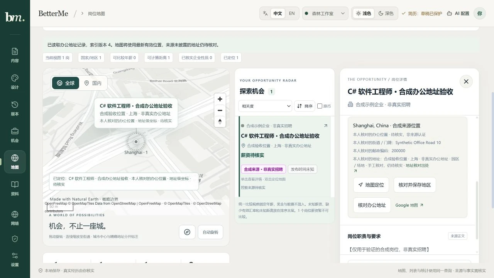

# 桌面工作区与具体办公地址 · 2026-10-19

这批处理桌面端底部大抽屉遮挡地图、地点只到城市、双击无法进入具体工作地址的问题。桌面布局与办公地址能力分别发布；最终验证和发布记录在文末。

## 桌面操作

地图、结果列表、详情是三个独立 grid 区域。通过 ResizeObserver 读取工作区实际宽度，至少 900px 使用三栏，600–899px 将详情放在下一行正常文档流，小于 600px 才使用底部详情。打开详情不重挂地图；保留地图视角、键盘焦点、Esc 关闭和减少动态效果偏好。宽度改变不通过 CSS container containment 改变 fixed 元素的参照系。

单击查看详情，双击定位地图；多工作地点先要求选择本次位置。岗位卡片与详情优先显示有效完整地址、街址，其次才是城市或原始地点。完全远程岗位及远程资格范围不能作为办公室定位。单个未知性质地点也不能因为有坐标便变为办公室。

## 来源地址与可撤销核对

通用 JobPosting JSON-LD、Ashby 和 SmartRecruiters 适配器保留来源明确的 streetAddress 与 postalCode，不从城市、公司总部或品牌推断。邮编保留前导零，拒绝空值、控制字符与超长地址。旧地点 ID 继续按既有地点原文、国家、地区和城市产生；同 ID 只允许缺字段的证据增强，已有值冲突拒绝。本人覆盖不当成来源数据重新导入。

本机索引详情提供“核对办公地址”：明确输入地址查询，或填写 WGS84 坐标、国家、街址、对应楼宇／入口／园区和依据链接，说明该地址与当前岗位的关系。先预览，再独立勾选确认。保存的是本人核对且待核实的位置，详情明确区分“来源披露”与“本人核对”。城市参考不预填成精确坐标，GCJ-02／BD-09 不冒充 WGS84。

SQLite V4 使用追加式 office_decisions 保存确认、撤销和内部来源失效事件；来源 base_locations 与行政范围决议保留。来源地点或证据一度变化后旧办公确认永久失效，即使来源随后 A→B→A 返回也必须重审。显式撤销行政范围后恢复原 basis 的既有语义保留。完整备份包含办公历史及耐久回执，公共快照导入不能伪造本地决议。

候选、预览绑定同一岗位／地点／索引版本；父版本变化时丢弃迟到只读响应。已提交写入仍沿原输入与原幂等键核对耐久回执，页面刷新失败只重新读取。旧快照不能覆盖新版本。确认与撤销保留历史；撤销需要独立勾选与说明，当前没有独立的撤销影响预览工具。

## 地址查询提供方

地址服务由可信宿主安装，默认关闭。首次实现可显式启动 `--office-geocoder nominatim`：固定 HTTPS Nominatim 端点，每次最多 5 个结果，至少 1.1 秒门控，有限 15 分钟进程缓存并尊重 Retry-After。没有自动补全、批量扫描索引或自动重试；超时、限流、认证、格式和预算失败不伪装成空结果。

只发送用户显式输入的 query 及已知国家过滤，不隐式发送岗位正文、来源街址、家庭位置或执行身份。城市、道路、邮编或行政区边界不能成为办公地址候选；候选必须披露门牌、道路、真实 ISO 国家及地址级点，并带 OpenStreetMap 原记录、署名和待核实标识。它只能提供地图候选，不能证明雇主确实在该点办公。国内地址覆盖取决于公开地图数据；未找到时可使用已有 Google 地图查询入口核对，再手工填写有依据的 WGS84 点。尚未内嵌 Google Maps SDK。

## 共享工具与地图

| 工具 | POST /api/v1/locations/office-address/ 路径 |
| --- | --- |
| locations.office-address-candidates | candidates |
| locations.preview-office-confirmation | preview |
| locations.confirm-office-address | confirmations |
| locations.revoke-office-address | revoke |

工具、认证 HTTP、Web 和未来 Agent 共用严格 Schema，不接受客户端指定 Provider 端点或执行身份。确认输入包含 proposal、expectedRevision、reason、previewFingerprint 与 reviewed；写操作还需 Idempotency-Key。候选读取没有 query 时只读配置／来源，不访问网络。

有效地址点双击后平滑进入 16.5 级、显示地址与高亮，保留本人核对／待核实标识。城市分布参考仍限制在 9 级。本人核对的地址可参与直线距离筛选排序，但 estimated 保持 true，不称零误差或通勤距离。保存后使用同快照与当前筛选单独验证该岗位，避免第 31 条以后的岗位被首屏分页误判为不匹配。

## 验证与发布

桌面提交 `3eb8a2f88b2189854cf00a240da7649ae1c4f7b0` 已推送。独立树 `3c8264792b44fe7a11a7a21633e37fec9768123d` 离线冻结安装、memory、types10、lint、build6 通过；layout／workspace 35 项和 detail 10 项分别通过。独立合成页面实际工作区宽 1057px 时三栏无重叠，视口 900px 详情正常流、390px 底部抽屉，均无横向溢出，临时视口复原。[Actions39188287804](https://github.com/nanfengovo/better-me/actions/runs/39188287804) 的 Windows 质量、Linux 构建、Docker 与 Pages 均 success。

办公地址提交 `3a0c8ee78bb63ec0555a023d90b2ab50ee35445c` 已正常推送。43 文件独立冻结树 `71476950671ba510cf9ff4808c5bcc0e5b6650df` 完成离线冻结安装、memory、types10、lint、2332/2332 完整测试与 build6，失败／取消／跳过／todo 均为 0。没有混入并行 Career Agent 的依赖与入口改动。

独立 origin 的真实 React 页面接入合成 HTTP 与内存 SQLite，完成来源街址显示、查询合成候选、填表、预览、独立勾选、保存 revision1→2、关闭详情后双击重新定位、撤销 revision2→3、再确认 revision3→4。地图实际显示 50m 比例尺、本人核对地址与高亮；桌面视口 1280×720 三栏，无横向溢出，页面 error 日志为空。截图只含明确标记的合成岗位、企业和非真实办公地址；合成候选不代表实际地理编码服务成功。未访问先前被 URL 策略拒绝的私人索引页面。

升级前完整 SQLite 在线备份及 quick_check 通过。独立克隆 V3→V4 的 89 岗／revision66、规范数据哈希及既有历史表逐值核对保持一致，office_decisions=0，原备份哈希不变。原自有服务温和停止后以相同端口、目录、Origin 和 DNS 启动新版，并显式安装 Nominatim（仅安装、不发查询）。升级后 HTTP 数据及 token 哈希不变，V4 quick_check／foreign_key_check 通过、0 running、0 办公决议。C# 查询保持全球52岗／36企业、严格国内26／22、上海25／21、浦东7／6、松江3／2。无 query 的地址接口只读返回配置，未对真实岗位写入任何办公点。

真实公开地标仅探测一次：transport 调用1次，实际出站0、字节0、HTTP状态为空、候选0，返回 source-changed；未留下该次底层code，根因未确定，没有重试／换路由或把失败称可用。另有离线 controlled transport 回归证明固定 policy 可正常发送至注入 sender、Fake-IP 在发送前拒绝、302不跟随；这不替代真实联网验证。

[功能 Actions39190824724](https://github.com/nanfengovo/better-me/actions/runs/39190824724) 状态由本次发布收尾核对。

原真实索引在本批之前为 89 岗／revision 66，尚无已核对办公坐标。该能力不会自动把所有已有岗位升级到门牌精度；仍需来源披露或逐岗核对证据。私人索引、凭据、原文、备份和浏览器资料不入 Git；并行 Career Agent 改动保持独立。

[地图使用说明](../job-atlas.md) · [本机服务](../../apps/job-service/README.md) · [路线图](../ROADMAP.md)
