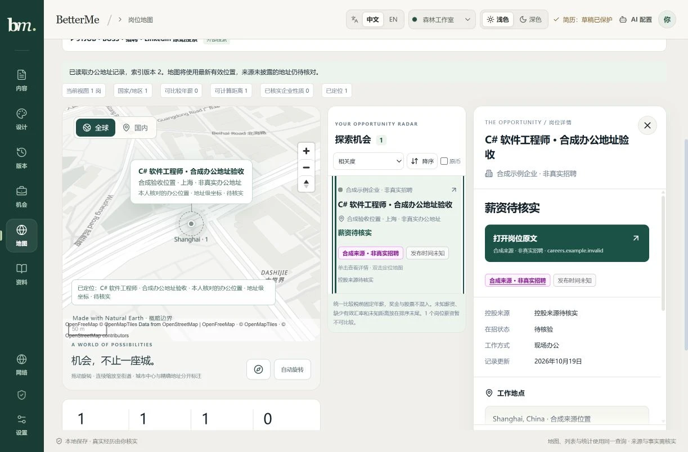

# 桌面即时阅读与办公地址查询约束

日期：2026-10-19。接续[桌面与办公地址能力](job-atlas-desktop-office-address-2026-10-19.md)，本批修复电脑单击延迟、开关详情时列表移动、街址被城市参考截获，以及同名道路跨城市的候选误用。

## 电脑操作

工作区实际宽度至少900px时，固定预留地图、列表、阅读三栏。未选岗位时阅读栏显示空态，开关详情不改变地图高度、列表轨道或卡片尺寸。鼠标单击立即阅读；双击保持在同一个按钮上完成定位，地图实例继续保留。600–899px的详情仍在正常文档流，低于600px才使用底部面板；较窄布局保留双击窗口，键盘激活立即阅读。

定位只在地图完全不可见时滚回地图；可视判断同时考虑浏览器视口与工作区自身overflow滚动裁剪。打开多办公地点岗位仍需先选择具体地点。远程资格、性质未明地点不升级为办公点。

定位顺序为有效地址／手动点、已连接真实索引的来源街址核对、再到城市参考。有街址但没有精确点时，双击会打开办公地址核对；详情按钮显示“核对地址后定位”。已有地址点按16.5级飞入并高亮；城市参考仍保留城市精度与非办公地址标识。

## 城市和邮编约束

共享`OfficeAddressCandidatesInput`、认证HTTP与Web增加可选`locality`和`postalCode`。两字段必须与明确的query同时提交，最长分别200和100字符，拒绝控制字符。网页两字段默认留空，只有点击“查询地址候选”才发送明确填入的值；来源城市、邮编不会被隐式发送。配置读取不含地址查询。编辑地址、城市或邮编立即移除旧候选；确认表单邮编与查询邮编独立。

Nominatim在有约束时采用structured street／city／postalcode，不混用q；无约束保留旧查询行为。结果城市只接受provider明确披露的city／town／village／municipality，不用州、县、城区或近似字符串证明城市。城市名称仅忽略首尾空白和大小写，不猜翻译或别名，因此跨语言名称可能需要按地图原文填写。邮编仅忽略大小写、空格和连字符，保留前导零，缺失或不符拒绝。缓存包含所有约束，旧城市查询与新城市、邮编查询不会串用。

固定HTTPS端点、公共DNS与钉住传输、禁止重定向、单次预算、1.1秒门控、15分钟有限缓存、取消和版本复核保持。候选仍是待本人核对的估算地址，不认证雇主办公关系、不自动写库。JSON配置和Agent工具继续共用严格契约，不允许客户端选择任意端点。

## 真实查询与准确性

对先前保存的公开响应做SHA校验后完全离线重放：无约束解析保留3个门牌候选；明确纽约市和10118邮编后，Greenport／Watervliet／Pelham三个其他城镇的点全部拒绝，没有网络请求。

另按当前宿主已配置Google DoH执行一次公开地标structured查询：street为`350 Fifth Avenue`、city为`New York`、postalcode为`10118`。Google DoH一次、Nominatim一次，无重试或路由替换；HTTP200、总耗时2.546秒、响应1513字节，SHA256为`5652ca70feb34e1415430ba89b99feabbb49c40d594cf371e8d2e9cea8a9d755`。

上游仍返回一个Pelham门牌点及一条纽约道路；新城市／邮编／地址级精度检查将两者拒绝，最终0候选。**本批证明错误候选能被排除，没有证明该提供方已准确找到目标地标或任何真实岗位的办公室。** 国内地址覆盖与真实门牌证据继续补充；当前没有内嵌Google Maps SDK。

## 验证与交付

15文件最终冻结树`b7f5c3887afd03d2f629835ad13fa1e078e0c8d3`经过离线冻结依赖安装、Memory检查、Typecheck10/10、Lint、156/156相关测试及Build6/6，失败／取消／跳过／todo均为0。156是最终树独立结果，不与前批数字相加；全量CI另行记录。

独立origin的真实React、认证HTTP和内存SQLite使用明确合成岗位、企业、来源、地址与候选。默认1223×804视口下，单击前后可见卡片矩形、地图矩形及工作区scrollTop逐值相同；三栏轨道约459.75／247.25／344px。原生双击来源街址进入核对，新城市与邮编字段可填写，预览／独立勾选保存revision1→2后，再双击进入地址高亮与50m比例尺。无横向溢出、页面error日志为空。900px视口详情relative、390px为fixed，均无横向溢出，临时viewport已复原。截图是实际页面捕获，没有注入布局或拼接，不代表真实招聘地点。

完整SQLite在线备份及quick_check通过、确认0 running后，以同端口、目录、Origin、Google DoH及显式Nominatim配置更新本机服务。首次验后工具进程在续轮已不存在，确认原handle missing、原PID退出及端口无监听后，恢复为隐藏后台进程；再次复核同一数据、token、版本、历史与查询均保持。原因未据此猜测。89岗／revision67、公共dataset与token哈希、V4及外键检查保持；办公决议0。真实C#查询保持全球52岗／36企业、严格国内26／22、上海25／21、浦东7／6、松江3／2，mapped仍0；来源street0、postal2，没有向真实岗位写入办公室。 续轮另核原5286进程退出且端口无监听后，按相同工作目录、loopback及strictPort恢复隐藏后台Vite；首页及3个Atlas模块HTTP全部200，实际分发新版布局／查询字段。5178未再重启，数据哈希、token与五组查询再次核对不变。

桌面提交`8ddf788675302d73cce8805f945ad816ac9846e8`与地址约束提交`dc2f2a5b7b7953eed1e3f726467c2f54f6bbef1d`已正常推送main。远端Actions39195657845首轮Windows全量2346项、2345通过、1个未修改jd-session-extension文件级失败；Linux构建与Docker成功、Pages skipped。失败没有具体子进程exit／signal栈，尚不能确定根因。相同冻结文件独立TAP两次24/24、exit0且stderr为空；同一远端SHA仅重跑失败任务一次，attempt2全量2355/2355，失败／取消／跳过／todo均0，Windows质量、Linux构建、Docker与Pages四任务最终success。未修改产品、测试、timeout、并发或workflow，不称首次根因已修复。部署后实际读取公开首页、main、Atlas、办公面板和CSS共5个资源均200，核固定阅读空态／三栏及城市／邮编字段。并行Career Agent代码、依赖与共享文档改动保留，未混入Atlas发布；私人库、令牌、备份和完整来源响应不入Git。

[使用说明](../job-atlas.md) · [本机服务](../../apps/job-service/README.md) · [路线图](../ROADMAP.md)
