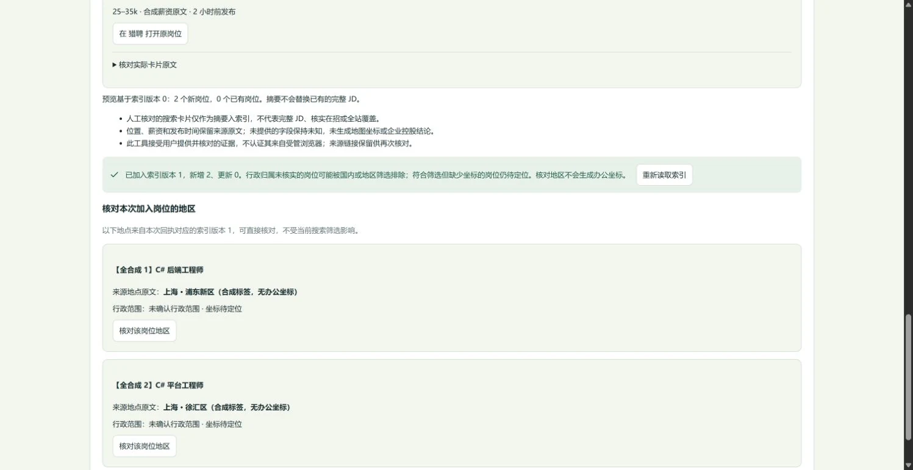

# JSON 分页与搜索卡片批量审核 · 2026-10-22

本批针对两个实际覆盖缺口：公开 JSON 岗位 API 只读第一页，以及四平台搜索结果必须逐条审核入库。新增通用配置分页和当前页多选审核，复用既有来源工具、持久扫描进度、索引和卡片证据契约。用户原 5173 开发进程继续保留；本批没有访问或修改私人岗位库，也没有更新已安装来源。

## 来源返回的分页

`mapped-json@1` 支持在来源 `options` 中配置平铺字段 `nextPageUrlPath`、`pageParameter`。来源实际返回的下一页必须保持已审核端点的同源、同路径及固定参数，仅允许递增数字页码；缺失或不安全的链接保留当前有效记录，但报告部分覆盖。没有新字段的旧来源保持原有限单页语义。GitHub JSON 始终输出待核对线索。

当前页超出输出额度时，私有游标保存与来源、配置、原搜索范围和整页指纹绑定的有效候选偏移；继续读取先下载并校验同一页。页内内容变化会拒绝旧偏移，防止把旧位置应用到新列表。读完才进入来源给出的下一页。请求、字节、时间、页数、记录和刷新间隔限制继续适用；后续批次通过已有扫描面板明确发起。

每次 `fetchedRecords`／累计尝试按实际下载整页计量。同页为输出剩余记录而重读时，尝试数会重复计入，不能作为唯一岗位数。实时分页不提供跨页快照，来源之间的更新可能产生重复或移动；末页只表示该 API 当次有限清单末尾，不能表示市场或全网完成。

内置 Arbeitnow 待审配置增加 `links.next`／`page`，单批页数上限从 1 调为 3，记录上限仍为 300；实际批次可能先到记录或网络预算上限。旧的已安装配置不会被目录覆盖，需在来源工具读取并核对当前 JSON，按版本明确更新字段和额度后才能获得分页能力。配置说明见[适配器 README](../../packages/source-adapters/README.md#json-来源分页)。

## 真实公开探测

2026-10-21 18:27:36 UTC（北京时间 10 月 22 日），实际适配器通过项目现有受控传输、显式 Google DoH 路径读取 Arbeitnow 两页。共 4 次预算内请求（含 DNS HTTPS）、4,835,025 字节，未保存岗位标题或正文，也未打开私人数据库。

| 项目 | 实际结果 | 含义 |
| --- | --- | --- |
| 第一页 | 300 条，有有效下一页 | 字段映射和分页入口可用。 |
| 第二页 | 300 条，有有效下一页 | 实际请求进入来源返回的 `?page=2`，逐字段证据指向该页。 |
| 两页来源 ID 去重 | 552 个 | 存在重叠，不能把 600 条下载直接叫 600 个唯一岗位。 |
| `C#` 字面提及 | 4 条 | 只说明文本提及，未判断核心技能、个人适岗或独立在招。 |
| 已安装来源／私人索引变更 | 0 | 公开能力探测没有导入岗位或修改用户配置。 |

系统 DNS 路径在请求来源前被公开端点校验拒绝，未放宽保留地址检查；显式 DoH 沿用项目已有能力，不修改系统网络。Python 普通 HTTP 读取与受控适配器成功是两条分别验证的路径。此次未遍历全部页、未验证跨页时间点完整性或长期可用性。

## 当前页批量审核

四平台当前成功读取的最多 50 张卡片可逐项选择或全选符合入库条件的卡片，再进入现有预览和明确确认。缺少雇主的卡片保留原文与回链，禁止加入这批索引；卡片仍是摘录，不能当作完整 JD 或精确办公点。

选择绑定当前成功捕获、会话与平台；重读、失败、结束会话和新平台均清空。上方搜索条件变化不会重写仍在进行的原会话。整批内容纳入审核身份，同时间、同首条 URL 而选择集合不同，也必须重新预览和确认。来源、原卡片文本、字段证据与捕获时间沿用原契约，不为批量导入补造发布时间、国家、薪资或坐标。

写入结果未知时，当前工作区保留原输入和幂等键核对回执，并阻止关闭原核对、切换单卡／批次、数据视图或后端连接。成功或明确拒绝后才解除。整页刷新或工作区彻底卸载的持久恢复仍不是本批承诺；界面明确提示凭据只在本页内存，服务端原回执保持耐久。

独立 Chrome 操作真实两个面板与正式客户端，接到真实应用工具和内存 SQLite。固定合成页面有3张卡片，2张具备雇主、1张禁选。实际全选2/2，打开核对和预览均保持0岗／版本0；勾选后确认，得到2岗／版本1、新增2／更新0。再次读取后选择清零。合成页面禁止外部招聘传输和原岗外链，外部调用为0，没有启动真实招聘浏览器。

桌面批量选择画面，卡片均清晰标为合成：

确认后的实际应用回执与待核对地区：

默认桌面视口1512px，页面宽1497px；390px窄屏页面宽375px，无横向溢出，批量操作可见，临时视口已复原。浏览器记录的错误／警告为0。这里是面板隔离验收，完整Workspace的选择和未知写屏障另由集成测试覆盖，不当作真实四站或私人页面目视。截图大小、SHA与来源范围见[清单](../images/atlas-platform-batch-manifest.json)。本批自有5310合成服务已停止，原5173／5178保留。

## 检查与发布状态

| 检查 | 实际结果 |
| --- | --- |
| 分页专项与独立审查 | 13/13，通过实际适配器、应用工具、SQLite重开继续、原键重放零读取、页变化失效及不安全下一页保留既有岗位；独立只读审查无阻断问题。 |
| 分页7文件独立树 | `e96539360240d48f15ea5d5cc0be6b7efa2b81b1`：适配器整包及持久分页354/354、适配器类型／Lint／构建通过。 |
| 批量交互相关回归 | reader／links／Workspace／Import共102/102；整批改变重新审核、50卡、读中禁用、缺雇主、迟到响应、网络未知后阻止换批和后端、原body／key恢复均通过。 |
| 组合15文件独立产品树 | `a674d415cfcf8c938a2247dcc626910399e82e90`：2812/2812（失败／取消／跳过／todo均0），类型10任务／Lint／构建6任务／memory通过；未混入并行Career或其依赖。 |
| 实际浏览器 | 上述合成0→2、预览不写入、禁选缺雇主、重读清选择、桌面及390px通过；不代表完整Workspace或真实招聘网站。 |
| 功能提交 | JSON分页 `6c5a566`、批量卡片 `0a02d79` 已分别正常推送，逐笔核对远端main；远端各任务及文档后续状态见[main工作流](https://github.com/nanfengovo/better-me/actions/workflows/ci-pages.yml?query=branch%3Amain)。本地通过不能代替远端检查。 |

本批没有数据库迁移。已运行的5178仍为上一批已验证V8进程，未重启，因此新JSON分页须按原服务参数／原数据目录由管理终端重启才会加载；旧安装来源须另行核对并更新分页配置。本机网页的批量卡片操作沿用已有后端接口。原5173的拥有者需要重启时，使用下方链接中的strictPort命令，不新建冲突进程。

本批不声称四平台全站爬取、全网搜索、自动翻页或精准办公室覆盖。默认后端和原服务拥有者的重启方式见[服务说明](../../apps/job-service/README.md#网页默认后端)。
