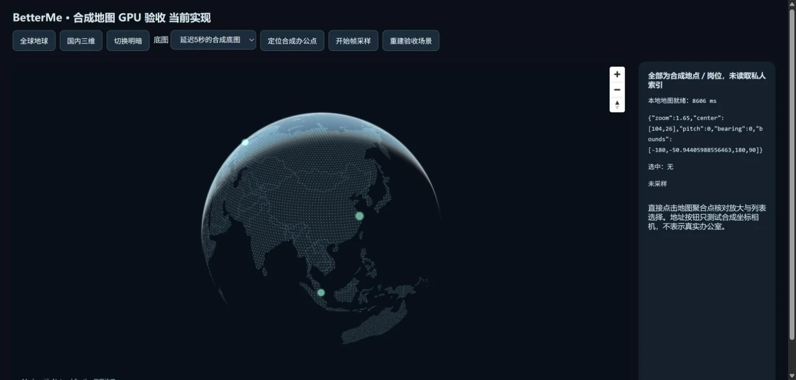
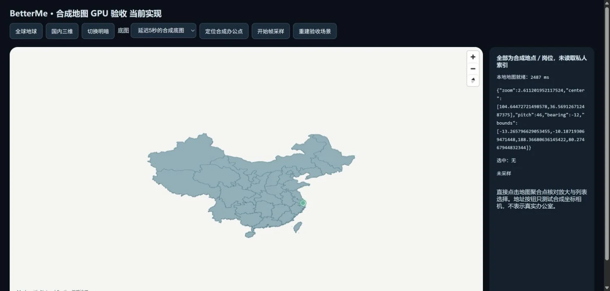
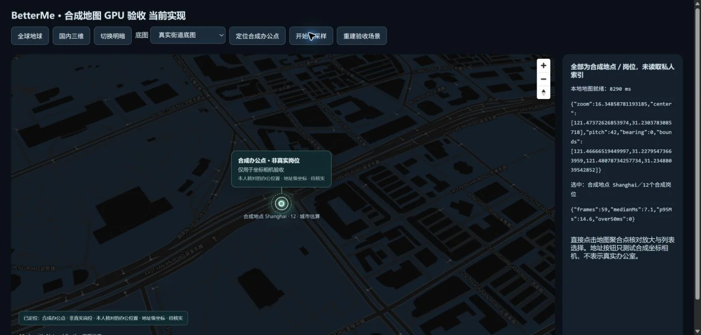

# 地图首帧与聚合下钻 · 2026-10-22

本批修复两个具体问题：地图构造被可选远程街道样式阻塞；点击聚合点只选中列表而不调整相机。现在先绘制本地轮廓、点阵和岗位，再在同一个地图实例中安装在线样式，保留相机、选择和最新定位。远程请求有八秒超时，失败或插入失败保留本地图层；切模式、卸载和迟到响应相互隔离。

聚合点按查询级别下钻：国家 4.5、地区 7.5、城市或地点 10.5；只有城市参考坐标时上限为 9，保留估算标识，不冒充办公室。已在相同或更高缩放时不反复拉远。减少动态效果偏好使用零时长。WebGL 恢复在下一次有效渲染后通知工作区，避免地图已经恢复而错误遮罩仍保留。

## 浏览器观察

使用独立端口、实际地图组件、四个合成地点，未打开私人岗位库或改变原开发服务。比较基线是本批前已发布实现；延迟底图由固定五秒响应模拟。时间从场景重建到本地地图就绪，包含开发模块、资源与浏览器调度，只有有限单机样本。

| 检查 | 实际观察 | 限制 |
| --- | --- | --- |
| 相同五秒底图延迟的暖场景 | 旧版约 8,314 ms；当前约 2,470 ms，本地地图和控件先于底图出现。 | 非统计基准；初次开发模块加载仍曾达到约 8 秒，新标签一次为 8,606 ms。 |
| 国内浅色场景 | 本地地图就绪 2,487 ms；国内视角、边界与合成上海点可见。 | 单次开发环境观察，不保证所有设备或网络的时间。 |
| 点击合成上海聚合点 | 保留 12 个合成岗位选择，相机平滑到 zoom 9。 | 城市参考点，未生成具体办公位置。 |
| 在线街道与合成办公点 | OpenFreeMap 实际道路／建筑轮廓可见，地址级相机约 zoom 16.5、pitch 42，比例尺约 50 m。 | 位置为合成坐标；底图覆盖与地名取决于提供方。 |
| 前台短滚轮采样 | 59 帧，间隔中位数 7.1 ms、p95 14.6 ms，超过 50 ms 为 0。 | 只证明该短交互样本；不能外推整市场负载或保证帧率。后台约一秒的间隔属于隐藏标签调度，不作为 GPU 性能结果。 |

全球深色场景，所有点均为合成岗位：

国内浅色场景：

实际在线街道与合成地址相机：

*地图截图数据与样式：[OpenFreeMap](https://openfreemap.org/) · [© OpenMapTiles](https://openmaptiles.org/) · [© OpenStreetMap contributors](https://www.openstreetmap.org/copyright)。本地概略轮廓来自公有领域 Natural Earth；岗位与办公点均为合成验收内容。*

实际提供方曾报告缺少 `wood-pattern` 图像的非致命警告；不能据此声称所有纹理均已验收。截图是地图组件隔离验收界面，不是已有全市场真实岗位的证明。四张新增截图的来源范围与文件哈希见[清单](../images/atlas-map-scan-manifest.json)。

## 自动检查与真实数据边界

地图专项 27 项通过，覆盖下钻、选择、减少动态效果、局部首帧、远程超时／失败、相机保留、迟到响应、模式切换、样式回滚与 context 恢复。组合产品冻结树 `582cd5c92d1ff73ed39da4aa71294ab67a0d0c65` 的全量 2,793 项、类型 10 任务、Lint 与构建 6 任务通过；首次开发编译耗时和既有大包提示仍存在。

地图 `4aea333` 与来源续读 `fde6ac9` 已分别提交并正常推送。[产品Actions39646498353](https://github.com/nanfengovo/better-me/actions/runs/39646498353) 的Windows质量、Linux构建、Docker和Pages四项均成功，实际Windows日志为2,793/2,793，失败／取消／跳过／todo为0，无重跑。文档后续状态以[main工作流](https://github.com/nanfengovo/better-me/actions/workflows/ci-pages.yml?query=branch%3Amain)为准。

真实索引在本次采集前为 89 岗／revision 85，18 份来源街址、9 份道路编号，已确认办公坐标为 0。本批没有把城市中心、公司总部或合成点写为真实办公室；高德尚未接通，申请方式见[配置步骤](../amap-setup.md)。更多真实岗位与精确办公点仍需来源证据和另行核验。

来源清单后部漏读另由[持久扫描与显式续读](job-atlas-scan-continuation-2026-10-22.md)处理。后端默认连接与严格端口启动见[服务说明](../../apps/job-service/README.md#网页默认后端)。
