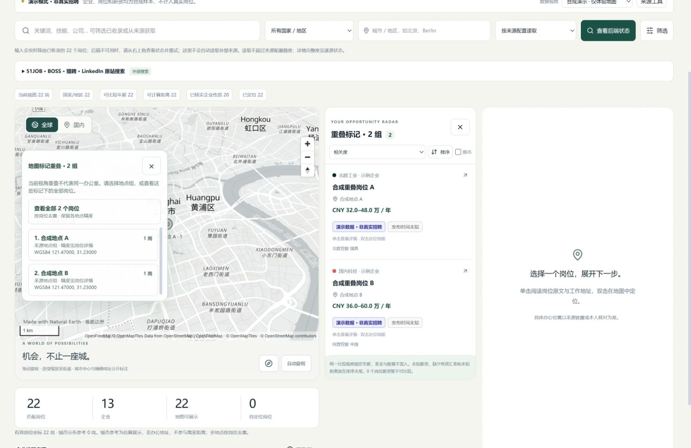

# 重叠地图标记与办公地址补全接续 · 2026-10-22

本批修复两个会隐藏已有信息的交互问题：同一屏幕位置的多个地图标记只取首个命中，以及来源已有街址但地址服务没有候选时不再继续官网查找。继续复用当前地图、共享岗位查询与已持有同岗证据链，没有扩张采集权限或把城市坐标当成办公室。

## 重叠标记逐组选择与查看全部

MapLibre的核心点与类别环可能为同一地点组返回重复命中；不同地点组也可能位于相同坐标或在当前视角重叠。命中现在按当前原始地点组解析全部有效ID，去重并忽略已退休的要素。只有一组时沿用原组回调和原精度相机规则；多组时先打开明确选择面板，不自动采用图层首个结果。

面板逐组显示名称、原岗位数、WGS84坐标以及来源地点／城市参考区别。选择一组返回原对象；“查看全部”保留成员ID，列表采用成员岗位ID去重并集。这个集合只用于列表选择，没有共同坐标、企业类别或新的地点精度。屏幕重叠不证明各岗位在同一办公室。

已有关键词、地区、排序与真实游标分页继续作用于所选岗位；地图桶和统计仍来自原查询全量范围。同一岗位属于多个地点组时只计一次。集成回归覆盖66个唯一岗位、多地点重叠、共享岗位、30→60→66分页以及保留排序。切换国内范围或城市参考过期后清理旧选择。

地图从城市级分组切换到地点级分组时，分组ID可能整体改变。工作区按选中岗位ID与当前地图桶的交集重建高亮ID，保留列表集合；晚加载的街道文字层也接收全部高亮。相同ID集合换序不重复写筛选，选择变化本身不重新上传GeoJSON，继续保留原几何缓存和悬停按帧合并规则。

## 焦点、相机与过渡

选择面板是非模态区域，使用原生按钮，不声明焦点陷阱。打开后焦点进入关闭按钮；焦点仍在面板时，Esc或关闭恢复到地图画布。打开时停止当前飞行动画和自转，并清除此前手势结束可能留下的700毫秒恢复计时器，避免选择中又自动转动。

拖动／缩放、切换分组级别、岗位／定位、模式、数据或地图配置后真正清理面板状态；回到原视角不会复活旧命中。相机仍保留减少动态效果设置及按来源精度限定缩放。这里没有降低地图精度或缩放上限来掩盖性能问题，也没有新增全负载GPU基准。

## 来源街址无候选时继续官网读取

旧判断把“存在来源街址目标”当成已有可用候选，因此地址服务返回0、未配置或失败后，同岗位官网链被抑制。现在按本次响应中实际具有候选的`locationId`与`pendingLocationIds`比较；有任一待补地点未覆盖，就继续既有原岗／官网详情及必要的企业入口发现流程。

一个地点的候选不能覆盖同岗位另一个地点。每岗原有两个来源街址查询上限继续适用，第三个未查询地点也保持待补。全部待补地点有候选时避免更弱的额外查找；有效同岗地址捕获已经进入本人审核时，保持先审核的停止规则，不承诺一次处理完成所有地点。

原平台、listing、来源、原编号与URL的同岗身份约束未放宽。精确读取到的来源地址先预览、独立勾选后保存；较弱官网线索或企业招聘入口仍只供核对。候选不自动写坐标，不采用公司总部替代工作地点，不改变JD、薪资或企业事实。

地址面板31项回归包含真实React→HTTP→应用工具→内存SQLite：预先存在街址而未配置地理编码时，接续官网同岗读取；预览不写入，明确确认只保存地点；响应未知使用原请求恢复。JD、薪资、企业、原时间保持，坐标新增为0。这里的“真实HTTP与SQLite”是隔离合成集成，不是本次真实市场采集或私人库验证。

## 浏览器交互范围

独立Chrome页面加载实际AtlasWorkspace和MapLibre，使用清晰标识的22条合成岗位，其中A／B具有相同WGS84坐标及不同地点组。桌面实际点击验证：重叠点打开A／B选择，选B后只显示B；查看全部显示两条，原匹配统计保持22。Esc关闭并将焦点交回CANVAS；城市级放大至街道级后仍保持两条所选岗位及当前分组高亮。在线街道底图加载不代表岗位已具有办公地址精度。

390px窄屏已实际验证：页面宽384px，不超过390px视口；选择器宽294px、高256.75px，完整落在视口内。组列表可滚动（可见81px／内容153px），可以滚动到第二组并选择B；Esc关闭且焦点回到CANVAS。完整工作台按钮样式曾让组内文字横向挤压，已用两处局部block规则修正，桌面／窄屏最终截图均目视检查。临时验收页的Tailwind插件与文件监听也已修正；早期空白／重载截图没有计为通过。

验收结束已复原临时视口、关闭自有标签并停止5311合成服务。原5173和5178进程保持；本次浏览器控制台未记录warn／error。这里是有限合成交互验收，不代表大规模市场数据性能或真实办公地址精度。

两图来自真实Chrome合成页面，保留Natural Earth、OpenFreeMap、OpenMapTiles和OpenStreetMap地图署名；截图来源、尺寸与SHA见[清单](../images/atlas-overlap-manifest.json)。

## 检查与发布状态

| 检查 | 当前有证据的状态 |
| --- | --- |
| 最终功能产品树 | `22dda927813d68274484a43566c81050977040a4`：12个明确产品／测试文件，离线冻结安装、memory、Lint、类型10任务、构建6任务及4个相关测试文件105/105通过；fail／cancel／skip／todo均0。 |
| 自转计时器回归 | 旧实现实际失败；修后105项包含拖拽／缩放／旋转／俯仰及map.stop同步结束事件回归，验证后续主动交互仍恢复旋转。 |
| 后续局部CSS修正 | `706bb37`，独立树 `2e6574e33890a59bae8fee1973b70cde363e09cb`，与功能树仅一份CSS不同；离线冻结安装、Lint、构建6/6通过。纯样式没有新增或重复运行测试。 |
| 本地全仓测试 | 本批没有执行；105是定向测试数，远端全仓结果独立记录。 |
| 浏览器 | 1512px桌面与390px窄屏合成交互、两张最终截图已验；临时视口复原，自有标签与5311服务已清理，原5173／5178保留。 |
| 功能提交 | 地址补全 `48b0dae`、重叠地图点 `46ef711` 已正常push；组合产品树与独立冻结一致。后续CSS／文档发布另记。 |
| 产品GitHub Actions／公开部署 | `46ef711` 的 [39661484281](https://github.com/nanfengovo/better-me/actions/runs/39661484281) 首次四任务success，实际全量2821/2821、fail／cancel／skip／todo均0，无重跑。公开首页和实际引用的7个JS/CSS共8项HTTP200并核本批功能标识；这个产品结果不外推后续CSS／文档提交。 |

后续CSS修正与本说明按正常提交发布，继续由同一[CI与部署工作流](https://github.com/nanfengovo/better-me/actions/workflows/ci-pages.yml)执行全量检查和Pages部署；该提交的最终CI与公开截图状态以对应运行记录为准，不用上面的产品CI替代。
两笔功能提交分别为 `48b0dae2e6870bde043dca482c803a11b651d052`（地址补全）与 `46ef711e7d667d0f2d6918e415a9349e00ffef47`（地图选择），正常push后远端main已核一致；局部CSS提交为 `706bb37fdafbede8ad33de18876fe6d0e2d99adf`。本说明与README截图另作独立文档提交，未混入并行Career代码、依赖或Docker改动。

本批只修改前端和相关测试，无数据库迁移，不需要替换5173或5178进程。同源自动后端已在此前批次发布，本次保留；静态GitHub Pages／Docker网页仍需要独立岗位服务，不能将地图UI发布当作公网采集后台已上线。原服务重启方式见[服务说明](../../apps/job-service/README.md#网页默认后端)。

本批真实新增岗位0、确认办公室0，未读取或写入私人岗位库，未进行真实外部招聘采集。前次真实数据时点为89岗／revision85、18份街址披露、9份道路编号、已确认办公室0，本次没有重新读取或更新这些数量。高德尚未接入，用户无Key时的准备步骤仍见[高德申请说明](../amap-setup.md)。

整个岗位聚合与地图目标仍在进行：四平台和官网覆盖、更多地区／完整JD、具体办公点的可靠匹配、企业发现与GitHub线索转原岗位等仍需继续验证和建设。屏幕可访问所有重叠岗位，不等于已取得全市场岗位或逐岗准确办公点。
