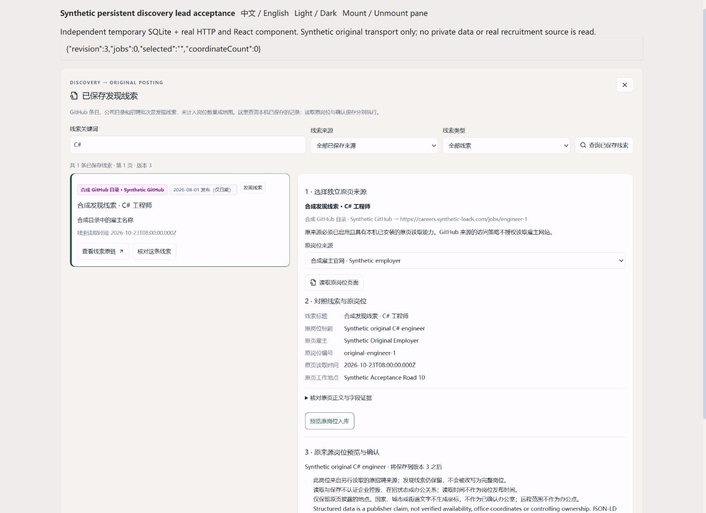

# 持久发现线索接续原岗位

日期：2026-10-23。本批独立产品快照的全量检查已完成；远端运行结果以本批提交的 [GitHub Actions](https://github.com/nanfengovo/better-me/actions/workflows/ci-pages.yml?query=branch%3Amain) 和对应 Pages 部署为准。前批 JSON 地点发布 `7a36049` 的结果保持其原报告范围。

此前后台可以保存 GitHub 等来源的招聘线索，Web 没有分页浏览、重新打开或接续原岗位的入口。本批增加持久线索工作台与五个共享工具，使已保存线索能经独立原来源读取、原文核对、预览与明确确认后进入统一索引，并保留发现链。

## 行为与架构

`leads.query/read` 在一个 SQLite 事务取得线索、原来源投影和有效岗位，支持默认 50／上限 100 的分页、来源、关键词与类型。游标绑定查询和 revision，记录变化后不能悄悄翻入混合版本。旧 `leads.list@1` 与 GET `/api/v1/leads` 保持兼容。

`leads.read-original` 不收调用方 URL，使用持久线索的 `record.url`。JSON-LD 与 SmartRecruiters 原来源必须独立配置并启用，由已安装的同步 URL hook 判断适用范围，再执行原适配器与受控传输检查。GitHub 访问范围不扩展到雇主域名；仅有首页或批次线索、缺稳定原编号、实际雇主、可读正文或返回多个岗位时，不能直接生成规范岗位；页面 URL 的外观不是判断依据，原来源必须读出唯一完整 JobPosting。不自动换用 `applicationUrl`，不扫描整源。

`leads.preview-original` 校验宿主 HMAC、lead 摘要、两个来源指纹、读取时间和序号及当前 revision。预览的 `job` 是原来源增量，`canonicalJobId` 指向当前有效归并目标。`leads.import-original` 仅接受已核对的预览指纹和 `reviewed:true`；规范身份由原来源及实际原编号拥有，两个线索接续同一原岗不创建两个身份。

每个接续在独立不可变 observation 保存 lead ID／摘要、发现来源、原来源指纹、原编号、URL、读取序号与记录摘要，同时填充 listing 的发现来源和保留链接。JD 观察与快照保留自己的内容哈希。普通来源刷新、完整备份恢复及已有人工归并继续保留这些关联；查询展示的是包含历史的接续记录，不声称当前线索 URL 仍有效。

## 恢复与界面

同时间戳读取顺序仅在本工具宿主会话内由序号保证；跨其他刷新工具／其他进程尚无共享读序列，revision 与来源指纹屏障仍然生效。Web 不会在别的写入之后自动重基旧确认。

确认保存先查耐久回执，之后才验证临时 capture。相同 actor／原幂等键／完整 body 恢复原回执，不重复写入；同 key 不同 body 冲突。未提交 capture 在服务重建后失效，已提交回执可恢复；提交后丢响应或取消不当作回滚。

Web 连接范围内的内存恢复状态跨面板关闭、视图切换与组件重挂保留原请求。未知写结果阻止新采集与替换连接，成功回执后快照失败只重读索引。整页刷新前需完成恢复，内存状态不宣称持久跨浏览器重启。保存后再由用户点击“查看规范岗位 · 清除地图筛选”，读取同版详情与地图选择；本批不推断或创建办公室坐标。

## 验证与限制

独立产品快照基于 `7a36049a60e8d2227d76764ced32163dbcdb8362`，仅加入本批 29 个产品与测试文件；冻结树为 `e03821ea4a5c0b799b284672cf9e0c4c94b61ff0`。离线冻结依赖安装、全量 **2917/2917** 测试（失败、取消、跳过、todo 均为 0）、类型检查 **10/10**、Lint 与构建 **6/6** 全部通过。共享工作区的 Career Agent、App、依赖清单与锁文件没有进入该快照。发布前再次以 Git blob 校验产品文件与被测树一致。

回归覆盖持久分页与版本绑定、独立原来源授权、实际原岗位编号、唯一完整 JobPosting、原来源去重与双发现链、归并／刷新／撤销、备份及回执恢复、同毫秒倒序读取、禁止任意 URL／备用申请链接、未知写入后的面板卸载与根组件重挂恢复。Web 集成另核对恢复后的连接身份、同版汇率与岗位查询，以及缺坐标时的规范岗位选择。

实际 Chrome 验收使用同一冻结树、独立临时 SQLite、真实 HTTP 与真实 React 面板，仅原招聘页传输为显式合成内容。关键词 C# 将两条线索筛为一条；浏览与预览仍为 revision 3／0 岗，明确确认后为 revision 4／1 岗。仅发生一次受控合成原页读取，保存和重开面板没有重复外读。用户主动查看后选中相同规范岗位，重挂面板仍显示一条历史接续；地址文字未产生任何坐标。1512px 中文浅色与 390px 英文深色均无横向溢出，深色纸面实际为 `rgb(24, 27, 26)`，文字为 `rgb(236, 238, 232)`，无浏览器 warning／error。临时视口已复原，自有标签页与验收服务已清理。此处验收的是接续面板和选择回调，完整工作台恢复由集成测试覆盖，不计作本轮地图 GPU／精确办公点验收。

[390px 英文深色接续历史](../images/atlas-persistent-lead-history-narrow.jpg)与[截图来源／尺寸／哈希](../images/atlas-persistent-leads-manifest.json)可核对；截图没有合成真实招聘覆盖或修改页面外观。

本批使用隔离的合成 SQLite、来源原页与浏览器样本验证；没有读取或修改私人岗位库，没有真实外部采集或新增真实办公室。原 5173／5178 保留，现有后台未加载本批新工具。由原终端按[严格端口步骤](../../apps/job-service/README.md#网页默认后端)重启 Vite；后端升级另需原配置、原数据目录、完整备份和隔离验证，源码或公网静态更新不能当作后端运行版本已更新。

来源覆盖仍有限：此功能接续已保存线索，并非全网搜索；Greenhouse、Lever、Ashby 等其他原页接续、四平台人工验证、真实 JD 与可靠办公地址覆盖继续独立验收。地图精确办公点仍需原页地址与独立地理核对；高德尚未配置，见[配置步骤](../amap-setup.md)。
