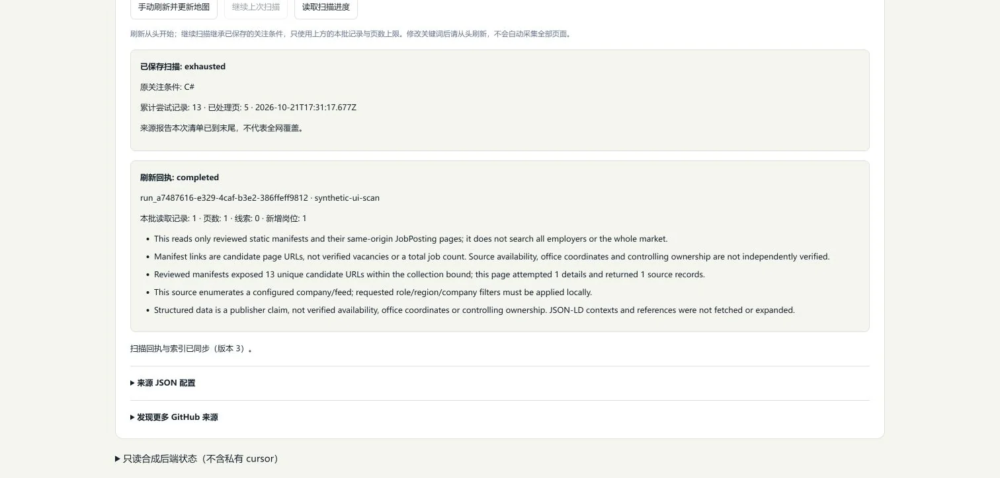

# 来源分批扫描与显式续读

日期：2026-10-22。当前状态：组合产品独立冻结 2,793/2,793、类型／Lint／构建通过，实际合成面板与有限地图 GPU 验收通过；真实服务已完成备份、隔离 V7→V8 迁移和升级后核对。地图 `4aea333`、来源续读 `fde6ac9` 已按功能推送，产品远端四项CI均成功，实际Windows日志为2,793/2,793。真实更多岗位与办公坐标仍待来源证据，本批不声称全网覆盖。

有限采集每次新建 `sources.sync` 都从清单前部开始。以每批最多 6 次详情尝试为例，即使后面存在符合关键词的岗位，反复刷新也可能一直只处理前 6 个候选。本批保留从头刷新的原语义，增加持久扫描位置和单独的显式继续操作，使后续批次能够接着读取，而不把一次操作扩展为自动全量采集。

## 工具、HTTP 与公共契约

| 工具 | HTTP | 效果与输入 |
| --- | --- | --- |
| `sources.sync` | `POST /api/v1/sources/:sourceId/sync` | 原有 `local-write`；`{ scope?, maxRecords?, maxPages? }`，新扫描从头开始。 |
| `sources.read-scan-progress` | `POST /api/v1/sources/:sourceId/scan-progress` | 新增 `read-index`；`{ runId? }`，只读当前身份进度，不联网、不需幂等键。 |
| `sources.continue-sync` | `POST /api/v1/sources/:sourceId/continue-sync` | 新增 `local-write`；`{ fromRunId, expectedProgressVersion, maxRecords?, maxPages? }`，需要 `Idempotency-Key`。 |

应用工具输入另包含 `sourceId`；HTTP 从路径注入此字段。执行身份、访问权限与总预算由可信宿主提供，调用方不能提交 `actorScope`、新 `scope`、任意 cursor、端点或文件路径。HTTP 沿用 Bearer 身份、精确 Origin、请求体限制、取消与固定路由规则；页面、CLI 和后续 Agent 共用应用工具与 Schema，不各自实现采集语义。

共享浏览器安全契约定义于 [source-scan-contracts.ts](../../packages/source-adapters/src/source-scan-contracts.ts)。`SourceSyncRun` 兼容旧字段，新增可选 `scanId`／`continuedFromRunId`；同步结果新增可选 `scanProgress`。输出校验同时检查来源、run、scan、原关注范围和 running 状态的一致性，避免把另一个任务的进度当作本次回执。

公共进度包含 `scanId`、`sourceId`、当前拥有位置的 `runId`、`version`、原 `scope`、`state`、`running`、`canContinue`、累计 `attemptedRecords`／`pages`、`hadErrors`、更新时间及可选失效原因。它不包含私有上游 cursor。未指定 run 时返回当前身份的最新进度；指定精确 `runId` 后，位置已被后续继续任务接管则返回 null，不把新 run 的进度放在旧查询下。旧成功回执可能保留当时缓存的进度，当前位置另经只读工具获取。

## 刷新、继续与有界读取

新 sync 建立新扫描，并永久失效该来源之前的保存位置。继续必须绑定原 run 与期望进度版本，原 run 已结束且进度可继续；核对来源、身份、配置和范围后原子认领位置。并发重复认领、陈旧版本、跨身份、新范围或原始 cursor 注入均被拒绝。

继续继承原扫描的关键词、地区、企业及明确国家条件；当前输入仅能收紧或在来源策略范围内调整本批 `maxRecords`／`maxPages`。每批仍执行最小刷新间隔、每分钟请求数和可信请求／字节／时间预算，不绕过来源访问策略。修改关注条件后应明确从头刷新，不把新条件静默用于旧位置，也不自动循环完成全部页面。

| 状态 | 对应边界 |
| --- | --- |
| `ready` | 保存下一页 cursor，任务结束后可显式继续。 |
| `retry-page` | 保留未完成页的起点，任务结束后可显式重读。第一页的起点可以没有 cursor。 |
| `exhausted` | 仅当适配器明确报告完整覆盖且无下一页；只针对该次受审清单。 |
| `truncated` | 部分覆盖且无下一页，也没有明确重读标记；无法据此继续，更不能称已读完。 |
| `invalidated` | 配置变化、新扫描或来源变化永久失效位置，需另行从头刷新。 |

`canContinue` 精确等于“原任务已结束，且状态为 ready 或 retry-page”。累计尝试包含失败和显式重读；它与返回记录、唯一岗位、本地关键词命中及新增岗位分别计量，不用一个数字代替市场覆盖率。

JSON-LD 的详情超时保留已经读取的记录并停止后续详情／分页，新增 `SourcePage.retryCurrentPage: true`。该标记只允许部分页且没有下一页 cursor，表示保存原页起点；后续手动继续重读该页，既有稳定身份及观察去重规则避免把相同内容重复当作新岗位。普通 partial 无 cursor 且没有此标记时保持 truncated；并不假定所有适配器都支持原页重试。

JSON-LD cursor 绑定完整关注范围、来源固定配置和实际枚举队列。继续前重新读取受审清单，次序或内容变化即拒绝旧偏移，永久失效原扫描；不能把旧位置套用到新队列。来源配置 A→B→A、来源报告 `source-changed`，以及重复 cursor 也不能复活或无限循环旧位置。新机制没有增加来源访问权限，没有把动态页面、登录验证或全市场检索变成已支持能力。

## 原子页面、回执与中断恢复

私有 checkpoint 定义于 [source-scan-state.ts](../../apps/job-service/src/source-scan-state.ts)。每个页面的来源投影、发现线索、checkpoint 事件、任务统计和耐久页面回执由 `commitScanPage()` 在一个 SQLite 事务中提交。提交前的取消在四个事务边界均整笔回滚，提交后客户端停止等待不会撤销已保存的页面。

同一 body／幂等键恢复先查耐久 run，不受当前来源已禁用或当前适配器未安装影响，也不再次请求来源。同一键换内容仍为冲突；活跃原任务返回 running，不启动另一个执行器。重开数据库不会自动联网；服务取得独占所有权后调用一次 `recoverInterruptedRuns()`，将中断 run 标为失败并保留已提交记录、页数和最后位置，随后由本人显式继续。

网页的目标行为是按连接保留原请求和键，覆盖关闭面板、切换视图与工作区重挂；终态回执可信后只重读索引／进度，不再写入。整页刷新或关闭浏览器不保证前端内存恢复状态仍在，后台耐久回执与原输入／键须分别保留。旧后端没有进度路由时，应明确提示升级；可信终态回执和最新索引均已取得后，进度接口 404 只代表当前进度不可用，不推断已读完，也不自动重写。Web 验收状态见下节，尚不以本段设计说明代替实际验收。

## V8、完整备份与旧代码边界

SQLite V8 增加仅追加的 `source_scan_events`、扫描版本唯一约束、来源／身份查询索引及拒绝 UPDATE／DELETE 的触发器。V7→V8 只新增扫描存储，空历史迁移应保留既有表、数据、revision、任务与回执；真实服务升级前仍须完整备份、隔离克隆迁移与结果核对。

`repository.backup()` 的完整格式升至 8，增加私有 `sourceScans` 和相关 run／页面命令回执；公共 dataset 的格式版本仍为 1，不携带这些私有扫描记录，不能代替完整备份。私有备份含上游 cursor，不进入 Git、公开报告或网页配置。当前没有 HTTP 备份恢复路由或 CLI 备份命令，可信集成使用 `repository.restore(backup, { expectedRevision, actorScope, idempotencyKey })`。

恢复核对扫描事件版本链、原 scope／来源指纹、run／身份／代次、累计统计及逐页原子回执，且保留目标已有历史与精确回执身份。有效旧 V1–V7 备份可以用于没有冲突历史的目标，但不能删除目标已有 V8 扫描事件或关联命令，不能消除永久失效记录或复活已消费的位置。校验／冲突失败保持目标不变。有效完整恢复将备份中的 running run 标为 cancelled／`backup-restored`，保留已提交统计，不自动执行继续。

`GET /healthz` 只给进程状态及 `apiVersion: 1`，不能作为 SQLite 版本证明。只读检查应通过 Node `DatabaseSync(path, { readOnly: true })` 查询明确文件的 `PRAGMA user_version`；`openJobRepository()` 会执行迁移，不能用于升级前只读检查。V7 及以前代码拒绝打开已升级 V8 文件。需要回滚时保留新库及升级后完整历史，再由原管理终端安排恢复升级前完整备份，不能覆盖正在运行的库，也不能不经核对丢弃新写入。

当前 5173 保留，不替换并行需求管理的进程。确需加载新网页配置时，由原管理终端停止自身进程，再按[严格端口重启步骤](../../apps/job-service/README.md#网页默认后端)启动。后台升级另用原数据目录、端口与 Origin，经独占所有权和备份核对执行，不另起空库冒充迁移成功。

## 验证状态与待办

本批在共享工作区完成适配器整包 **341/341**、job-service 整包 **349/349**，失败／取消／跳过／todo 均为 0；两个包 TypeScript 检查、改动产品文件定向 ESLint 及 diff 空白检查通过。它们是各自范围的检查，不与其他历史数字相加为全仓冻结结论。

来源扫描专项 12 项包括真实安装的 JSON-LD 适配器读取固定合成响应：13 个候选中，第一批尝试 1–6 没有 C# 命中，关闭重开后手动继续 7–12 找到第 8 个匹配，再继续第 13 个找到第二个匹配并到末尾。同键重放零新增外读。其余覆盖新范围／cursor／跨身份／陈旧版本／并发认领拒绝、A→B→A、清单变化、初始及后续页超时重读、truncated、原间隔及较小预算、认证 HTTP、V7→V8 实际 SQLite 迁移、恢复篡改拒绝、四个取消事务边界、中断后保留已提交计数及有效新库恢复。

独立后端审计 **12 组通过**：另核原范围与同键零外读、严格输入、partial／retry、配置与清单永久失效、页面事务回滚、事件／回执篡改、重开与手动继续、有效 V8 新库恢复、旧 V7 不可丢目标历史，以及来源禁用后的只读回执恢复。共享契约专项 7 项验证旧结果兼容、严格边界、进度状态、私有字段拒绝及回执身份／范围关联；JSON-LD 旧测试补充仅超时标原页 retry 的断言。

后端已实际证明的闭环如下。这里的“外读”指测试记录的来源 transport 调用，响应来自固定合成内容，不是对真实招聘网站的请求。

| 后端检查 | 已观察结果 | 结论范围 |
| --- | --- | --- |
| 超过首批的关键词召回 | 13 候选依次尝试 1–6、7–12、13，C# 岗位由 0→1→2；关闭重开后仍从第 7 个开始。 | 证明持久位置可达后部匹配，不证明真实公司清单完整或全网召回。 |
| 原范围、身份与并发 | scope／cursor 注入、其他身份和陈旧版本在来源读取前拒绝；两个并发继续只有一个成功认领并创建后续 run。 | 继续原范围是后端约束，不依赖表单当前值或前端禁用按钮。 |
| 从头刷新与永久失效 | 新 sync 实际重读 1–6；配置 A→B→A 后原位置仍失效；清单反序时只读取清单即拒绝详情，恢复清单也不能继续旧扫描。 | 新刷新与继续分开，旧偏移不能用于新的来源状态。 |
| 超时原页重读 | 安装的 JSON-LD 适配器在初始及后续详情页超时，保留原页起点；恢复后重读该页并继续，已有有效岗位不丢失。 | 重试由本人显式发起；未标重读的 partial／无 cursor 保持 truncated。 |
| 来源间隔与较小批次 | 配置 60 秒间隔时，提前继续返回 rate-limited，来源调用和完整备份不变；时间到后以 2 条／1 页仅尝试原队列第 7、8 条。 | 继续不绕过间隔，也不将批次上限理解为全市场覆盖量。 |
| 页面事务与原回执 | 四个取消边界均使岗位、线索、checkpoint、统计及三类页面回执一起回滚；成功页在 run 结束后可用精确原请求重放。 | 页面提交是原子的；停止客户端等待不能撤回已提交事务。 |
| 服务中断与配置改变后恢复 | 重开不产生来源调用，已提交 3 条／1 页及 cursor 保留；恢复后的显式继续从第 4 条开始。同键恢复在来源已禁用、适配器未安装时仍零外读。 | 查询／恢复原任务不等于授权新采集；运行中原任务不能被同键重试复制执行。 |
| V7→V8 与完整恢复 | 实际 SQLite V7 副本迁移后 dataset、run 和原 receipts 保持；有效 V8 可恢复到新库，事件／回执篡改及有效旧 V7 丢弃目标 V8 历史均被拒绝且目标不变。 | 证明合成文件的迁移与防丢历史；真实数据库仍须另外备份、隔离迁移并核对。 |
| 认证与公共输出 | 实际认证 HTTP 可读进度并继续；无令牌进度请求为 401。公共严格 Schema 拒绝私有 cursor 和跨来源／任务／范围的混合回执。 | HTTP 与工具复用同一应用语义；进程健康信息仍不能证明 SQLite 版本。 |

独立 Chrome 已实际点击来源面板，经过严格客户端、应用工具、内存 SQLite 和安装的 JSON-LD 适配器。固定 13 候选中的第 8／13 个含 C#：首批累计尝试 6、岗位 0；输入改为 Java 后继续，累计 12、岗位 1，保存的原条件仍为 C#；重载后进度仍在，再继续到 13、岗位 2、exhausted。关闭后重新打开面板仍显示原 C# 范围、累计 13 和禁用的继续按钮。所有来源响应为固定合成，无真实招聘请求或私人数据读取。

验收夹具曾将证据对象直接当作岗位标题渲染而白屏；修正的是忽略目录的临时展示，产品组件没有相同渲染路径。产品恢复专项另验证原 body／key、Running、丢回执、仅读重试、跨面板互斥、确定拒绝解除和迟到结果隔离；独立聚合审计 4 组通过。夹具与运行身份仅留本地，不作为真实岗位发布。实际进度截图如下：

| 验收项 | 当前结果 |
| --- | --- |
| 后端／适配器整包与独立后端审计 | 已通过上述有限范围。 |
| 独立完整产品树冻结、全仓类型／Lint／测试／构建 | 42 文件组合树 `582cd5c92d1ff73ed39da4aa71294ab67a0d0c65`：2,793/2,793，失败／取消／跳过／todo 0，类型10任务、Lint、构建6任务、memory与隐私检查通过；未混入并行Career改动。 |
| Web 实际客户端、恢复屏障及合成浏览器 | 上述实际面板三批与重挂通过；扫描组件7项、聚合恢复5项，独立聚合审计4组通过。 |
| 地图本地首帧、聚合下钻、3D／GPU 性能 | 27专项与真实浏览器有限样本通过，见[单独报告](job-atlas-map-loading-2026-10-22.md)；不外推所有设备或市场规模。 |
| 真实服务 V7→V8 备份／隔离迁移／运行后核对 | 完整SQLite与令牌备份、隔离副本迁移通过；只升级5178，42张原表及schema对象、89岗／revision85、dataset／token、任务／回执、五组查询及统计保持。14个来源进度API均为null，scan事件0；未发起采集。5173原进程保留，同源ready与新进度API均200。 |
| 按功能提交、远端 CI、Pages／Docker 发布核对 | 地图 `4aea333`（7文件独立树，27专项／类型／Lint／构建通过）、来源续读 `fde6ac9`（达到上述组合验证树）已正常推送；[产品Actions39646498353](https://github.com/nanfengovo/better-me/actions/runs/39646498353) Windows质量、Linux构建、Docker及Pages四项success，实际日志2,793/2,793，失败／取消／跳过／todo均0，无重跑。文档提交后的状态以[main工作流](https://github.com/nanfengovo/better-me/actions/workflows/ci-pages.yml?query=branch%3Amain)为准。 |
| 新真实来源覆盖、实时岗位、精确办公坐标 | 本切片未采集或验证。 |

本批解决有限清单的可继续性，不证明四平台或全网岗位完整覆盖，也不补造薪资、雇主关系、办公地点或坐标。使用入口见[本机岗位地图说明](../job-atlas.md#继续上次扫描)，完整接口与启动约束见[服务说明](../../apps/job-service/README.md#分批扫描与显式续读)。
